# 루미아 프레임 전체화면 시안 21장

캐릭터 선택, 스탯, 백팩, 다이어리, 일정, 캐릭터 카드, 마이룸을 1920×1080 PNG로 내보낸 **화면 검토용 시안**입니다. `asset/screen/`의 과거 흐름 참고 이미지나 분리된 게임 UI 에셋과 구분합니다. 각 그림은 UI와 배경을 합친 이미지이며, 조작 가능한 구현 화면이나 최종 채택본으로 간주하지 않습니다.

원본 출처: 로컬 `asset/ui_review_v05/screens/01-screen.png`부터 `21-screen.png`까지. 이미지의 파일명과 바이트를 그대로 복사했습니다. 아래 미리보기를 누르면 원본 크기로 열립니다.

| 번호 | 내용 | 미리보기 |
|---:|---|---|
| 01 | [32인 통합 캐릭터 선택 · 전체](./01-screen.png) | <a href="./01-screen.png">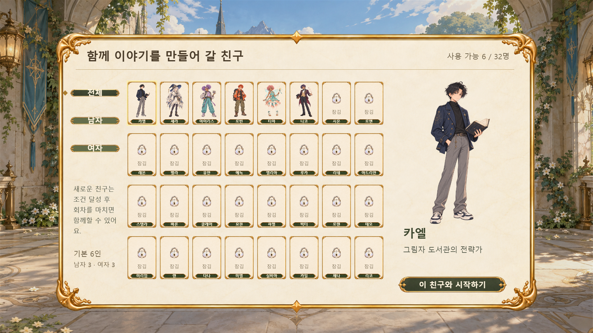</a> |
| 02 | [32인 통합 캐릭터 선택 · 남자](./02-screen.png) |  |
| 03 | [32인 통합 캐릭터 선택 · 여자](./03-screen.png) | <a href="./03-screen.png">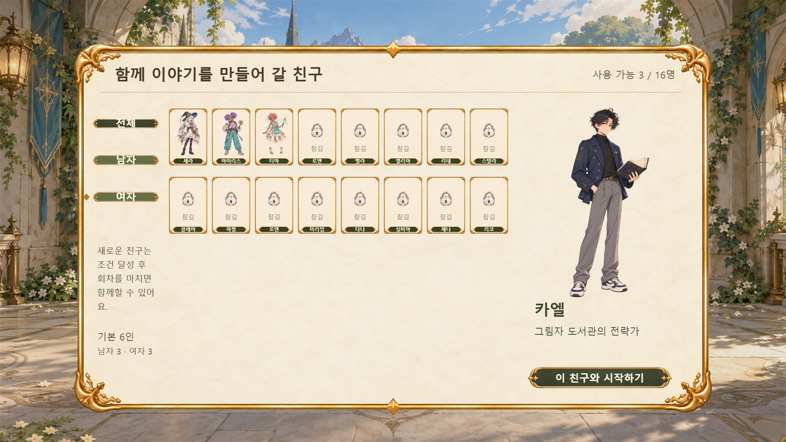</a> |
| 04 | [보이는 스탯 6종 · 체력 100](./04-screen.png) |  |
| 05 | [보이는 스탯 6종 · 저체력](./05-screen.png) | <a href="./05-screen.png">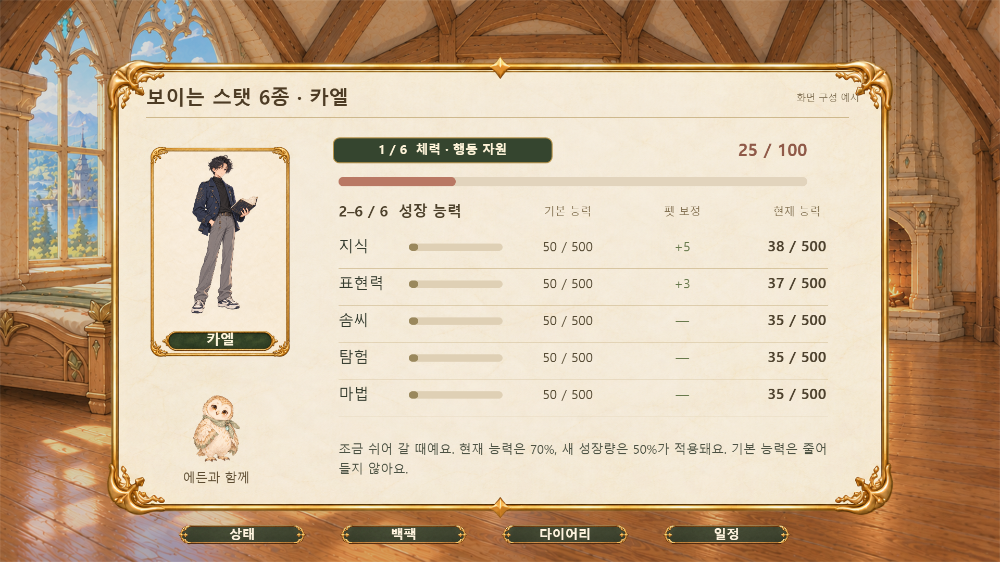</a> |
| 06 | [백팩 · 아이템과 배지](./06-screen.png) | <a href="./06-screen.png">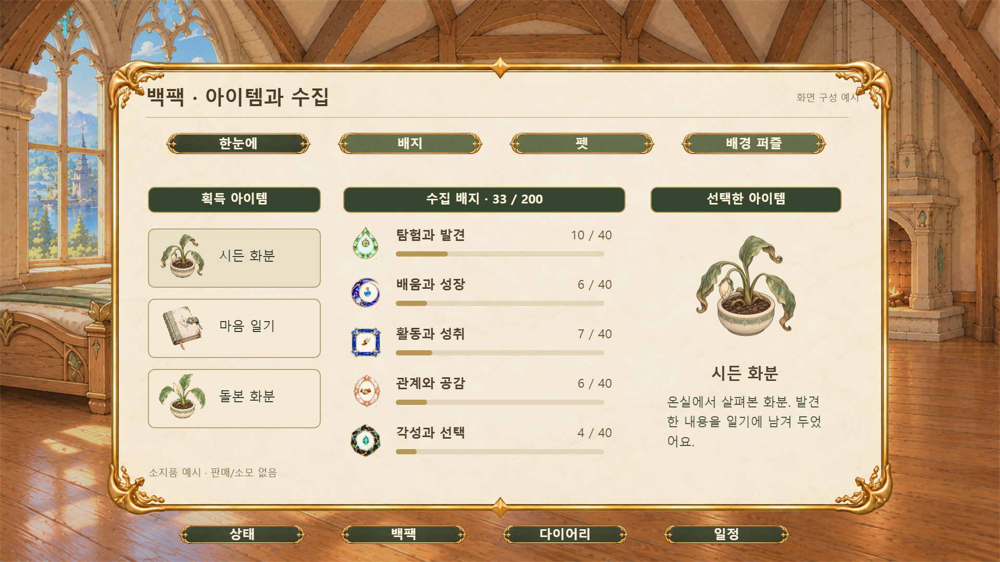</a> |
| 07 | [백팩 · 5개 배지 분류](./07-screen.png) |  |
| 08 | [백팩 · 펫](./08-screen.png) |  |
| 09 | [백팩 · 배경 퍼즐](./09-screen.png) | <a href="./09-screen.png">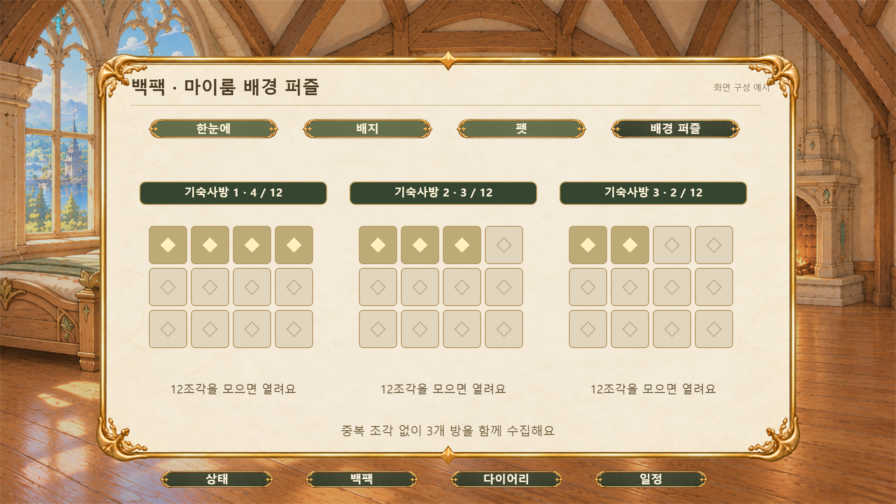</a> |
| 10 | [다이어리 · 주별 활동](./10-screen.png) | <a href="./10-screen.png">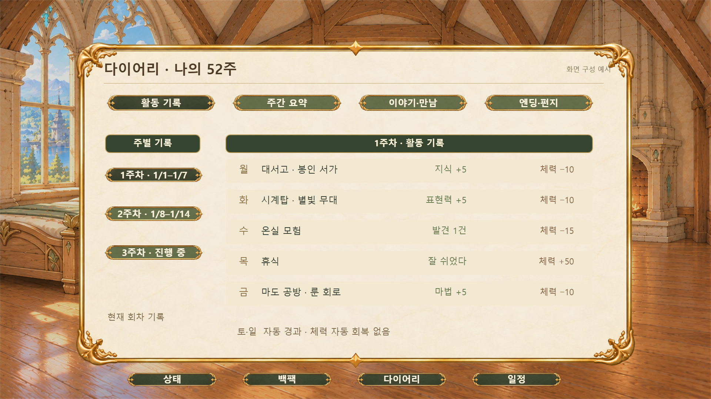</a> |
| 11 | [다이어리 · 주간 요약](./11-screen.png) |  |
| 12 | [다이어리 · 이야기와 만남](./12-screen.png) | <a href="./12-screen.png">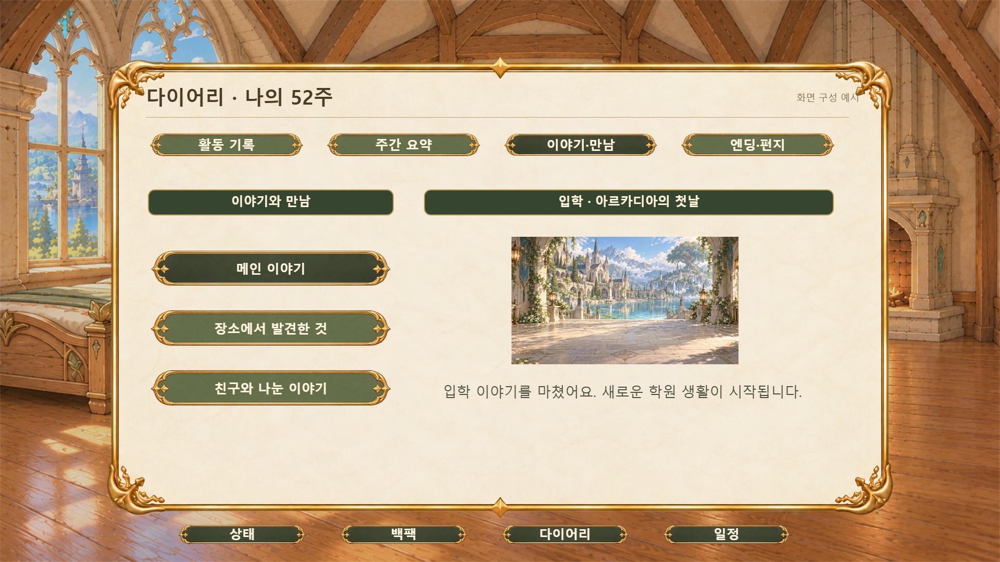</a> |
| 13 | [다이어리 · 엔딩 편지](./13-screen.png) | <a href="./13-screen.png">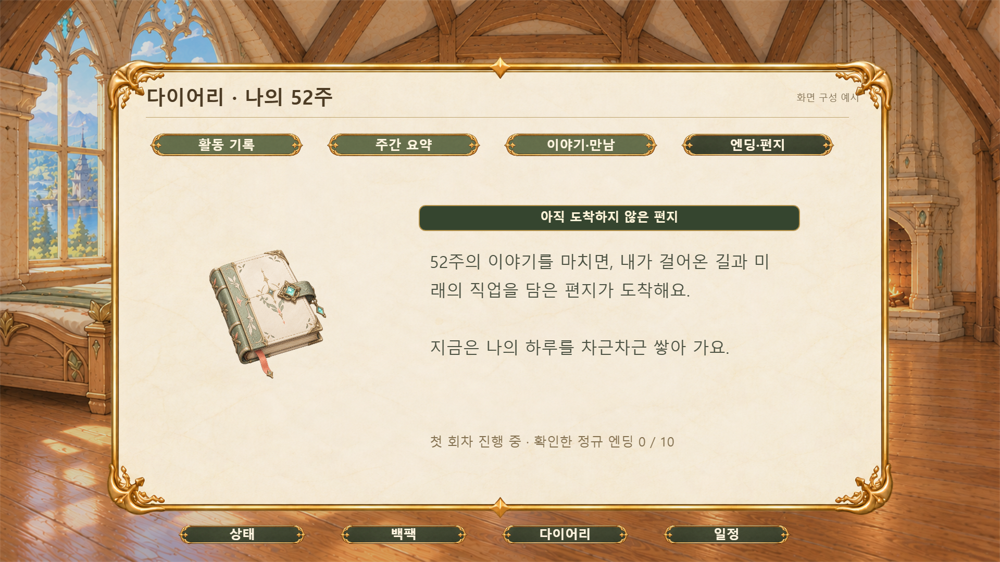</a> |
| 14 | [월~금 일정](./14-screen.png) |  |
| 15 | [캐릭터 카드 이름칸 비교](./15-screen.png) | <a href="./15-screen.png">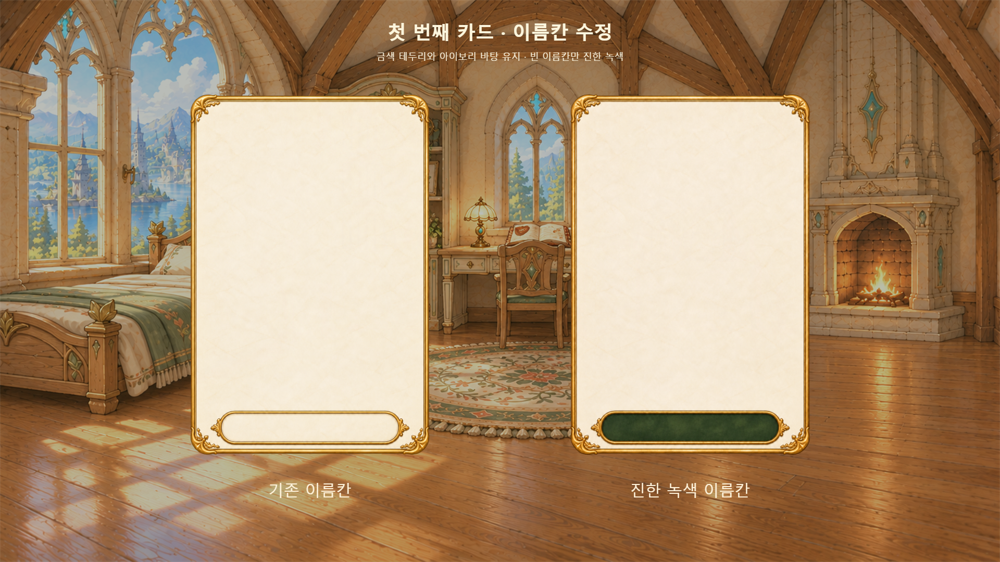</a> |
| 16 | [마이룸 안 2 · 창가 독서실 · 낮](./16-screen.png) |  |
| 17 | [마이룸 안 3 · 룬 연구실 · 노을](./17-screen.png) | <a href="./17-screen.png">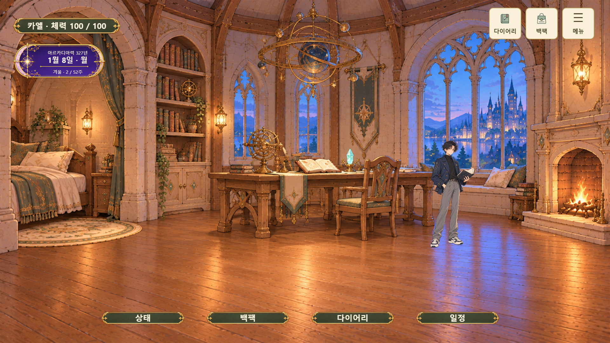</a> |
| 18 | [마이룸 안 2 · 창가 독서실 · 노을](./18-screen.png) | <a href="./18-screen.png">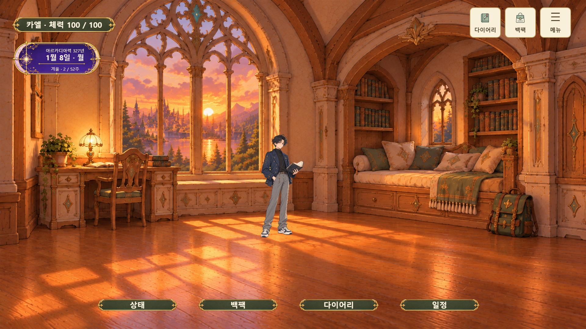</a> |
| 19 | [마이룸 안 2 · 창가 독서실 · 밤](./19-screen.png) |  |
| 20 | [마이룸 안 3 · 룬 연구실 · 낮](./20-screen.png) |  |
| 21 | [마이룸 안 3 · 룬 연구실 · 밤](./21-screen.png) |  |

마이룸 16~17번은 기존 낮·해질녘 화면이고, 18~21번은 뒤이어 추가한 시간대 화면입니다. 이 README의 번호는 비교용 화면 순서이며 게임 진행 순서를 뜻하지 않습니다.
