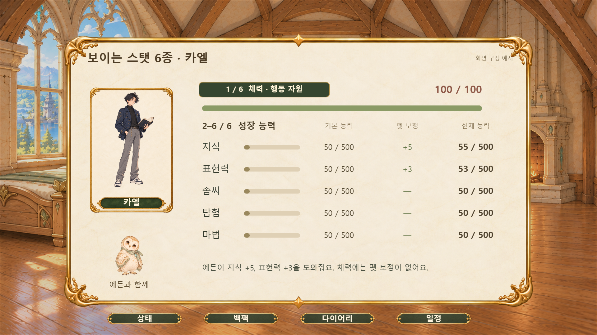
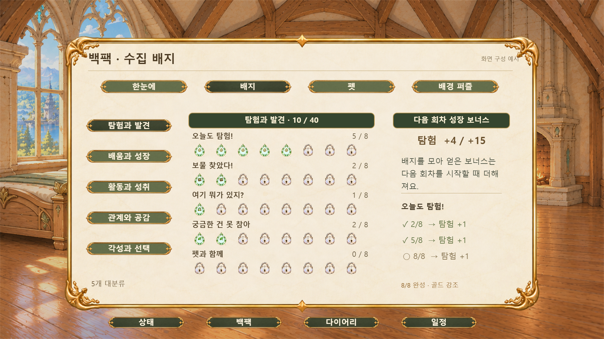
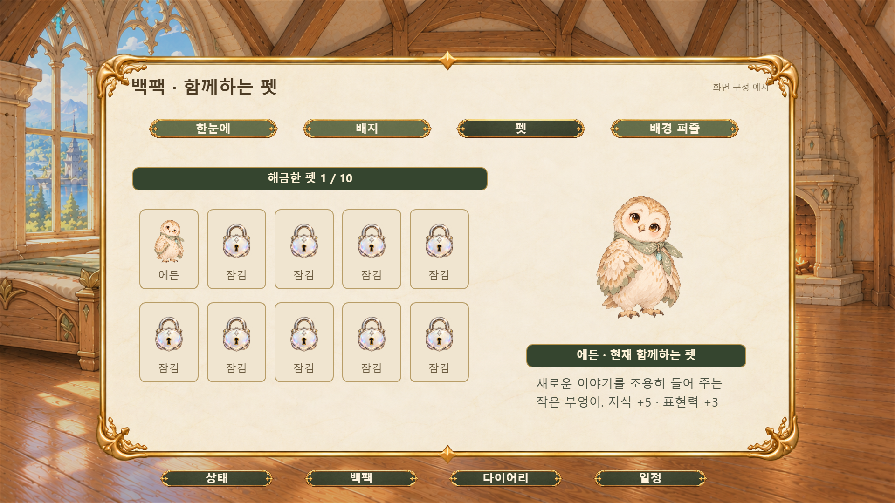
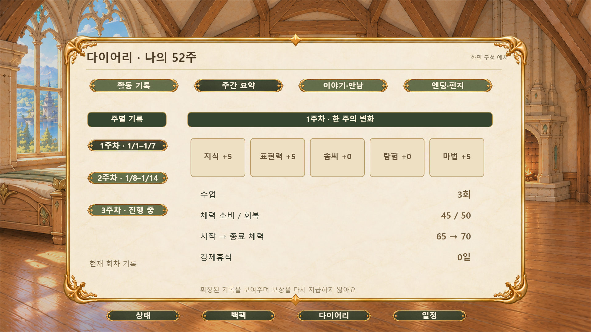
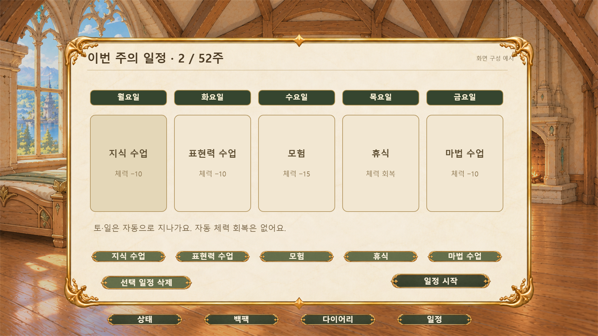
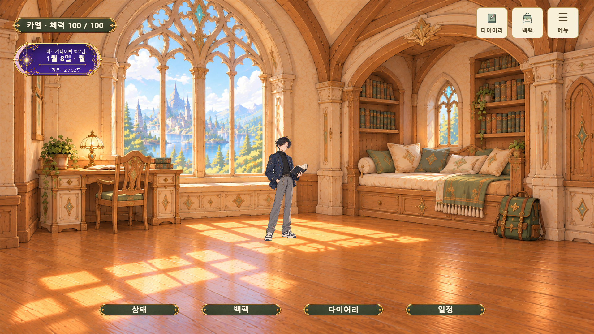
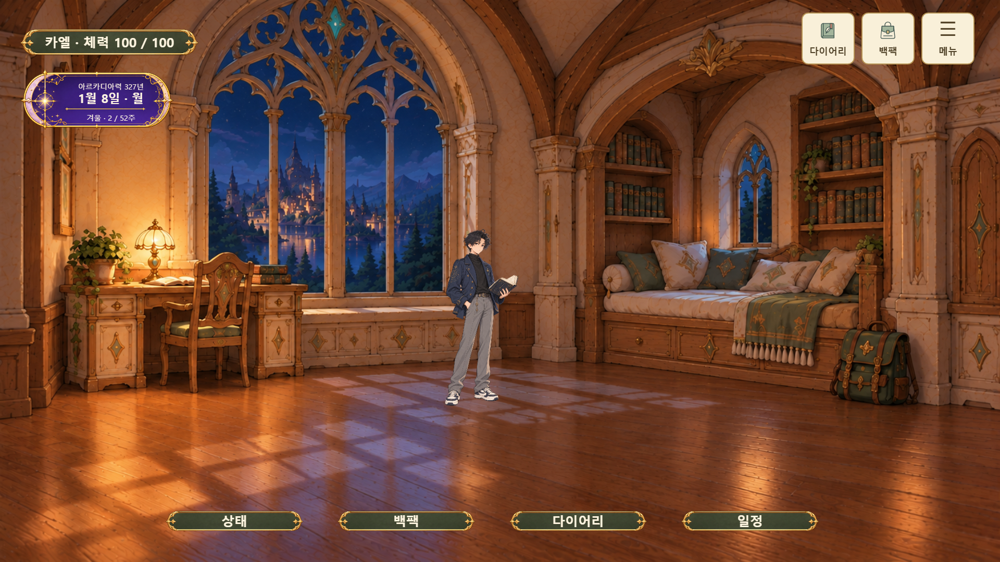
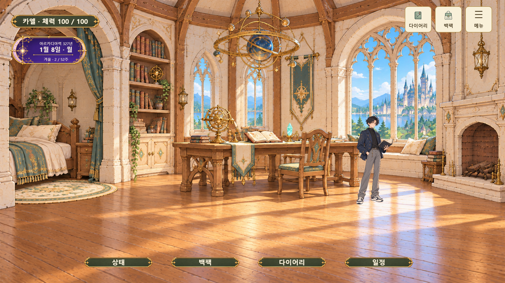
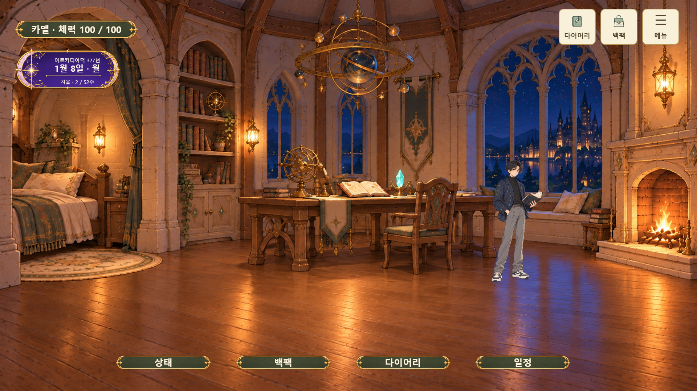

# 루미아 프레임 전체화면 시안 21장

캐릭터 선택, 스탯, 백팩, 다이어리, 일정, 캐릭터 카드, 마이룸을 1920×1080 PNG로 내보낸 **화면 검토용 시안**입니다. 이 폴더의 [`screen/`](./screen/README.md)에 있는 과거 흐름 참고 이미지나 분리된 게임 UI 에셋과 구분합니다. 각 그림은 UI와 배경을 합친 이미지이며, 조작 가능한 구현 화면이나 최종 채택본으로 간주하지 않습니다.

## 빠른 탐색

| 사용처·장면 | 파일명 기준 | 현재 상태 | 파일 목록·미리보기 |
|---|---|---|---|
| 전체화면 검토 시안; 구성 확인용 합성 화면; 분리 UI와 구별 | `FS*` | 이 폴더 이미지 21장. 개별 파일의 채택·후보·검수 상태는 아래 설명을 따름 | 아래 파일 표와 미리보기, [에셋 전체 장면표](../README.md) 참조 |

초기 검토 시안 `01-screen.png`부터 `21-screen.png`까지의 이미지를 현재 `FS01.png`부터 `FS21.png`까지의 파일명으로 정리했습니다. 이미지 내용은 유지했습니다. 아래 미리보기를 누르면 원본 크기로 열립니다.

| 번호 | 내용                                           | 미리보기                                                                                                         |
| ---: | ---------------------------------------------- | ---------------------------------------------------------------------------------------------------------------- |
|   01 | [32인 통합 캐릭터 선택 · 전체](./FS01.png)     |      |
|   02 | [32인 통합 캐릭터 선택 · 남자](./FS02.png)     |      |
|   03 | [32인 통합 캐릭터 선택 · 여자](./FS03.png)     |      |
|   04 | [보이는 스탯 6종 · 체력 100](./FS04.png)       |        |
|   05 | [보이는 스탯 6종 · 저체력](./FS05.png)         |          |
|   06 | [백팩 · 아이템과 배지](./FS06.png)             |              |
|   07 | [백팩 · 5개 배지 분류](./FS07.png)             |              |
|   08 | [백팩 · 펫](./FS08.png)                        |                         |
|   09 | [백팩 · 배경 퍼즐](./FS09.png)                 |                  |
|   10 | [다이어리 · 주별 활동](./FS10.png)             |              |
|   11 | [다이어리 · 주간 요약](./FS11.png)             |              |
|   12 | [다이어리 · 이야기와 만남](./FS12.png)         |          |
|   13 | [다이어리 · 엔딩 편지](./FS13.png)             |              |
|   14 | [월~금 일정](./FS14.png)                       |                        |
|   15 | [캐릭터 카드 이름칸 비교](./FS15.png)          |           |
|   16 | [마이룸 안 2 · 창가 독서실 · 낮](./FS16.png)   |    |
|   17 | [마이룸 안 3 · 룬 연구실 · 노을](./FS17.png)   |    |
|   18 | [마이룸 안 2 · 창가 독서실 · 노을](./FS18.png) |  |
|   19 | [마이룸 안 2 · 창가 독서실 · 밤](./FS19.png)   |    |
|   20 | [마이룸 안 3 · 룬 연구실 · 낮](./FS20.png)     |      |
|   21 | [마이룸 안 3 · 룬 연구실 · 밤](./FS21.png)     |      |

마이룸 16~17번은 기존 낮·해질녘 화면이고, 18~21번은 뒤이어 추가한 시간대 화면입니다. 이 README의 번호는 비교용 화면 순서이며 게임 진행 순서를 뜻하지 않습니다.
