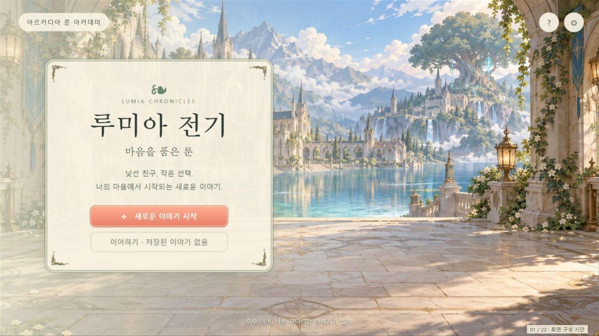
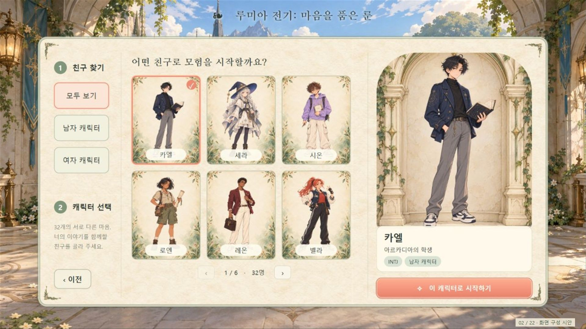
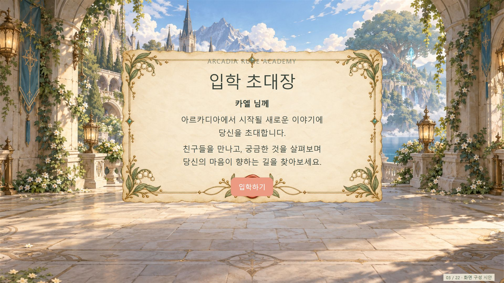
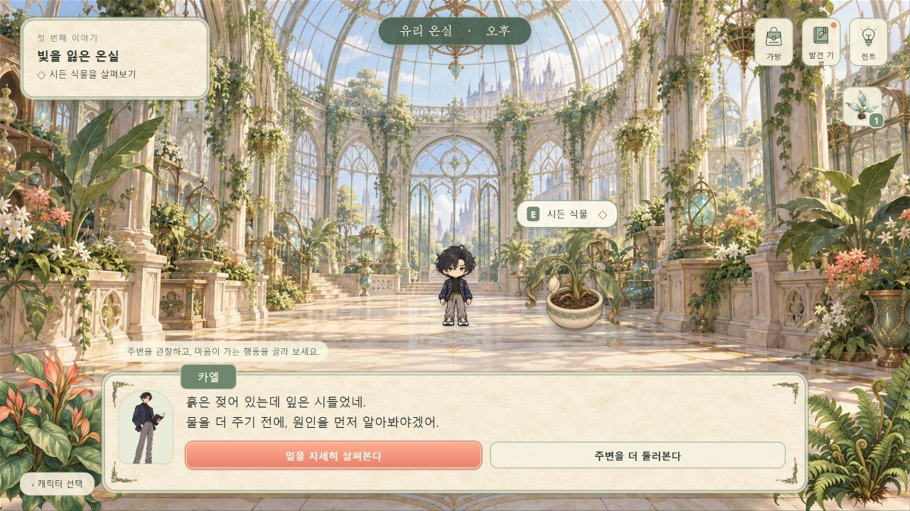
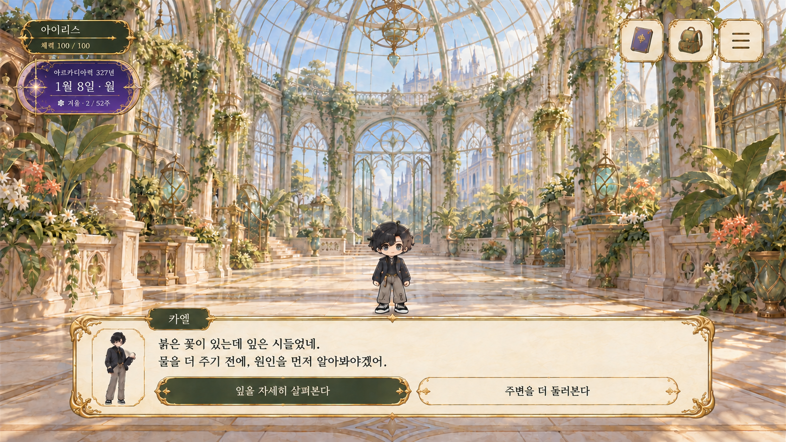
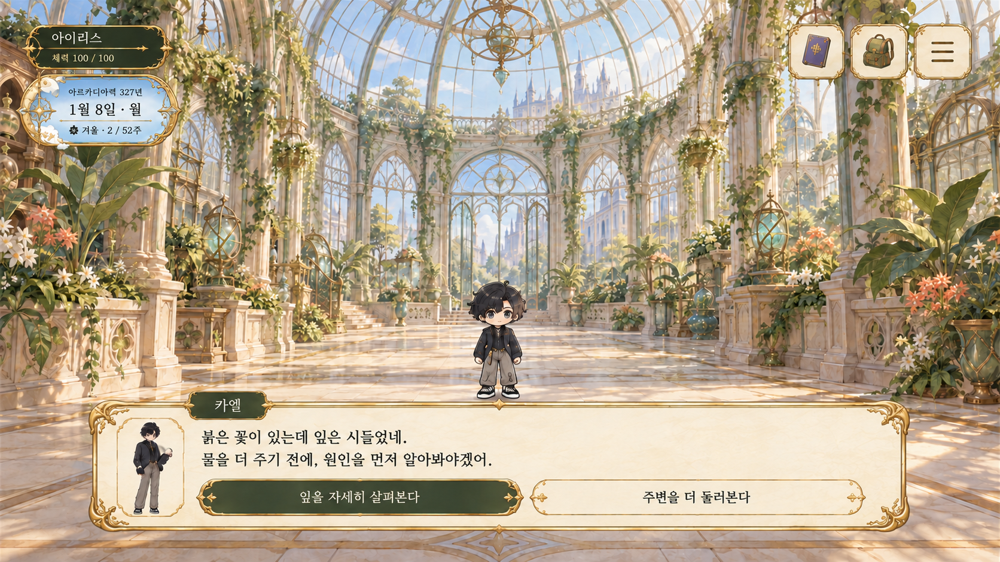

# 스크린 이미지

화면 흐름·레이아웃 참고 PNG/JPG 9장입니다. 합쳐진 화면 시안이며 개별 UI 부품이나 실행 화면이 아닙니다. 흐름 번호는 현재 게임의 확정 진행 순서를 의미하지 않습니다. 이미지 존재가 최종 게임 적용 승인을 의미하지 않습니다.

명칭·용도는 기존 파일명을 풀어 쓴 안내입니다. 게임용 전체맵은 [map](../../map/README.md), 개별 UI 재료는 [ui](../../ui/README.md)를 확인합니다.

## 빠른 탐색

| 사용처·장면 | 파일명 기준 | 현재 상태 | 파일 목록·미리보기 |
|---|---|---|---|
| 이전 화면 비교 자료; 이전 레이아웃 비교; 채택 게임 화면 아님 | `기존 screen 계열` | 이 폴더 이미지 9장. 개별 파일의 채택·후보·검수 상태는 아래 설명을 따름 | 아래 파일 표와 미리보기, [에셋 전체 장면표](../../README.md) 참조 |

## 온실 대화 UI 비교 시안 공통 조건

두 시안은 `BG06_glass_greenhouse_1920x1080_016.png`를 배경 기준으로 사용합니다. 이름 프레임은 짙은 녹색을 유지하고, 날짜 패널만 1안 퍼플 문라이트와 2안 블루 스카이로 구분합니다. 오른쪽 상단 버튼은 양피지 원본 컬러, 하단 대화창과 선택 버튼은 기존 컬러를 유지하며 스케줄 버튼은 제외했습니다. 구현 화면이나 최종 채택본이 아닌 비교용 화면 시안입니다.

| 파일 | 명칭·용도 | 미리보기 |
|---|---|---|
| [FLOW01_title_005.jpg](./FLOW01_title_005.jpg) | 타이틀 화면 시안 |  |
| [FLOW02_character_selection_006.jpg](./FLOW02_character_selection_006.jpg) | 캐릭터 선택 화면 시안 |  |
| [FLOW03_admission_invitation_007.jpg](./FLOW03_admission_invitation_007.jpg) | 입학 초대장 화면 시안 |  |
| [LIFE01_myroom_side_dialogue_source_004.png](./LIFE01_myroom_side_dialogue_source_004.png) | 마이룸 측면 대화 구성 원본 |  |
| [SC02_game_start_000.jpg](./SC02_game_start_000.jpg) | 게임 시작 화면 시안 |  |
| [SC03_character_selection_001.jpg](./SC03_character_selection_001.jpg) | 캐릭터 선택 화면 시안 |  |
| [SC04_greenhouse_adventure_002.jpg](./SC04_greenhouse_adventure_002.jpg) | 온실 어드벤처 화면 시안 |  |
| [SC05_greenhouse_dialogue_ui_purple_008.png](./SC05_greenhouse_dialogue_ui_purple_008.png) | 온실 대화 화면 UI 1안. 퍼플 문라이트 날짜 패널을 적용한 전체 화면 비교 시안. 최종 채택 미정. |  |
| [SC05_greenhouse_dialogue_ui_blue_009.png](./SC05_greenhouse_dialogue_ui_blue_009.png) | 온실 대화 화면 UI 2안. 블루 스카이 날짜 패널을 적용한 전체 화면 비교 시안. 최종 채택 미정. |  |
