# 이미지 자원 안내 · 스토리별 찾기

이 문서는 **이야기 ID → 화면에 쓸 이미지 경로**를 찾는 시작점입니다. 사용처를 문서로 연결하며, 아이템과 UI 파일은 용도에 맞는 경로로 정리했습니다. 이미지가 폴더에 있다는 사실과 이야기용 채택·엔진 연결 완료는 다릅니다. 아래의 `확정 경로`도 게임에서 표시되는지 별도 검수가 필요합니다.

## 폴더별 바로 찾기

먼저 이야기 ID로 아래 [장면 연결표](#메인-스토리와-엔딩)를 찾고, 이미지 종류를 확인한 뒤 해당 폴더 README의 파일 목록과 미리보기를 엽니다. **확정 경로·후보·미제작·엔진 표시 여부를 서로 구분**합니다. 모든 폴더 README는 `빠른 탐색 → 사용처/상태 → 파일 목록·미리보기` 순서로 읽습니다.

| 폴더 · 상세 README | 찾는 이미지 | 파일명 기준 | 판단 기준 |
|---|---|---|---|
| [background/](background/README.md) | 장면·시간대별 공간 배경 · 이미지 31장 | `BG*, 기존 마이룸 계열` | MS/LOC/NPC의 BACKGROUND·마이룸; 채택과 후보 구분 |
| [character/](character/README.md) | 학생 전신 32장·상반신 표정 160장·교수 시안 2장·`요정의 거래` 요정 1장 · 이미지 195장 | `이름0_fullbody.png` / `이름1_base.png`~`이름5_relieved.png` / `CH_DRM_fairy_trade_upperbody_01.png` | 캐스팅 조건에 맞는 화자 이미지와 기숙사 `DRM` 특수 활동에 사용하는 요정 캐릭터를 구분 |
| [item/](item/README.md) · [모험 목표 15종](item/adventure/README.md) | 스토리 FOCUS·소품·가구·모험 목표 · 이미지 60장 | `IT_*` / `ADV_GH/LIB/OBS_*` | `ART-*` FOCUS와 `ADV_*` 모험 목표를 용도별로 검색; 후보는 자동 배치 금지 |
| [ui/](ui/README.md) | 버튼·프레임·로고·환경 UI · 이미지 62장 | `BT / UI / LG 및 실행 호환 이름` | 마이룸 프로필·날짜 프레임 `UI21`·`UI22`(공통 가로 2058px), 일지 화살표·닫기, 대화·선택지 버튼 |
| [map/](map/README.md) | 이동·충돌용 맵 · 이미지 22장 | `MP* 및 기존 참고 맵` | MP02·MP03 갱신 마스터와 기존 게임용 WebP를 구분. [대서고 원본](map/MP02_grand_library_master_3840x2161.png) 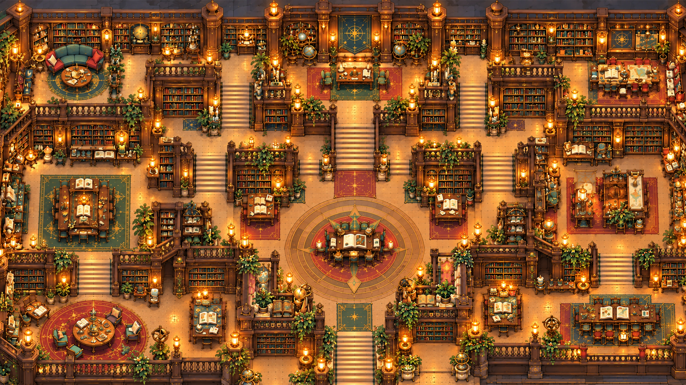 · [천문대 원본](map/MP03_starlight_observatory_master_3840x2162.png) 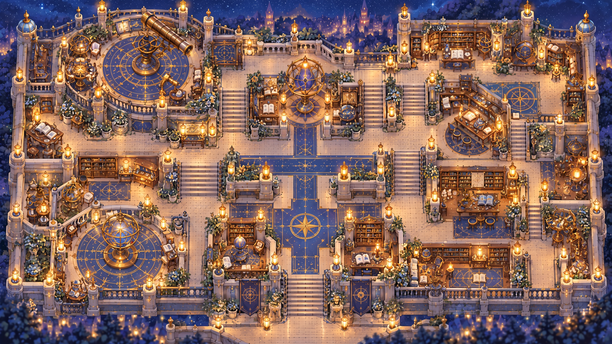 |
| [pet/](pet/README.md) | 펫·루루 의상/표정 · 이미지 28장 | `PT / NPC_LULU` | 루루 회차와 의상 번호를 구별해 검색 |
| [sd_character/](sd_character/README.md) | SD 캐릭터 · 이미지 48장 | `기존 캐릭터별 SD 계열` | Adventure용 작은 캐릭터; 전신 대화 화자와 구분 |
| [puzzle/](puzzle/README.md) | 방 배경 12조각 퍼즐 · 이미지 48장 | `PZ + 방·조각 번호` | 우주방·공주방·식물방 완성본과 개별 조각 |
| [badge/](badge/README.md) | 배지 프레임·심볼·상태 · 이미지 41장 | `기존 badge 계열` | 배지 조합과 잠금/해금 상태; 실행 호환 이름 유지 |
| [effect/](effect/README.md) | 게임 효과·로고 광휘 · 이미지 3장 | `FX 및 실행 호환 이름` | 효과 레이어; 로고 본체는 ui에서 검색 |
| [font_files/](font_files/README.md) | 서체·타이포그래피 이미지 · 이미지 18장 | `기존 서체별 이름` | 글꼴 비교 이미지; 메인 호환 웹폰트 2개와 라이선스도 보관 |
| [Full screen/](Full%20screen/README.md) | 전체화면 검토 시안 · 이미지 21장 | `FS*` | 구성 확인용 합성 화면; 분리 UI와 구별 |
| [Full screen/screen/](Full%20screen/screen/README.md) | 이전 화면 비교 자료 · 이미지 9장 | `기존 screen 계열` | 이전 레이아웃 비교; 채택 게임 화면 아님 |
| [audio/](audio/README.md) | 배경음·효과음 · 이미지 0장 | `bgm / sfx` | 소리 파일; 이미지 미리보기 대신 파일 표 |
| [stat/](stat/README.md) | 스탯 이미지 예정 · 이미지 0장 | `미정` | 현재 이미지 없음; 제작 완료로 해석하지 않음 |

`Full screen/screen`은 `Full screen`의 하위 자료입니다. `background/myroom`은 [background README](background/README.md), `audio/bgm`·`audio/sfx`는 [audio README](audio/README.md), `font_files/licenses`는 [font_files README](font_files/README.md)에서 함께 찾습니다. Git에서 관리하지 않는 로컬 검토 폴더는 이 배포용 목록에 넣지 않았습니다.

## 판단 기준

- 현재 제작 기준: [메인](../story/main/MAIN_STORY_PRODUCTION.md) · [장소](../story/location/LOCATION_STORY_PRODUCTION.md) · [NPC](../story/npc/NPC_STORY_PRODUCTION.md) · [공통 아트 목록](../story/ASSET_DIALOGUE_LEDGER.md). 옛 에셋 제작 마스터 v0.1의 장면 번호·발주량은 이 최신 제작안과 다르므로 현재 검색 기준에서 제외했습니다. 이전 표는 Git 이력에서 볼 수 있습니다.
- **확정 경로**: 해당 파일이 현재 브랜치에 있고 제작 지시와 일치합니다. **조건부**: 주인공·방문 장소·선택에 따라 파일이 달라집니다. **후보**: 파일은 있으나 제작 지시와의 일치 또는 사용 승인이 남았습니다. **미제작/미연결**: `ART-*`에 대응하는 확정 파일 경로가 없습니다. 후보를 AI나 엔진이 확정 이미지로 대신 쓰지 않습니다.
- `BACKGROUND`는 화면 전체 배경, `FOCUS`는 대화 중 중앙에 표시하는 한 장의 그림, **화자 이미지**는 캐릭터 표정/스프라이트입니다. [대화 엔진 인계 기준](../document_for_ai/07_DIALOGUE_ENGINE_HANDOFF.md)과 [대화 시퀀스](../document/content/13_DIALOGUE_SEQUENCE.md)를 따릅니다. 같은 FOCUS 이미지를 여러 회차에서 재사용해도 파일을 복제하지 않습니다.
- `MS07`은 별도 스토리 사건이 아닌 자유 플레이 구간입니다. 아래 `END`는 마지막 카드 화면입니다.

## 파일명과 배치 상태

`MS05_S4_SHARE_ROLES`(메인 스토리 5장, 겨울 별빛축제)의 48자 선택지로 폭을 확인한 [공통 긴 선택지 빈 프레임](ui/BT04_choice_blank_pale_green.png)을 `asset/ui/`에 둡니다.  다른 선택지에도 재사용할 수 있으며, 실제 문구는 이미지에 들어 있지 않습니다. 엔진 연결 여부와 전체 목록은 [UI README](ui/README.md#버튼)에서 확인합니다.

이 브랜치의 새 UI는 `BT`(버튼)·`UI`(화면 재료)·`LG`(로고), 장소 배경은 `BG`, 이동 맵은 `MP`, 일반 아이템·FOCUS는 `IT_<역할>_<장면 또는 후보 영역>_<대상>_<번호>`, 모험 목표는 문서·엔진 ID와 같은 `ADV_<장소>_<번호>`로 찾습니다. 제작 ID `ART-*`와 파일 경로는 아래 장면표에서 연결합니다. 학생 전신, 기숙사 `요정의 거래` 전용 요정 캐릭터 `CH_DRM`, 펫 `PT`, 루루 의상 `NPC_LULU`, 퍼즐 `PZ`와 배지는 해당 폴더의 기존 번호 체계를 유지합니다. 번호가 같은 루루 **의상**과 **대화 회차**는 별개입니다. 일반 아이템은 `IT` 체계로 통일했습니다. 배지·기존 로고 광휘 등 다른 범주의 실행 호환 파일명은 유지합니다. 엔진의 아트 미리보기 목록과 경로 테스트는 새 이름에 맞췄습니다. 에셋 밖 기획 문서의 옛 파일명 예시는 별도 정비가 필요합니다. 새 그림이 생길 때 해당 폴더 README에 실제 파일명·장면 ID 또는 후보 용도·연결 상태·미리보기를 함께 갱신합니다.

아이템 검색은 [모험 목표 15종](item/adventure/README.md)에서 장소별 `ADV_*`와 단서 화면용 이미지를 찾고, [item/README.md](item/README.md)의 `채택한 스토리 FOCUS`에서 **확정 경로**, `스토리 FOCUS 연결 상태`에서 **후보·불일치**, `일반 아이템 아트`에서 **장면 미배정 소품**을 구분합니다. 아이템 목록의 의미상 용도만으로 획득·배치·엔진 표시를 추정하지 않습니다.

## 기숙사 특수 활동 · 요정의 거래

| 활동 · 장소 | 캐릭터 이미지 · 작은 미리보기 | 사용·연결 상태 |
|---|---|---|
| `DRM` · `fairy-trade` · 요정의 거래에 사용하는 요정 캐릭터 | [CH_DRM_fairy_trade_upperbody_01.png](character/CH_DRM_fairy_trade_upperbody_01.png)  | 5개 성장 스탯 사이에서 1~5포인트를 1:1로 옮기는 **요정의 거래 전용 캐릭터 이미지**. 사용자 선택으로 이미지 확정·파일 등록; 엔진 표시 미연결. 거래 플레이 화면의 NPC 대화·배치에는 사용하지 않음. |

**콘텐츠 식별자:** `fairy-trade` · **정확한 에셋 경로:** `asset/character/CH_DRM_fairy_trade_upperbody_01.png`. 백엔드·엔진에서 해당 활동의 요정 이미지를 찾을 때 이 경로를 기준으로 합니다. 실제 화면 연결은 별도 검수 대상입니다.

세부 구도·파일 상태는 [캐릭터 README](character/README.md#기숙사-공용-공간-요정의-거래), 활동 규칙은 [7개 공간 콘텐츠 상세 규칙](../document/content/06_01_LOCATION_ACTIVITIES.md)을 참조합니다.

## 모험 목표 아이템 · 15장

`ADV_*`는 [공통 엔진 프레임 7.1](../document/content/10_COMMON_ENGINE_FRAME.md#71-장소별-목표-아이템-풀)의 **장소별 모험판 임시 목표**입니다. 선택된 목표의 단서 화면 이름 옆에 쓸 이미지이며, 숨은 위치 표지·가방 소지품·스토리 대화 FOCUS가 아닙니다. [15종 제작 목록](../document/content/14_ADVENTURE_ITEM_IMAGES.md)의 ID·파일 경로를 그대로 적용했습니다. 아트 승인 및 등록은 완료됐고 엔진 화면 표시 검수는 별도입니다.

| 장소 | ID 범위 | 작은 미리보기 · 파일 찾기 |
|---|---|---|
| 유리 온실·약초원 | `ADV_GH_01`–`ADV_GH_05` | 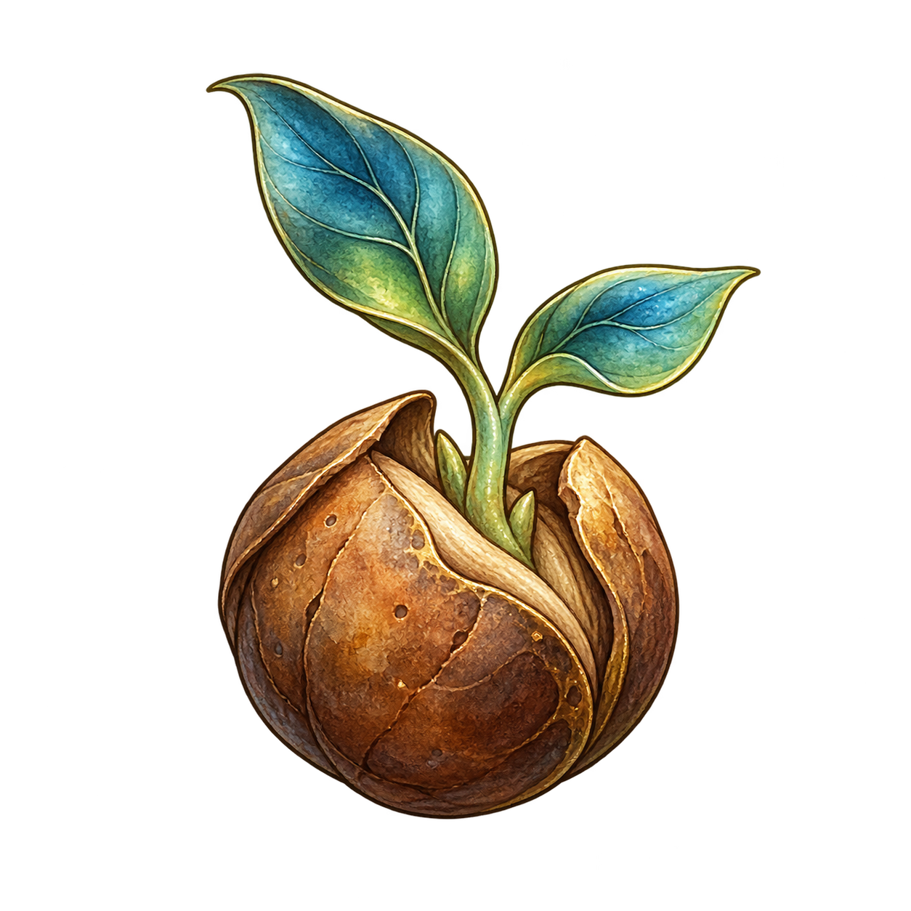 [5종 목록](item/adventure/README.md#유리-온실약초원) |
| 대서고 | `ADV_LIB_01`–`ADV_LIB_05` | 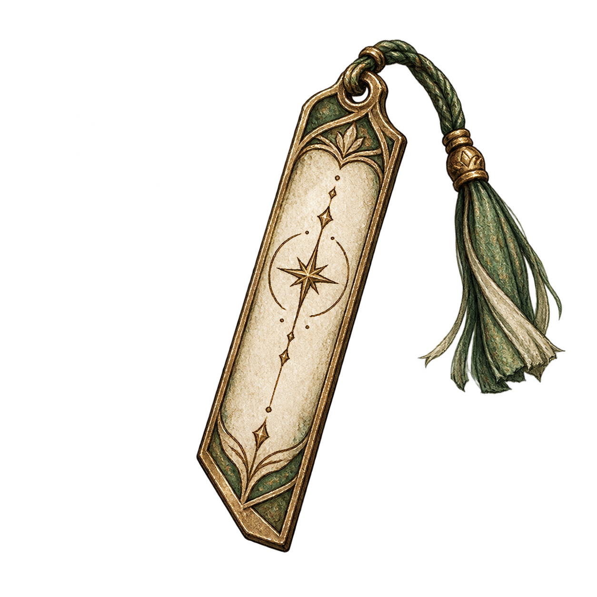 [5종 목록](item/adventure/README.md#대서고) |
| 별빛 천문대 | `ADV_OBS_01`–`ADV_OBS_05` | 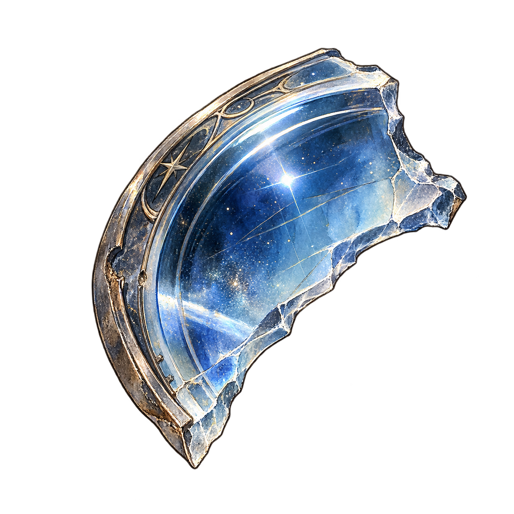 [5종 목록](item/adventure/README.md#별빛-천문대) |

## 확정 스토리 FOCUS·엔딩 카드 바로 찾기

장면 ID → 제작 ID → 실제 파일 경로를 1:1로 확인합니다. 그림 설명·재사용 회차와 더 큰 미리보기는 [item README](item/README.md#확정-스토리-focus와-엔딩-카드--17장)에 있습니다. 대화 화면의 FOCUS 16장은 백엔드의 `/item-assets/<파일명>`에서 읽으며, `ART-E01`은 엔딩 직업명·편지 텍스트 뒤의 공용 받침입니다. `IT_card_candidate_*`와 일반 아이템은 이 연결표의 대체 이미지가 아닙니다.

| 제작 ID | 장면·회차 | 실제 파일 · 미리보기 | 구분 |
|---|---|---|---|
| `ART-M01` | `MS02-S1` | [IT_focus_MS02_blocked_vines_01.png](item/IT_focus_MS02_blocked_vines_01.png) 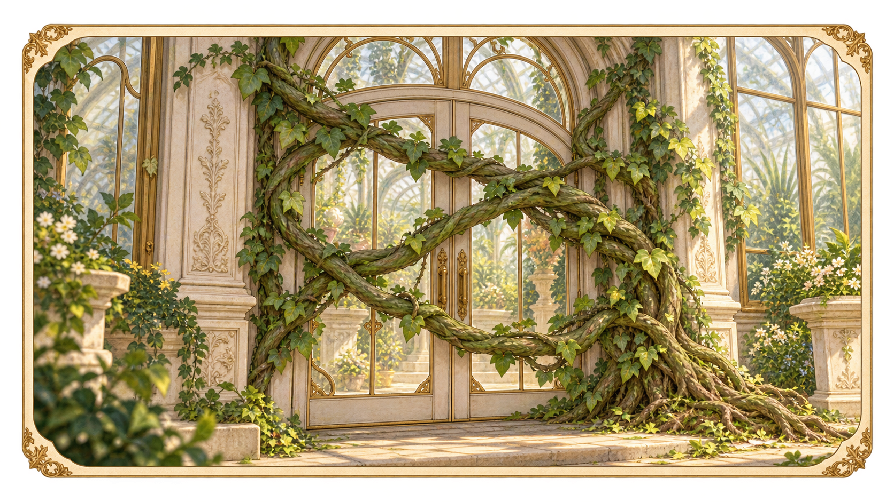 | 출입구를 막은 덩굴; 1672×941 |
| `ART-M02` | `MS02-S3–S4` | [IT_focus_MS02_glowing_bud_vines_02.png](item/IT_focus_MS02_glowing_bud_vines_02.png) 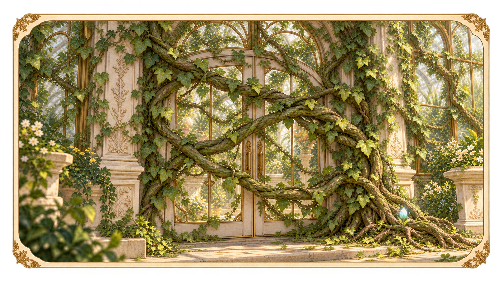 | 커진 덩굴과 빛나는 꽃봉오리; 1672×941 |
| `ART-M03` | `MS03-S1–S4` | [IT_focus_MS03_wrong_clock_rune_01.png](item/IT_focus_MS03_wrong_clock_rune_01.png) 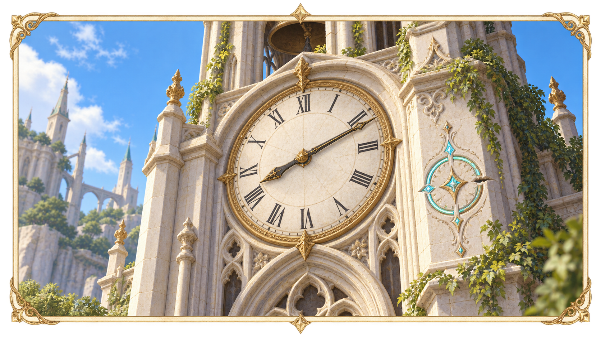 | 틀린 시각의 시계판과 흐릿한 룬; 1672×941 |
| `ART-M04` | `MS04-S1–S2·S5` | [IT_focus_MS04_detached_shadow_01.png](item/IT_focus_MS04_detached_shadow_01.png) 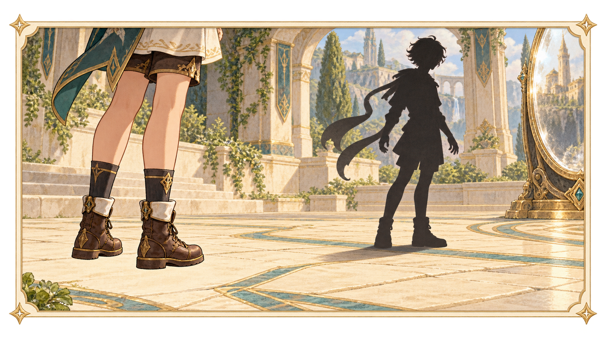 | 떨어져 나온 그림자; 1672×941 |
| `ART-M05` | `MS04-S3–S4` | [IT_focus_MS04_shadow_shield_02.png](item/IT_focus_MS04_shadow_shield_02.png) 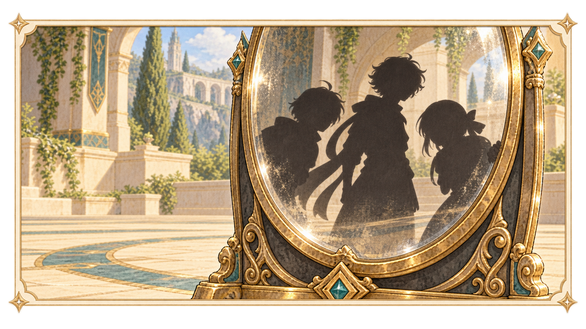 | 그림자가 비치는 방패; 1672×941 |
| `ART-M06` | `MS06-S1–S5` | [IT_focus_MS06_winter_games_decor_01.png](item/IT_focus_MS06_winter_games_decor_01.png) 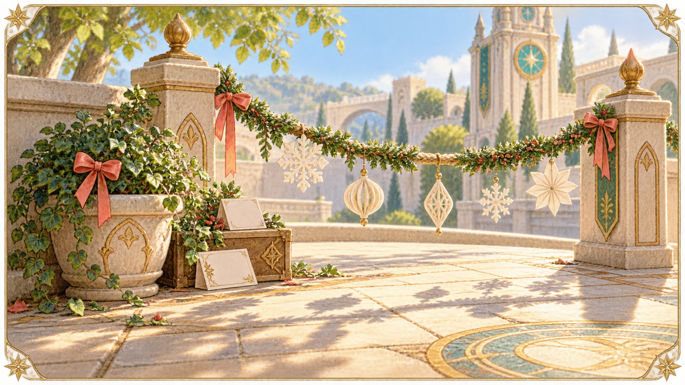 | 겨울 놀이회 장식; 1672×941 |
| `ART-N01` | `NPC_GUIDE_01–02·04` | [IT_focus_NPC_GUIDE_01_meeting_notices_01.png](item/IT_focus_NPC_GUIDE_01_meeting_notices_01.png) 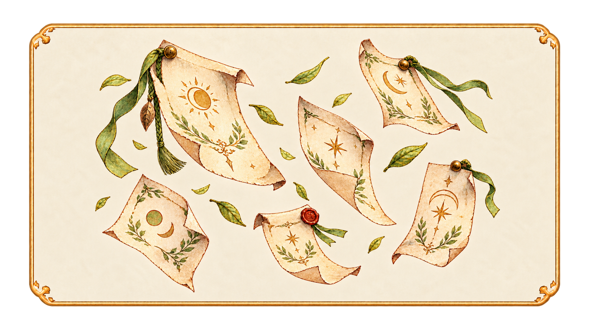 | 바람에 흩어진 모임 안내지; 1672×941 |
| `ART-N02` | `NPC_GUIDE_03–04` | [IT_focus_NPC_GUIDE_03_two_ribbons_01.png](item/IT_focus_NPC_GUIDE_03_two_ribbons_01.png) 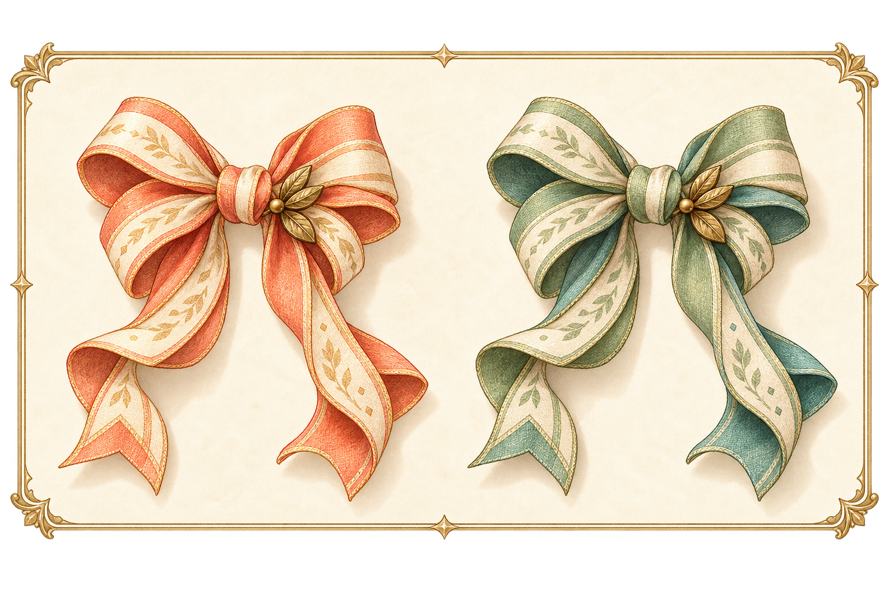 | 서로 다른 장식 리본 두 개; 1536×1024 |
| `ART-N03` | `NPC_WORK_01–02` | [IT_focus_NPC_WORK_01_workshop_parts_01.png](item/IT_focus_NPC_WORK_01_workshop_parts_01.png) 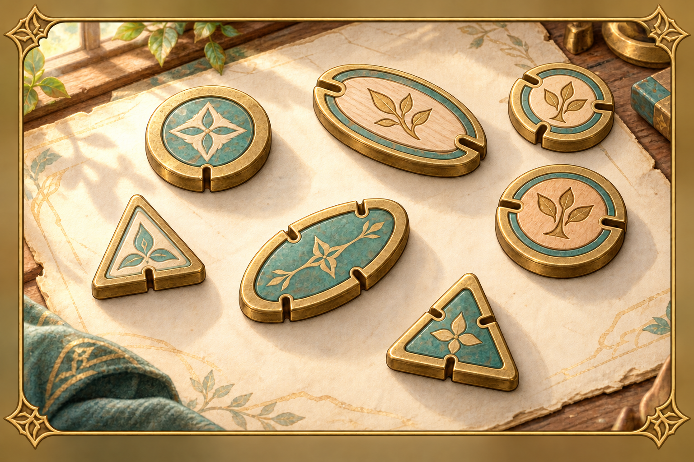 | 서로 다른 공방 부품; 1536×1024 |
| `ART-N04` | `NPC_WORK_03–04` | [IT_focus_NPC_WORK_03_tidy_workbench_02.png](item/IT_focus_NPC_WORK_03_tidy_workbench_02.png) 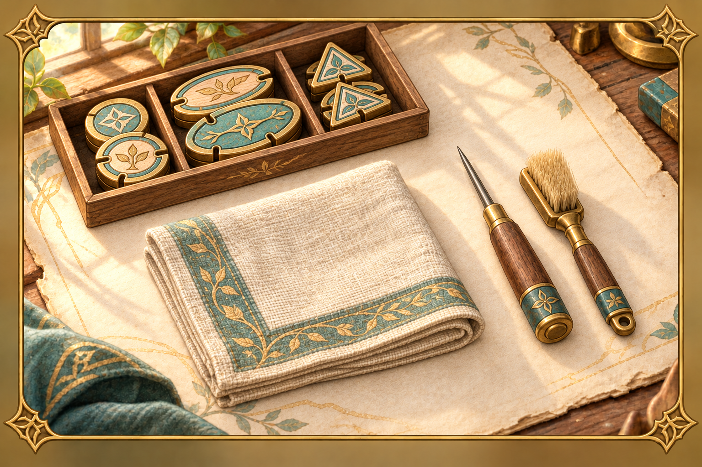 | 정돈된 작업대; 1536×1024 |
| `ART-N05` | `NPC_LULU_01–02` | [IT_focus_NPC_LULU_01_patterned_button_01.png](item/IT_focus_NPC_LULU_01_patterned_button_01.png) 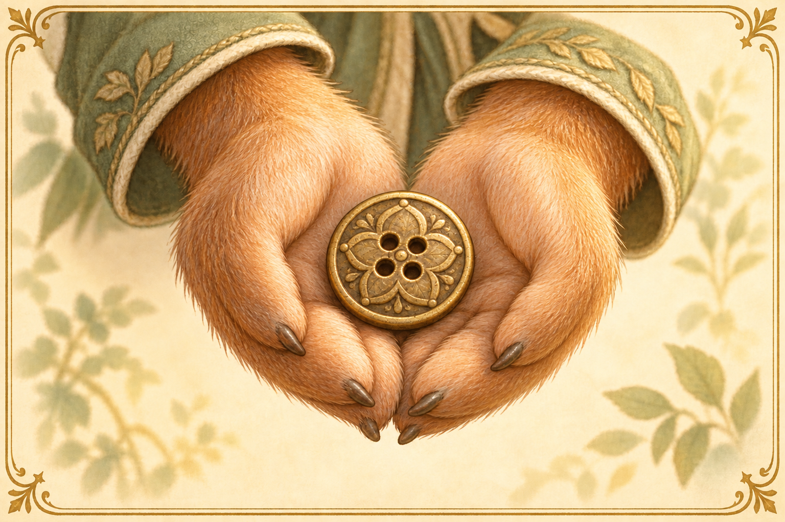 | 루루가 발견한 무늬 단추; 1536×1024 |
| `ART-N06` | `NPC_LULU_02–04` | [IT_focus_NPC_LULU_02_treasure_chest_02.png](item/IT_focus_NPC_LULU_02_treasure_chest_02.png) 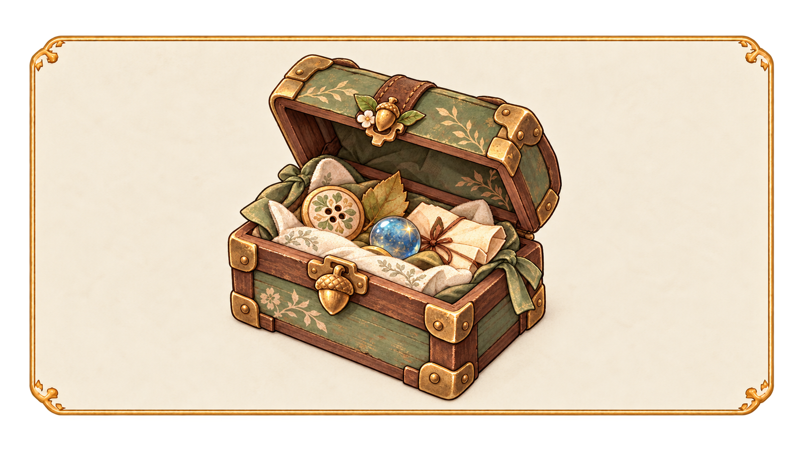 | 루루의 열린 보물상자; 1672×941 |
| `ART-L01` | `LOC_OBS_01–04` | [IT_focus_LOC_OBS_01_observation_diary_03.png](item/IT_focus_LOC_OBS_01_observation_diary_03.png) 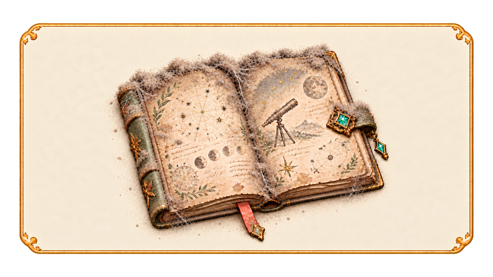 | 먼지 쌓인 펼친 관측 일기; 1672×941 |
| `ART-L02` | `LOC_GH_01-R1` | [IT_focus_LOC_GH_01_wilted_pot_01.png](item/IT_focus_LOC_GH_01_wilted_pot_01.png) 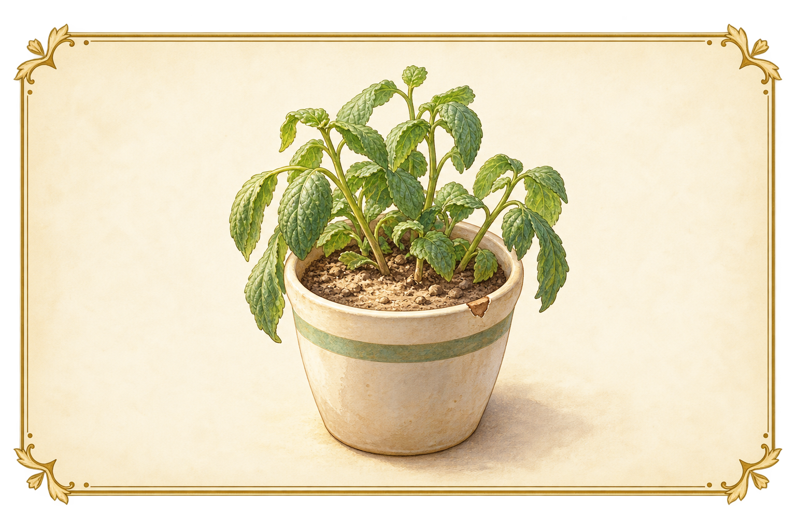 | 시든 화분; 1536×1024 |
| `ART-L03` | `LOC_GH_01-R2` | [IT_focus_LOC_GH_01_restored_pot_02.png](item/IT_focus_LOC_GH_01_restored_pot_02.png) 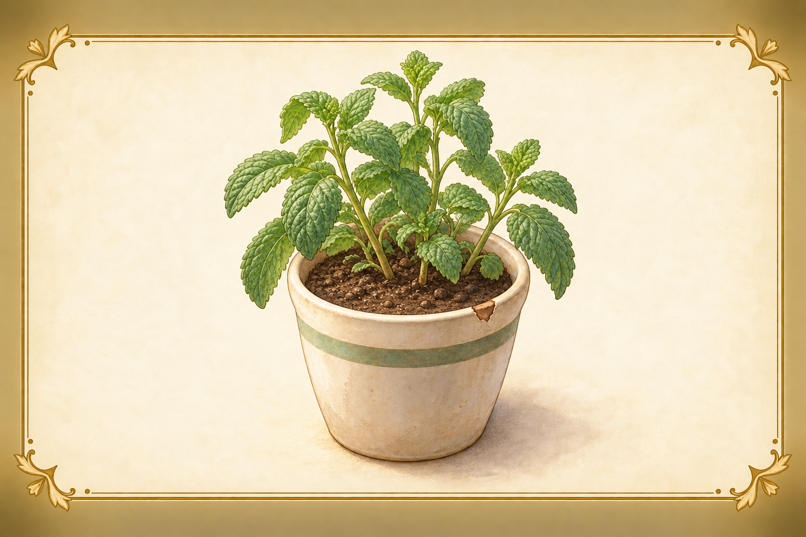 | 회복한 화분; 1536×1024 |
| `ART-L04` | `LOC_LIB_01-R1` | [IT_focus_LOC_LIB_01_plain_book_01.png](item/IT_focus_LOC_LIB_01_plain_book_01.png) 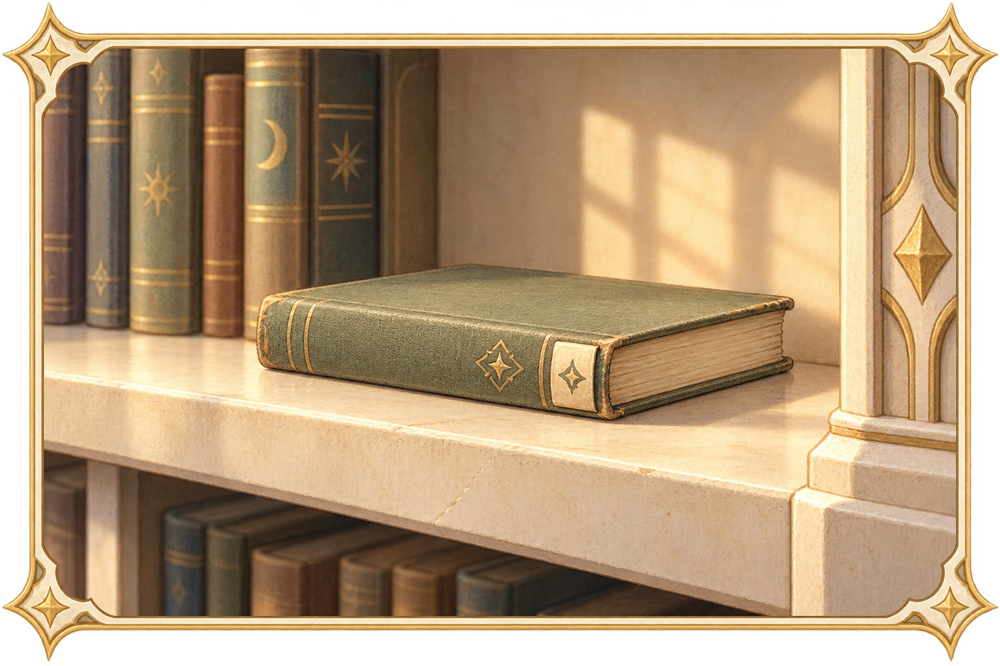 | 책장 위 평범한 책; 1536×1024 |
| `ART-E01` | `END 직업 결과·편지` | [IT_focus_END_career_letter_card_01.png](item/IT_focus_END_career_letter_card_01.png) 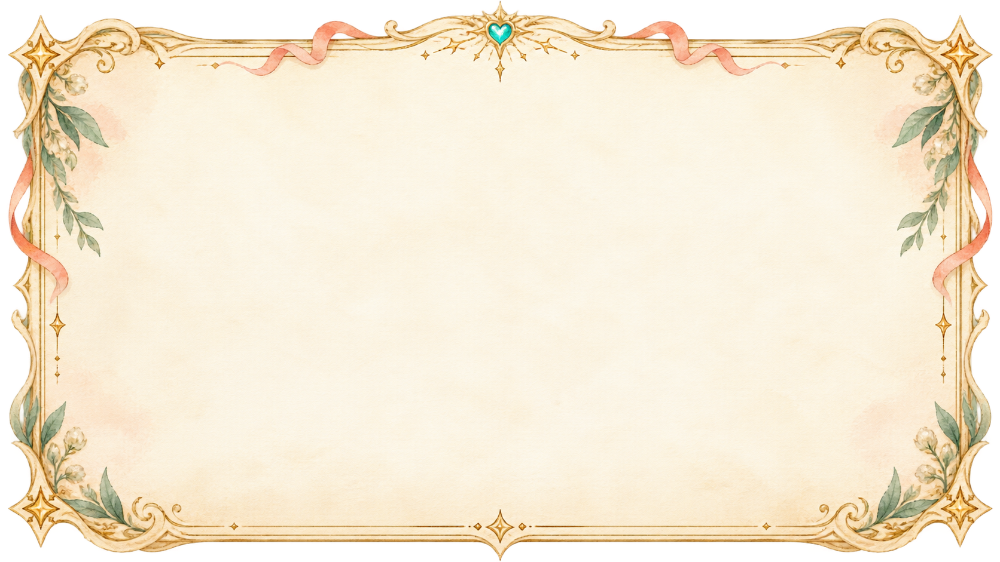 | 글자 없는 공용 직업 카드·편지 받침; 1672×941 |

item 폴더 이미지 **60장**은 확정 17장·비교 카드 3장·일반 아이템 25장·모험 목표 15장입니다. UI 폴더 이미지 **62장**에는 원래 녹색 선택지 프레임과 새 아이보리 양피지 프레임 각 1940×311, 2400×311 버전이 함께 있습니다. [UI README](ui/README.md#버튼)에서 선택하세요.

## 메인 스토리와 엔딩

| 이야기·단계 | BACKGROUND·기존 재료 | FOCUS/화자와 전환 | 연결 판정 |
|---|---|---|---|
| `MS01-S1–S5` 입학·안내 | S2 광장 [시계탑 광장](background/BG02_clocktower_plaza_1920x1080_011.png)  / 생활 공간 [기숙사](background/BG03_academy_dormitory_1920x1080_013.png) 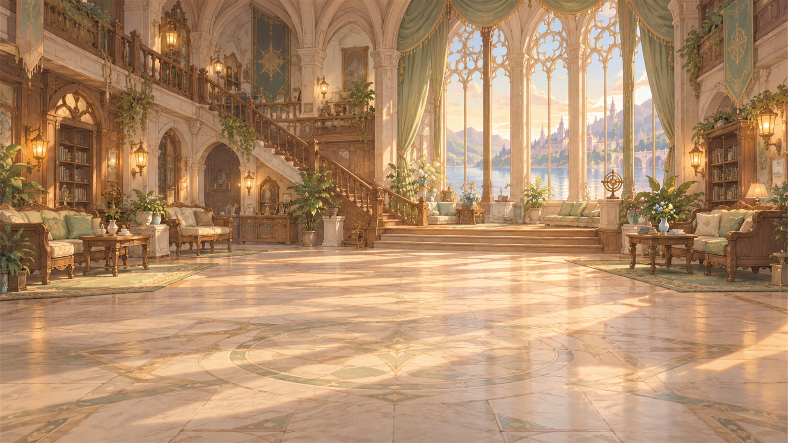 / S4 마이룸 후보 [마이룸 낮](background/BG10_myroom1_day_1920x1080_012.png) 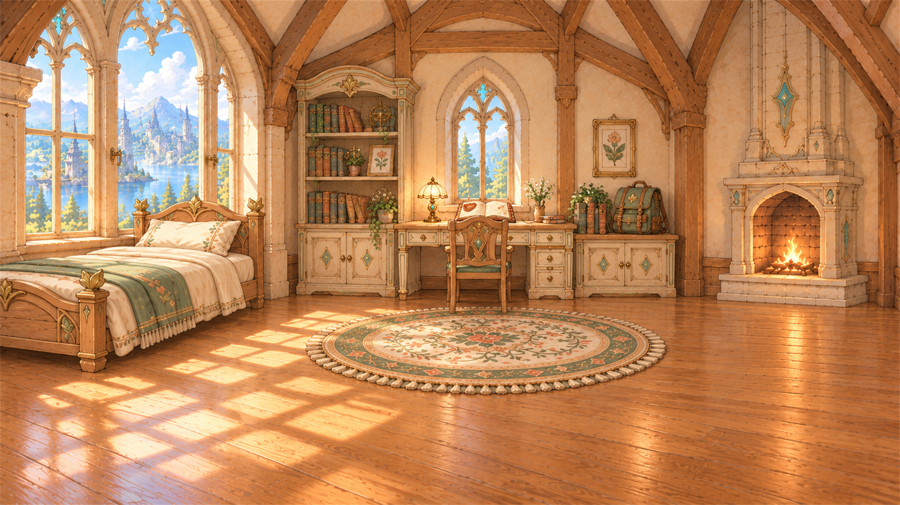 | S1 초대장 후보 [입학 초대장](ui/UI07_admission_invitation_004.png) ; 안내 학생은 동적 캐스팅. 시설별 표시 순서·초대장 채택은 미확정 | 기존 이미지 재사용, **정확한 단계별 배정 확인 필요**. 신규 그림 0장 |
| `MS02-S1–S5` 마법 덩굴 | [유리 온실](background/BG06_glass_greenhouse_1920x1080_016.png) 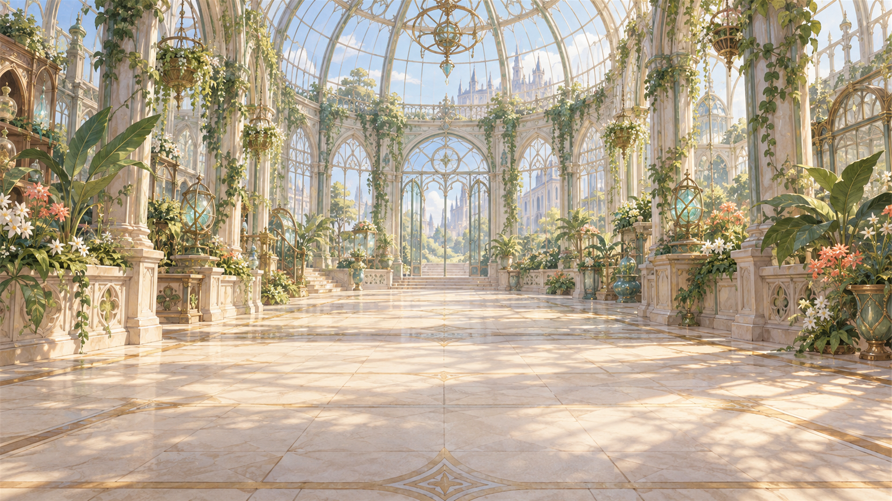 | S1 `ART-M01` [출구 봉쇄](item/IT_focus_MS02_blocked_vines_01.png), S3–S4 `ART-M02` [급성장 덩굴·빛나는 꽃봉오리](item/IT_focus_MS02_glowing_bud_vines_02.png). S4 뒤 FOCUS 숨기고 온실 배경 복귀 | 배경 경로 확인 / FOCUS 2장 파일·API 경로 연결. 일상 화분 `ART-L02/L03`과 다른 사건 |
| `MS03-S1–S5` 시계탑 | [시계탑 광장](background/BG02_clocktower_plaza_1920x1080_011.png)  | S1–S4 `ART-M03` [잘못된 시각의 시계판·흐릿한 문양](item/IT_focus_MS03_wrong_clock_rune_01.png); S5 평상 광장 | 배경 경로 확인 / FOCUS 파일·API 경로 연결 |
| `MS04-S1–S5` 그림자 | [룬 수련장](background/BG09_rune_training_ground_1920x1080_019.png) 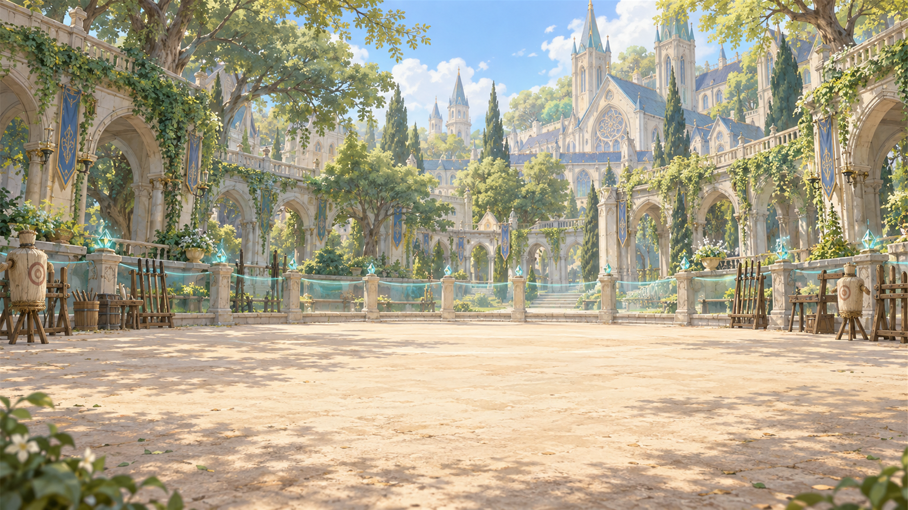 | S1–S2 `ART-M04` [그림자 1명](item/IT_focus_MS04_detached_shadow_01.png) → S3–S4 `ART-M05` [여러 그림자의 반사 방패](item/IT_focus_MS04_shadow_shield_02.png) → S5 평상 수련장, M04 잠깐 재사용 | 배경 경로 확인 / FOCUS 2장 파일·API 경로 연결 |
| `MS05-S1–S5` 별빛 축제 | S1–S2 [별빛 켜진 광장](background/BG02_clocktower_plaza_starlight_festival_lit_3840x2161.png)  → S3–S4 해결 전 [별빛 꺼진 광장](background/BG02_clocktower_plaza_starlight_festival_unlit_3840x2161.png) 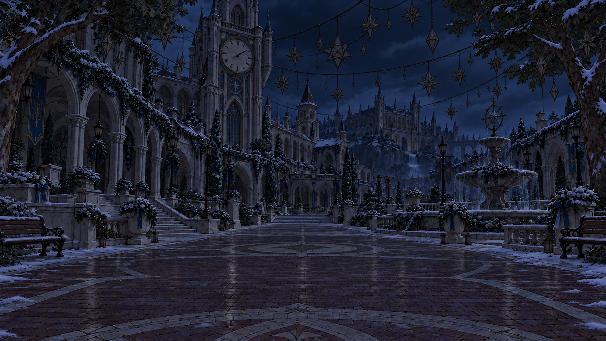 → S4 해결 후–S5 밝음 재사용 | 기존 배경 두 장을 교체. 새 FOCUS 그림 없음 | **제작 문서에 파일명·전환 순서 명시** |
| `MS06-S1–S5` 후일담 | 평온한 광장 장면. [기본 광장](background/BG02_clocktower_plaza_1920x1080_011.png) 은 장소 대응 후보 | `ART-M06` [겨울 놀이회 한 장](item/IT_focus_MS06_winter_games_decor_01.png)을 S1–S5 재사용 | 배경 버전 확인 필요 / FOCUS 파일·API 경로 연결 |
| `END` 직업·편지 | 배경 파일 지정 없음 | `ART-E01` [공용 직업 카드·편지 받침](item/IT_focus_END_career_letter_card_01.png) ; 직업명·부제·편지는 텍스트 | 엔딩 UI 배경 경로 연결. 직업별 10장으로 추정하지 않음 |

메인 등장 학생 역할(`MAIN_GUIDE_STUDENT`, `MAIN_GREENHOUSE_STUDENT` 등)은 [메인 제작 문서의 캐스팅 순서](../story/main/MAIN_STORY_PRODUCTION.md)에 따라 주인공과 겹치지 않게 결정합니다. 한 인물의 파일명을 모든 플레이에 고정하지 않습니다. 실제 학생 전신과 발렌티누스 교수 시안은 [character/](character/README.md)에서 확인합니다. 상반신 표정 160장은 로컬 보관본에서 [캐릭터 폴더](character/README.md#학생-상반신-표정-160장)로 복원했습니다. 현재 게임은 학생 전신을 사용하며, 표정별 대사 매핑과 실행 화면 연결은 아직 확정되지 않았습니다.

## NPC 대화 12회

| 이야기 ID | BACKGROUND | FOCUS/화자 이미지 | 연결 판정 |
|---|---|---|---|
| `NPC_GUIDE_01` 안내지 줍기 | [시계탑 광장](background/BG02_clocktower_plaza_1920x1080_011.png)  | `ART-N01` [흩어진 모임 안내지](item/IT_focus_NPC_GUIDE_01_meeting_notices_01.png) ; 티아 [티아 전신](character/tia0_fullbody.png) / 티아가 주인공이면 [로빈 전신](character/robin0_fullbody.png) | 배경·화자·FOCUS 파일 경로 확인 / 엔진 표시 미검수 |
| `NPC_GUIDE_02` 안내지 놓기 | [시계탑 광장](background/BG02_clocktower_plaza_1920x1080_011.png) | [`ART-N01` 안내지](item/IT_focus_NPC_GUIDE_01_meeting_notices_01.png) 재사용; 티아/로빈 조건 동일 | FOCUS 추가 제작 없음 / 엔진 표시 미검수 |
| `NPC_GUIDE_03` 리본 고르기 | [시계탑 광장](background/BG02_clocktower_plaza_1920x1080_011.png)  | `ART-N02` [색이 다른 리본 두 개](item/IT_focus_NPC_GUIDE_03_two_ribbons_01.png); 티아/로빈 조건 동일 | FOCUS 파일·API 경로 연결. 선택 색별 그림 없음 |
| `NPC_GUIDE_04` 준비 확인 | [시계탑 광장](background/BG02_clocktower_plaza_1920x1080_011.png) | [`ART-N01` 안내지](item/IT_focus_NPC_GUIDE_01_meeting_notices_01.png)와 [`ART-N02` 리본](item/IT_focus_NPC_GUIDE_03_two_ribbons_01.png) 재사용 | 안내지 파일 경로 확인 / 리본 파일·API 경로 연결 / 엔진 표시 미검수 |
| `NPC_WORK_01` 부품 모으기 | [마도 공방](background/BG08_magic_workshop_1920x1080_018.png) 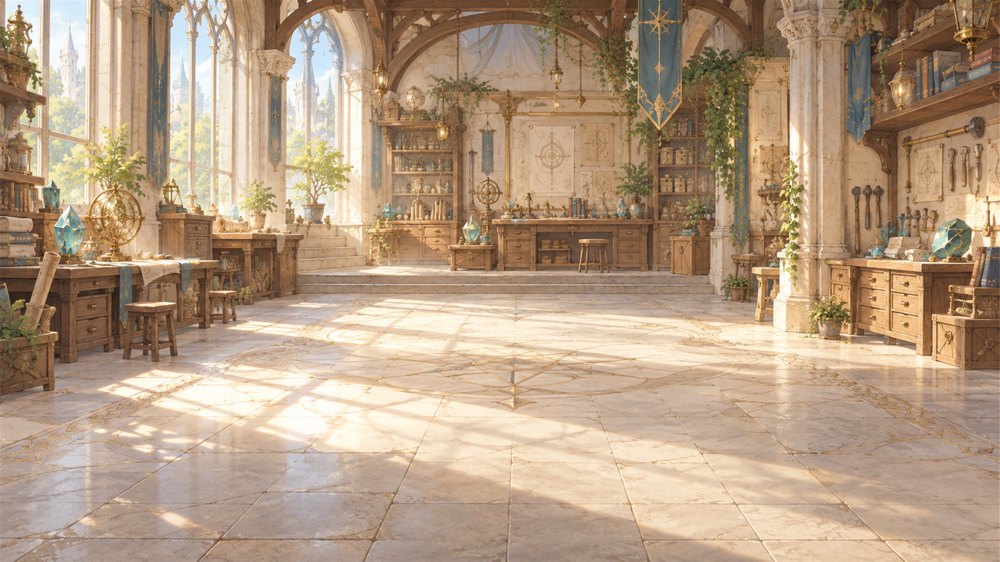 | `ART-N03` [홈·모양이 다른 부품](item/IT_focus_NPC_WORK_01_workshop_parts_01.png); 렌 [렌 전신](character/ren0_fullbody.png)  / 렌이 주인공이면 [다나 전신](character/dana0_fullbody.png)  | 배경·화자 경로 확인 / FOCUS 파일·API 경로 연결 |
| `NPC_WORK_02` 부품 찾기 | [마도 공방](background/BG08_magic_workshop_1920x1080_018.png)  | `ART-N03` 재사용; 렌/다나 조건 동일 | FOCUS 신규 0장; N03 파일·API 경로 연결 |
| `NPC_WORK_03` 도구 정돈 | [마도 공방](background/BG08_magic_workshop_1920x1080_018.png)  | `ART-N04` [천·도구·정돈된 작업대](item/IT_focus_NPC_WORK_03_tidy_workbench_02.png); 렌/다나 조건 동일 | FOCUS 파일·API 경로 연결 |
| `NPC_WORK_04` 작업대 확인 | [마도 공방](background/BG08_magic_workshop_1920x1080_018.png)  | `ART-N04` 재사용; 렌/다나 조건 동일 | FOCUS 신규 0장; N04 파일·API 경로 연결 |
| `NPC_LULU_01` 단추 | 방문 장소에 따라 [유리 온실](background/BG06_glass_greenhouse_1920x1080_016.png)  또는 [치유의 약초원](background/BG07_healing_herb_garden_1920x1080_017.png) 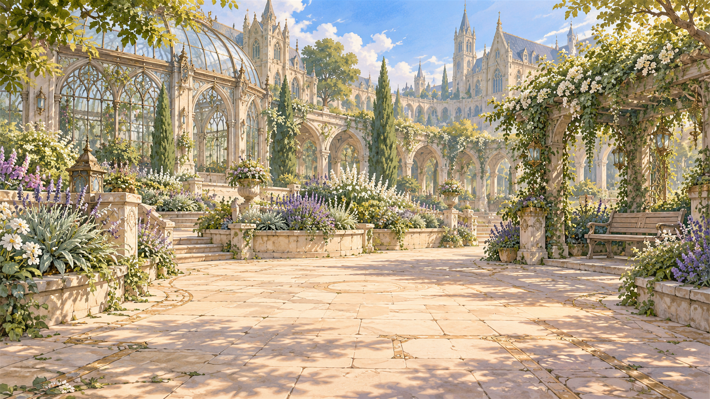 | `ART-N05` [손바닥 위 단추](item/IT_focus_NPC_LULU_01_patterned_button_01.png); 루루 의상·표정은 별도 지정 필요. [초록 탐험복 예시](pet/NPC_LULU_01_front.png) 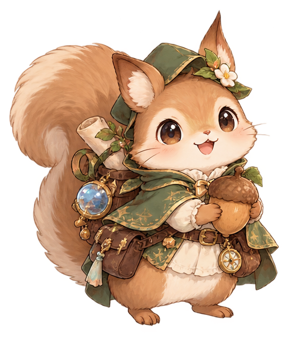 | 배경 조건부 / FOCUS 파일·API 경로 연결 / 의상 미정 |
| `NPC_LULU_02` 보물상자 | 방문 장소에 따라 온실 또는 약초원 | `ART-N06` [열린 보물상자](item/IT_focus_NPC_LULU_02_treasure_chest_02.png) ; 필요하면 `ART-N05` 회상 | FOCUS 파일 경로 확인 / 엔진 표시·루루 의상 미검수 |
| `NPC_LULU_03` 발견물 | 온실 또는 약초원, 방문 장소 조건 동일 | [`ART-N06` 보물상자](item/IT_focus_NPC_LULU_02_treasure_chest_02.png) 재사용. 새 물건은 대사로 설명 | FOCUS 추가 제작 없음 / 엔진 표시 미검수 |
| `NPC_LULU_04` 마지막 만남 | 온실 또는 약초원, 방문 장소 조건 동일 | [`ART-N06` 보물상자](item/IT_focus_NPC_LULU_02_treasure_chest_02.png) 재사용. 깃털·씨앗은 대사로 설명 | FOCUS 추가 제작 없음 / 엔진 표시 미검수 |

`NPC_LULU_01–04`는 **이야기 회차 번호**입니다. `pet/NPC_LULU_01_front.png`의 `01`은 **의상 번호**이므로 자동으로 같은 번호끼리 연결하지 않습니다. 초록 의상 미리보기는 보유 이미지의 예일 뿐, 이 회차의 확정 의상이 아닙니다.

## 장소 이야기 6회

| 이야기 ID | BACKGROUND | FOCUS/화자 이미지 | 연결 판정 |
|---|---|---|---|
| `LOC_OBS_01` 첫 관측 일기 | [별빛 천문대](background/BG05_starlight_observatory_1920x1080_015.png) 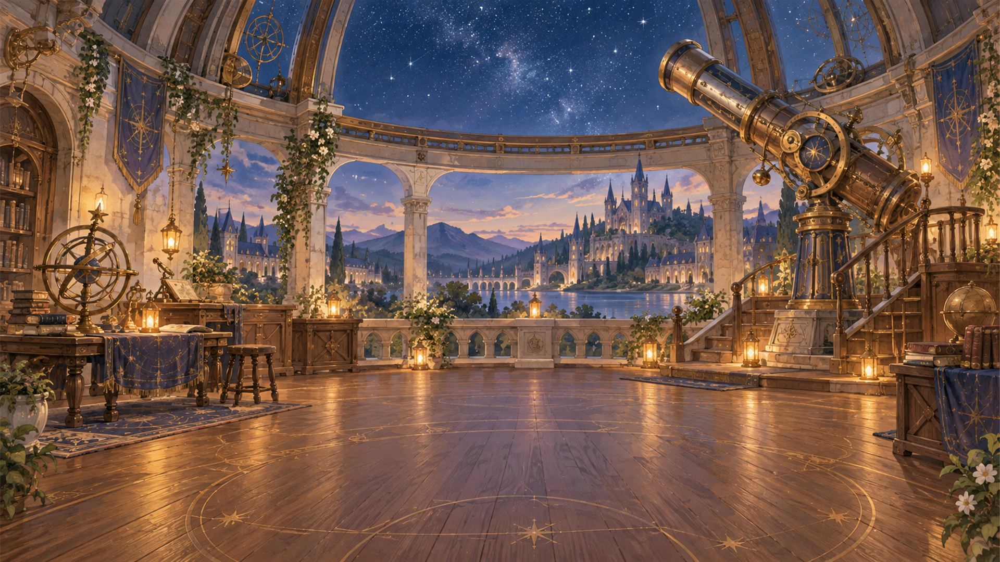 | `ART-L01` [펼친 관측 일기](item/IT_focus_LOC_OBS_01_observation_diary_03.png)  | 배경·FOCUS 파일 경로 확인 / 엔진 표시 미검수 |
| `LOC_OBS_02` 늦은 관측 | [별빛 천문대](background/BG05_starlight_observatory_1920x1080_015.png) | [`ART-L01` 관측 일기](item/IT_focus_LOC_OBS_01_observation_diary_03.png) 재사용. 기록 내용만 대사로 변경 | 새 페이지 그림 없음 / 엔진 표시 미검수 |
| `LOC_OBS_03` 자리 맡아 주기 | [별빛 천문대](background/BG05_starlight_observatory_1920x1080_015.png) | [`ART-L01` 관측 일기](item/IT_focus_LOC_OBS_01_observation_diary_03.png) 재사용 | 새 찻잔·자리표 그림 없음 / 엔진 표시 미검수 |
| `LOC_OBS_04` 빈 관측 칸 | [별빛 천문대](background/BG05_starlight_observatory_1920x1080_015.png) | [`ART-L01` 관측 일기](item/IT_focus_LOC_OBS_01_observation_diary_03.png) 재사용. 선택 표식은 대사 텍스트 | 새 선택별 그림 없음 / 엔진 표시 미검수 |
| `LOC_GH_01` 시든 화분 | [유리 온실](background/BG06_glass_greenhouse_1920x1080_016.png)  | R1 `ART-L02` [확정 시든 화분](item/IT_focus_LOC_GH_01_wilted_pot_01.png)  → R2 `ART-L03` [확정 회복 화분](item/IT_focus_LOC_GH_01_restored_pot_02.png) . 화자 `LOC_GREENHOUSE_STUDENT`는 동적 배정 | 배경 확인 / 두 확정 FOCUS는 파일·API 경로 연결; 화면 표시 검수 필요 |
| `LOC_LIB_01` 책 정리 | [대서고](background/BG04_grand_library_1920x1080_014.png)  | R1 `ART-L04` [책장 위 평범한 책](item/IT_focus_LOC_LIB_01_plain_book_01.png)  → R2 숨김. 세린은 이미지 없이 화자명·대사 사용 가능 | 배경 확인 / FOCUS 파일·API 경로 연결 |

### 관측 일기 선택과 비슷한 시안 구분

| 보유 이미지 미리보기 | 사용 판단 |
|---|---|
| [펼친 관측 일기](item/IT_focus_LOC_OBS_01_observation_diary_03.png)  | **확정:** `LOC_OBS_01–04`의 `ART-L01` FOCUS는 이 그림 한 장을 재사용합니다. |
| [장식 있는 고서](item/IT_card_candidate_LIB_ancient_book_03.png) 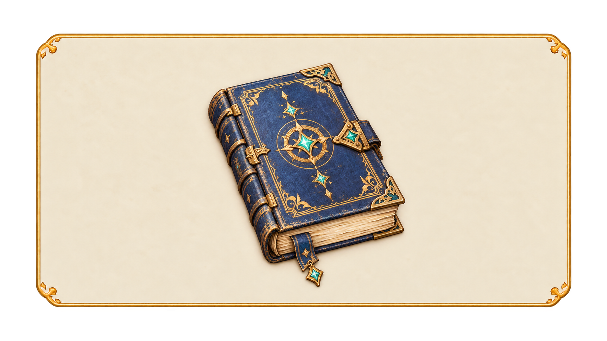 | `ART-L04`는 **책장 위에 가로로 놓인 평범한 책**입니다. 현재 고서는 그 구도와 내용이 다릅니다. |
| [방치된 온실](background/BG06_glass_greenhouse_neglected_3840x2162.png) 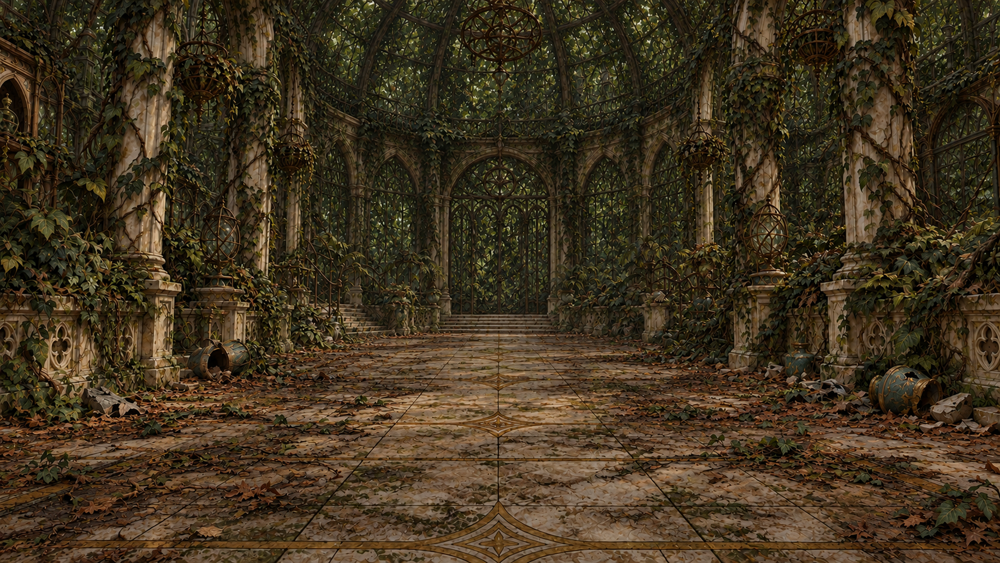 | 보유 시안이지만 `MS02`의 `ART-M01/M02`를 대신하는 확정 그림은 아닙니다. |

## README 갱신 기준

새 이미지나 파일명 변경 시 이 문서의 장면 ID별 경로·상태, 해당 폴더 README의 사용처·미리보기, 실제 이미지 파일을 같은 변경에서 대조합니다. 후보 그림은 제작 문서와 일치하고 승인되기 전까지 확정 경로로 올리지 않습니다. 게임 엔진의 경로 변경은 별도 검증이 필요합니다.
