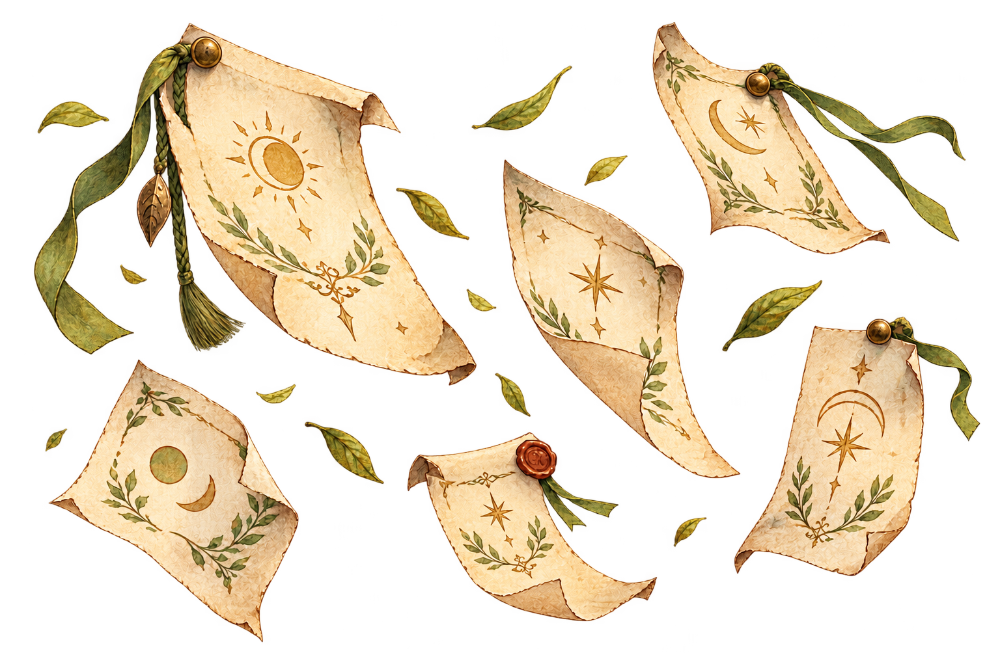
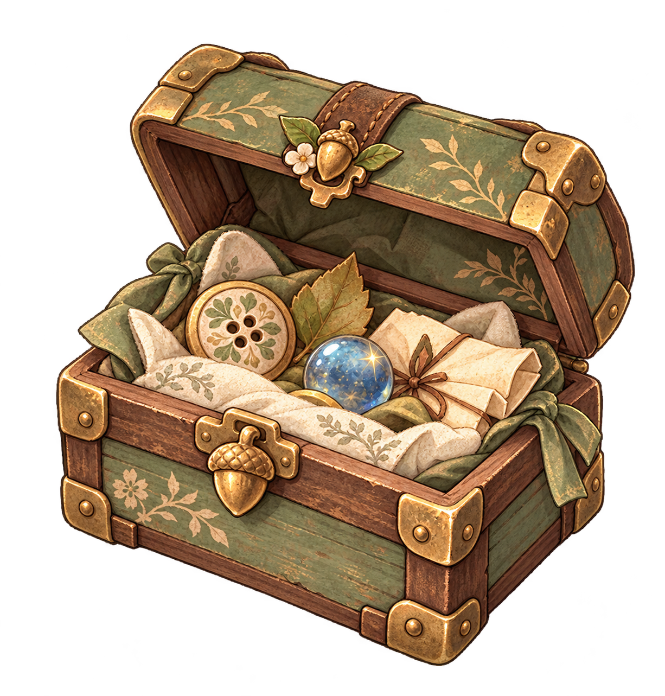
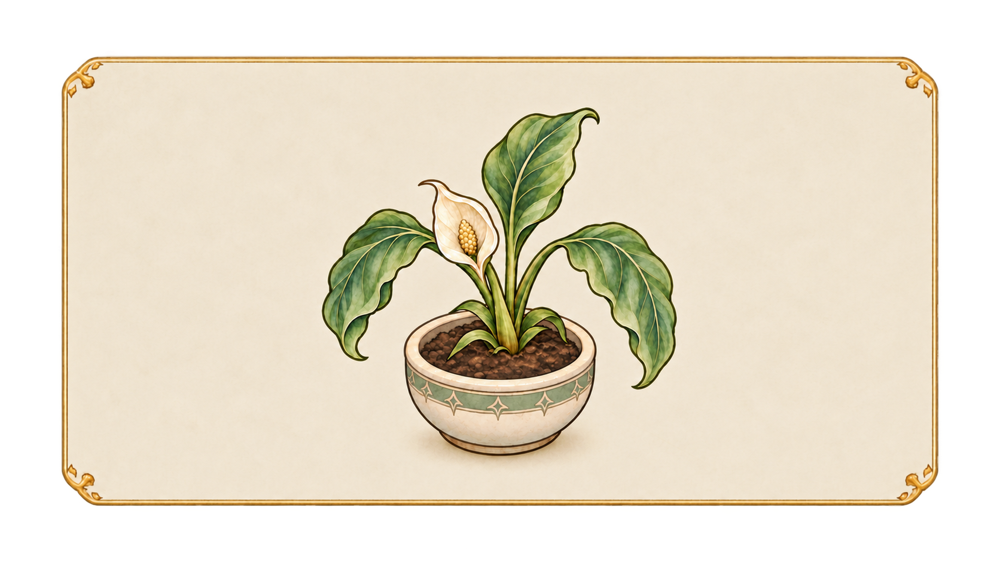

# 이미지 자원 안내 · 스토리별 찾기

이 문서는 **이야기 ID → 화면에 쓸 이미지 경로**를 찾는 시작점입니다. 파일의 실제 위치는 유지하고, 사용처를 문서로 연결합니다. 이미지가 폴더에 있다는 사실과 이야기용 채택·엔진 연결 완료는 다릅니다. 아래의 `확정 경로`도 게임에서 표시되는지 별도 검수가 필요합니다.

## 판단 기준

- 현재 제작 기준: [메인](../story/main/MAIN_STORY_PRODUCTION.md) · [장소](../story/location/LOCATION_STORY_PRODUCTION.md) · [NPC](../story/npc/NPC_STORY_PRODUCTION.md) · [공통 아트 목록](../story/ASSET_DIALOGUE_LEDGER.md). 옛 에셋 제작 마스터 v0.1의 장면 번호·발주량은 이 최신 제작안과 다르므로 현재 검색 기준에서 제외했습니다. 이전 표는 Git 이력에서 볼 수 있습니다.
- **확정 경로**: 해당 파일이 현재 브랜치에 있고 제작 지시와 일치합니다. **조건부**: 주인공·방문 장소·선택에 따라 파일이 달라집니다. **후보**: 파일은 있으나 제작 지시와의 일치 또는 사용 승인이 남았습니다. **미제작/미연결**: `ART-*`에 대응하는 확정 파일 경로가 없습니다. 후보를 AI나 엔진이 확정 이미지로 대신 쓰지 않습니다.
- `BACKGROUND`는 화면 전체 배경, `FOCUS`는 대화 중 중앙에 표시하는 한 장의 그림, **화자 이미지**는 캐릭터 표정/스프라이트입니다. [대화 엔진 인계 기준](../document_for_ai/07_DIALOGUE_ENGINE_HANDOFF.md)과 [대화 시퀀스](../document/content/13_DIALOGUE_SEQUENCE.md)를 따릅니다. 같은 FOCUS 이미지를 여러 회차에서 재사용해도 파일을 복제하지 않습니다.
- `MS07`은 별도 스토리 사건이 아닌 자유 플레이 구간입니다. 아래 `END`는 마지막 카드 화면입니다.

## 파일명과 배치 상태

이 브랜치의 새 UI는 `BT`(버튼)·`UI`(화면 재료)·`LG`(로고), 장소 배경은 `BG`, 이동 맵은 `MP`, 스토리 FOCUS는 제작 ID `ART-*`를 기준으로 찾습니다. 학생 전신, 펫 `PT`, 루루 의상 `NPC_LULU`, 퍼즐 `PZ`와 배지는 해당 폴더의 기존 번호 체계를 유지합니다. 번호가 같은 루루 **의상**과 **대화 회차**는 별개입니다. 게임 코드가 참조하는 일반 아이템·배지·기존 로고 광휘의 파일명은 경로 호환을 위해 임의 변경하지 않습니다. 새 그림이 생길 때 해당 폴더 README에 실제 파일명·장면 ID 또는 후보 용도·연결 상태·미리보기를 함께 갱신합니다.

아이템 검색은 [item/README.md](item/README.md)의 `채택한 스토리 FOCUS`에서 **확정 경로**, `스토리 FOCUS 연결 상태`에서 **후보·불일치**, `일반 아이템 아트`에서 **장면 미배정 소품**을 구분합니다. 아이템 목록의 의미상 용도만으로 획득·배치·엔진 표시를 추정하지 않습니다.

## 이번에 경로가 확정된 스토리 FOCUS

| 제작 ID | 파일 · 작은 미리보기 | 정확한 사용처 | 상태 |
|---|---|---|---|
| `ART-N01` | [아이보리 프레임 · 흩어진 모임 안내지](item/ART-N01_meeting_notices_scattered.png)  | `NPC_GUIDE_01` 최초, `NPC_GUIDE_02·04` 재사용. 시계탑 광장 배경 위 FOCUS | 이미지 채택·파일 등록. 엔진 표시 미검수 |
| `ART-N06` | [아이보리 프레임 · 루루의 열린 보물상자](item/ART-N06_lulu_treasure_chest_open.png)  | `NPC_LULU_02` 최초, `NPC_LULU_03–04` 재사용. 방문 장소는 온실 또는 약초원 | 이미지 채택·파일 등록. 엔진 표시 미검수 |
| `ART-L01` | [아이보리 프레임 · 펼친 관측 일기](item/ART-L01_observation_diary_open_dusty.png)  | `LOC_OBS_01` 최초, `LOC_OBS_02–04` 재사용. 별빛 천문대 배경 위 FOCUS | 이미지 채택·파일 등록. 엔진 표시 미검수 |

세 FOCUS는 모두 밝은 아이보리 프레임과 투명한 바깥 배경의 1672×941 PNG입니다. 일반 아이템 25장, 기존 프레임 카드 3장, 사용자 승인 마이룸·일지 UI 재료 5장까지 포함한 **item 폴더 이미지 전체 36장**의 파일명·미리보기는 [item/README.md](item/README.md)에서 확인합니다. UI 재료는 사용자의 저장 위치 요청에 따라 `item/`에 두었지만 소지품이나 스토리 FOCUS가 아닙니다. 프레임 카드·일반 아이템을 `ART-*` 전용 그림에 자동 대입하지 않습니다.

## 메인 스토리와 엔딩

| 이야기·단계 | BACKGROUND·기존 재료 | FOCUS/화자와 전환 | 연결 판정 |
|---|---|---|---|
| `MS01-S1–S5` 입학·안내 | S2 광장 [시계탑 광장](background/BG02_clocktower_plaza_1920x1080_011.png)  / 생활 공간 [기숙사](background/BG03_academy_dormitory_1920x1080_013.png)  / S4 마이룸 후보 [마이룸 낮](background/BG10_myroom1_day_1920x1080_012.png)  | S1 초대장 후보 [입학 초대장](ui/UI07_admission_invitation_004.png) ; 안내 학생은 동적 캐스팅. 시설별 표시 순서·초대장 채택은 미확정 | 기존 이미지 재사용, **정확한 단계별 배정 확인 필요**. 신규 그림 0장 |
| `MS02-S1–S5` 마법 덩굴 | [유리 온실](background/BG06_glass_greenhouse_1920x1080_016.png)  | S1 `ART-M01` 출구 봉쇄, S3–S4 `ART-M02` 급성장 덩굴·빛나는 꽃봉오리. S4 뒤 FOCUS 숨기고 온실 배경 복귀 | 배경 경로 확인 / FOCUS 2장 미연결. 일상 화분 `ART-L02/L03`과 다른 사건 |
| `MS03-S1–S5` 시계탑 | [시계탑 광장](background/BG02_clocktower_plaza_1920x1080_011.png)  | S1–S4 `ART-M03` 잘못된 시각의 시계판·흐릿한 문양; S5 평상 광장 | 배경 경로 확인 / FOCUS 미연결 |
| `MS04-S1–S5` 그림자 | [룬 수련장](background/BG09_rune_training_ground_1920x1080_019.png)  | S1–S2 `ART-M04` 그림자 1명 → S3–S4 `ART-M05` 여러 그림자의 반사 방패 → S5 평상 수련장, M04 잠깐 재사용 | 배경 경로 확인 / FOCUS 2장 미연결 |
| `MS05-S1–S5` 별빛 축제 | S1–S2 [별빛 켜진 광장](background/BG02_clocktower_plaza_starlight_festival_lit_3840x2161.png)  → S3–S4 해결 전 [별빛 꺼진 광장](background/BG02_clocktower_plaza_starlight_festival_unlit_3840x2161.png)  → S4 해결 후–S5 밝음 재사용 | 기존 배경 두 장을 교체. 새 FOCUS 그림 없음 | **제작 문서에 파일명·전환 순서 명시** |
| `MS06-S1–S5` 후일담 | 평온한 광장 장면. [기본 광장](background/BG02_clocktower_plaza_1920x1080_011.png) 은 장소 대응 후보 | `ART-M06` 겨울 놀이회 한 장을 S1–S5 재사용 | 배경 버전 확인 필요 / FOCUS 미연결 |
| `END` 직업·편지 | 배경 파일 지정 없음 | `ART-E01` 공용 직업 카드 1장; 직업명·부제는 텍스트 치환 | FOCUS 미연결. 직업별 10장으로 추정하지 않음 |

메인 등장 학생 역할(`MAIN_GUIDE_STUDENT`, `MAIN_GREENHOUSE_STUDENT` 등)은 [메인 제작 문서의 캐스팅 순서](../story/main/MAIN_STORY_PRODUCTION.md)에 따라 주인공과 겹치지 않게 결정합니다. 한 인물의 파일명을 모든 플레이에 고정하지 않습니다. 실제 학생 전신과 발렌티누스 교수 시안은 [character/](character/README.md)에서 확인합니다. 상반신 표정 파일은 로컬 보관본으로 옮겼으며, 엔진의 기존 참조는 전신 기준으로 연결 확인이 필요합니다.

## NPC 대화 12회

| 이야기 ID | BACKGROUND | FOCUS/화자 이미지 | 연결 판정 |
|---|---|---|---|
| `NPC_GUIDE_01` 안내지 줍기 | [시계탑 광장](background/BG02_clocktower_plaza_1920x1080_011.png)  | `ART-N01` [흩어진 모임 안내지](item/ART-N01_meeting_notices_scattered.png) ; 티아 [티아 전신](character/tia0_fullbody.png) / 티아가 주인공이면 [로빈 전신](character/robin0_fullbody.png) | 배경·화자·FOCUS 파일 경로 확인 / 엔진 표시 미검수 |
| `NPC_GUIDE_02` 안내지 놓기 | [시계탑 광장](background/BG02_clocktower_plaza_1920x1080_011.png) | [`ART-N01` 안내지](item/ART-N01_meeting_notices_scattered.png) 재사용; 티아/로빈 조건 동일 | FOCUS 추가 제작 없음 / 엔진 표시 미검수 |
| `NPC_GUIDE_03` 리본 고르기 | [시계탑 광장](background/BG02_clocktower_plaza_1920x1080_011.png)  | `ART-N02` 색이 다른 리본 두 개; 티아/로빈 조건 동일 | FOCUS 미연결. 선택 색별 그림 없음 |
| `NPC_GUIDE_04` 준비 확인 | [시계탑 광장](background/BG02_clocktower_plaza_1920x1080_011.png) | [`ART-N01` 안내지](item/ART-N01_meeting_notices_scattered.png) 재사용; `ART-N02` 리본은 별도 미제작 | 안내지 파일 경로 확인 / 리본 미연결 / 엔진 표시 미검수 |
| `NPC_WORK_01` 부품 모으기 | [마도 공방](background/BG08_magic_workshop_1920x1080_018.png)  | `ART-N03` 홈·모양이 다른 부품; 렌 [렌 전신](character/ren0_fullbody.png)  / 렌이 주인공이면 [다나 전신](character/dana0_fullbody.png)  | 배경·화자 경로 확인 / FOCUS 미연결 |
| `NPC_WORK_02` 부품 찾기 | [마도 공방](background/BG08_magic_workshop_1920x1080_018.png)  | `ART-N03` 재사용; 렌/다나 조건 동일 | FOCUS 신규 0장; N03 미연결 |
| `NPC_WORK_03` 도구 정돈 | [마도 공방](background/BG08_magic_workshop_1920x1080_018.png)  | `ART-N04` 천·도구·정돈된 작업대; 렌/다나 조건 동일 | FOCUS 미연결 |
| `NPC_WORK_04` 작업대 확인 | [마도 공방](background/BG08_magic_workshop_1920x1080_018.png)  | `ART-N04` 재사용; 렌/다나 조건 동일 | FOCUS 신규 0장; N04 미연결 |
| `NPC_LULU_01` 단추 | 방문 장소에 따라 [유리 온실](background/BG06_glass_greenhouse_1920x1080_016.png)  또는 [치유의 약초원](background/BG07_healing_herb_garden_1920x1080_017.png)  | `ART-N05` 손바닥 위 단추; 루루 의상·표정은 별도 지정 필요. [초록 탐험복 예시](pet/NPC_LULU_01_front.png)  | 배경 조건부 / FOCUS 미연결 / 의상 미정 |
| `NPC_LULU_02` 보물상자 | 방문 장소에 따라 온실 또는 약초원 | `ART-N06` [열린 보물상자](item/ART-N06_lulu_treasure_chest_open.png) ; 필요하면 `ART-N05` 회상 | FOCUS 파일 경로 확인 / 엔진 표시·루루 의상 미검수 |
| `NPC_LULU_03` 발견물 | 온실 또는 약초원, 방문 장소 조건 동일 | [`ART-N06` 보물상자](item/ART-N06_lulu_treasure_chest_open.png) 재사용. 새 물건은 대사로 설명 | FOCUS 추가 제작 없음 / 엔진 표시 미검수 |
| `NPC_LULU_04` 마지막 만남 | 온실 또는 약초원, 방문 장소 조건 동일 | [`ART-N06` 보물상자](item/ART-N06_lulu_treasure_chest_open.png) 재사용. 깃털·씨앗은 대사로 설명 | FOCUS 추가 제작 없음 / 엔진 표시 미검수 |

`NPC_LULU_01–04`는 **이야기 회차 번호**입니다. `pet/NPC_LULU_01_front.png`의 `01`은 **의상 번호**이므로 자동으로 같은 번호끼리 연결하지 않습니다. 초록 의상 미리보기는 보유 이미지의 예일 뿐, 이 회차의 확정 의상이 아닙니다.

## 장소 이야기 6회

| 이야기 ID | BACKGROUND | FOCUS/화자 이미지 | 연결 판정 |
|---|---|---|---|
| `LOC_OBS_01` 첫 관측 일기 | [별빛 천문대](background/BG05_starlight_observatory_1920x1080_015.png)  | `ART-L01` [펼친 관측 일기](item/ART-L01_observation_diary_open_dusty.png)  | 배경·FOCUS 파일 경로 확인 / 엔진 표시 미검수 |
| `LOC_OBS_02` 늦은 관측 | [별빛 천문대](background/BG05_starlight_observatory_1920x1080_015.png) | [`ART-L01` 관측 일기](item/ART-L01_observation_diary_open_dusty.png) 재사용. 기록 내용만 대사로 변경 | 새 페이지 그림 없음 / 엔진 표시 미검수 |
| `LOC_OBS_03` 자리 맡아 주기 | [별빛 천문대](background/BG05_starlight_observatory_1920x1080_015.png) | [`ART-L01` 관측 일기](item/ART-L01_observation_diary_open_dusty.png) 재사용 | 새 찻잔·자리표 그림 없음 / 엔진 표시 미검수 |
| `LOC_OBS_04` 빈 관측 칸 | [별빛 천문대](background/BG05_starlight_observatory_1920x1080_015.png) | [`ART-L01` 관측 일기](item/ART-L01_observation_diary_open_dusty.png) 재사용. 선택 표식은 대사 텍스트 | 새 선택별 그림 없음 / 엔진 표시 미검수 |
| `LOC_GH_01` 시든 화분 | [유리 온실](background/BG06_glass_greenhouse_1920x1080_016.png)  | R1 `ART-L02` 시든 화분 후보 [시든 화분 후보](item/plant1_wilted_frame_thin_3840x2161.png)  → R2 `ART-L03` 건강해진 화분 후보 [회복 화분 후보](item/plant2_restored_frame_thin_3840x2161.png) . 화자 `LOC_GREENHOUSE_STUDENT`는 동적 배정 | 배경 확인 / 두 FOCUS는 **후보**, 채택·표시 방식 검수 필요 |
| `LOC_LIB_01` 책 정리 | [대서고](background/BG04_grand_library_1920x1080_014.png)  | R1 `ART-L04` **책장 위에 가로로 놓인 평범한 책** → R2 숨김. 세린은 이미지 없이 화자명·대사 사용 가능 | 배경 확인 / FOCUS 미연결 |

### 관측 일기 선택과 비슷한 시안 구분

| 보유 이미지 미리보기 | 사용 판단 |
|---|---|
| [펼친 관측 일기](item/ART-L01_observation_diary_open_dusty.png)  | **확정:** `LOC_OBS_01–04`의 `ART-L01` FOCUS는 이 그림 한 장을 재사용합니다. |
| [장식 있는 고서](item/book1_ancient_frame_thin_3840x2161.png)  | `ART-L04`는 **책장 위에 가로로 놓인 평범한 책**입니다. 현재 고서는 그 구도와 내용이 다릅니다. |
| [방치된 온실](background/BG06_glass_greenhouse_neglected_3840x2162.png)  | 보유 시안이지만 `MS02`의 `ART-M01/M02`를 대신하는 확정 그림은 아닙니다. |

## 폴더별 역방향 찾기

| 폴더 | 무엇을 찾나 |
|---|---|
| [background/](background/README.md) | 장면 배경·마이룸 시간대·게임용/시안 구분 |
| [item/](item/README.md) | 스토리 FOCUS 3장·일반 아이템 25장·기존 프레임 카드 3장·승인된 마이룸/일지 UI 5장과 사용처 |
| [character/](character/README.md) | 학생 전신 32장·발렌티누스 교수 시안 2장(이미지 총 34장); 동적 배역은 스토리 문서 기준 |
| [pet/](pet/README.md) | 루루 의상별 앞·뒤·표정; 회차 번호와 분리 |
| [ui/](ui/README.md) | 대화창·초대장·현재 BT04 버튼과 짧은 빈 버튼 2종·펼친 다이어리 등 공통 UI 재료와 채택 상태 |
| [map/](map/README.md) | 이동·충돌용 맵. 위 `BACKGROUND`와 다른 용도 |

그 밖의 [SD 캐릭터](sd_character/README.md), [퍼즐](puzzle/README.md), [이펙트](effect/README.md), [배지](badge/README.md), [풀스크린](Full%20screen/README.md), [글꼴](font_files/README.md), [스탯](stat/README.md)은 각 폴더 README의 목록·미리보기를 사용합니다. 새로운 이미지가 채택되면 **실제 파일·이 표의 경로와 상태·해당 폴더 README의 미리보기·엔진 참조**를 같은 변경에서 확인합니다.
