# 배경 이미지 (`asset/background/`)

이 폴더에는 게임용 배경 15장(1920×1080)과 마이룸 테마 시안 15장(1672×941)이 있습니다. 창가 독서실 시안 3장은 Git 이력의 원본을 `myroom/`에 복원했으며 UI 검토 화면용입니다. 두 종류의 크기와 적용 상태를 구분합니다. 실제 게임 화면 적용과 가장자리 검수는 별도입니다. 장소 설정은 [세계관 문서](../../document/02_WORLDVIEW.md)를 참고합니다.

## 게임용 장소 배경 · 9장

| 장소 | 파일 | 미리보기 |
|---|---|---|
| 아르카디아 입구와 호수 | [BG01_arcadia_entrance_and_lake_1920x1080_010.png](./BG01_arcadia_entrance_and_lake_1920x1080_010.png) | 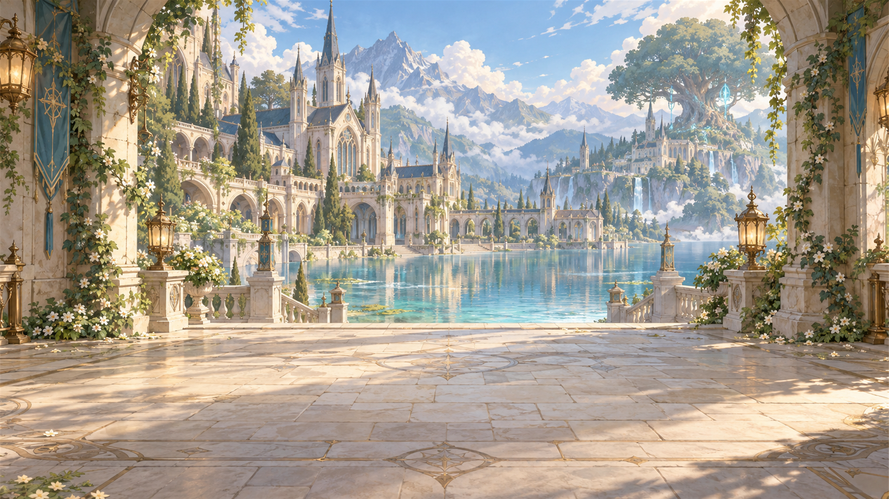 |
| 시계탑 광장 | [BG02_clocktower_plaza_1920x1080_011.png](./BG02_clocktower_plaza_1920x1080_011.png) |  |
| 학원 기숙사 | [BG03_academy_dormitory_1920x1080_013.png](./BG03_academy_dormitory_1920x1080_013.png) |  |
| 대서고 | [BG04_grand_library_1920x1080_014.png](./BG04_grand_library_1920x1080_014.png) |  |
| 별빛 천문대 | [BG05_starlight_observatory_1920x1080_015.png](./BG05_starlight_observatory_1920x1080_015.png) |  |
| 유리 온실 | [BG06_glass_greenhouse_1920x1080_016.png](./BG06_glass_greenhouse_1920x1080_016.png) |  |
| 치유의 약초원 | [BG07_healing_herb_garden_1920x1080_017.png](./BG07_healing_herb_garden_1920x1080_017.png) |  |
| 마도 공방 | [BG08_magic_workshop_1920x1080_018.png](./BG08_magic_workshop_1920x1080_018.png) |  |
| 룬 수련장 | [BG09_rune_training_ground_1920x1080_019.png](./BG09_rune_training_ground_1920x1080_019.png) |  |

## 게임용 마이룸 배경 · 6장

구도 1은 왼쪽 침대, 중앙 책상·다이어리, 오른쪽 수납장 위 가방이 보입니다. 구도 2는 왼쪽 책상과 바닥 가방, 중앙 오른쪽 침대를 사용합니다. 두 구도 모두 낮·노을·밤이 있으며 1920×1080입니다. 기존 이미지 뒤쪽 번호 `_012`, `_021`~`_025`는 유지했습니다.

| 구도·시간 | 파일 | 미리보기 |
|---|---|---|
| 마이룸 구도 1 · 낮 | [BG10_myroom1_day_1920x1080_012.png](./BG10_myroom1_day_1920x1080_012.png) |  |
| 마이룸 구도 1 · 노을 | [BG11_myroom1_sunset_1920x1080_021.png](./BG11_myroom1_sunset_1920x1080_021.png) | 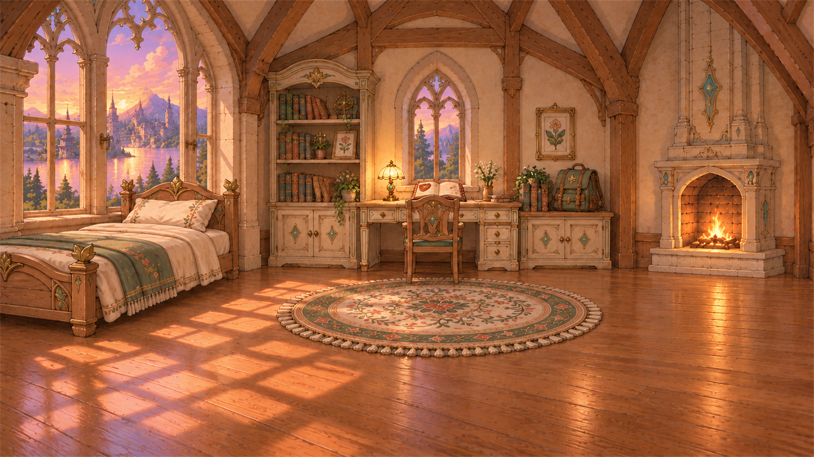 |
| 마이룸 구도 1 · 밤 | [BG11_myroom1_night_1920x1080_022.png](./BG11_myroom1_night_1920x1080_022.png) | 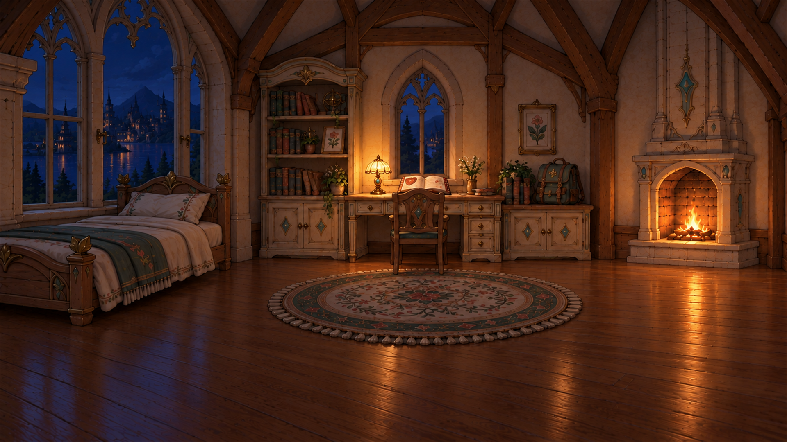 |
| 마이룸 구도 2 · 낮 | [BG11_myroom2_day_1920x1080_023.png](./BG11_myroom2_day_1920x1080_023.png) | 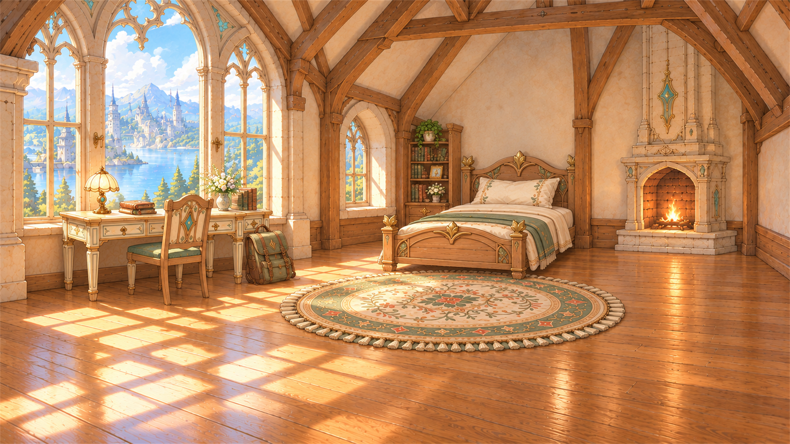 |
| 마이룸 구도 2 · 노을 | [BG11_myroom2_sunset_1920x1080_024.png](./BG11_myroom2_sunset_1920x1080_024.png) | 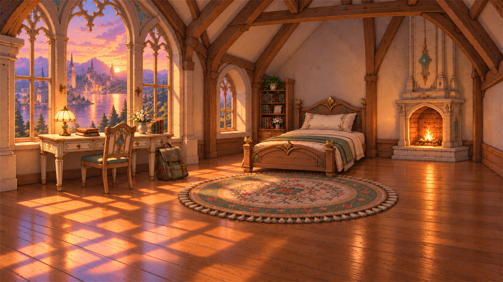 |
| 마이룸 구도 2 · 밤 | [BG11_myroom2_night_1920x1080_025.png](./BG11_myroom2_night_1920x1080_025.png) | 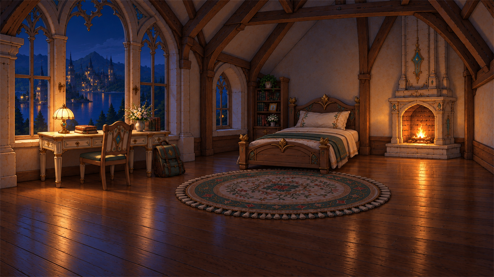 |

## 마이룸 테마 시안 · 15장

기존 네 테마 12장과 Git 이력에서 복원한 창가 독서실 3장은 모두 1672×941 시안 원본입니다. 게임용 1920×1080 배경으로 변환·적용한 상태는 아닙니다. 창가 독서실 파일은 과거 경로·파일명을 그대로 보존해 `asset/ui/` 검토 화면의 기존 참조를 복구했습니다.

| 테마 | 낮 | 노을 | 밤 |
|---|---|---|---|
| 창가 독서실 · UI 검토용 원본 | [myroom3_reading_day.png](./myroom/myroom3_reading_day.png)  | [myroom3_reading_sunset.png](./myroom/myroom3_reading_sunset.png)  | [myroom3_reading_night.png](./myroom/myroom3_reading_night.png)  |
| 룬 연구실 | [BG11_myroom3_rune_day.png](./BG11_myroom3_rune_day.png) 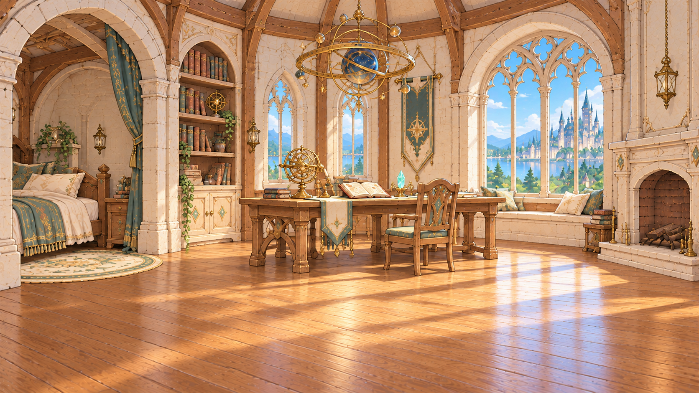 | [BG11_myroom3_rune_sunset.png](./BG11_myroom3_rune_sunset.png) 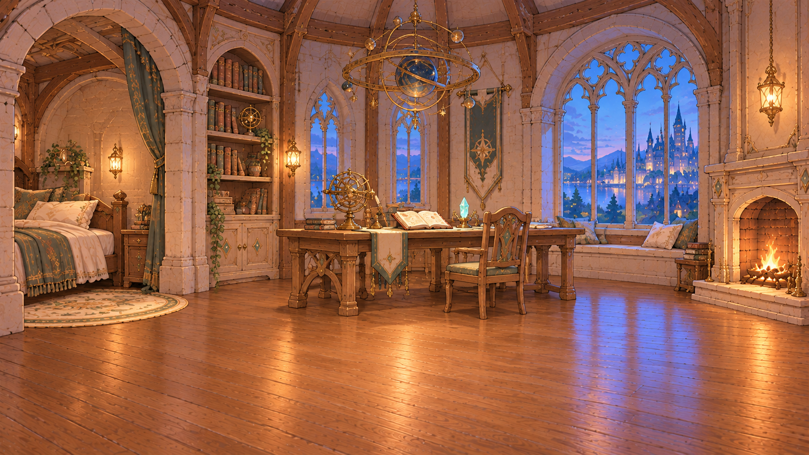 | [BG11_myroom3_rune_night.png](./BG11_myroom3_rune_night.png)  |
| 우주방 | [BG11_myroom4_cosmos_day.png](./BG11_myroom4_cosmos_day.png) 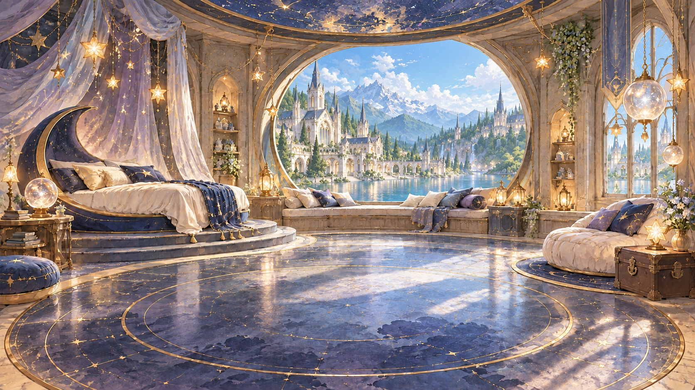 | [BG11_myroom4_cosmos_sunset.png](./BG11_myroom4_cosmos_sunset.png) 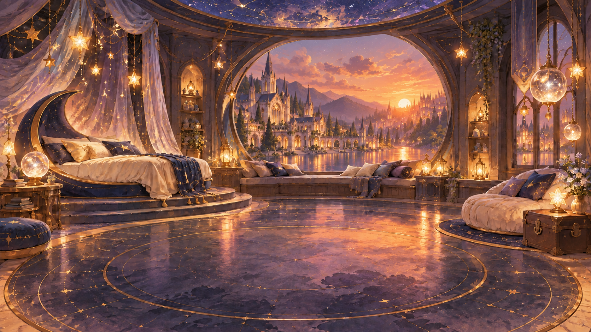 | [BG11_myroom4_cosmos_night.png](./BG11_myroom4_cosmos_night.png) 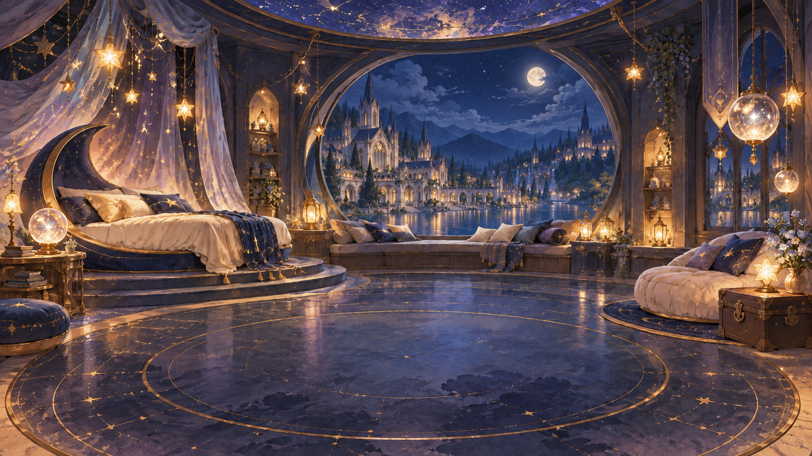 |
| 공주방 | [BG11_myroom5_princess_day.png](./BG11_myroom5_princess_day.png) 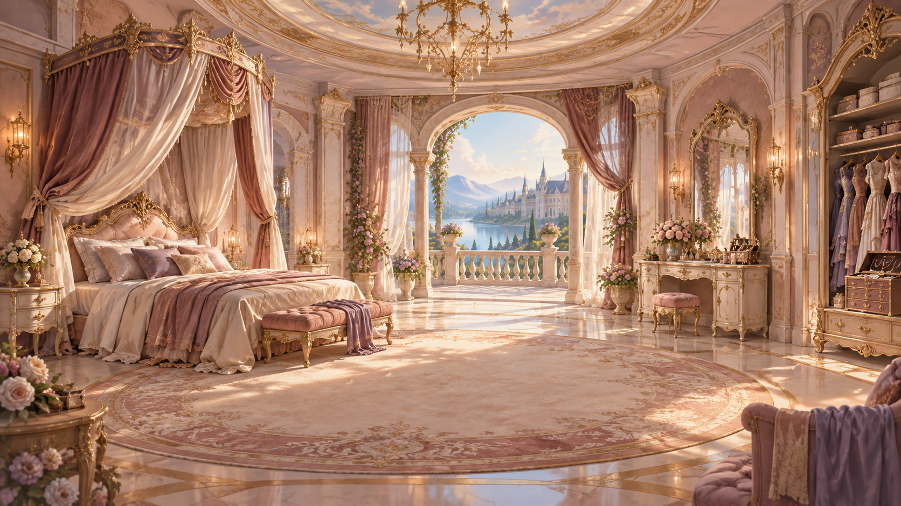 | [BG11_myroom5_princess_sunset.png](./BG11_myroom5_princess_sunset.png)  | [BG11_myroom5_princess_night.png](./BG11_myroom5_princess_night.png)  |
| 식물방 | [BG11_myroom6_botanical_day.png](./BG11_myroom6_botanical_day.png)  | [BG11_myroom6_botanical_sunset.png](./BG11_myroom6_botanical_sunset.png)  | [BG11_myroom6_botanical_night.png](./BG11_myroom6_botanical_night.png) 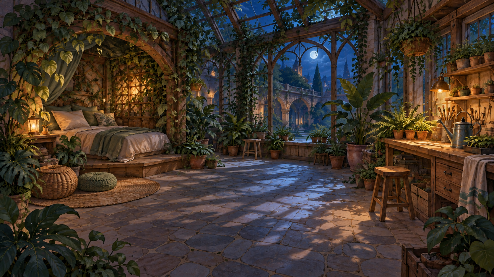 |

## 파일 이력과 사용 기준

- 게임용 마이룸 구도 1의 낮·노을·밤은 같은 가구 배치를 유지합니다. 구도 2도 시간대 3장을 별도 세트로 유지합니다.
- 루트의 테마 파일명은 `BG11_myroom3_rune`, `BG11_myroom4_cosmos`, `BG11_myroom5_princess`, `BG11_myroom6_botanical`입니다. 복원한 창가 독서실은 과거 `myroom/myroom3_reading_*` 경로를 유지하므로 `myroom3` 번호만으로 두 테마를 동일시하지 않습니다.
- 공주방·식물방의 낮은 기존 시안을 재사용했고, 우주방은 창밖을 아르카디아 호수·학원 풍경으로 조정했다는 제작 이력이 있습니다. 과거 콘셉트 파일은 현재 폴더에 없어 링크를 달지 않았습니다.
- 이전 생성 원본과 구도 검토 자료는 이 폴더 밖의 작업 이력 또는 Git 기록을 확인해야 합니다. 현재 `asset/background/` 하위의 30개 PNG를 미리보기와 경로 검증 기준으로 삼습니다.
