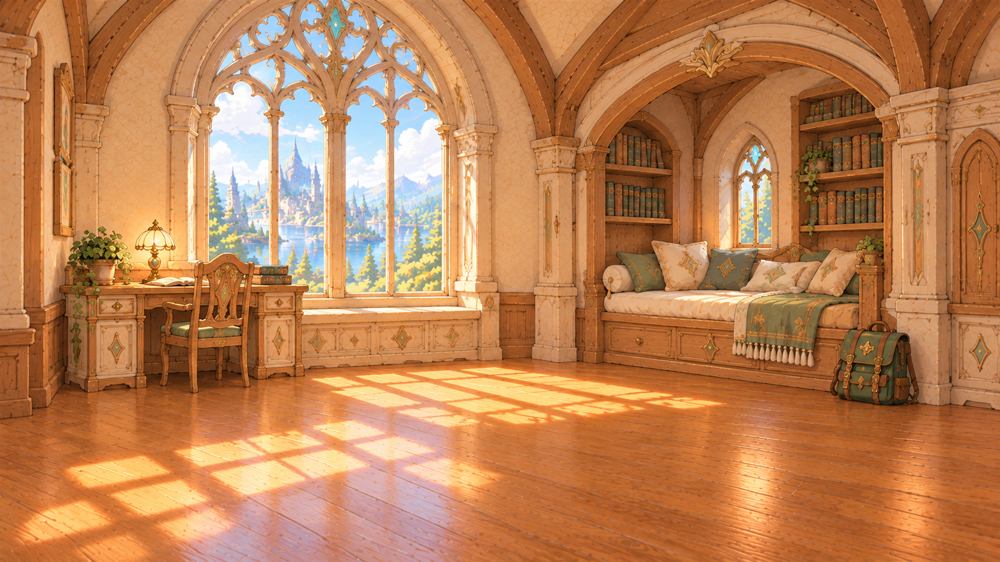
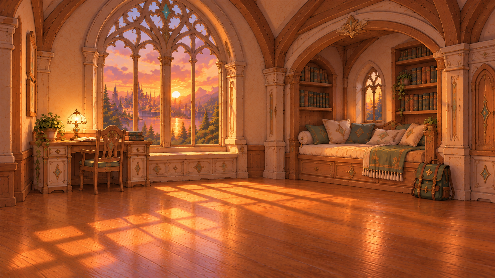
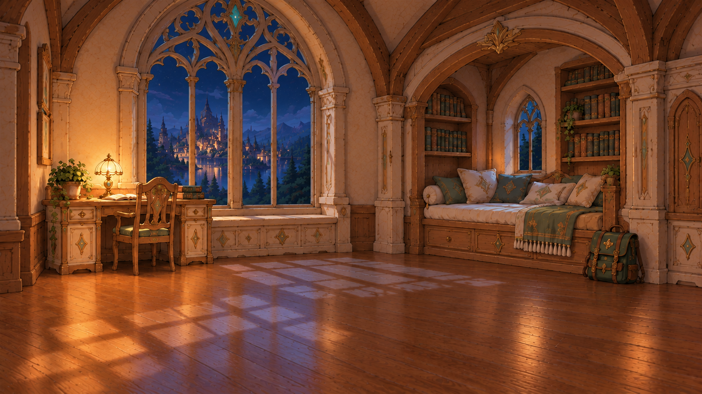
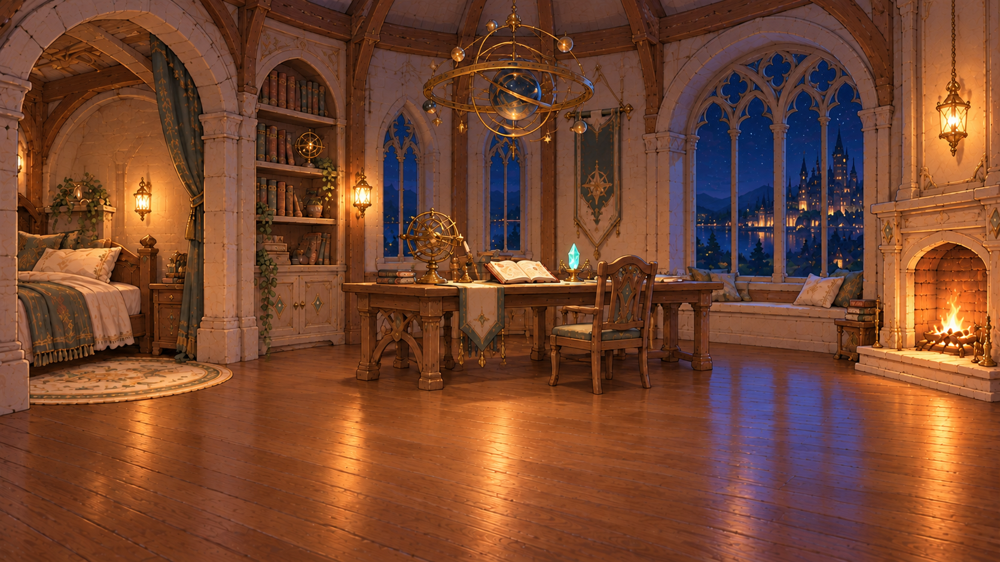

# 새 마이룸 배경 원본

2026-10-15 제작한 두 구도의 낮·노을·밤 PNG 6장입니다. 모두 1672×941 생성 원본이며, 캐릭터와 UI를 제외한 방 배경입니다. 기존 `../BG03_myroom1_*` 및 `../BG03_myroom2_*` 게임 배경은 보존했습니다. 이 원본의 1920×1080 게임 규격 변환과 화면 적용은 별도 검수 대상입니다.

| 구도 | 시간대 | 파일 | 미리보기 |
|---|---|---|---|
| 창가 독서실 (`myroom3`) | 낮 | [myroom3_reading_day.png](myroom3_reading_day.png) |  |
| 창가 독서실 (`myroom3`) | 노을 | [myroom3_reading_sunset.png](myroom3_reading_sunset.png) |  |
| 창가 독서실 (`myroom3`) | 밤 | [myroom3_reading_night.png](myroom3_reading_night.png) |  |
| 룬 연구실 (`myroom4`) | 낮 | [myroom4_rune_day.png](myroom4_rune_day.png) |  |
| 룬 연구실 (`myroom4`) | 노을 | [myroom4_rune_sunset.png](myroom4_rune_sunset.png) |  |
| 룬 연구실 (`myroom4`) | 밤 | [myroom4_rune_night.png](myroom4_rune_night.png) |  |

원본은 `C:/Users/josep/Desktop/Final Project/asset/background`에 있으며, 아래 대응표에 따라 바이트를 변경하지 않고 복사했습니다.

| 저장 파일 | 로컬 원본 파일 |
|---|---|
| `myroom3_reading_day.png` | `ChatGPT 이미지 2026년 10월 15일 오후 04_24_45.png` |
| `myroom3_reading_sunset.png` | `ChatGPT 이미지 2026년 10월 15일 오후 04_32_13.png` |
| `myroom3_reading_night.png` | `ChatGPT 이미지 2026년 10월 15일 오후 04_32_20.png` |
| `myroom4_rune_day.png` | `ChatGPT 이미지 2026년 10월 15일 오후 04_32_25.png` |
| `myroom4_rune_sunset.png` | `ChatGPT 이미지 2026년 10월 15일 오후 04_22_31.png` |
| `myroom4_rune_night.png` | `ChatGPT 이미지 2026년 10월 15일 오후 04_32_28.png` |

## 별도 테마 시안

[2026-10-15 테마 시안 5종](concepts/2026-10-15/README.md)은 우주·공주방·식물방·탐험가방·음악가방의 새 구도 비교용입니다. 위의 기존 6장 수량과 게임 배경 목록에는 포함하지 않습니다.
