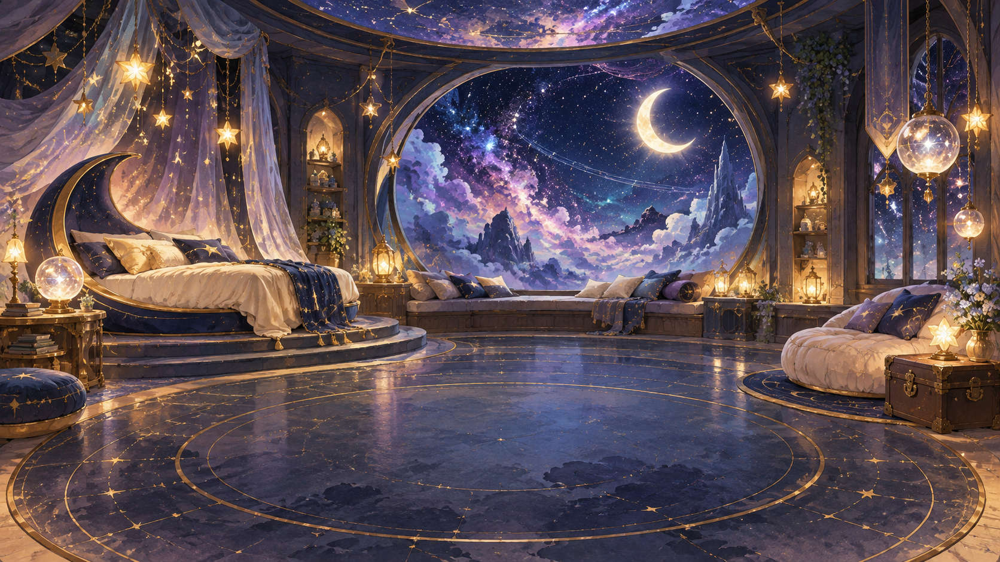
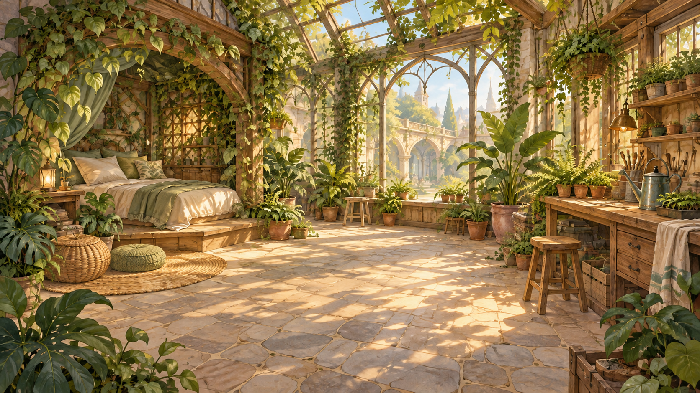
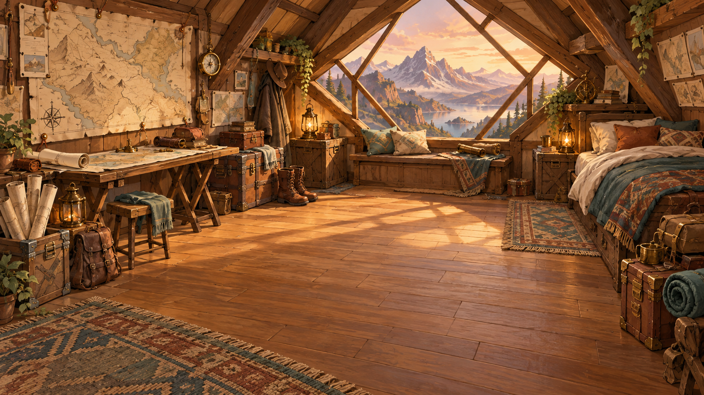
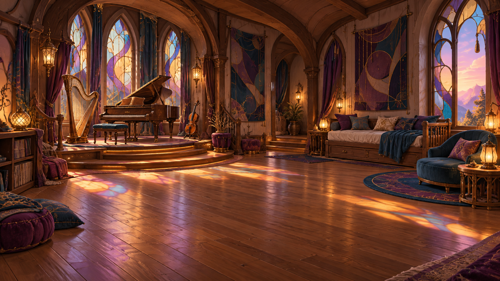

# 마이룸 테마 시안 5종 · 2026-10-15

기존 마이룸의 변형이 아니라 서로 다른 실내 건축과 생활 방식을 가진 새 방 배경입니다. 모두 캐릭터·펫·UI 없는 1672×941 PNG 시안이며, 최종 채택이나 1920×1080 게임 배경 변환은 하지 않았습니다. 기존 마이룸 자산 6장과 별도로 보관합니다.

| 시안 | 핵심 구도·색 | 미리보기 |
|---|---|---|
| [우주 방](concept_01_cosmos.png) | 곡면 천장·원형 우주 전망창·남색과 라벤더 |  |
| [럭셔리 공주방](concept_02_princess.png) | 캐노피 침대·드레스룸·로즈와 빈티지 골드 |  |
| [식물 애호가의 방](concept_03_botanical.png) | 실내 정원·식물 작업대·세이지와 테라코타 |  |
| [탐험가의 지도방](concept_04_cartographer.png) | 다락 지붕·산 전망창·지도와 여행 가방 |  |
| [음악가의 방](concept_05_musician.png) | 악기 알코브·스테인드글라스·자두색과 호두나무 |  |

제작 방식: 내장 이미지 생성 도구로 각 테마를 별도 프롬프트로 생성했습니다. 식물방의 오른쪽 하단 글자 유사 흔적은 같은 도구의 편집으로 제거했습니다. 각 시안의 브리프와 검수 항목은 [PLAN.md](PLAN.md)에 기록했습니다.

## 3종 낮·노을·밤 확장

[2026-10-16 우주방·공주방·식물방 3×3 시안](variants-2026-10-16/README.md)에 신규 7장과 기존 낮 2장 재사용 목록을 정리했습니다. 원본 5종은 그대로 보존합니다.

