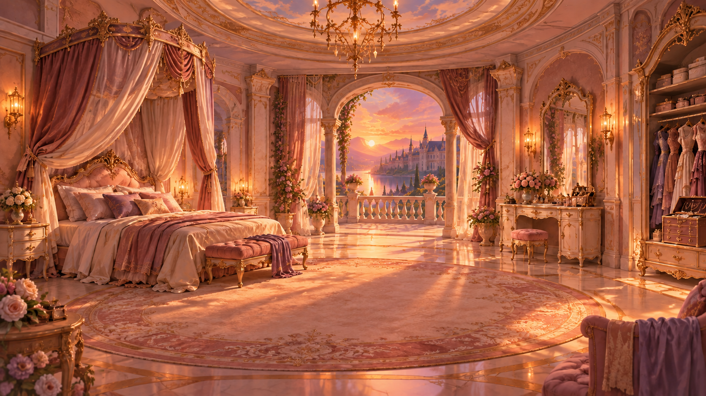
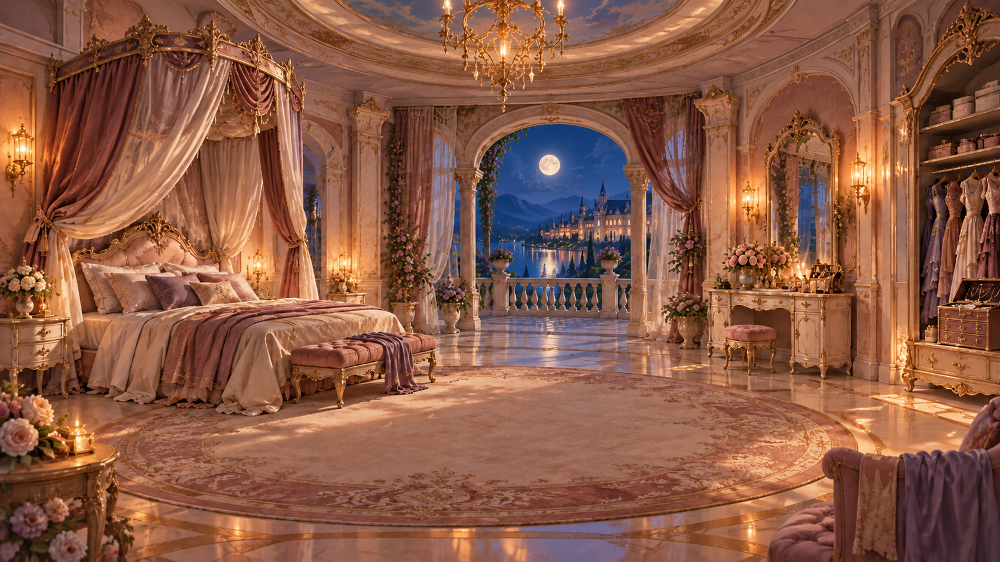
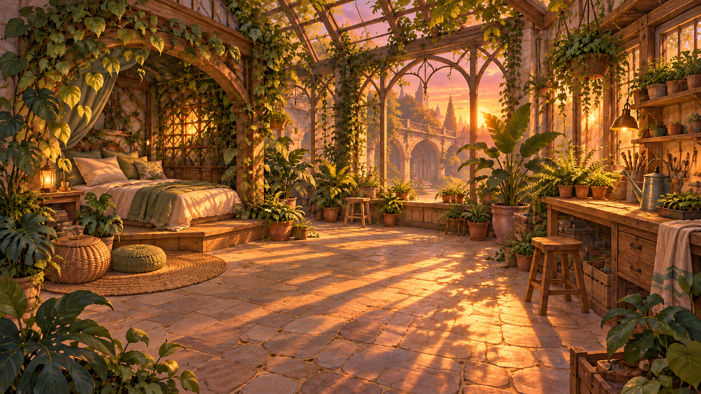

# 마이룸 테마 3종 · 낮/노을/밤 시안

2026-10-16 제작. 우주방·럭셔리 공주방·식물 애호가의 방을 각각 세 시간대로 비교합니다. **신규 이미지 7장 (모두 `asset/background/myroom/` 루트에 정리)**, 기존 낮 이미지 **2장 재사용**입니다. 모두 캐릭터·펫·글자·UI 없는 1672×941 PNG 시안이며, 게임용 1920×1080 변환과 최종 채택은 별도 검수 대상입니다.

| 방 | 낮 | 노을 | 밤 |
|---|---|---|---|
| 우주방 | [이미지](../../../myroom5_cosmos_day.png)  | [이미지](../../../myroom5_cosmos_sunset.png)  | [이미지](../../../myroom5_cosmos_night.png)  |
| 럭셔리 공주방 | [기존 낮 시안](../../../myroom6_princess_day.png)  | [이미지](../../../myroom6_princess_sunset.png)  | [이미지](../../../myroom6_princess_night.png)  |
| 식물 애호가의 방 | [기존 낮 시안](../../../myroom7_botanical_day.png)  | [이미지](../../../myroom7_botanical_sunset.png)  | [이미지](../../../myroom7_botanical_night.png)  |

우주방의 기존 [`concept_01_cosmos.png`](../concept_01_cosmos.png)은 창밖이 우주여서 보존만 하고 세트에는 포함하지 않았습니다. `../../../myroom5_cosmos_night.png`는 해당 원본의 창밖을 아르카디아 호수와 학원 건축물로 고친 버전입니다. 낮·노을은 그 수정본을 기준으로 시간대와 빛을 변형했습니다. 아르카디아 참조로 로컬 `BG01_arcadia_entrance_and_lake_000.png`와 `BG06_starlight_observatory_005.png`를 확인했습니다. 공주방·식물방의 낮 원본은 수정하지 않았습니다.

새 이미지와 기존 시안을 `dev-jw` 브랜치의 `asset/background/myroom/`에 함께 정리했습니다. 제작 범위는 [PLAN.md](PLAN.md)를 참조하세요.

