# LUMIA 조립형 수집 배지

## 상태와 기준

- 제작·정규화: 2026-10-11. 사용자 승인 시안을 바탕으로 저장한 아트 자원이다.
- 저장 위치: **smong2/codyssey_final** 저장소의 **main / asset/badge/**.
- **아트 디자인 승인 및 파일 규격 검증 완료 / 게임 연결·실제 화면 검수 미완료.** 이미지 존재를 기능 구현 완료로 해석하지 않는다.
- 기준: [가방 수집 배지 디자인](../../document/content/03_COLLECTION_UNLOCKS/01_BADGE_COLLECTION_DESIGN.md), [수집·해금 기획](../../document/content/03_COLLECTION_UNLOCKS/README.md), 사용자의 최신 프레임 선택과 골드 완성 상태 선택.
- 프레임 선택: 숲 B / 별 A / 공방 C / 우정 B / 룬 C. 반짝이는 보석·에나멜 재질은 이번 배지에 대해 승인된 방향이며 게임 전체 UI 재질을 변경하는 결정은 아니다.
- 카테고리명과 심볼의 묶음은 **디자인 관리용 분류·배정 제안**이다. 실제 게임의 대분류명·25개 소분류명·200개 획득 조건은 기획 확정과 별개다. 기존 24개 명칭은 기획 초안에서 가져왔고, '다시 도전!'은 추가 후보다.

## 41종과 저장 파일 수

| 구분 | 제작 원본 | 이 폴더 PNG | 역할 |
|---|---:|---:|---|
| 대분류 프레임 | 5 | 5 | 큰 외형과 테마 |
| 소분류 심볼 | 25 | 25 | 중심 의미 |
| 공용 장식 | 8 | 8 | 소분류 안의 8개 배지 구분 |
| 잠금 | 1 | 1 | 모든 미획득 배지에 같은 아이콘 |
| 획득 상태 예시 | 1 | 0 | 로컬 참고본만 보관; 게임에서는 부품 조합 자체를 표시 |
| 골드 완성 표식 | 1 | 1 | 소분류 전체 수집을 표시하는 공통 마크 |
| 합계 | **41** | **40** | 별도 완성 배지 200장을 저장한 것이 아님 |

상태는 잠금·획득·완성의 **3가지 논리 상태**를 유지한다. 획득 상태가 PNG 1장을 더 요구하는 것은 아니다. 5개 프레임에 소속 심볼 5개씩, 장식 8개를 조합하면 **5 × 5 × 8 = 200개**다. 모든 프레임과 모든 심볼을 무차별 조합하는 1,000개 구조가 아니다.

## 파일 규격

| 항목 | 규격 |
|---|---|
| 게임용 캔버스 | 전 PNG **200×200px** |
| 포맷 | 8비트 RGBA PNG, sRGB 색공간, 투명 알파 유지 |
| 원본 | 41종 모두 1254×1254px, 로컬 원본 보존 |
| 프레임 그림 영역 | 최대 180×180px, 중심 (100,100) |
| 일반 심볼 그림 영역 | 최대 90×88px, 중심 (100,98) |
| 별 계열 심볼 그림 영역 | 최대 78×82px, 중심 (115,94); 초승달 내부 공간에 맞춤 |
| 공용 장식 그림 영역 | 최대 38×30px, 중심 (100,164) |
| 잠금·완성 표식 그림 영역 | 최대 180×180px, 중심 (100,100) |
| 바깥 안전 여백 | 모든 파일 비투명 픽셀 기준 최소 10px |
| 리샘플링 | 종횡비 유지, Lanczos3, 색상·모티프 재생성 없음 |
| 파일명 | 영문 snake_case, 폴더 내 PNG 끝 번호 000~039 연속 |
| 파일 메타데이터 | [catalog.json](./catalog.json): ID, 분류, 명칭, 의미, 크기, 실제 그림 영역, 용량, SHA-256 |

각 그림은 작은 부품이어도 **200×200 투명 캔버스**에 정렬되어 있다. 자동 trim, object-fit cover, 불투명 사각 배경, 파일별 별도 확대를 적용하면 조합 위치가 깨진다. 프레임의 중앙 아이보리 면은 의도된 채움이며 구멍이 아니다. README 표의 미리보기는 투명 캔버스 전체를 200px로 표시하므로 장식이 작게 보이는 것이 정상이다. 링크를 열면 개별 파일을 확인할 수 있다.

## 조합 방법

1. 미획득: 프레임·심볼·장식을 노출하지 않고 공용 잠금만 표시한다.
2. 획득: 같은 200×200 영역에 **프레임 → 해당 분류 심볼 → 장식** 순서로 (0,0)에 겹친다. 이미 파일 내부 좌표가 맞춰져 있다.
3. 완성: 해당 소분류 8개를 모두 모으면 골드 완성 표식을 소분류 헤더 또는 완료 안내의 별도 영역에 표시한다.

골드 완성 파일은 중앙 모티프가 포함된 **독립 마크**다. 배지 위에 덮는 투명 테두리 전용 오버레이가 아니며, 기존 배지 중앙 심볼을 가리지 않도록 분리 배치한다. 카테고리별 완성 배지를 200개 추가 생성하지 않는다. 반짝임은 정적 그림이며 애니메이션은 구현하지 않았다.

PC·모바일 모두 같은 세 레이어를 동일 비율로 축소한다. 200px 기준으로 조합 검토했으며 더 작은 실표시 크기에서는 장식 식별을 다시 확인해야 한다. 가방의 페이지당 20개·총 10페이지는 사용자의 화면 요구이며, 이 폴더는 UI·페이지네이션 구현을 포함하지 않는다. 배지명과 획득 이유는 이미지에 굽지 않고 UI 텍스트로 표시한다. 보이지 않는 스탯 수치를 공개하거나 아이의 성품을 등급화하지 않는다.

## 카테고리별 프레임·심볼

### 숲 (forest) · 탐험과 발견

선택 프레임 **숲 B**: 물방울 형태의 연녹색 결정. 심볼 5개에 공용 장식 8개를 적용하는 관리상 40개 묶음이다. 명칭·획득 조건은 기획 확정 전이다.

| 미리보기 (200×200) | 명칭·모티프·용도 | 파일·실제 그림 영역 |
|---|---|---|
| 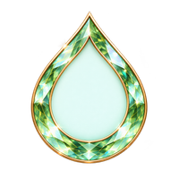 | **이슬 결정** 물방울 형태의 연녹색 결정 새로운 발견과 생명의 가능성 레이어: frame | [badge_frame_forest_dewdrop_000.png](./badge_frame_forest_dewdrop_000.png) 그림 154×173px 좌상단 (20, 12) 41.7 KiB |
| 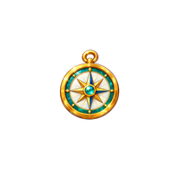 | **오늘도 탐험!** 나침반 모험 참여와 탐험의 발걸음 레이어: symbol | [badge_symbol_forest_compass_005.png](./badge_symbol_forest_compass_005.png) 그림 72×82px 좌상단 (64, 54) 14.0 KiB |
| 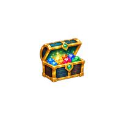 | **보물 찾았다!** 보물상자 숨겨진 획득물을 발견한 기쁨 레이어: symbol | [badge_symbol_forest_treasure_006.png](./badge_symbol_forest_treasure_006.png) 그림 79×77px 좌상단 (63, 60) 15.9 KiB |
| 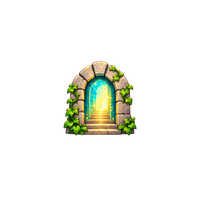 | **여기 뭐가 있지?** 돌 아치 문 새로운 장소와 조사 지점 발견 레이어: symbol | [badge_symbol_forest_door_007.png](./badge_symbol_forest_door_007.png) 그림 78×80px 좌상단 (61, 58) 16.6 KiB |
| 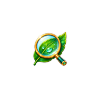 | **궁금한 건 못 참아** 잎과 돋보기 관찰과 질문으로 새 정보를 발견 레이어: symbol | [badge_symbol_forest_curiosity_008.png](./badge_symbol_forest_curiosity_008.png) 그림 75×80px 좌상단 (65, 55) 13.8 KiB |
| 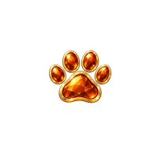 | **펫과 함께** 호박빛 발자국 펫과의 동행과 만남 레이어: symbol | [badge_symbol_forest_pet_009.png](./badge_symbol_forest_pet_009.png) 그림 82×72px 좌상단 (60, 61) 14.0 KiB |

### 별 (star) · 배움과 성장

선택 프레임 **별 A**: 남보라 초승달과 은빛 장식. 심볼 5개에 공용 장식 8개를 적용하는 관리상 40개 묶음이다. 명칭·획득 조건은 기획 확정 전이다.

| 미리보기 (200×200) | 명칭·모티프·용도 | 파일·실제 그림 영역 |
|---|---|---|
| 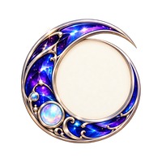 | **별빛 초승달** 남보라 초승달과 은빛 장식 지식과 상상이 넓어지는 순간 레이어: frame | [badge_frame_star_crescent_001.png](./badge_frame_star_crescent_001.png) 그림 152×158px 좌상단 (24, 21) 48.7 KiB |
| 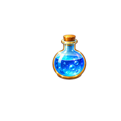 | **과학은 재미있어!** 푸른 플라스크 수업과 탐구를 통한 발견 레이어: symbol | [badge_symbol_star_science_010.png](./badge_symbol_star_science_010.png) 그림 61×80px 좌상단 (84, 54) 11.1 KiB |
|  | **말이 술술** 진주 말풍선 대화와 표현의 경험 레이어: symbol | [badge_symbol_star_speech_011.png](./badge_symbol_star_speech_011.png) 그림 65×54px 좌상단 (84, 68) 8.7 KiB |
| 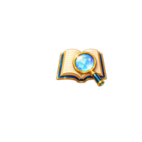 | **차근차근 생각해** 책과 돋보기 신중한 관찰과 판단 레이어: symbol | [badge_symbol_star_thinking_012.png](./badge_symbol_star_thinking_012.png) 그림 76×58px 좌상단 (77, 66) 11.2 KiB |
| 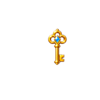 | **혼자서도 척척** 황금 열쇠 스스로 방법을 찾아 해결 레이어: symbol | [badge_symbol_star_independence_013.png](./badge_symbol_star_independence_013.png) 그림 42×76px 좌상단 (94, 56) 5.8 KiB |
| 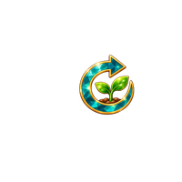 | **다시 도전!** 순환 화살표와 새싹 실패 뒤 다시 시도하며 성장; 추가 소분류 후보 레이어: symbol | [badge_symbol_star_retry_014.png](./badge_symbol_star_retry_014.png) 그림 65×71px 좌상단 (85, 58) 10.6 KiB |

### 공방 (workshop) · 활동과 성취

선택 프레임 **공방 C**: 코발트 결정과 은빛 사각 테두리. 심볼 5개에 공용 장식 8개를 적용하는 관리상 40개 묶음이다. 명칭·획득 조건은 기획 확정 전이다.

| 미리보기 (200×200) | 명칭·모티프·용도 | 파일·실제 그림 영역 |
|---|---|---|
| 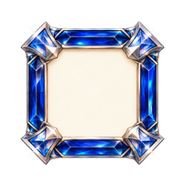 | **코발트 공방** 코발트 결정과 은빛 사각 테두리 직접 시도하고 완성하는 즐거움 레이어: frame | [badge_frame_workshop_cobalt_002.png](./badge_frame_workshop_cobalt_002.png) 그림 163×162px 좌상단 (20, 21) 53.6 KiB |
| 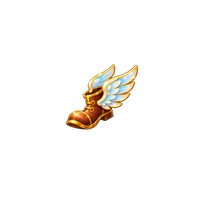 | **몸이 먼저!** 날개 부츠 몸으로 익히는 활동과 훈련 레이어: symbol | [badge_symbol_workshop_activity_015.png](./badge_symbol_workshop_activity_015.png) 그림 78×70px 좌상단 (63, 62) 9.9 KiB |
|  | **미니게임 챔피언** 트로피 미니게임 참여와 기록 달성 레이어: symbol | [badge_symbol_workshop_champion_016.png](./badge_symbol_workshop_champion_016.png) 그림 80×74px 좌상단 (59, 63) 12.5 KiB |
| 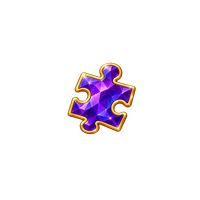 | **퍼즐 조각 착착** 보라 퍼즐 조각 배경 퍼즐 조각을 모으는 즐거움 레이어: symbol | [badge_symbol_workshop_puzzle_017.png](./badge_symbol_workshop_puzzle_017.png) 그림 73×77px 좌상단 (65, 60) 12.5 KiB |
| 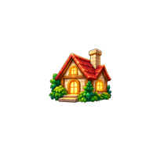 | **마이룸이 좋아** 불빛이 켜진 집 마이룸과 꾸미기 해금 레이어: symbol | [badge_symbol_workshop_room_018.png](./badge_symbol_workshop_room_018.png) 그림 84×78px 좌상단 (60, 59) 15.5 KiB |
|  | **약속은 지켜야지** 리본 두루마리 맡은 일과 약속을 마무리 레이어: symbol | [badge_symbol_workshop_promise_019.png](./badge_symbol_workshop_promise_019.png) 그림 79×69px 좌상단 (61, 63) 10.5 KiB |

### 우정 (friendship) · 관계와 공감

선택 프레임 **우정 B**: 진주빛 타원과 로즈골드. 심볼 5개에 공용 장식 8개를 적용하는 관리상 40개 묶음이다. 명칭·획득 조건은 기획 확정 전이다.

| 미리보기 (200×200) | 명칭·모티프·용도 | 파일·실제 그림 영역 |
|---|---|---|
| 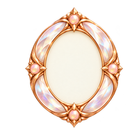 | **진주빛 연결** 진주빛 타원과 로즈골드 서로 다른 마음을 잇는 관계 레이어: frame | [badge_frame_friendship_pearl_003.png](./badge_frame_friendship_pearl_003.png) 그림 147×176px 좌상단 (34, 10) 41.9 KiB |
|  | **친구가 생겼어** 맞잡은 손 NPC와 만남 및 관계의 시작 레이어: symbol | [badge_symbol_friendship_friends_020.png](./badge_symbol_friendship_friends_020.png) 그림 86×56px 좌상단 (57, 73) 11.9 KiB |
| 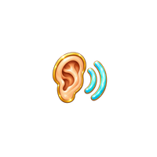 | **끝까지 들어볼게** 귀와 소리 파동 상대의 이야기를 끝까지 경청 레이어: symbol | [badge_symbol_friendship_listening_021.png](./badge_symbol_friendship_listening_021.png) 그림 75×70px 좌상단 (64, 64) 11.9 KiB |
|  | **마음을 알아줘** 손에 담은 하트 상대의 마음을 이해하는 행동 레이어: symbol | [badge_symbol_friendship_empathy_022.png](./badge_symbol_friendship_empathy_022.png) 그림 76×65px 좌상단 (63, 66) 12.0 KiB |
| 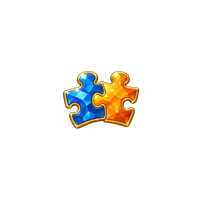 | **같이 하면 쉬워** 맞물린 두 조각 서로 힘을 보태 함께 해결 레이어: symbol | [badge_symbol_friendship_cooperation_023.png](./badge_symbol_friendship_cooperation_023.png) 그림 82×62px 좌상단 (60, 69) 12.1 KiB |
| 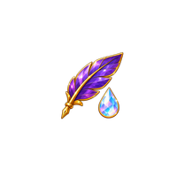 | **솔직하게 말해봐** 깃펜과 맑은 물방울 진솔한 표현과 대화 선택 레이어: symbol | [badge_symbol_friendship_honesty_024.png](./badge_symbol_friendship_honesty_024.png) 그림 75×81px 좌상단 (67, 56) 11.7 KiB |

### 룬 (rune) · 각성과 선택

선택 프레임 **룬 C**: 흑요석 다각형과 금색·청록 연결부. 심볼 5개에 공용 장식 8개를 적용하는 관리상 40개 묶음이다. 명칭·획득 조건은 기획 확정 전이다.

| 미리보기 (200×200) | 명칭·모티프·용도 | 파일·실제 그림 영역 |
|---|---|---|
| 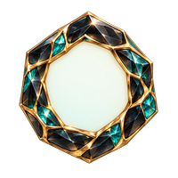 | **흑요석 룬** 흑요석 다각형과 금색·청록 연결부 선택을 통해 드러나는 마음의 빛 레이어: frame | [badge_frame_rune_obsidian_004.png](./badge_frame_rune_obsidian_004.png) 그림 161×176px 좌상단 (19, 10) 54.2 KiB |
| 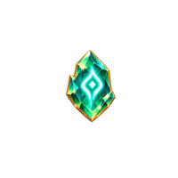 | **룬이 반짝!** 빛나는 룬 결정 룬과 마법의 발견 레이어: symbol | [badge_symbol_rune_awaken_025.png](./badge_symbol_rune_awaken_025.png) 그림 61×86px 좌상단 (71, 54) 11.1 KiB |
| 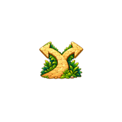 | **선택의 순간** 갈라지는 길 중요한 선택과 분기 경험 레이어: symbol | [badge_symbol_rune_choice_026.png](./badge_symbol_rune_choice_026.png) 그림 78×67px 좌상단 (62, 65) 13.1 KiB |
|  | **용기 한 스푼** 불꽃 방패 두려움 속에서도 시도하는 용기 레이어: symbol | [badge_symbol_rune_courage_027.png](./badge_symbol_rune_courage_027.png) 그림 69×84px 좌상단 (66, 54) 13.4 KiB |
| 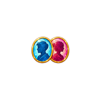 | **새로운 얼굴!** 두 인물의 카메오 새로운 플레이 캐릭터 해금 레이어: symbol | [badge_symbol_rune_character_028.png](./badge_symbol_rune_character_028.png) 그림 81×58px 좌상단 (60, 71) 13.2 KiB |
|  | **또 다른 미래** 책과 떠오르는 해 새로운 직업 엔딩과 미래 발견 레이어: symbol | [badge_symbol_rune_future_029.png](./badge_symbol_rune_future_029.png) 그림 88×77px 좌상단 (56, 57) 13.9 KiB |

## 공용 장식 8종

모든 소분류에서 재사용한다. 아래 의미는 아트 모티프 설명이며, A~H 순서는 수집 구분용이다. 왕관을 최고 등급으로 취급하거나 장식별 희귀도·보상 배율·획득 순서를 임의 부여하지 않는다.

| 미리보기 (200×200) | 명칭·모티프·용도 | 파일·실제 그림 영역 |
|---|---|---|
|  | **별** 별 발견의 반짝임 레이어: ornament | [badge_ornament_star_030.png](./badge_ornament_star_030.png) 그림 30×29px 좌상단 (85, 149) 1.7 KiB |
| 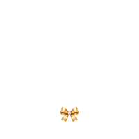 | **리본** 리본 소중한 경험을 기념 레이어: ornament | [badge_ornament_bow_031.png](./badge_ornament_bow_031.png) 그림 31×26px 좌상단 (84, 152) 2.3 KiB |
|  | **월계수** 월계수 꾸준한 노력의 결실 레이어: ornament | [badge_ornament_laurel_032.png](./badge_ornament_laurel_032.png) 그림 30×24px 좌상단 (85, 151) 1.9 KiB |
| 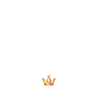 | **왕관** 왕관 스스로 느끼는 성취 레이어: ornament | [badge_ornament_crown_033.png](./badge_ornament_crown_033.png) 그림 31×27px 좌상단 (84, 150) 2.2 KiB |
| 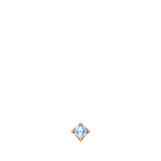 | **보석** 보석 발견한 가능성과 가치 레이어: ornament | [badge_ornament_gem_034.png](./badge_ornament_gem_034.png) 그림 28×30px 좌상단 (86, 149) 1.8 KiB |
|  | **조개** 조개 차곡차곡 간직한 경험 레이어: ornament | [badge_ornament_shell_035.png](./badge_ornament_shell_035.png) 그림 30×29px 좌상단 (85, 149) 2.5 KiB |
| 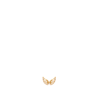 | **날개** 날개 새로운 시도와 확장 레이어: ornament | [badge_ornament_wings_036.png](./badge_ornament_wings_036.png) 그림 29×21px 좌상단 (85, 153) 1.8 KiB |
| 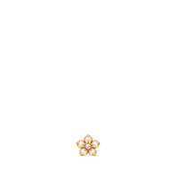 | **꽃** 꽃 경험을 통해 피어나는 성장 레이어: ornament | [badge_ornament_flower_037.png](./badge_ornament_flower_037.png) 그림 29×29px 좌상단 (85, 149) 2.4 KiB |

## 상태 표현

| 미리보기 (200×200) | 명칭·모티프·용도 | 파일·실제 그림 영역 |
|---|---|---|
|  | **공용 잠금** 은빛·진주 자물쇠 미획득 디자인을 노출하지 않는 공통 표시 레이어: state | [badge_state_locked_038.png](./badge_state_locked_038.png) 그림 135×161px 좌상단 (36, 19) 47.9 KiB |
| 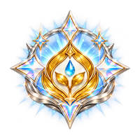 | **황금빛 완성** 골드 잎과 은빛·오팔 별빛 소분류 8개 수집 완료를 축하하는 공통 표식 레이어: state | [badge_state_complete_gold_039.png](./badge_state_complete_gold_039.png) 그림 179×177px 좌상단 (10, 10) 68.0 KiB |

**획득 상태:** 위 프레임·심볼·장식의 정상 조합이다. 별도 획득 PNG는 없다. 녹색 잎 획득 예시는 로컬 참고본으로만 보관해 전체 배지의 공통 심볼로 잘못 적용하지 않도록 했다.

## 출처·원본 보관

- 생성 방식: Codex 내장 image_gen, 승인 시안 시트를 참조해 개별 PNG 생성. 게임용 출력은 승인 원본을 기계적으로 축소·정렬한 파생본이다.
- 원본·참고 시트·규격화 스크립트·조합 검수 이미지는 사용자 로컬 프로젝트의 **asset/badge/**에 보관하며 GitHub에 포함하지 않는다.
- 로컬 원본 41종은 **originals/**, 획득 예시와 참고 시트는 **references/**, 원본 대응표·해시·검수 이미지는 **qa/**에 있다.
- 이 저장소의 파일명과 catalog ID는 아트 자원 식별자다. 세이브용 배지 ID, 획득 조건, 보상 ID를 임의 확정한 것이 아니다.

## 검증 결과와 남은 경계

| 항목 | 결과 |
|---|---|
| PNG 수량 | 40개; 원본 41개 중 획득 예시 1개 로컬 분리 |
| 크기·알파·여백 | 40/40 파일 200×200 RGBA, 비어 있지 않음, 투명 가장자리와 최소 10px 여백 |
| 중복·파일명 | 서로 다른 SHA-256 40개, 끝 번호 000~039 연속 |
| 원본 보존 | 1254×1254 원본 41개 별도 보관, 원본 SHA-256 대응표 로컬 기록 |
| 조합 검사 | 200개 조합을 20개씩 10장으로 합성해 로컬 검수; 별 심볼의 좌표 보정 반영 |
| README | 게임용 40개 전부 파일 링크·미리보기·명칭·의미·크기·용도 기재 |
| 게임 구현 | 미수행; 엔진 연결·실제 가방 화면·모바일 축소·상태 전환·접근성·아동 사용성 검수 대기 |

### 저장소 전체 검사와 구분

작업 시작 시 main에는 이미 다음 문제가 있었다: bern/font_files/map/screen/typography README의 manifest 미등록, font_files 미리보기 로컬 참조 경고, stat README 누락. 이 배지 작업은 다른 폴더를 변경하지 않는다. 따라서 새 배지 README의 source_manifest 등록과 전체 asset inventory 기준 갱신도 담당자 후속 작업이다. **배지 폴더 검증 통과를 저장소 전체 SYNC OK로 해석하지 않는다.** --record는 실행하지 않았다.

### 미정

- 실제 게임 대분류명과 25개 소분류의 최종 배정, '다시 도전!' 채택 여부.
- 배지별 200개 획득 조건과 소분류별 3단계 보상(전체 75지점)의 연결.
- 완성 마크의 실제 화면 위치·표시 크기, 작은 화면에서의 장식 식별성.
- 세이브 데이터·획득 알림·필터·페이지네이션·소분류 완성 판정 구현.
