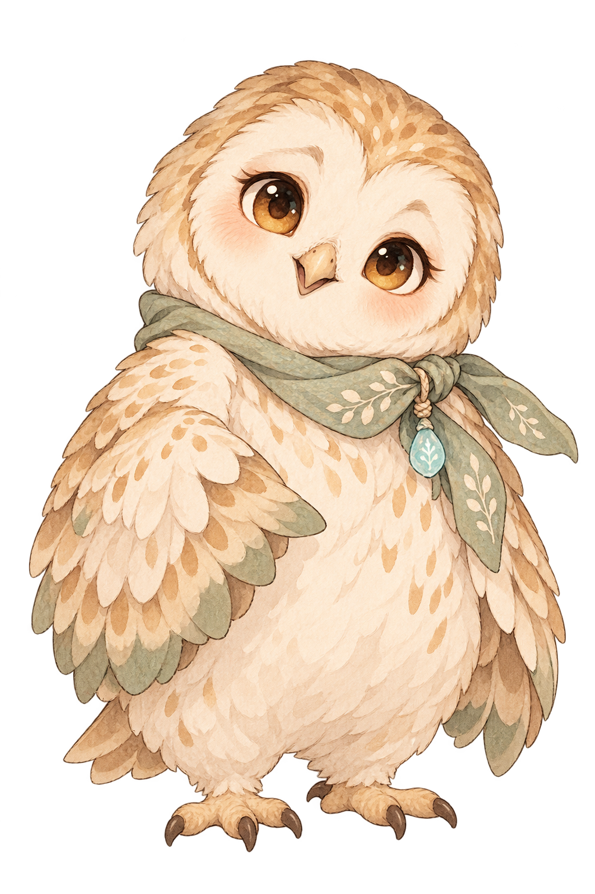
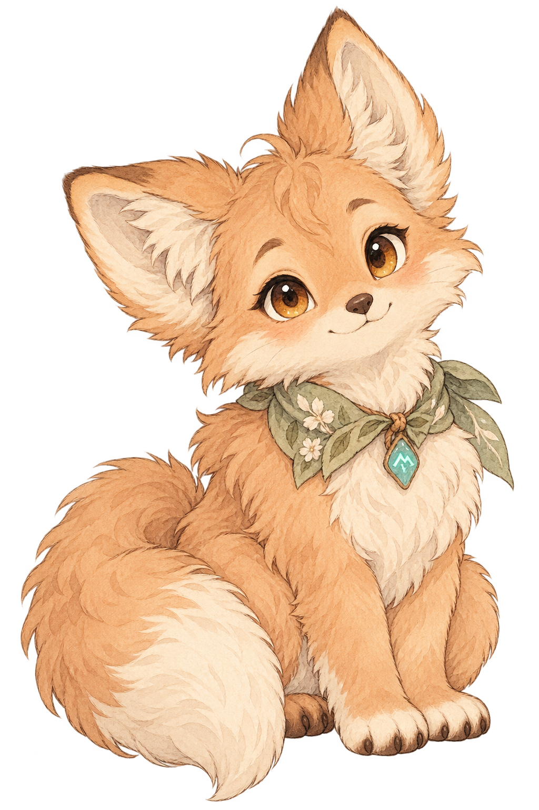
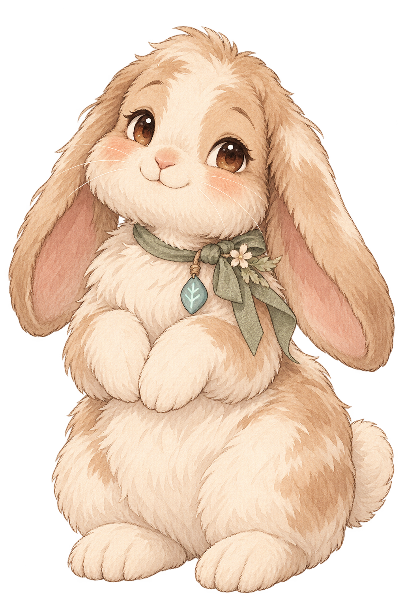
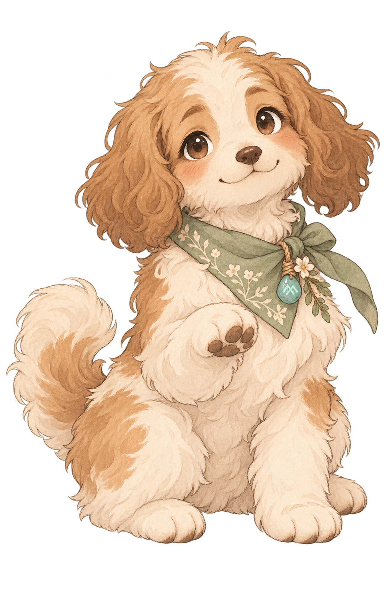
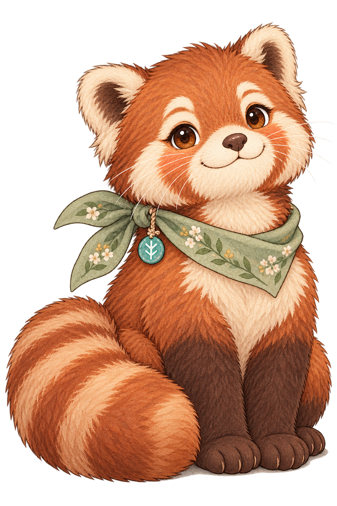
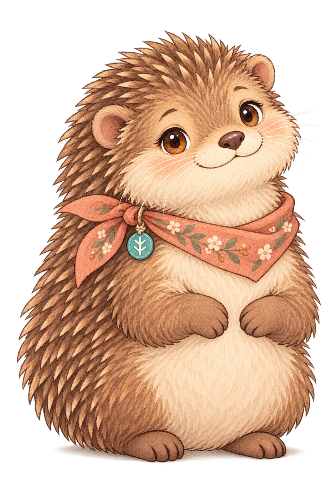
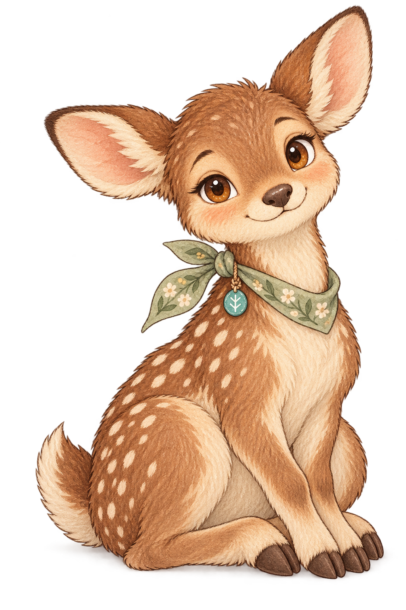

# 본편 펫 자원 (`asset/bern/`)

폴더 이름은 과거 작업 이력 때문에 `bern/`을 유지하지만, **본편에서는 이 폴더를 `asset/pet/`과 같은 의미의 펫 자원 폴더로 사용합니다.** 데모 버전에서 하나의 펫 역할을 하던 베른 설정은 더 이상 사용하지 않고, 아래 이미지 10종을 각각 독립된 본편 펫 `PET01~PET10`의 실제 자원으로 사용합니다. 펫 시스템 기준은 [펫 시스템](../../document/content/03_COLLECTION_UNLOCKS/05_PET_SYSTEM.md)을 따릅니다.

전부 1024×1536 투명 PNG이며, 현재 번호와 파일명을 그대로 안정적인 펫 자원 ID 매핑에 사용합니다.

| 펫 ID | 이름 | 동물 | 파일 | 미리보기 |
|---|---|---|---|---|
| `PET01` | 에든 | 부엉이 | [owl1.png](./owl1.png) |  |
| `PET02` | 루엔 | 여우 | [fox2.png](./fox2.png) |  |
| `PET03` | 포포 | 토끼 | [rabbit3.png](./rabbit3.png) |  |
| `PET04` | 마린 | 수달 | [otter4.png](./otter4.png) |  |
| `PET05` | 토비 | 강아지 | [puppy5.png](./puppy5.png) |  |
| `PET06` | 니브 | 고양이 | [cat6.png](./cat6.png) |  |
| `PET07` | 로코 | 레서판다 | [red_panda7.png](./red_panda7.png) |  |
| `PET08` | 피핀 | 다람쥐 | [squirrel8.png](./squirrel8.png) |  |
| `PET09` | 브램 | 고슴도치 | [hedgehog9.png](./hedgehog9.png) |  |
| `PET10` | 세렌 | 아기사슴 | [fawn10.png](./fawn10.png) |  |

2026-10-10: 과거 `pet` 폴더를 `bern`으로 변경했으나, 최종 본편 기획에서는 이 폴더의 10개 이미지를 다시 각각의 펫 자원으로 사용합니다. 물리 폴더명은 기존 경로 호환을 위해 유지합니다.
