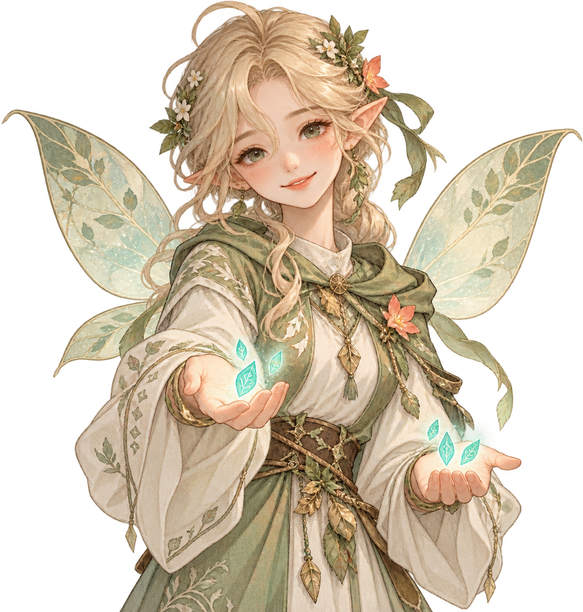
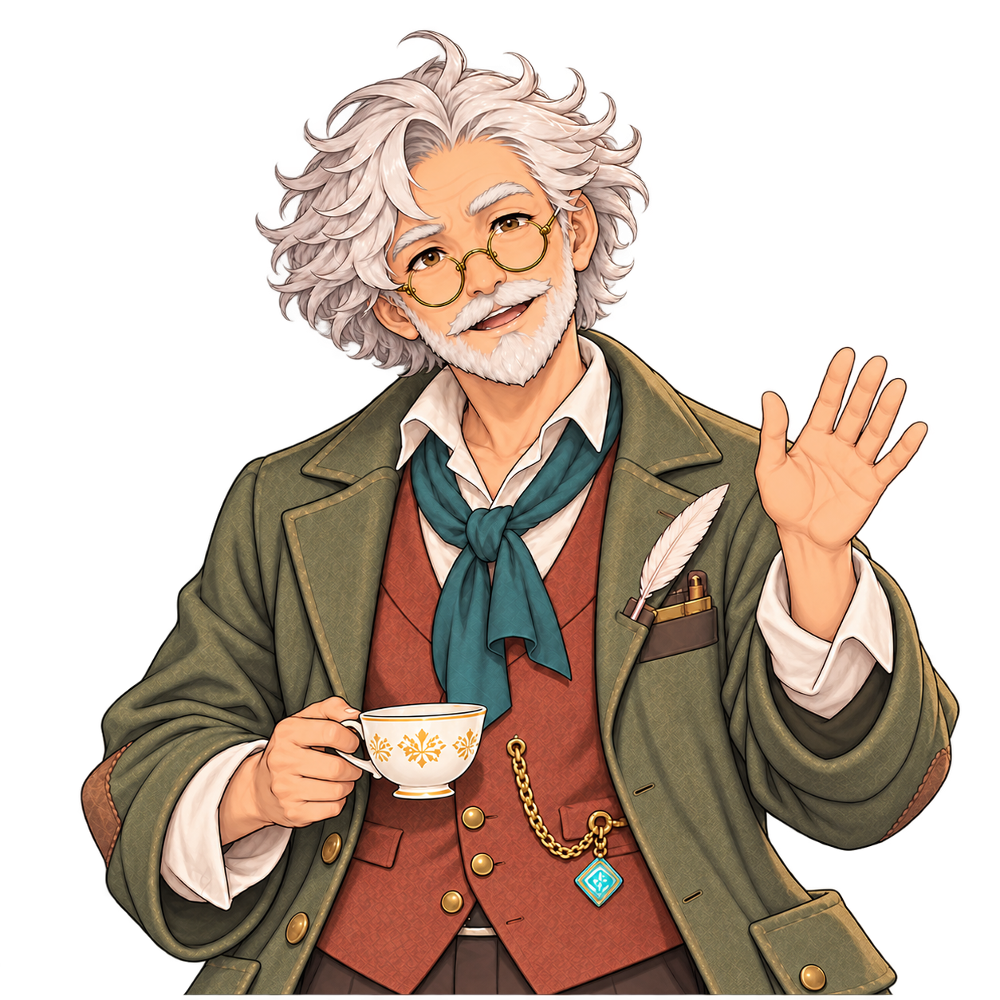
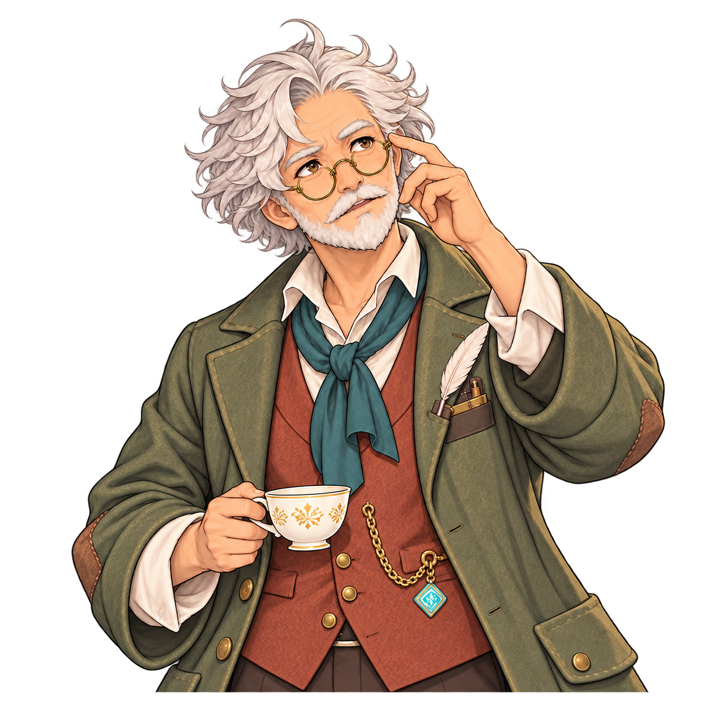
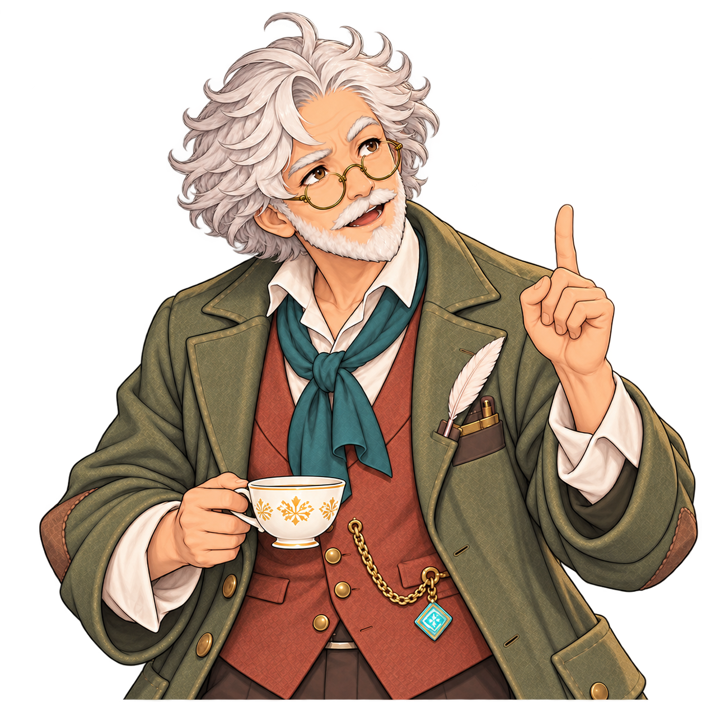

# 캐릭터 이미지

학생 32명의 전신 PNG 32장과 상반신 표정 5종씩 160장, 발렌티누스 교수 원본 시안 2장(PNG·WebP)과 대화 상반신 3장, 기숙사 `요정의 거래`에 사용하는 요정 캐릭터 상반신 PNG 1장으로 Git 추적 이미지 총 **198장**입니다. 학생은 캐릭터 선택·전신 표시용이며, 교수 2장은 `prototype/assets/`에서 복사한 동일한 임시 시안입니다. 파일이 보유되었다는 사실은 본편 장면 적용이나 최종 미술 검수를 뜻하지 않습니다.

## 빠른 탐색

| 사용처·장면 | 파일명 기준 | 현재 상태 | 파일 목록·미리보기 |
|---|---|---|---|
| 학생 전신·교수 캐릭터; 캐스팅 조건에 맞는 화자 이미지; 회차별 인물 고정 아님 | `기존 32인 전신 이름` | 학생 32장·교수 시안 2장 | 아래 파일 표와 미리보기, [에셋 전체 장면표](../README.md) 참조 |
| 발렌티누스 교수 대화 상반신 `MS01_S3_L01`·`MS01_S3_ASK`·`MS03_S3_L04` | `CH_<대사 ID>_valentinus_<동작>_upperbody_01.png` | 승인된 3장 등록·엔진 대사 표시 연결 미확인 | [대사별 파일·미리보기](#발렌티누스-교수--대화-상반신-3장) |
| 학생 32명의 상반신 표정 5종 보관본 | `이름1_base.png` ~ `이름5_relieved.png` | 160장 복원·현재 실행 화면 미연결 | [표정별 파일·미리보기](#학생-상반신-표정-160장) |
| 기숙사 공용 공간 `DRM`의 `요정의 거래`에 사용하는 요정 캐릭터 | `CH_DRM_fairy_trade_upperbody_01.png` | 확정된 요정 상반신 이미지 1장·엔진 표시 미연결 | [요정의 거래 미리보기](#기숙사-공용-공간-요정의-거래) |

## 기숙사 공용 공간 · 요정의 거래

| 파일 · 미리보기 | 정확한 사용처 | 상태 |
|---|---|---|
| [CH_DRM_fairy_trade_upperbody_01.png](./CH_DRM_fairy_trade_upperbody_01.png)  | `DRM` 기숙사 공용 공간의 `SPECIAL` 활동 **요정의 거래**에 사용하는 전용 요정 캐릭터 이미지. 지식·표현력·솜씨·탐험·마법 사이에서 1~5포인트를 1:1로 옮기는 선택을 시각화합니다. | 사용자 선택으로 이미지 확정·파일 등록. 게임 엔진 표시 연결·화면 검수는 아직 확인되지 않음. |

**콘텐츠 식별자:** `fairy-trade` · **캐릭터 파일 경로:** `asset/character/CH_DRM_fairy_trade_upperbody_01.png`. 백엔드·엔진에서 `요정의 거래` 이미지를 찾을 때 이 경로를 사용합니다. 이 요정은 학생 **티아**의 초상이나 별도 NPC 대화 화자가 아닙니다. [7개 공간 콘텐츠 상세 규칙](../../document/content/06_01_LOCATION_ACTIVITIES.md)에 따라 거래 플레이 화면에 NPC 대화나 NPC를 배치하지 않습니다. 파일 경로 등록과 실제 화면 연결 완료는 구분합니다.

## 학생 전신 32장

| 인물 | 파일 | 작은 미리보기 |
|---|---|:---:|
| 카엘 — 전략·관찰 성향의 학생 | [kael0_fullbody.png](./kael0_fullbody.png) |  |
| 세라 — 별과 통찰의 학생 | [sera0_fullbody.png](./sera0_fullbody.png) |  |
| 시온 — 룬 이론 연구생 | [sion0_fullbody.png](./sion0_fullbody.png) |  |
| 로엔 — 고문서 해독가 | [roen0_fullbody.png](./roen0_fullbody.png) |  |
| 레온 — 학생회장 | [leon0_fullbody.png](./leon0_fullbody.png) |  |
| 벨라 — 룬 기사단 지휘관 | [bella0_fullbody.png](./bella0_fullbody.png) |  |
| 유안 — 마도 연금술사 | [yuan0_fullbody.png](./yuan0_fullbody.png) |  |
| 아이리스 — 시공간 실험가 | [iris0_fullbody.png](./iris0_fullbody.png) |  |
| 에녹 — 은빛 호수의 예언자 | [enoch0_fullbody.png](./enoch0_fullbody.png) |  |
| 엘리아 — 정령과 소통하는 학생 | [elia0_fullbody.png](./elia0_fullbody.png) |  |
| 루카 — 음유시인 | [luca0_fullbody.png](./luca0_fullbody.png) |  |
| 리네 — 온실 식물 교감사 | [rine0_fullbody.png](./rine0_fullbody.png) |  |
| 아드리안 — 다정한 멘토 | [adrian0_fullbody.png](./adrian0_fullbody.png) |  |
| 스텔라 — 음악당의 조율사 | [stella0_fullbody.png](./stella0_fullbody.png) |  |
| 로빈 — 자유 유랑자 | [robin0_fullbody.png](./robin0_fullbody.png) |  |
| 티아 — 빛의 요정 소환사 | [tia0_fullbody.png](./tia0_fullbody.png) |  |
| 바론 — 성벽의 룬 수호 기사 | [baron0_fullbody.png](./baron0_fullbody.png) |  |
| 클레어 — 대서고 기록관 | [claire0_fullbody.png](./claire0_fullbody.png) |  |
| 요한 — 약초원·온실 보호자 | [johan0_fullbody.png](./johan0_fullbody.png) |  |
| 하젤 — 마음 치유실 견습생 | [hazel0_fullbody.png](./hazel0_fullbody.png) |  |
| 빅터 — 학원 풍기위원장 | [victor0_fullbody.png](./victor0_fullbody.png) |  |
| 로렌 — 룬 마법 훈련 교관 | [lauren0_fullbody.png](./lauren0_fullbody.png) |  |
| 테오 — 기숙사 생활 반장 | [theo0_fullbody.png](./theo0_fullbody.png) |  |
| 미리엄 — 학원 축제 준비위원장 | [miriam0_fullbody.png](./miriam0_fullbody.png) |  |
| 렌 — 마석 조각사 | [ren0_fullbody.png](./ren0_fullbody.png) |  |
| 다나 — 룬 메커니즘 엔지니어 | [dana0_fullbody.png](./dana0_fullbody.png) |  |
| 미엘 — 수채화가 | [miel0_fullbody.png](./miel0_fullbody.png) |  |
| 실비아 — 숲의 추적자 | [sylvia0_fullbody.png](./sylvia0_fullbody.png) |  |
| 카일 — 펜싱 챔피언 | [kyle0_fullbody.png](./kyle0_fullbody.png) |  |
| 제나 — 야생 조련사 | [jena0_fullbody.png](./jena0_fullbody.png) |  |
| 니코 — 무대 마술사 | [nico0_fullbody.png](./nico0_fullbody.png) |  |
| 리코 — 빛의 리본 무희 | [rico0_fullbody.png](./rico0_fullbody.png) |  |

## 발렌티누스 교수 · 프로토타입 시안

| 형태 | 파일 | 작은 미리보기 |
|---|---|:---:|
| 원본 PNG · 임시 | [NPC02_발렌티누스_임시.png](./NPC02_%EB%B0%9C%EB%A0%8C%ED%8B%B0%EB%88%84%EC%8A%A4_%EC%9E%84%EC%8B%9C.png) |  |
| Life용 투명 WebP · 임시 | [NPC02_발렌티누스_임시_life.webp](./NPC02_%EB%B0%9C%EB%A0%8C%ED%8B%B0%EB%88%84%EC%8A%A4_%EC%9E%84%EC%8B%9C_life.webp) |  |

원본 경로: `prototype/assets/`. 복사본은 이름과 이미지 내용을 유지했습니다. 프로토타입 원본은 변경하지 않았습니다.

## 발렌티누스 교수 · 대화 상반신 3장

아래 3장은 사용자가 선택한 **정확한 시안 파일**입니다. 대화 화자 `MAIN_TEACHER`의 발렌티누스 교수에 사용합니다. `MS01_S3_ASK`는 선택지 버튼 자체가 아니라 선택 후 교수의 **반응 대사**에 해당합니다. 새 파일의 저장과 실제 엔진·백엔드 대화 화면 연결은 구분하며, 현재 실행 연결은 확인되지 않았습니다. 원본 전신 시안 2장은 위에 별도로 보존합니다.

| 대사 ID · 장면 | 정확한 파일 · 미리보기 | 포즈·사용처 | 연결 상태 |
|---|---|---|---|
| [`MS01_S3_L01`](../../document/dialogue/main/MS01.md) · 첫 만남·인사 | [CH_MS01_S3_L01_valentinus_greeting_upperbody_01.png](./CH_MS01_S3_L01_valentinus_greeting_upperbody_01.png)  | 시계탑 광장에서 두 학생에게 말을 걸며 찻잔을 들지 않은 손을 들어 인사하는 화자 상반신 | 에셋 등록 완료 · 대화 화면 연결 미확인 |
| [`MS01_S3_ASK`](../../document/dialogue/main/MS01.md) · 문제 확인·관찰 | [CH_MS01_S3_ASK_valentinus_observing_upperbody_01.png](./CH_MS01_S3_ASK_valentinus_observing_upperbody_01.png)  | 시계탑의 빛을 살피며 안경을 짚는 선택지 반응 화자 상반신 | 에셋 등록 완료 · 대화 화면 연결 미확인 |
| [`MS03_S3_L04`](../../document/dialogue/main/MS03.md) · 실패에서 단서 발견 | [CH_MS03_S3_L04_valentinus_insight_upperbody_01.png](./CH_MS03_S3_L04_valentinus_insight_upperbody_01.png)  | 시계탑 룬의 실패에서 정보를 얻고 손가락을 들어 설명하는 화자 상반신 | 에셋 등록 완료 · 대화 화면 연결 미확인 |

**선택 기준:** `MS01_S3_L01`은 처음 인사하는 대사, `MS01_S3_ASK`는 ‘무슨 문제가 있는 건가요?’ 선택 후 관찰 반응, `MS03_S3_L04`는 실패를 단서로 해석하는 대사입니다. 그 밖의 교수 대사에 임의로 적용하지 않습니다. 3장 모두 1254×1254 투명 PNG이며 위·좌·우의 인물 잘림이 없도록 구성했습니다.

## 학생 상반신 표정 160장

아래 32명 × 기본·경청·생각·격려·안도 5종은 이전에 로컬 보관했던 원본을 사용자 요청으로 브랜치에 **복원한 보유 이미지**입니다. 번호는 `1=기본`, `2=경청`, `3=생각`, `4=격려`, `5=안도`입니다. [학생 역할·캐스팅 규칙](../../story/main/MAIN_STORY_PRODUCTION.md)에 따라 등장 인물은 유동적이며, 현재 게임 실행 화면은 학생 **전신**을 사용합니다. 상반신 표정 파일은 재사용 후보이지만 대사별 매핑이나 게임 화면 연결이 확정되지 않았습니다. 새 코드가 직접 이 경로를 참조하기 전까지 연결 완료로 표시하지 않습니다.

| 인물 | 1 기본 | 2 경청 | 3 생각 | 4 격려 | 5 안도 |
|---|---|---|---|---|---|
| 카엘 — 전략·관찰 성향의 학생 | [kael1_base.png](./kael1_base.png)  | [kael2_listening.png](./kael2_listening.png)  | [kael3_thinking.png](./kael3_thinking.png)  | [kael4_encouraging.png](./kael4_encouraging.png)  | [kael5_relieved.png](./kael5_relieved.png)  |
| 세라 — 별과 통찰의 학생 | [sera1_base.png](./sera1_base.png)  | [sera2_listening.png](./sera2_listening.png)  | [sera3_thinking.png](./sera3_thinking.png)  | [sera4_encouraging.png](./sera4_encouraging.png)  | [sera5_relieved.png](./sera5_relieved.png)  |
| 시온 — 룬 이론 연구생 | [sion1_base.png](./sion1_base.png)  | [sion2_listening.png](./sion2_listening.png)  | [sion3_thinking.png](./sion3_thinking.png)  | [sion4_encouraging.png](./sion4_encouraging.png)  | [sion5_relieved.png](./sion5_relieved.png)  |
| 로엔 — 고문서 해독가 | [roen1_base.png](./roen1_base.png)  | [roen2_listening.png](./roen2_listening.png)  | [roen3_thinking.png](./roen3_thinking.png)  | [roen4_encouraging.png](./roen4_encouraging.png)  | [roen5_relieved.png](./roen5_relieved.png)  |
| 레온 — 학생회장 | [leon1_base.png](./leon1_base.png)  | [leon2_listening.png](./leon2_listening.png)  | [leon3_thinking.png](./leon3_thinking.png)  | [leon4_encouraging.png](./leon4_encouraging.png)  | [leon5_relieved.png](./leon5_relieved.png)  |
| 벨라 — 룬 기사단 지휘관 | [bella1_base.png](./bella1_base.png)  | [bella2_listening.png](./bella2_listening.png)  | [bella3_thinking.png](./bella3_thinking.png)  | [bella4_encouraging.png](./bella4_encouraging.png)  | [bella5_relieved.png](./bella5_relieved.png)  |
| 유안 — 마도 연금술사 | [yuan1_base.png](./yuan1_base.png)  | [yuan2_listening.png](./yuan2_listening.png)  | [yuan3_thinking.png](./yuan3_thinking.png)  | [yuan4_encouraging.png](./yuan4_encouraging.png)  | [yuan5_relieved.png](./yuan5_relieved.png)  |
| 아이리스 — 시공간 실험가 | [iris1_base.png](./iris1_base.png)  | [iris2_listening.png](./iris2_listening.png)  | [iris3_thinking.png](./iris3_thinking.png)  | [iris4_encouraging.png](./iris4_encouraging.png)  | [iris5_relieved.png](./iris5_relieved.png)  |
| 에녹 — 은빛 호수의 예언자 | [enoch1_base.png](./enoch1_base.png)  | [enoch2_listening.png](./enoch2_listening.png)  | [enoch3_thinking.png](./enoch3_thinking.png)  | [enoch4_encouraging.png](./enoch4_encouraging.png)  | [enoch5_relieved.png](./enoch5_relieved.png)  |
| 엘리아 — 정령과 소통하는 학생 | [elia1_base.png](./elia1_base.png)  | [elia2_listening.png](./elia2_listening.png)  | [elia3_thinking.png](./elia3_thinking.png)  | [elia4_encouraging.png](./elia4_encouraging.png)  | [elia5_relieved.png](./elia5_relieved.png)  |
| 루카 — 음유시인 | [luca1_base.png](./luca1_base.png)  | [luca2_listening.png](./luca2_listening.png)  | [luca3_thinking.png](./luca3_thinking.png)  | [luca4_encouraging.png](./luca4_encouraging.png)  | [luca5_relieved.png](./luca5_relieved.png)  |
| 리네 — 온실 식물 교감사 | [rine1_base.png](./rine1_base.png)  | [rine2_listening.png](./rine2_listening.png)  | [rine3_thinking.png](./rine3_thinking.png)  | [rine4_encouraging.png](./rine4_encouraging.png)  | [rine5_relieved.png](./rine5_relieved.png)  |
| 아드리안 — 다정한 멘토 | [adrian1_base.png](./adrian1_base.png)  | [adrian2_listening.png](./adrian2_listening.png)  | [adrian3_thinking.png](./adrian3_thinking.png)  | [adrian4_encouraging.png](./adrian4_encouraging.png)  | [adrian5_relieved.png](./adrian5_relieved.png)  |
| 스텔라 — 음악당의 조율사 | [stella1_base.png](./stella1_base.png)  | [stella2_listening.png](./stella2_listening.png)  | [stella3_thinking.png](./stella3_thinking.png)  | [stella4_encouraging.png](./stella4_encouraging.png)  | [stella5_relieved.png](./stella5_relieved.png)  |
| 로빈 — 자유 유랑자 | [robin1_base.png](./robin1_base.png)  | [robin2_listening.png](./robin2_listening.png)  | [robin3_thinking.png](./robin3_thinking.png)  | [robin4_encouraging.png](./robin4_encouraging.png)  | [robin5_relieved.png](./robin5_relieved.png)  |
| 티아 — 빛의 요정 소환사 | [tia1_base.png](./tia1_base.png)  | [tia2_listening.png](./tia2_listening.png)  | [tia3_thinking.png](./tia3_thinking.png)  | [tia4_encouraging.png](./tia4_encouraging.png)  | [tia5_relieved.png](./tia5_relieved.png)  |
| 바론 — 성벽의 룬 수호 기사 | [baron1_base.png](./baron1_base.png)  | [baron2_listening.png](./baron2_listening.png)  | [baron3_thinking.png](./baron3_thinking.png)  | [baron4_encouraging.png](./baron4_encouraging.png)  | [baron5_relieved.png](./baron5_relieved.png)  |
| 클레어 — 대서고 기록관 | [claire1_base.png](./claire1_base.png)  | [claire2_listening.png](./claire2_listening.png)  | [claire3_thinking.png](./claire3_thinking.png)  | [claire4_encouraging.png](./claire4_encouraging.png)  | [claire5_relieved.png](./claire5_relieved.png)  |
| 요한 — 약초원·온실 보호자 | [johan1_base.png](./johan1_base.png)  | [johan2_listening.png](./johan2_listening.png)  | [johan3_thinking.png](./johan3_thinking.png)  | [johan4_encouraging.png](./johan4_encouraging.png)  | [johan5_relieved.png](./johan5_relieved.png)  |
| 하젤 — 마음 치유실 견습생 | [hazel1_base.png](./hazel1_base.png)  | [hazel2_listening.png](./hazel2_listening.png)  | [hazel3_thinking.png](./hazel3_thinking.png)  | [hazel4_encouraging.png](./hazel4_encouraging.png)  | [hazel5_relieved.png](./hazel5_relieved.png)  |
| 빅터 — 학원 풍기위원장 | [victor1_base.png](./victor1_base.png)  | [victor2_listening.png](./victor2_listening.png)  | [victor3_thinking.png](./victor3_thinking.png)  | [victor4_encouraging.png](./victor4_encouraging.png)  | [victor5_relieved.png](./victor5_relieved.png)  |
| 로렌 — 룬 마법 훈련 교관 | [lauren1_base.png](./lauren1_base.png)  | [lauren2_listening.png](./lauren2_listening.png)  | [lauren3_thinking.png](./lauren3_thinking.png)  | [lauren4_encouraging.png](./lauren4_encouraging.png)  | [lauren5_relieved.png](./lauren5_relieved.png)  |
| 테오 — 기숙사 생활 반장 | [theo1_base.png](./theo1_base.png)  | [theo2_listening.png](./theo2_listening.png)  | [theo3_thinking.png](./theo3_thinking.png)  | [theo4_encouraging.png](./theo4_encouraging.png)  | [theo5_relieved.png](./theo5_relieved.png)  |
| 미리엄 — 학원 축제 준비위원장 | [miriam1_base.png](./miriam1_base.png)  | [miriam2_listening.png](./miriam2_listening.png)  | [miriam3_thinking.png](./miriam3_thinking.png)  | [miriam4_encouraging.png](./miriam4_encouraging.png)  | [miriam5_relieved.png](./miriam5_relieved.png)  |
| 렌 — 마석 조각사 | [ren1_base.png](./ren1_base.png)  | [ren2_listening.png](./ren2_listening.png)  | [ren3_thinking.png](./ren3_thinking.png)  | [ren4_encouraging.png](./ren4_encouraging.png)  | [ren5_relieved.png](./ren5_relieved.png)  |
| 다나 — 룬 메커니즘 엔지니어 | [dana1_base.png](./dana1_base.png)  | [dana2_listening.png](./dana2_listening.png)  | [dana3_thinking.png](./dana3_thinking.png)  | [dana4_encouraging.png](./dana4_encouraging.png)  | [dana5_relieved.png](./dana5_relieved.png)  |
| 미엘 — 수채화가 | [miel1_base.png](./miel1_base.png)  | [miel2_listening.png](./miel2_listening.png)  | [miel3_thinking.png](./miel3_thinking.png)  | [miel4_encouraging.png](./miel4_encouraging.png)  | [miel5_relieved.png](./miel5_relieved.png)  |
| 실비아 — 숲의 추적자 | [sylvia1_base.png](./sylvia1_base.png)  | [sylvia2_listening.png](./sylvia2_listening.png)  | [sylvia3_thinking.png](./sylvia3_thinking.png)  | [sylvia4_encouraging.png](./sylvia4_encouraging.png)  | [sylvia5_relieved.png](./sylvia5_relieved.png)  |
| 카일 — 펜싱 챔피언 | [kyle1_base.png](./kyle1_base.png)  | [kyle2_listening.png](./kyle2_listening.png)  | [kyle3_thinking.png](./kyle3_thinking.png)  | [kyle4_encouraging.png](./kyle4_encouraging.png)  | [kyle5_relieved.png](./kyle5_relieved.png)  |
| 제나 — 야생 조련사 | [jena1_base.png](./jena1_base.png)  | [jena2_listening.png](./jena2_listening.png)  | [jena3_thinking.png](./jena3_thinking.png)  | [jena4_encouraging.png](./jena4_encouraging.png)  | [jena5_relieved.png](./jena5_relieved.png)  |
| 니코 — 무대 마술사 | [nico1_base.png](./nico1_base.png)  | [nico2_listening.png](./nico2_listening.png)  | [nico3_thinking.png](./nico3_thinking.png)  | [nico4_encouraging.png](./nico4_encouraging.png)  | [nico5_relieved.png](./nico5_relieved.png)  |
| 리코 — 빛의 리본 무희 | [rico1_base.png](./rico1_base.png)  | [rico2_listening.png](./rico2_listening.png)  | [rico3_thinking.png](./rico3_thinking.png)  | [rico4_encouraging.png](./rico4_encouraging.png)  | [rico5_relieved.png](./rico5_relieved.png)  |

엘리아 전신 크기 보정본은 별도 로컬 보관본이며 이 브랜치에는 포함하지 않습니다.
