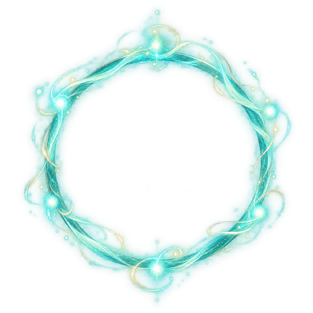

# 게임용 효과 에셋

확정 로고 전용 광휘를 포함하여 게임용 효과 에셋 3개를 유지합니다. 원본·광량 비교 시안은 로컬에 보관합니다. 최종 로고 자체는 `../ui/lumia_logo_final_034.png`에 있습니다.

| 파일 | 규격 | 용도 |
|---|---|---|
| [FX01_shared_rune_light_000.png](./FX01_shared_rune_light_000.png)  | 512×512 PNG | 공통 룬 발광 합성 효과 |
| [lumia_moonlight_sparkle_002.svg](./lumia_moonlight_sparkle_002.svg)  | 1600×800 SVG | 루미아 로고 위 달빛 광휘 오버레이 |
| [lumia_logo_glow_003.png](./lumia_logo_glow_003.png)  | 1774×887 투명 PNG | 확정 LUMIA 로고 뒤에 합성하는 빛무리 레이어. 로고와 같은 캔버스 크기 |

## 로컬 보관

`C:/Users/josep/Desktop/Final Project/asset/effect`

- `originals`: 룬 발광 원본 1개 (1254×1254).
- `review_variants`: 달빛 광휘 광량 비교 시안 3개. 동일 용도의 대안이며 게임용 기본형과 함께 중복 배포하지 않습니다.
- `effect_archive_000.md`: 원래 파일명·용도·검증 기록.

이전 달빛 광휘 비교 시안은 세 단계로 검토했습니다. A안은 기존 별 3개를 강조하고 작은 별 3개를 추가한 구성, B안은 A안에 빛살 3개를 더한 중간 밝기, C안은 B안에 외곽 별 3개를 더한 가장 풍부한 구성입니다. 이 비교안들은 최종 게임용 중복 자원으로 유지하지 않고 로컬 검토 기록으로만 남겼습니다.

2026-10-10: 로컬 복사본의 내용 일치를 확인한 뒤 GitHub 원본 및 비교 시안 4개를 제거했습니다. 게임용 2개는 내용과 파일명을 그대로 유지했습니다. 화면 합성·애니메이션 적용 검수는 별도입니다.
