# 게임용 효과 에셋

이 폴더에는 PNG 효과 이미지 3개를 보관합니다. 새 효과 파일명은 `FX` 접두어와 일련번호로 정리했습니다. 메인 게임이 참조하는 기존 로고 광휘 파일명은 호환을 위해 유지합니다. 최종 로고 본체는 [`LG01_lumia_logo_final.png`](../ui/LG01_lumia_logo_final.png)입니다.

| 파일 | 규격 | 용도 | 미리보기 |
|---|---|---|---|
| [FX01_shared_rune_light.png](./FX01_shared_rune_light.png) | 512×512 PNG | 공통 룬 발광 합성 효과. 화면 적용 검수 별도 |  |
| [FX02_lumia_logo_glow.png](./FX02_lumia_logo_glow.png) | 1774×887 투명 PNG | 타이틀에서 최종 로고 뒤에 합성하는 빛무리 |  |
| [lumia_logo_glow_003.png](./lumia_logo_glow_003.png) | PNG | 메인 타이틀 코드가 사용하는 기존 로고 광휘 |  |
