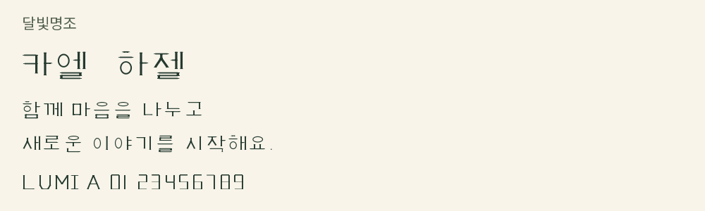
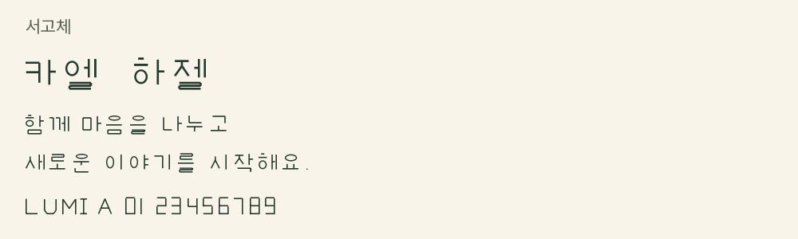
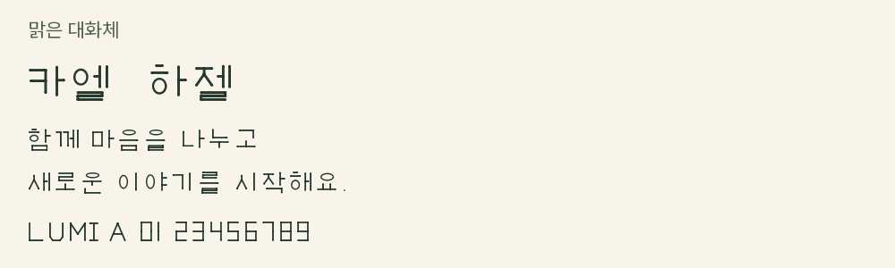
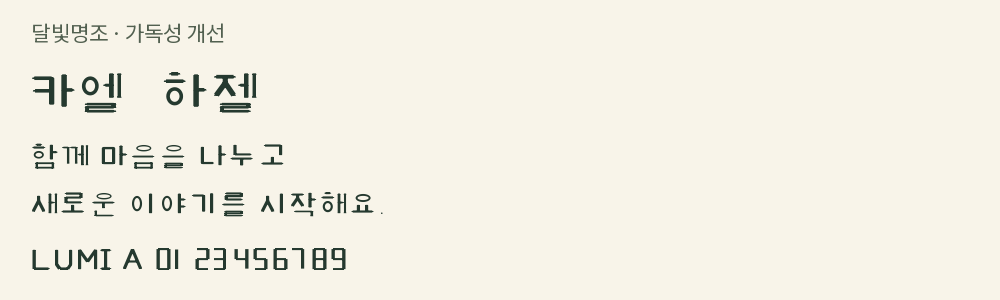
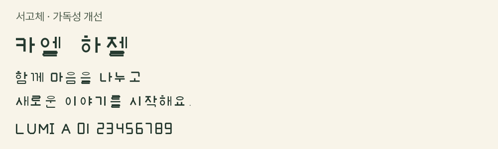
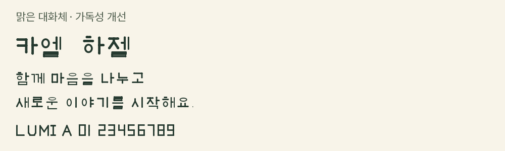
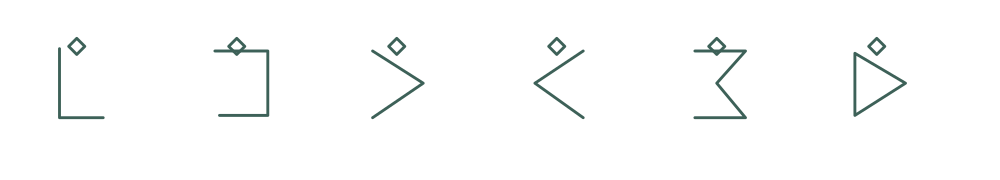
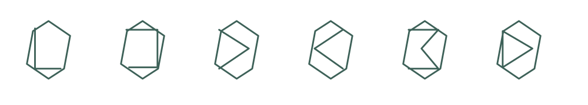
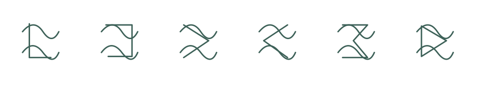

# 게임용 웹폰트

폰트 분류에는 [타이포그래피 참고 시안 5장](../typography/README.md)도 포함됩니다. WOFF2는 실행용 서체, 룬 SVG는 문자 디자인 이미지, 타이포그래피 PNG는 서체 방향 참고 자료입니다. 기존 저장 경로는 유지하며 PNG를 설치 가능한 폰트로 취급하지 않습니다.

9종을 서체별 WOFF2 한 파일로 정리했습니다. 기본형과 가독성 개선형은 별도 버전입니다. 원본 TTF 8개는 [`originals/`](./originals/README.md)에 보존하고, 외부 무료 폰트의 배포 라이선스는 [`licenses/`](./licenses/README.md)에 보존합니다. 미리보기는 previews 폴더에만 보관합니다.

| 서체 / 게임용 파일 | 미리보기 |
|---|---|
| 달빛명조<br>[lumia_moon_serif.woff2](./lumia_moon_serif.woff2) |  |
| 서고체<br>[lumia_archive.woff2](./lumia_archive.woff2) |  |
| 맑은 대화체<br>[lumia_clear_dialogue.woff2](./lumia_clear_dialogue.woff2) |  |
| 달빛명조 가독성 개선<br>[lumia_moon_readable.woff2](./lumia_moon_readable.woff2) |  |
| 서고체 가독성 개선<br>[lumia_archive_readable.woff2](./lumia_archive_readable.woff2) |  |
| 맑은 대화체 가독성 개선<br>[lumia_clear_readable.woff2](./lumia_clear_readable.woff2) |  |
| Pretendard<br>[pretendard.woff2](./pretendard.woff2) |  |
| Noto Serif KR ExtraLight<br>[noto_serif_kr.woff2](./noto_serif_kr.woff2) |  |
| 고운바탕<br>[gowun_batang.woff2](./gowun_batang.woff2) |  |

추가 로컬 원본: `C:/Users/josep/Desktop/Final Project/asset/font_files/originals`. Noto와 고운바탕은 글자 범위를 줄이지 않고 WOFF2로 변환했습니다. 루미아 자체 서체 일부는 한글 글자 지원이 제한되어 있습니다. Noto는 저장된 ExtraLight 굵기를 유지합니다.

## 자체 서체 시제품의 지원 범위와 검수 기록

`Lumia Moon Serif / Lumia Archive / Lumia Clear Dialogue`와 각 가독성 개선형은 완성 한글 서체가 아니라 **198개 코드 포인트만 직접 설계한 시제품**입니다. 지원하지 않는 글자는 무료 웹폰트 fallback을 전제로 했습니다. 가독성 개선형 TTF/WOFF2는 1000 units/em으로 정상 로드되는 것을 확인했고, 검토 화면에서는 최대 42px의 2줄 대화가 대화창 안에 들어가는지 확인했습니다. 당시 기본 비교값은 38px, 행간 1.70, 자간 -0.012em이었으며 최종 본문 서체 선정과 실제 아동·학부모 독해 검증은 별도 과제로 남겼습니다.

가독성 개선형은 내부 1000 units/em 기준으로 중심 획을 보강했습니다. 달빛 명조는 세로 64→106·가로 35→72, 서고체는 53→92, 맑은 대화체는 58→96 단위로 보강했고 작은 받침·쌍자음은 속공간을 유지하도록 비례 보정했습니다. 이 수치는 시제품 제작 이력이며 최종 게임용 폰트 규격을 강제하는 값이 아닙니다.

무료 웹폰트 적용 예시에서는 대제목에 `Noto Serif KR 500 / 31px / line-height 1.5`, 설명문에 `Pretendard 400 / 16px / line-height 1.85`를 사용했습니다. 별도 대화 비교 화면에서는 자체 3종과 Pretendard / Noto Serif KR / Gowun Batang 6종을 동일 조건으로 비교했고, 1920×1080 논리 화면에서 기본 34px 및 38px까지 대화창 넘침 여부를 확인했습니다. 이는 비교용 기준이며 최종 UI 타이포그래피 확정값은 아닙니다.

직접 설계한 공통 지원 문자는 다음과 같습니다.

```text
 !(),-.0123456789:;?ABCDEFGHIJKLMNOPQRSTUVWXYZabcdefghijklmnopqrstuvwxyz—가간거건검게견고관괜교구금기길까께꽃나난날남내넨녁누는늘다닫달대도돌되떤렌력로록루를리마만말면모목발번별보볼봐빛살새색서선세소수순스시실싶아야약어억업에엘열오온요용운월유은을음의이일작장저적전젤조좋주짜찮찰찾책천체쳐초친카택토티펴펼표하한함해험화후히
```

## 게임용 창조 룬폰트 — SVG 문자 디자인

번호 01~10의 독립 디자인 10종입니다. 각 파일은 1000×180 SVG이며 6개 문자 요소를 포함합니다. 일반 WOFF2 웹폰트와 달리 텍스트 입력으로 표시되는 폰트 파일은 아닙니다. 코드 포인트 U+05D0~U+05D5에 대응하는 요소 ID u05d0~u05d5를 사용하며 히브리어 글꼴 전체를 지원하는 것은 아닙니다. SVG 색상은 currentColor를 사용합니다. 외부 이미지로 표시할 때는 기본 색상이 적용되고 색 변경은 인라인 SVG에서 설정합니다.

제작 단계에서 붙인 10개 세트명은 `별의 격자 / 새싹 필사 / 달의 고리 / 유리 프리즘 / 물결 기록 / 깃의 언어 / 아치의 문 / 연결 인장 / 꽃잎 문장 / 혜성 궤도`입니다. 각 세트의 6개 요소는 U+05D0~U+05D5와 일대일 대응하며 실제 히브리어 문자 모양이나 번역을 대체하는 언어 체계가 아닙니다. 오른쪽→왼쪽으로 표시하는 연출에서는 배열 순서를 반전합니다.

| 번호 | 파일 | 미리보기 |
|---|---|---|
| 01 | [creative_rune_font01.svg](./creative_rune_font01.svg) |  |
| 02 | [creative_rune_font02.svg](./creative_rune_font02.svg) |  |
| 03 | [creative_rune_font03.svg](./creative_rune_font03.svg) |  |
| 04 | [creative_rune_font04.svg](./creative_rune_font04.svg) |  |
| 05 | [creative_rune_font05.svg](./creative_rune_font05.svg) |  |
| 06 | [creative_rune_font06.svg](./creative_rune_font06.svg) |  |
| 07 | [creative_rune_font07.svg](./creative_rune_font07.svg) |  |
| 08 | [creative_rune_font08.svg](./creative_rune_font08.svg) |  |
| 09 | [creative_rune_font09.svg](./creative_rune_font09.svg) |  |
| 10 | [creative_rune_font10.svg](./creative_rune_font10.svg) |  |

2026-10-10: 기존 rune 폴더를 제거하고 문자 디자인을 font_files에 통합했습니다. 기존 이름으로 중복 저장하지 않았습니다. 원본과 이전 README는 `C:/Users/josep/Desktop/Final Project/asset/font_files/rune_originals`에 보관했습니다.
