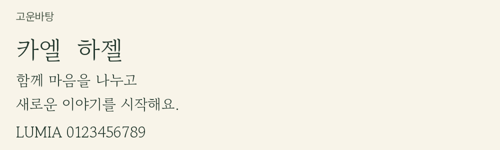
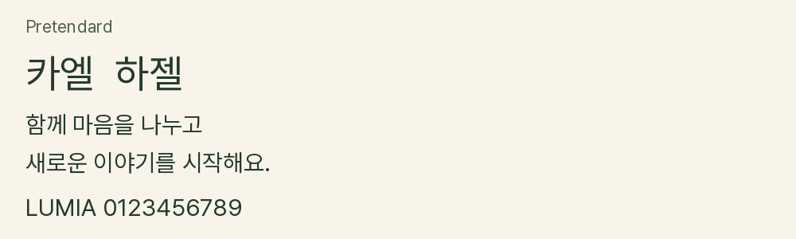
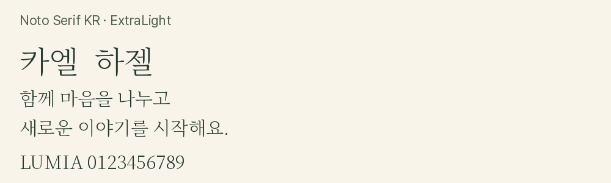
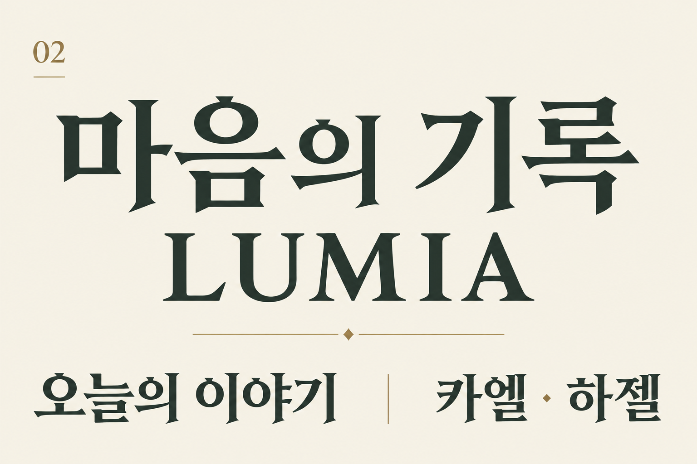
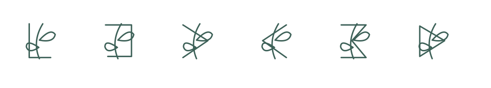
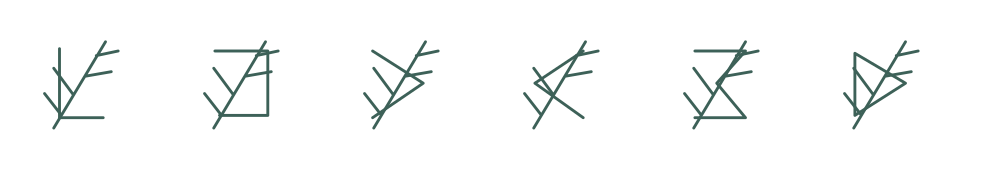
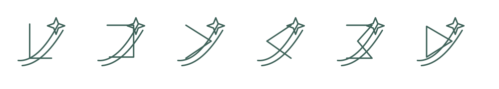

# 폰트 이미지

이 폴더에는 설치형 글꼴 파일 없이 **이미지 18개와 이 README**만 둡니다. 파일명 접두어로 용도를 구분합니다: `FN_PREVIEW`는 서체 비교 이미지, `FN_TYPO`는 레터링 방향 시안, `FN_RUNE`은 룬 문자 디자인 SVG입니다. 이미지가 있다는 사실은 게임 적용이나 최종 채택을 뜻하지 않습니다.

게임 화면에서 사용하는 Gowun Batang과 Pretendard 웹폰트 및 라이선스는 [engine/fonts](../../engine/fonts)에 보관합니다. `FN_PREVIEW_03_noto_serif_kr.png`는 비교 이미지만 남긴 것이며 실행용 Noto 폰트 파일은 이 폴더에 없습니다.

## 서체 비교 이미지

| 파일 | 표시 서체 | 미리보기 |
|---|---|---|
| [FN_PREVIEW_01_gowun_batang.png](./FN_PREVIEW_01_gowun_batang.png) | 고운바탕 · 게임 사용 글꼴 |  |
| [FN_PREVIEW_02_pretendard.png](./FN_PREVIEW_02_pretendard.png) | Pretendard · 게임 사용 글꼴 |  |
| [FN_PREVIEW_03_noto_serif_kr.png](./FN_PREVIEW_03_noto_serif_kr.png) | Noto Serif KR · 비교 시안 |  |

## 타이포그래피 방향 시안

아래 다섯 PNG는 제목·레터링 방향을 비교하기 위한 이미지입니다. 설치 가능한 웹폰트나 확정 게임 에셋이 아닙니다. 원본 크기에서 한글 식별성, 영문 높이, 작은 크기의 가독성은 별도로 검수해야 합니다.

| 파일 | 방향 | 미리보기 |
|---|---|---|
| [FN_TYPO_01_inscription_serif.png](./FN_TYPO_01_inscription_serif.png) | 비문형 세리프 · 짧고 단단한 쐐기 획 |  |
| [FN_TYPO_02_literary_serif.png](./FN_TYPO_02_literary_serif.png) | 문학형 세리프 · 부드러운 명조 계열 |  |
| [FN_TYPO_03_manuscript_serif.png](./FN_TYPO_03_manuscript_serif.png) | 필사본형 세리프 · 절제된 필기 흐름 |  |
| [FN_TYPO_04_moonlit_serif.png](./FN_TYPO_04_moonlit_serif.png) | 달빛형 세리프 · 높은 획 대비 |  |
| [FN_TYPO_05_scholarly_serif.png](./FN_TYPO_05_scholarly_serif.png) | 학술형 세리프 · 안정적인 서적 제목 계열 |  |

## 창작 룬 문자 디자인

10개 SVG는 각각 1000×180 크기에 6개 문자 요소를 담은 독립 디자인입니다. 텍스트 입력으로 표시되는 웹폰트가 아닙니다. 원본의 요소 ID `u05d0`~`u05d5`를 유지했으며, 실제 언어 번역이나 완전한 히브리어 글꼴로 취급하지 않습니다.

| 파일 | 디자인 | 미리보기 |
|---|---|---|
| [FN_RUNE_01.svg](./FN_RUNE_01.svg) | 별의 격자 |  |
| [FN_RUNE_02.svg](./FN_RUNE_02.svg) | 새싹 필사 |  |
| [FN_RUNE_03.svg](./FN_RUNE_03.svg) | 달의 고리 |  |
| [FN_RUNE_04.svg](./FN_RUNE_04.svg) | 유리 프리즘 |  |
| [FN_RUNE_05.svg](./FN_RUNE_05.svg) | 물결 기록 |  |
| [FN_RUNE_06.svg](./FN_RUNE_06.svg) | 깃의 언어 |  |
| [FN_RUNE_07.svg](./FN_RUNE_07.svg) | 아치의 문 |  |
| [FN_RUNE_08.svg](./FN_RUNE_08.svg) | 연결 인장 |  |
| [FN_RUNE_09.svg](./FN_RUNE_09.svg) | 꽃잎 문장 |  |
| [FN_RUNE_10.svg](./FN_RUNE_10.svg) | 혜성 궤도 |  |
