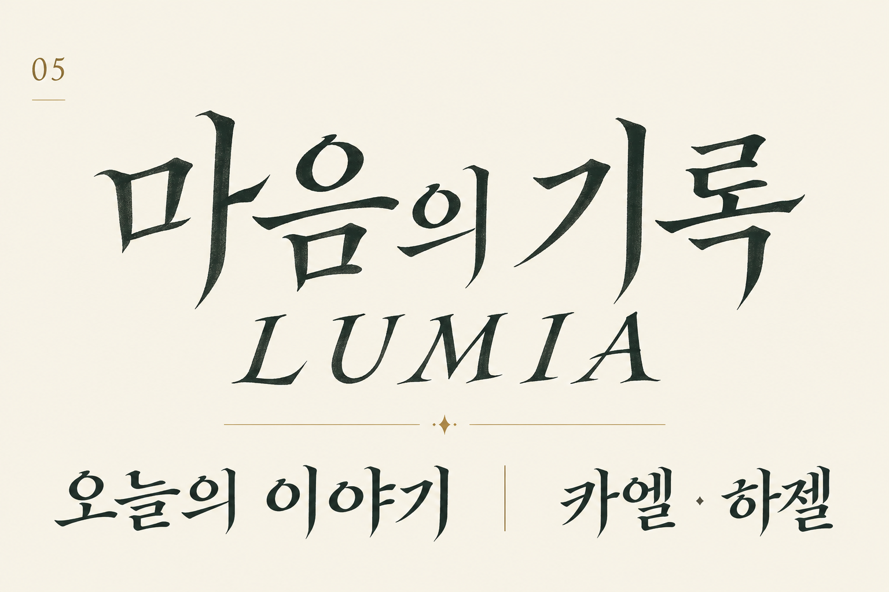
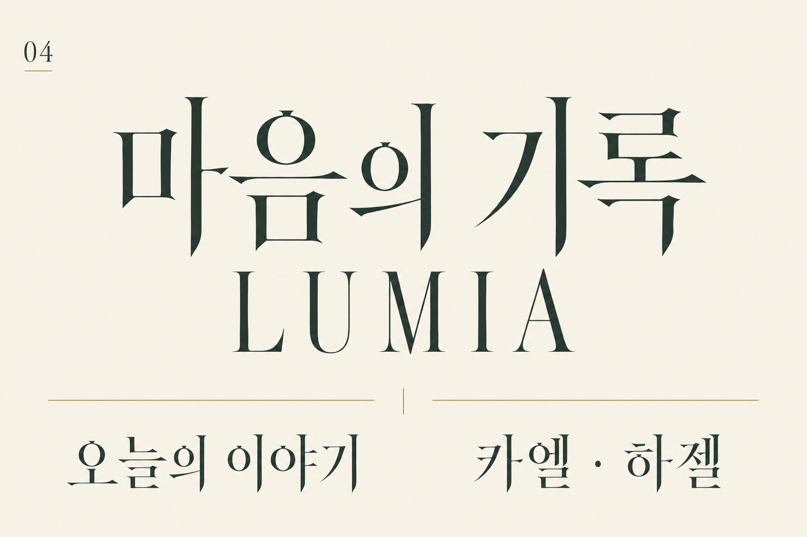

# 폰트 관련 타이포그래피 시안

이 PNG 5장은 [폰트 자원](../font_files/README.md)에 포함되는 서체 방향 참고 자료입니다. 기존 경로만 유지합니다. 설치 가능한 폰트가 아니며 웹폰트와의 일대일 대응이나 최종 채택을 확정하지 않습니다.

명칭은 파일 식별명을 풀어 쓴 안내입니다. 화면 적용과 가독성 검수는 별도입니다.

## 파일·명칭·미리보기

| 파일 | 명칭·용도 | 미리보기 |
|---|---|---|
| [mature_type_inscription_serif_000.png](./mature_type_inscription_serif_000.png) | 비문형 세리프: 각인·비문 계열 |  |
| [mature_type_literary_serif_001.png](./mature_type_literary_serif_001.png) | 문학형 세리프: 문학적 본문 계열 |  |
| [mature_type_manuscript_serif_002.png](./mature_type_manuscript_serif_002.png) | 필사본형 세리프: 필사본 계열 |  |
| [mature_type_moonlit_serif_003.png](./mature_type_moonlit_serif_003.png) | 달빛형 세리프: 달빛 테마 |  |
| [mature_type_scholarly_serif_004.png](./mature_type_scholarly_serif_004.png) | 학술형 세리프: 학술·서고 계열 |  |

## 제작·검토 기록

5안은 각각 방향 비교를 위해 제작한 레터링 이미지이며, 설치 가능한 웹폰트나 최종 게임 적용 에셋으로 승인한 자료가 아닙니다.

- 학술형: 유기적인 부리와 안정적인 네모틀을 비교한 1안
- 비문형: 굵고 짧은 쐐기 계열을 비교한 2안
- 문학형: 중간 대비와 둥근 부리·열린 속공간을 비교한 3안
- 달빛형: 높은 획 대비와 가는 가로획을 비교한 4안
- 필사본형: 절제된 붓 흐름과 필사체 움직임을 비교한 5안

검토 당시 `마음의 기록 / LUMIA / 오늘의 이야기 / 카엘 · 하젤` 문구의 식별 가능 여부를 확인했습니다. 일부 영문 대문자 높이 통일, 작은 크기에서의 사용 범위, 단어 사이 여백, 획 균질화, 색상 변경 가능한 벡터화는 최종 방향 선택 후 작업 대상으로 남겼습니다.

기존 작업 폴더를 제거한 뒤에도 5안의 생성 방향을 재현할 수 있도록 공통 프롬프트 조건과 방향별 획·비례 기준은 [타이포그래피 시안 재생성 메모](GENERATION_NOTES.md)에 보존합니다.
