# 게임용 아이템

이 폴더에는 스토리에서 채택한 FOCUS·엔딩 카드 17장, 채택 전 프레임 카드 3장, 배치 후보 소품·가구 25장, 승인된 모험 목표 15장, 총 **60장**이 있습니다. 마이룸·일지의 UI 재료 5장은 용도에 맞춰 [`asset/ui/`](../ui/README.md)로 옮겼습니다.

## 빠른 탐색

| 순서 | 찾을 내용 | 이 폴더에서 확인할 곳 |
|---|---|---|
| 1 | `MS*`, `NPC_*`, `LOC_*`, `END`의 확정 FOCUS·엔딩 카드 | [확정 스토리 FOCUS·엔딩 카드](#확정-스토리-focus와-엔딩-카드--17장) |
| 2 | 온실 화분·대서고 고서의 카드 후보 | [확정 스토리 FOCUS·엔딩 카드](#확정-스토리-focus와-엔딩-카드--17장) → [기존 프레임형 조사 이미지](#기존-프레임형-조사-이미지--3장) |
| 3 | 마이룸 가구·일반 소품 후보 | [일반 아이템 아트](#일반-아이템-아트--25장) |
| 4 | 모험 목표 아이템 15종 · `ADV_GH/LIB/OBS_*` | [모험 목표 아이템](#모험-목표-아이템--15장) → [전용 목록·미리보기](adventure/README.md) |

일반 소품·가구·스토리 FOCUS 파일명은 `IT_<역할>_<장면 또는 후보 영역>_<대상>_<번호>.png`입니다. `adventure/`의 모험 목표는 엔진 목표 ID를 그대로 쓰는 `ADV_<장소>_<번호>.png`입니다. `focus`의 `NPC_*`·`LOC_*`는 **최초 등장 장면**이고 재사용 회차는 아래 사용처에 적었습니다. `card`·`prop`·`furniture`의 `candidate`는 **배치 제안**이므로 확정 스토리 이미지로 사용하지 않습니다. 제작 ID `ART-M*`·`ART-N*`·`ART-L*`·`ART-E01`은 파일명 대신 아래 표와 [에셋 전체 장면표](../README.md)에 계속 기록합니다. 소유·해금·획득 조건은 이미지 파일명만으로 확정되지 않습니다.

이미지의 경로가 등록된 것과 게임 화면에 표시되는 것은 별도입니다. 대화 API는 확정 FOCUS 16장을 `ART-*`와 연결하며, 엔딩 카드는 엔딩 UI의 공용 받침으로 연결했습니다. 일부 `document/`·`document_for_ai/` 문서는 옛 파일명 예시를 유지하므로, 에셋 밖 문서 정리 시 새 경로로 교체해야 합니다.

## 모험 목표 아이템 · 15장

선택된 모험 목표를 단서 화면의 이름 옆에 표시하는 승인 이미지입니다. [공통 엔진 프레임 7.1](../../document/content/10_COMMON_ENGINE_FRAME.md#71-장소별-목표-아이템-풀)과 [15종 제작 목록](../../document/content/14_ADVENTURE_ITEM_IMAGES.md)의 ID에 1:1 대응합니다. 모험판 임시 목표이며 일반 가방 아이템이나 스토리 대화 FOCUS가 아닙니다. **이미지 파일 등록 완료, 실제 엔진 표시 검수 별도**입니다.

| 장소 | 아이템 ID | 이미지 예시 · 전체 목록 |
|---|---|---|
| 유리 온실·약초원 | `ADV_GH_01`–`ADV_GH_05` |  [5종 파일명·미리보기](adventure/README.md#유리-온실약초원) |
| 대서고 | `ADV_LIB_01`–`ADV_LIB_05` |  [5종 파일명·미리보기](adventure/README.md#대서고) |
| 별빛 천문대 | `ADV_OBS_01`–`ADV_OBS_05` |  [5종 파일명·미리보기](adventure/README.md#별빛-천문대) |

## 확정 스토리 FOCUS와 엔딩 카드 · 17장

제작 ID와 최초 장면은 [대화 이미지 대장](../../story/ASSET_DIALOGUE_LEDGER.md) 및 [`document/dialogue/`](../../document/dialogue/README.md)에 맞췄습니다. **정확한 파일 경로는 표의 링크**이며, 백엔드 대화 `ART-*` 16개는 `/item-assets/<파일명>`으로 제공합니다. `ART-E01`은 엔딩 화면의 공용 받침으로 표시하며 직업명·편지는 화면의 실시간 텍스트입니다. `NPC_*`·`LOC_*` 파일명은 최초 등장 회차를 나타내고 재사용 범위는 아래에 따로 적었습니다. 새 아이보리 선택지 프레임은 [UI 목록](../ui/README.md)에 있습니다.

| 제작 ID | 사용 장면 | 파일 · 미리보기 | 내용 · 실제 크기 |
|---|---|---|---|
| `ART-M01` | `MS02-S1` | [IT_focus_MS02_blocked_vines_01.png](./IT_focus_MS02_blocked_vines_01.png)  | 출입구를 막은 덩굴 · 1672×941 |
| `ART-M02` | `MS02-S3–S4` | [IT_focus_MS02_glowing_bud_vines_02.png](./IT_focus_MS02_glowing_bud_vines_02.png)  | 커진 덩굴과 빛나는 꽃봉오리 · 1672×941 |
| `ART-M03` | `MS03-S1–S4` | [IT_focus_MS03_wrong_clock_rune_01.png](./IT_focus_MS03_wrong_clock_rune_01.png)  | 틀린 시각의 시계판과 흐릿한 룬 · 1672×941 |
| `ART-M04` | `MS04-S1–S2·S5` | [IT_focus_MS04_detached_shadow_01.png](./IT_focus_MS04_detached_shadow_01.png)  | 떨어져 나온 그림자 · 1672×941 |
| `ART-M05` | `MS04-S3–S4` | [IT_focus_MS04_shadow_shield_02.png](./IT_focus_MS04_shadow_shield_02.png)  | 그림자가 비치는 방패 · 1672×941 |
| `ART-M06` | `MS06-S1–S5` | [IT_focus_MS06_winter_games_decor_01.png](./IT_focus_MS06_winter_games_decor_01.png)  | 겨울 놀이회 장식 · 1672×941 |
| `ART-N01` | `NPC_GUIDE_01–02·04` | [IT_focus_NPC_GUIDE_01_meeting_notices_01.png](./IT_focus_NPC_GUIDE_01_meeting_notices_01.png)  | 바람에 흩어진 모임 안내지 · 1672×941 |
| `ART-N02` | `NPC_GUIDE_03–04` | [IT_focus_NPC_GUIDE_03_two_ribbons_01.png](./IT_focus_NPC_GUIDE_03_two_ribbons_01.png)  | 서로 다른 장식 리본 두 개 · 1536×1024 |
| `ART-N03` | `NPC_WORK_01–02` | [IT_focus_NPC_WORK_01_workshop_parts_01.png](./IT_focus_NPC_WORK_01_workshop_parts_01.png)  | 서로 다른 공방 부품 · 1536×1024 |
| `ART-N04` | `NPC_WORK_03–04` | [IT_focus_NPC_WORK_03_tidy_workbench_02.png](./IT_focus_NPC_WORK_03_tidy_workbench_02.png)  | 정돈된 작업대 · 1536×1024 |
| `ART-N05` | `NPC_LULU_01–02` | [IT_focus_NPC_LULU_01_patterned_button_01.png](./IT_focus_NPC_LULU_01_patterned_button_01.png)  | 루루가 발견한 무늬 단추 · 1536×1024 |
| `ART-N06` | `NPC_LULU_02–04` | [IT_focus_NPC_LULU_02_treasure_chest_02.png](./IT_focus_NPC_LULU_02_treasure_chest_02.png)  | 루루의 열린 보물상자 · 1672×941 |
| `ART-L01` | `LOC_OBS_01–04` | [IT_focus_LOC_OBS_01_observation_diary_03.png](./IT_focus_LOC_OBS_01_observation_diary_03.png)  | 먼지 쌓인 펼친 관측 일기 · 1672×941 |
| `ART-L02` | `LOC_GH_01-R1` | [IT_focus_LOC_GH_01_wilted_pot_01.png](./IT_focus_LOC_GH_01_wilted_pot_01.png)  | 시든 화분 · 1536×1024 |
| `ART-L03` | `LOC_GH_01-R2` | [IT_focus_LOC_GH_01_restored_pot_02.png](./IT_focus_LOC_GH_01_restored_pot_02.png)  | 회복한 화분 · 1536×1024 |
| `ART-L04` | `LOC_LIB_01-R1` | [IT_focus_LOC_LIB_01_plain_book_01.png](./IT_focus_LOC_LIB_01_plain_book_01.png)  | 책장 위 평범한 책 · 1536×1024 |
| `ART-E01` | `END 직업 결과·편지` | [IT_focus_END_career_letter_card_01.png](./IT_focus_END_career_letter_card_01.png)  | 글자 없는 공용 직업 카드·편지 받침 · 1672×941 |

### 재사용과 상태 전환

- `ART-N01`: `NPC_GUIDE_01–02·04`에서 사용. `NPC_GUIDE_03–04`는 `ART-N02` 리본도 사용합니다.
- `ART-N03`: `NPC_WORK_01–02`, `ART-N04`: `NPC_WORK_03–04`에서 사용합니다.
- `ART-N05`: `NPC_LULU_01`의 단추, `NPC_LULU_02` 회상에도 사용. `ART-N06`: `NPC_LULU_02–04`의 보물상자입니다.
- `ART-L01`: `LOC_OBS_01–04`가 한 장을 재사용합니다. `ART-L02`·`ART-L03`은 `LOC_GH_01`의 시든 상태(R1)와 회복 상태(R2)이며, `ART-L04`는 `LOC_LIB_01` 첫 조사(R1)입니다.
- `ART-M06`은 `MS06` 겨울 놀이회 장식으로, `MS05` 별빛 축제의 켜짐/꺼짐 배경과 다릅니다.

`IT_card_candidate_*` 3장은 아래에 별도 보관한 이전 비교용 카드입니다. `ART-L02–L04` 대신 자동으로 선택하지 마세요. 파일 등록과 로컬 경로 검증은 완료했으며, 운영 배포 검증은 별도입니다.

## 기존 프레임형 조사 이미지 · 3장

기존 아이템 디자인을 바탕으로 만든 밝은 아이보리 카드 시안입니다. 원본 아이템은 그대로 유지합니다. 얇은 모서리 장식 프레임 3장을 한 묶음으로 정리했습니다. 모두 3840×2161 PNG이며 생성 시안을 확대한 출력물입니다. 게임 화면 적용 검수는 별도입니다.

| 파일 | 명칭·용도 | 규격 | 미리보기 |
|---|---|---:|:---:|
| [IT_card_candidate_GH_wilted_plant_01.png](./IT_card_candidate_GH_wilted_plant_01.png) | 온실: 시든 식물, 얇은 아이보리 프레임 | 3840×2161 | 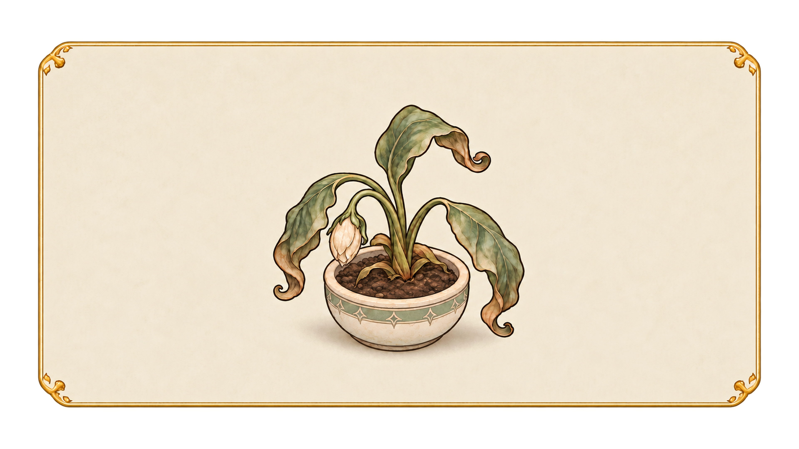 |
| [IT_card_candidate_GH_restored_plant_02.png](./IT_card_candidate_GH_restored_plant_02.png) | 온실: 되살아난 식물, 얇은 아이보리 프레임 | 3840×2161 |  |
| [IT_card_candidate_LIB_ancient_book_03.png](./IT_card_candidate_LIB_ancient_book_03.png) | 대서고: 고서, 얇은 아이보리 프레임 | 3840×2161 |  |

원본: `C:/Users/josep/Desktop/Final Project/asset/item/originals`. 이전 회복 식물: `asset/item/review`. 기존 소지품·가구 20장은 1254×1254 원본에서 1024×1024로 축소했습니다. 기존 조사 오브젝트는 픽셀 데이터를 유지했습니다. 기존 25장은 새 이미지 생성 없이 정리한 파일이고, 위 프레임형 3장은 새로 생성한 투명 배경 PNG 시안입니다. 실제 게임 적용 검수는 별도입니다.

## 일반 아이템 아트 · 25장

같은 대상을 그린 일반 PNG와 프레임 카드는 화면 역할이 다릅니다. 일반 PNG는 소품·가구 이미지 후보이고, 프레임 카드는 대화 중 중앙에 띄울 FOCUS 후보입니다. 아래의 `마이룸`, `온실`, `공방` 등은 파일명·그림 내용에 따른 후보 장소입니다. 제작 문서가 장면 ID를 지정하기 전에는 엔진이 이 표만 보고 배치하지 않습니다.

| 파일 | 명칭·용도 | 배치 후보 · 연결 상태 | 규격 | 미리보기 |
|---|---|---|---:|:---:|
| [IT_prop_candidate_MYROOM_heart_diary_01.png](./IT_prop_candidate_MYROOM_heart_diary_01.png) | 마음 일기: 일반 기록 소품. 관측 일기 `ART-L01`과 별개 | 개인 기록·마이룸 소품 후보. `ART-L01` 관측 일기 아님; 화면 배치 미확인 | 1024×1024 |  |
| [IT_prop_candidate_MYROOM_rune_lamp_02.png](./IT_prop_candidate_MYROOM_rune_lamp_02.png) | 룬 램프: 조명 소품 | 마이룸 조명 소품 후보; 화면 배치 미확인 | 1024×1024 | 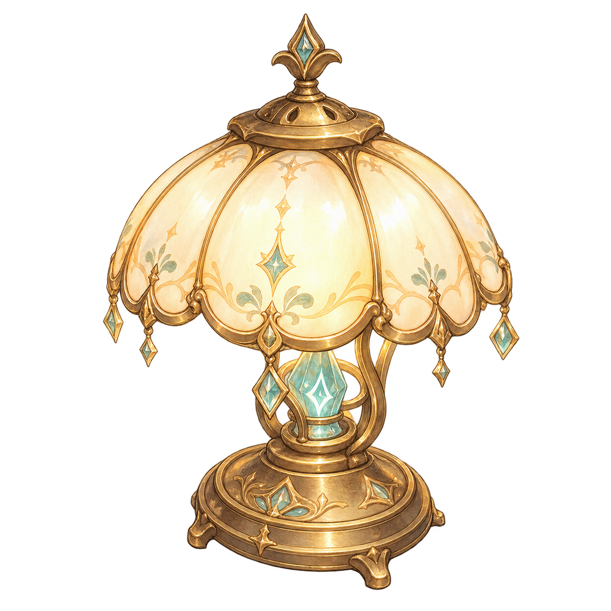 |
| [IT_prop_candidate_MYROOM_tea_set_03.png](./IT_prop_candidate_MYROOM_tea_set_03.png) | 차 세트: 생활 소품 | 마이룸 생활 소품 후보; 화면 배치 미확인 | 1024×1024 | 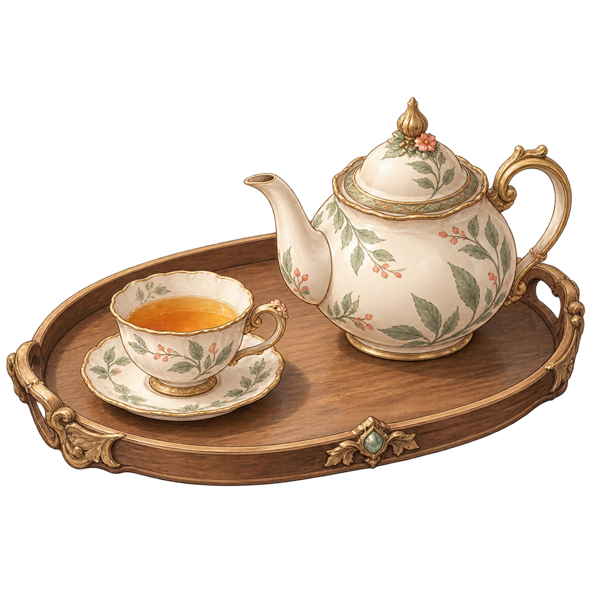 |
| [IT_prop_candidate_GH_herb_pot_04.png](./IT_prop_candidate_GH_herb_pot_04.png) | 약초 화분 | 마이룸·온실 화분 후보. `ART-L02/L03` 확정 그림 아님 | 1024×1024 |  |
| [IT_prop_candidate_RUNE_fragment_05.png](./IT_prop_candidate_RUNE_fragment_05.png) | 룬 조각 | 룬 수집·조사 소품 후보; 획득 조건·화면 배치 미확인 | 1024×1024 | 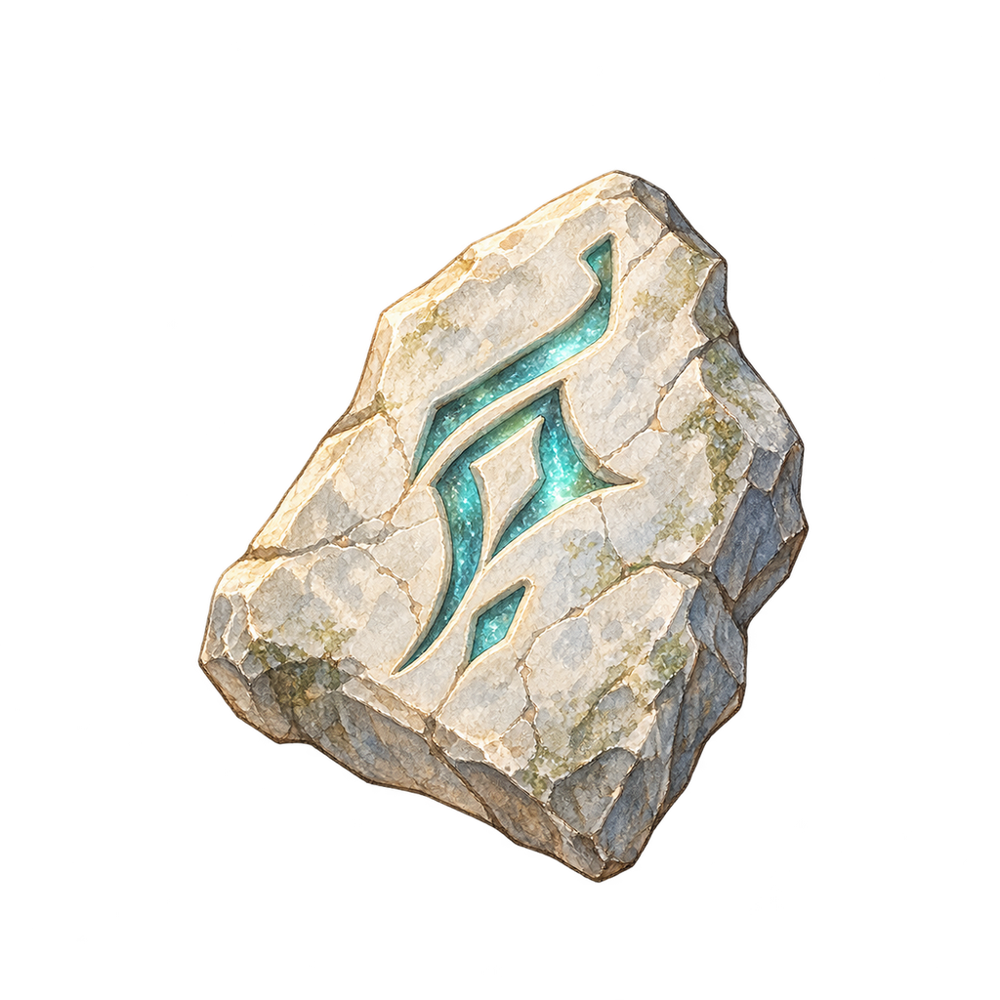 |
| [IT_prop_candidate_MYROOM_memory_frame_06.png](./IT_prop_candidate_MYROOM_memory_frame_06.png) | 추억 액자 | 마이룸 장식 후보; 화면 배치 미확인 | 1024×1024 | 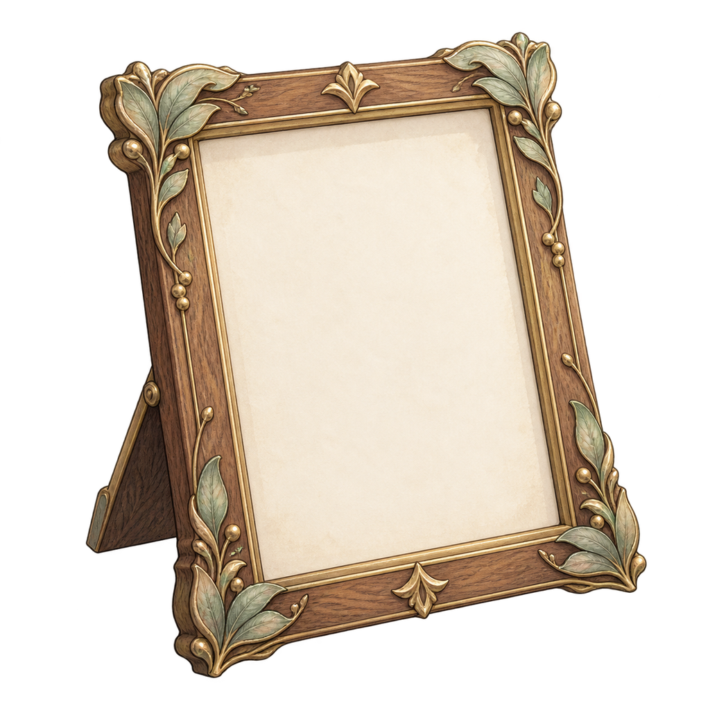 |
| [IT_furniture_candidate_MYROOM_desk_07.png](./IT_furniture_candidate_MYROOM_desk_07.png) | 마이룸 책상 | 마이룸 가구 후보; 화면 배치 미확인 | 1024×1024 |  |
| [IT_furniture_candidate_MYROOM_chair_08.png](./IT_furniture_candidate_MYROOM_chair_08.png) | 마이룸 의자 | 마이룸 가구 후보; 화면 배치 미확인 | 1024×1024 | 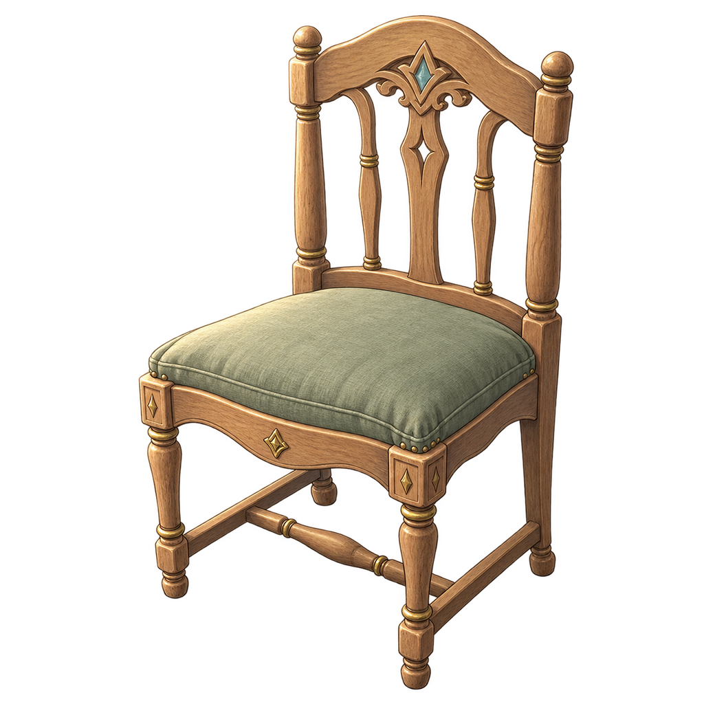 |
| [IT_furniture_candidate_MYROOM_bed_09.png](./IT_furniture_candidate_MYROOM_bed_09.png) | 마이룸 침대 | 마이룸 가구 후보; 화면 배치 미확인 | 1024×1024 |  |
| [IT_furniture_candidate_MYROOM_bookshelf_10.png](./IT_furniture_candidate_MYROOM_bookshelf_10.png) | 마이룸 책장 | 마이룸 가구 후보; 화면 배치 미확인 | 1024×1024 | 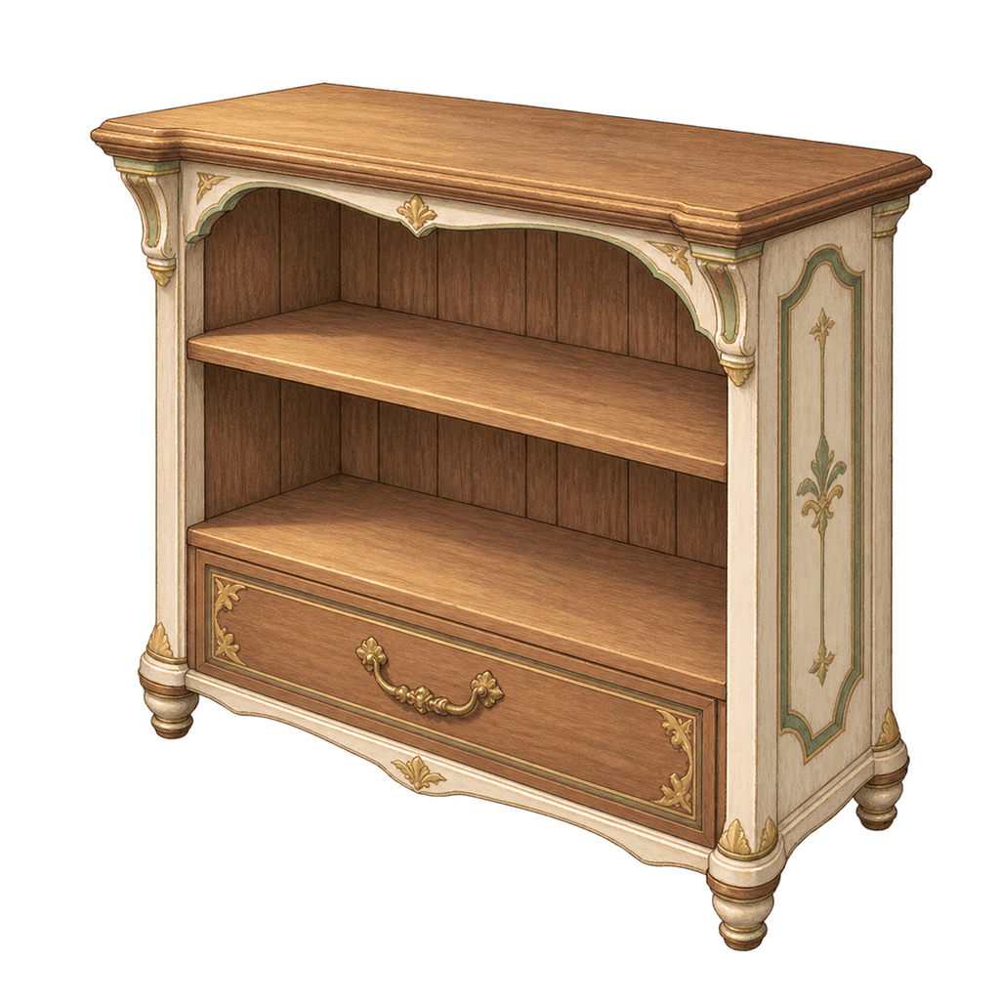 |
| [IT_furniture_candidate_MYROOM_rug_11.png](./IT_furniture_candidate_MYROOM_rug_11.png) | 마이룸 러그 | 마이룸 가구 후보; 화면 배치 미확인 | 1024×1024 |  |
| [IT_prop_candidate_MYROOM_rune_ornament_12.png](./IT_prop_candidate_MYROOM_rune_ornament_12.png) | 룬 장식품 | 마이룸 룬 장식 후보; 화면 배치 미확인 | 1024×1024 |  |
| [IT_prop_candidate_LIB_ancient_book_13.png](./IT_prop_candidate_LIB_ancient_book_13.png) | 고서 | 대서고 소품 후보. `ART-L04`의 평범한 가로 책과 불일치 | 1024×1024 |  |
| [IT_prop_candidate_GENERAL_parchment_letter_14.png](./IT_prop_candidate_GENERAL_parchment_letter_14.png) | 양피지 편지 | 편지·문서 소품 후보. `MS01` 초대장이나 `END` 편지로 확정되지 않음 | 1024×1024 |  |
| [IT_prop_candidate_WORKSHOP_tools_15.png](./IT_prop_candidate_WORKSHOP_tools_15.png) | 공방 도구 | 마도 공방 소품 후보. `ART-N03/N04`로 확정되지 않음 | 1024×1024 | 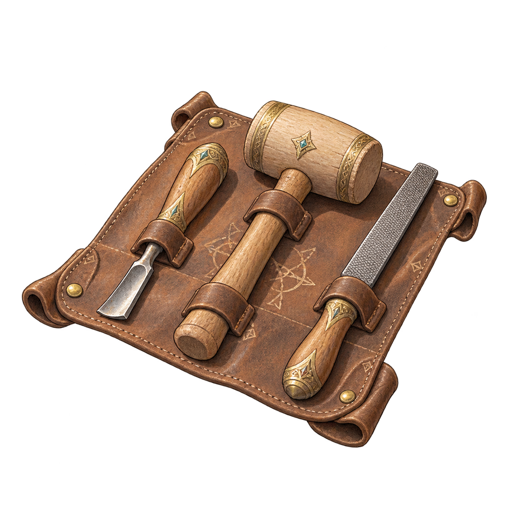 |
| [IT_prop_candidate_TRAINING_wooden_sword_16.png](./IT_prop_candidate_TRAINING_wooden_sword_16.png) | 목검: 훈련 소품 | 훈련 소품 후보; 룬 수련장 배치 미확인 | 1024×1024 |  |
| [IT_prop_candidate_RUNE_magic_stone_17.png](./IT_prop_candidate_RUNE_magic_stone_17.png) | 마석 | 마법 재료 후보; 스토리 배정 미확인 | 1024×1024 | 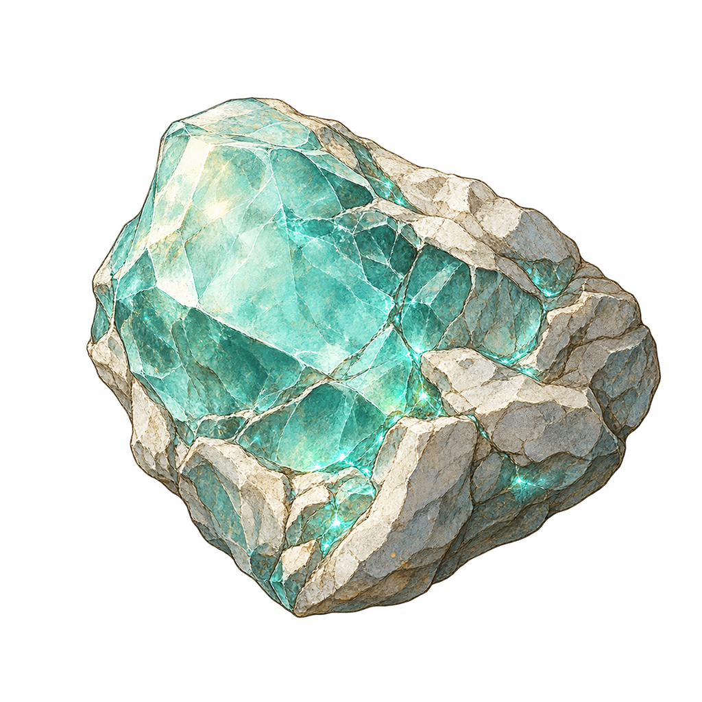 |
| [IT_prop_candidate_RUNE_heart_rune_18.png](./IT_prop_candidate_RUNE_heart_rune_18.png) | 마음의 룬 | 룬 수집·조사 소품 후보; 스토리 배정 미확인 | 1024×1024 | 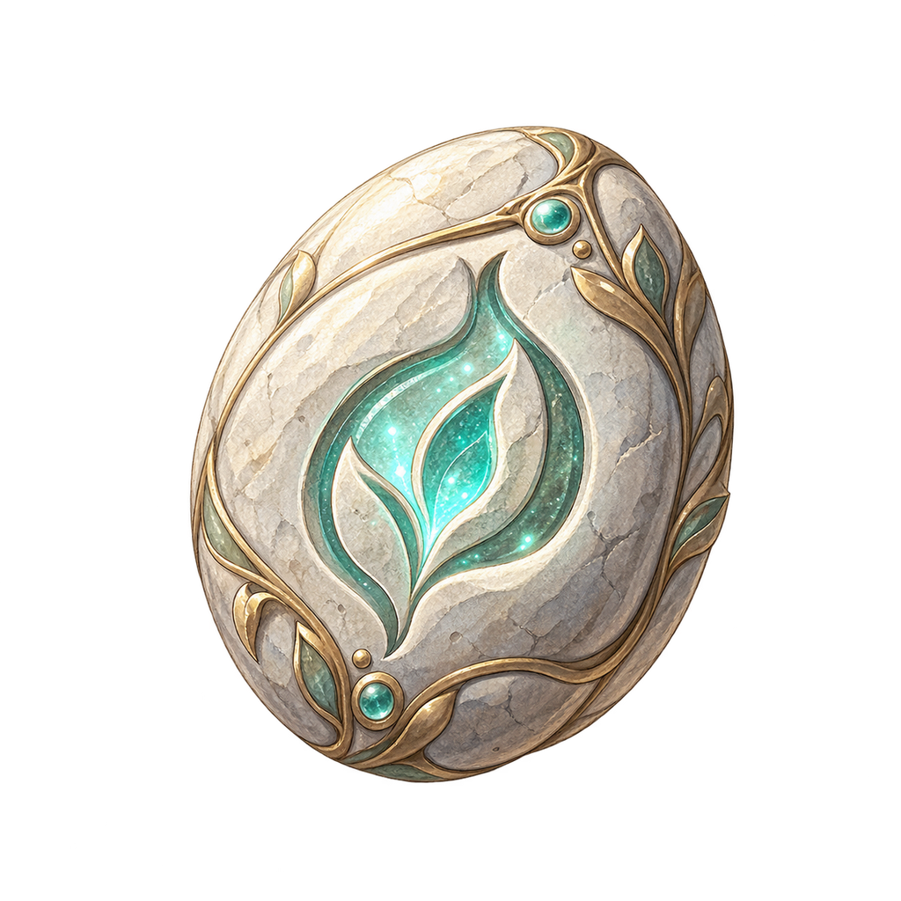 |
| [IT_prop_candidate_RUNE_shadow_rune_19.png](./IT_prop_candidate_RUNE_shadow_rune_19.png) | 그림자 룬 | 룬 수집·조사 소품 후보. `ART-M04/M05` 그림자 장면 아님 | 1024×1024 |  |
| [IT_prop_candidate_RUNE_purified_rune_20.png](./IT_prop_candidate_RUNE_purified_rune_20.png) | 정화된 룬 | 룬 수집·조사 소품 후보; 스토리 배정 미확인 | 1024×1024 | 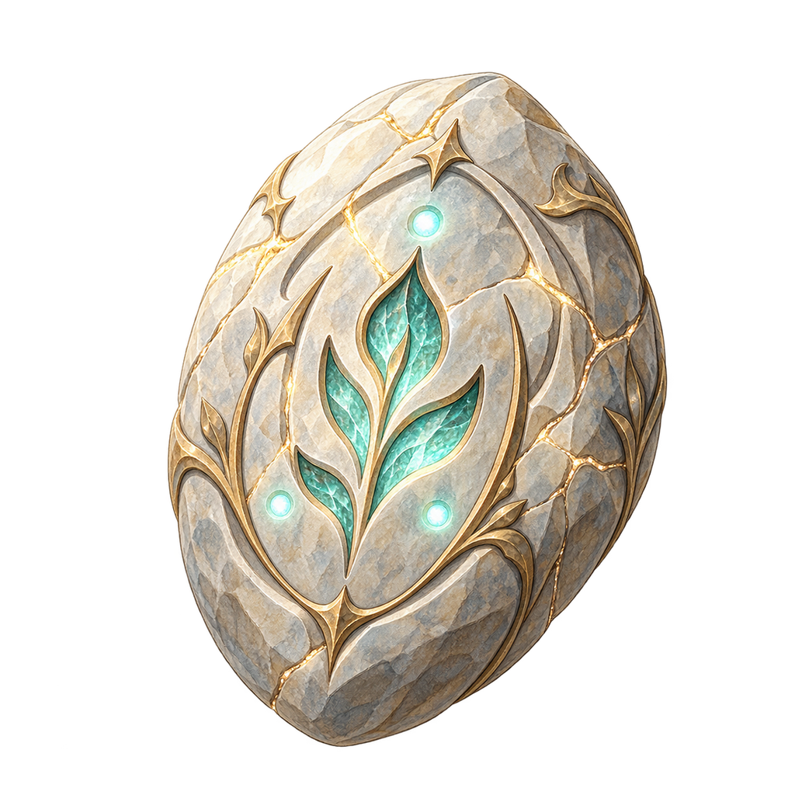 |
| [IT_prop_candidate_GH_wilted_plant_21.png](./IT_prop_candidate_GH_wilted_plant_21.png) | 시든 식물: 회복 전 | 온실 상태 소품 후보. `ART-L02` 확정 FOCUS는 위 별도 파일 | 512×512 |  |
| [IT_prop_candidate_GH_restored_plant_22.png](./IT_prop_candidate_GH_restored_plant_22.png) | 회복된 식물: 승인 v2 | 온실 상태 소품 후보. `ART-L03` 확정 FOCUS는 위 별도 파일 | 512×512 | 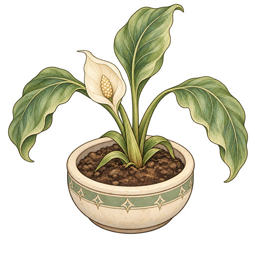 |
| [IT_prop_candidate_GH_moonlight_herb_23.png](./IT_prop_candidate_GH_moonlight_herb_23.png) | 달빛 약초: 조사 소품 | 약초원 조사 소품 후보; 획득 조건·장면 배정 미확인 | 256×256 | 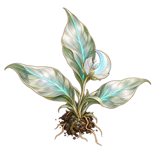 |
| [IT_prop_candidate_EVENT_rune_inactive_24.png](./IT_prop_candidate_EVENT_rune_inactive_24.png) | 이벤트 룬: 비활성 | 이벤트 룬 비활성 상태 후보; 장면 배정 미확인 | 512×512 |  |
| [IT_prop_candidate_EVENT_rune_active_25.png](./IT_prop_candidate_EVENT_rune_active_25.png) | 이벤트 룬: 활성 | 이벤트 룬 활성 상태 후보; 장면 배정 미확인 | 512×512 |  |
