# 게임용 아이템

명칭·용도는 자원 설명이며 획득 조건·수치·소모 효과를 확정하는 데이터가 아닙니다.

기존 게임용 PNG 25장과 프레임형 조사 이미지 4장, 신규 스토리 FOCUS 3장, 총 32장입니다. 원본 26장과 이전 회복 식물 시안 1장은 로컬에 보관했습니다. 시든/회복 식물과 비활성/활성 이벤트 룬은 게임 상태가 달라 별도 이미지로 유지합니다. 회복 식물은 승인된 v2를 사용합니다.

## 스토리 FOCUS 연결 상태

아래 그림은 보유 이미지입니다. `ART-*`는 최신 제작 문서의 **필요 그림 ID**이며, 이름이나 장소가 비슷하다는 이유로 자동 확정하지 않습니다. [전체 장면 연결표](../README.md)에서 배경·화자와 함께 확인하세요.

| 이야기·필요 그림 | 현재 보유 이미지 · 미리보기 | 판단 |
|---|---|---|
| `LOC_OBS_01–04` · `ART-L01` 펼친 관측 일기 | [먼지·거미줄이 쌓인 펼친 관측 일기](./ART-L01_observation_diary_open_dusty.png)  | **이미지 채택**: 네 회차가 이 한 장을 재사용. 엔진 표시 검수는 별도 |
| `LOC_GH_01-R1` · `ART-L02` 시든 허브 화분 | [시든 화분 카드](./plant1_wilted_frame_thin_3840x2161.png)  | **채택 후보**: 프레임을 포함한 3840×2161 카드. 온실 배경 위 FOCUS 표시 방식 검수 필요 |
| `LOC_GH_01-R2` · `ART-L03` 같은 화분의 회복 상태 | [회복 화분 카드](./plant2_restored_frame_thin_3840x2161.png)  | **채택 후보**: L02와 한 쌍. 상태 전환·규격 검수 필요 |
| `LOC_LIB_01-R1` · `ART-L04` 책장 위 평범한 책 | [장식 있는 고서 카드](./book1_ancient_frame_thin_3840x2161.png)  | **불일치 후보**: 보유 그림은 장식 있는 고서 카드. 평범한 책이 책장 위에 가로로 놓인 구도가 아님 |

`MS02`의 마법 덩굴은 `ART-M01/M02`로 별도 제작 지시가 있습니다. 여기의 일상 시든·회복 화분이나 `LOC_GH_01` 카드를 MS02에 자동 연결하지 않습니다. `ART-N01` 안내지와 `ART-N06` 루루 보물상자는 아래의 전용 FOCUS를 사용합니다. 그 밖의 `ART-N02–N05`, `ART-M01–M06`, `ART-E01`은 이름이 비슷한 일반 아이템을 대신 연결하지 않습니다.

## 채택한 스토리 FOCUS · 3장

다음 세 장은 사용자 시안 선택에 따라 등록했습니다. `ART-*`는 제작 문서의 ID입니다. **이미지 경로 확정과 엔진 화면 연결 완료는 별개**이며, 실제 표시·크기 검수는 남아 있습니다. 아래 규격은 파일의 실제 픽셀 수입니다.

| 파일 · ID | 처음 사용하는 장면과 재사용처 | 규격 | 미리보기 |
|---|---|---:|:---:|
| [ART-N01_meeting_notices_scattered.png](./ART-N01_meeting_notices_scattered.png) · `ART-N01` | `NPC_GUIDE_01` 시계탑 광장: 바람에 흩어진 작은 모임 안내지 여러 장. `NPC_GUIDE_02`, `NPC_GUIDE_04`에서 같은 그림 재사용. 글자는 읽히지 않는 문양으로 표현 | 1536×1024 |  |
| [ART-N06_lulu_treasure_chest_open.png](./ART-N06_lulu_treasure_chest_open.png) · `ART-N06` | `NPC_LULU_02` 온실 또는 약초원: 루루가 단추와 작은 수집품을 보관하는 열린 보물상자. `NPC_LULU_03–04`에서 같은 그림 재사용. 새 발견물은 대사로 설명 | 1226×1283 |  |
| [ART-L01_observation_diary_open_dusty.png](./ART-L01_observation_diary_open_dusty.png) · `ART-L01` | `LOC_OBS_01` 별빛 천문대: 오래 방치되어 먼지와 거미줄이 쌓인 펼친 관측 일기. `LOC_OBS_02–04`에서 같은 그림 재사용. 회차별 기록 내용은 대화창 텍스트로 표시 | 1672×941 |  |

## 기존 게임용 아이템 · 25장

| 파일 | 명칭·용도 | 규격 | 미리보기 |
|---|---|---:|:---:|
| [diary1_heart.png](./diary1_heart.png) | 마음 일기: 기록 소품 | 1024×1024 | 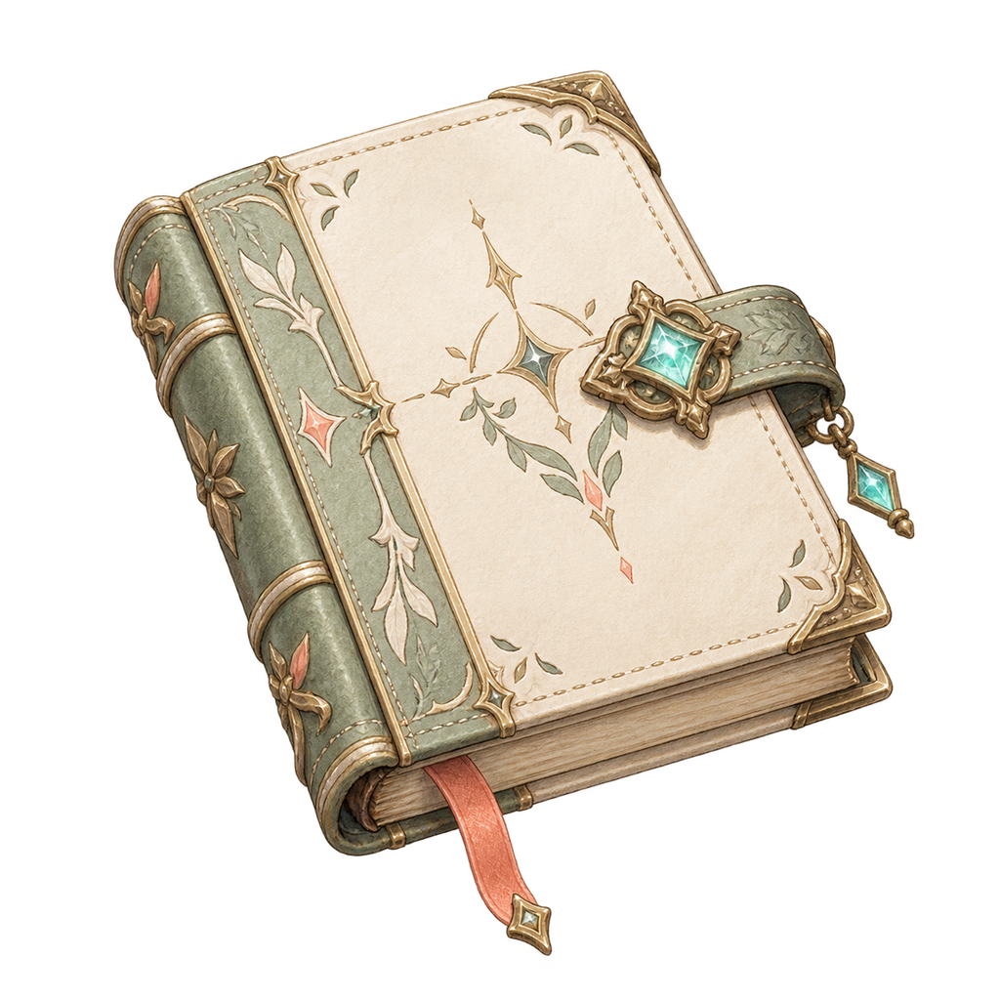 |
| [lamp1_rune.png](./lamp1_rune.png) | 룬 램프: 조명 소품 | 1024×1024 |  |
| [tea1_set.png](./tea1_set.png) | 차 세트: 생활 소품 | 1024×1024 |  |
| [pot1_herb.png](./pot1_herb.png) | 약초 화분 | 1024×1024 | 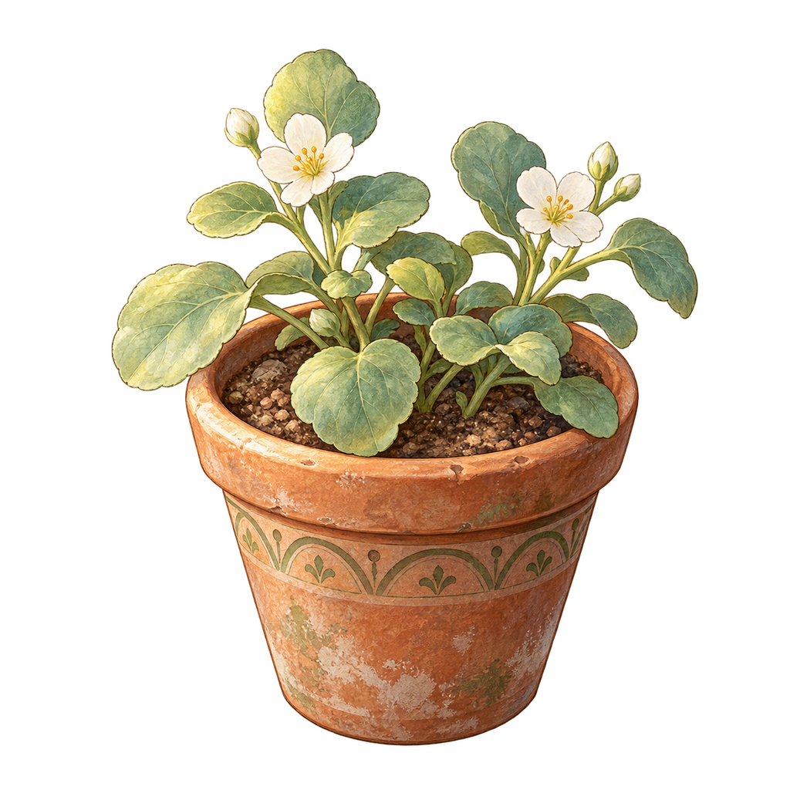 |
| [rune1_fragment.png](./rune1_fragment.png) | 룬 조각 | 1024×1024 |  |
| [frame1_memory.png](./frame1_memory.png) | 추억 액자 | 1024×1024 |  |
| [desk1_myroom.png](./desk1_myroom.png) | 마이룸 책상 | 1024×1024 | 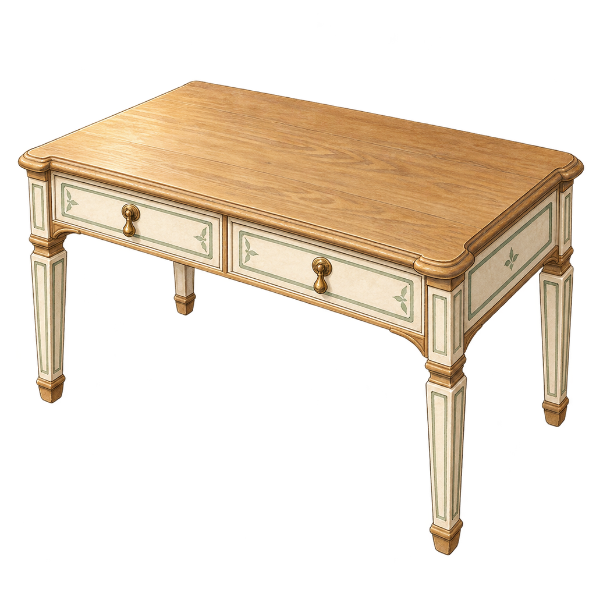 |
| [chair1_myroom.png](./chair1_myroom.png) | 마이룸 의자 | 1024×1024 |  |
| [bed1_myroom.png](./bed1_myroom.png) | 마이룸 침대 | 1024×1024 | 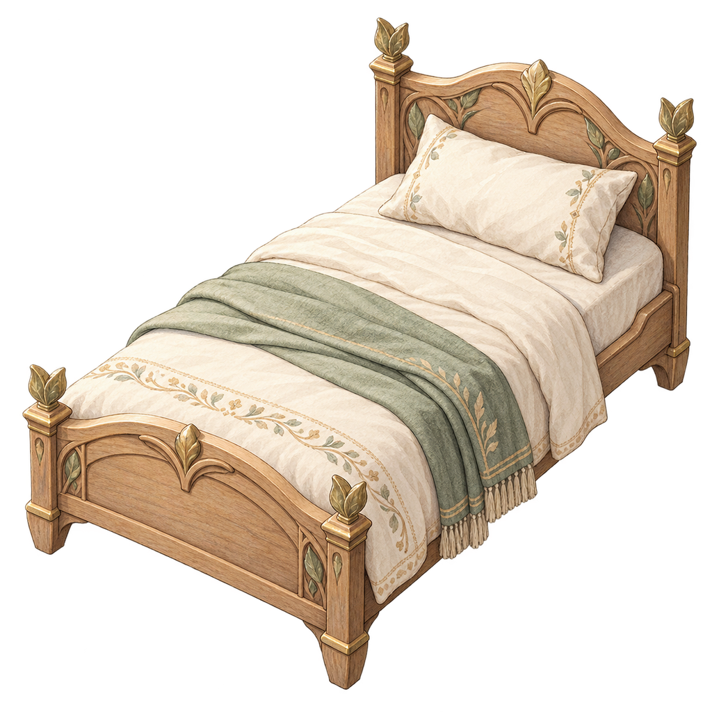 |
| [bookshelf1_myroom.png](./bookshelf1_myroom.png) | 마이룸 책장 | 1024×1024 |  |
| [rug1_myroom.png](./rug1_myroom.png) | 마이룸 러그 | 1024×1024 | 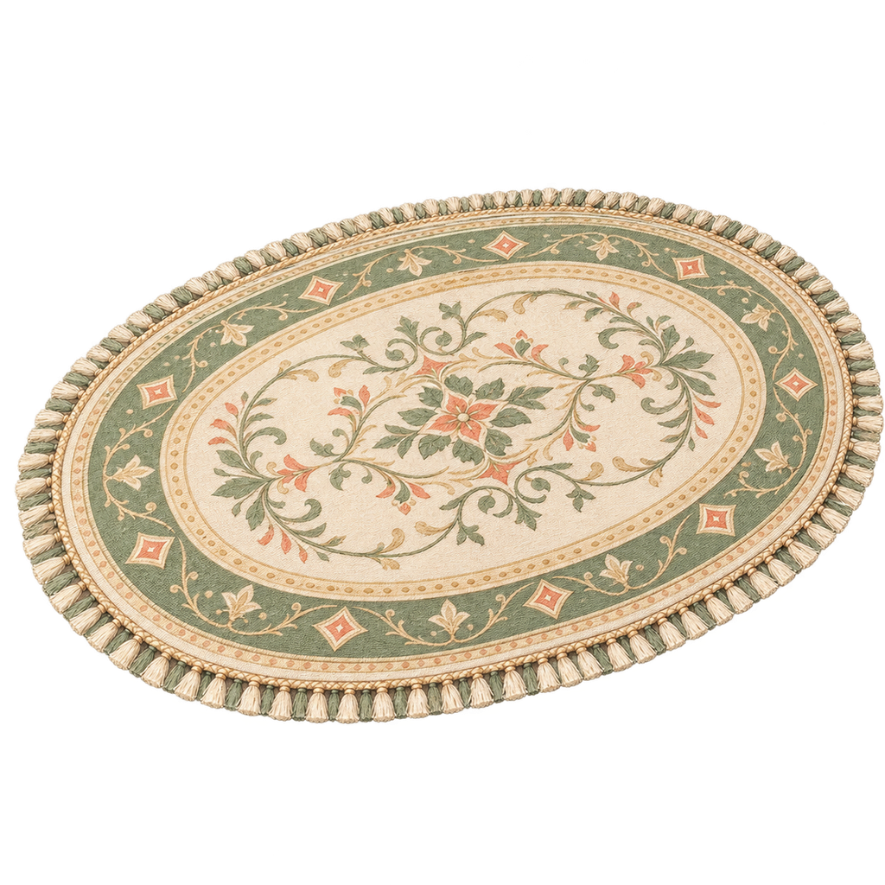 |
| [ornament1_rune.png](./ornament1_rune.png) | 룬 장식품 | 1024×1024 | 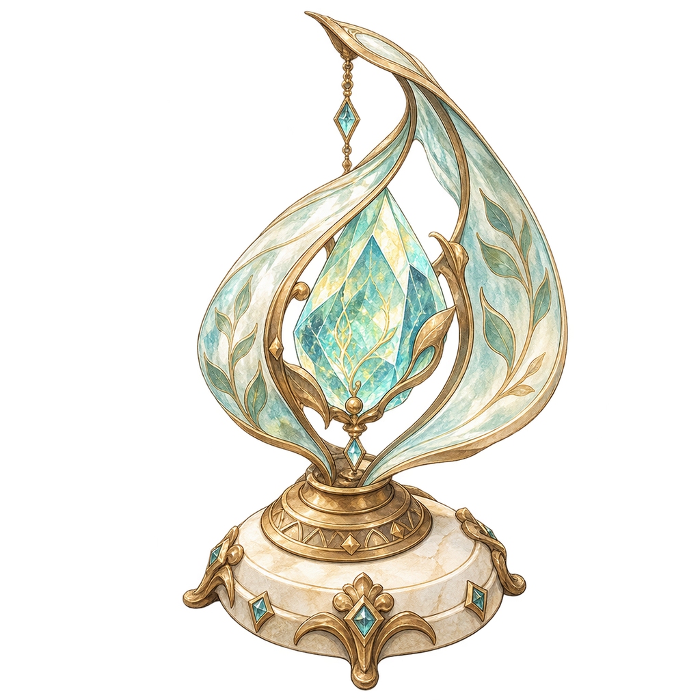 |
| [book1_ancient.png](./book1_ancient.png) | 고서 | 1024×1024 | 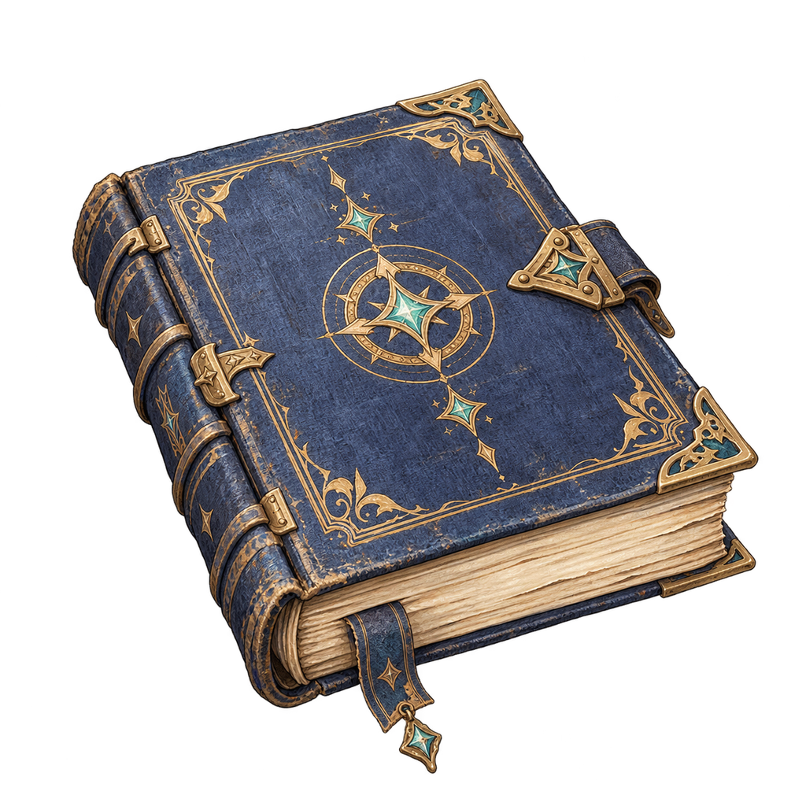 |
| [letter1_parchment.png](./letter1_parchment.png) | 양피지 편지 | 1024×1024 |  |
| [tools1_workshop.png](./tools1_workshop.png) | 공방 도구 | 1024×1024 |  |
| [sword1_wooden.png](./sword1_wooden.png) | 목검: 훈련 소품 | 1024×1024 | 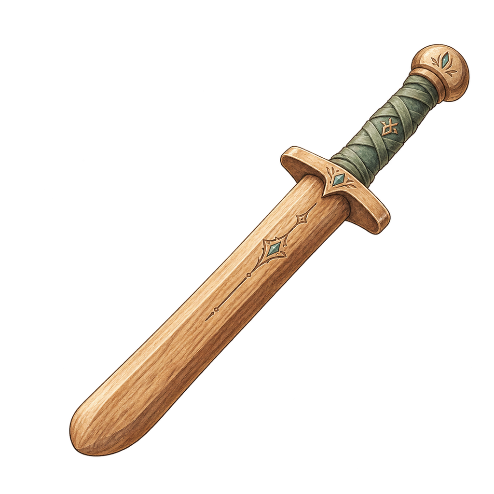 |
| [stone1_magic.png](./stone1_magic.png) | 마석 | 1024×1024 |  |
| [rune2_heart.png](./rune2_heart.png) | 마음의 룬 | 1024×1024 |  |
| [rune3_shadow.png](./rune3_shadow.png) | 그림자 룬 | 1024×1024 | 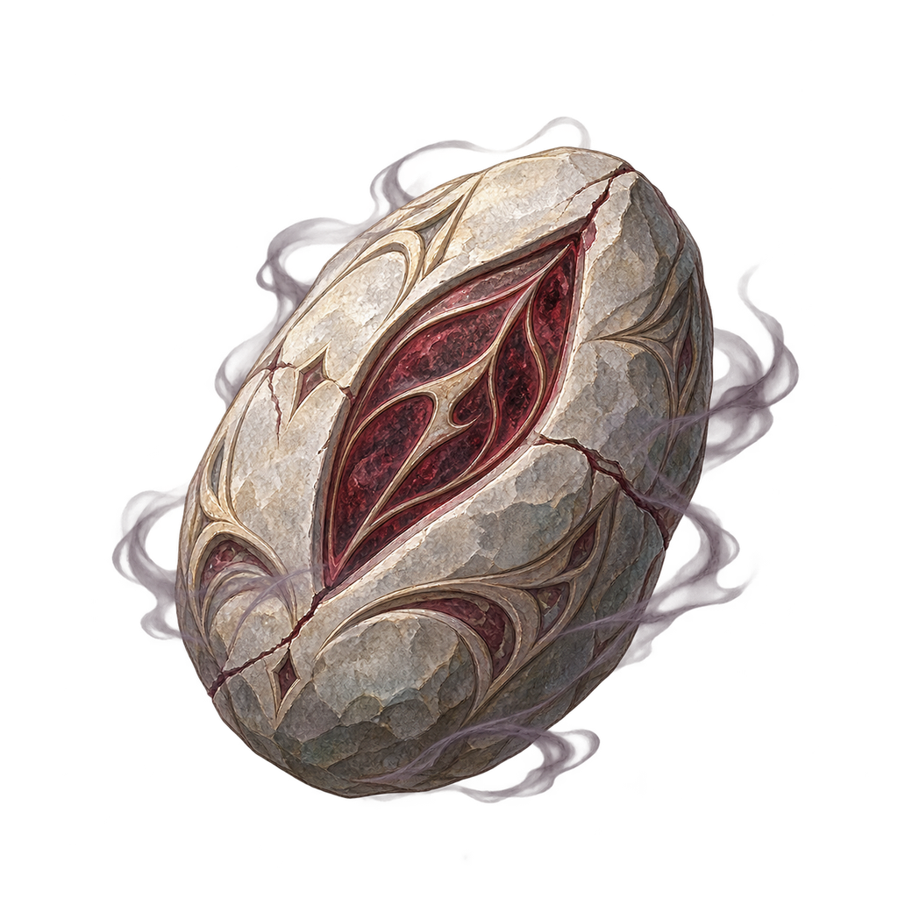 |
| [rune4_purified.png](./rune4_purified.png) | 정화된 룬 | 1024×1024 |  |
| [plant1_wilted.png](./plant1_wilted.png) | 시든 식물: 회복 전 | 512×512 | 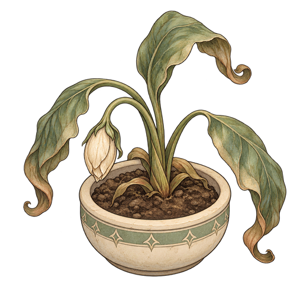 |
| [plant2_restored.png](./plant2_restored.png) | 회복된 식물: 승인 v2 | 512×512 |  |
| [herb1_moonlight.png](./herb1_moonlight.png) | 달빛 약초: 조사·획득 대상 | 256×256 |  |
| [event_rune1_inactive.png](./event_rune1_inactive.png) | 이벤트 룬: 비활성 | 512×512 | 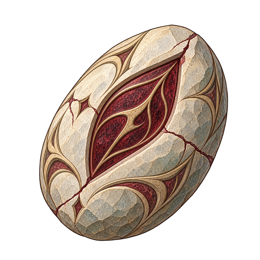 |
| [event_rune2_active.png](./event_rune2_active.png) | 이벤트 룬: 활성 | 512×512 | 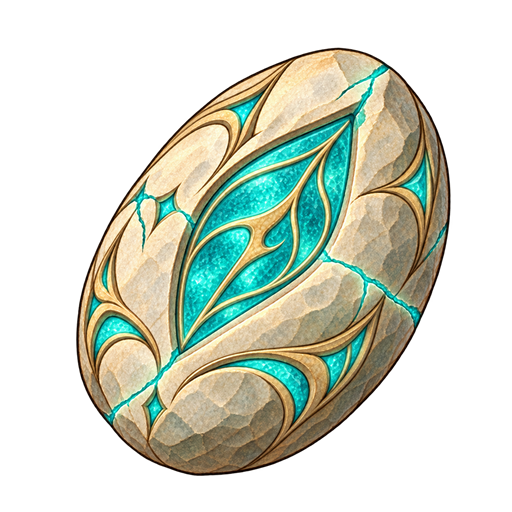 |

## 기존 프레임형 조사 이미지 · 4장

기존 아이템 디자인을 바탕으로 만든 밝은 아이보리 카드 시안입니다. 원본 아이템은 그대로 유지합니다. 얇은 모서리 장식 프레임 4장을 한 묶음으로 정리했습니다. 모두 3840×2161 PNG이며 생성 시안을 확대한 출력물입니다. 게임 화면 적용 검수는 별도입니다.

| 파일 | 명칭·용도 | 규격 | 미리보기 |
|---|---|---:|:---:|
| [diary1_heart_dusty_frame_thin_3840x2161.png](./diary1_heart_dusty_frame_thin_3840x2161.png) | 천문대용으로 제작했던 **닫힌** 먼지 쌓인 마음 일기 카드. 펼친 관측 일기 `ART-L01`과 구분하여 보존 | 3840×2161 | 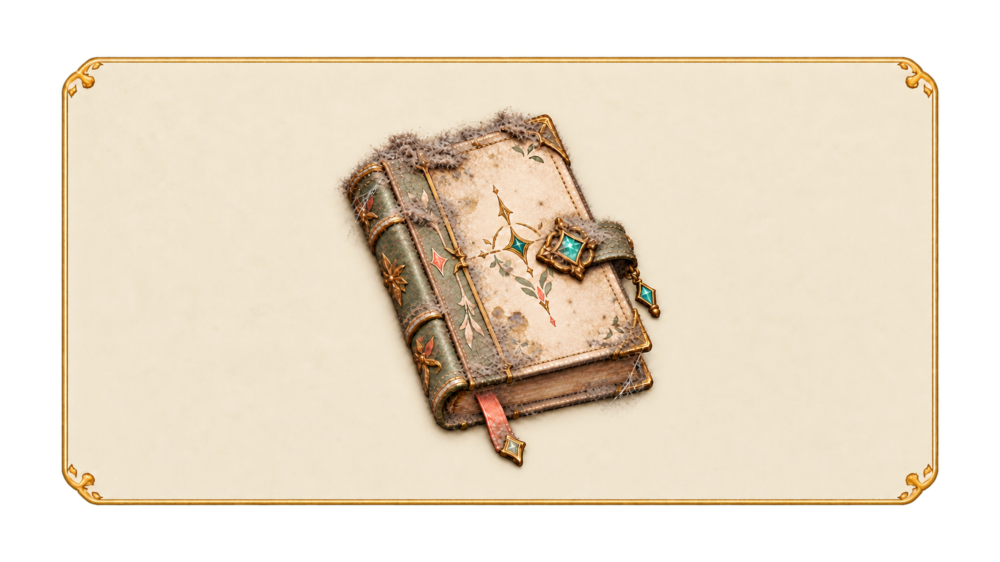 |
| [plant1_wilted_frame_thin_3840x2161.png](./plant1_wilted_frame_thin_3840x2161.png) | 온실: 시든 식물, 얇은 아이보리 프레임 | 3840×2161 |  |
| [plant2_restored_frame_thin_3840x2161.png](./plant2_restored_frame_thin_3840x2161.png) | 온실: 되살아난 식물, 얇은 아이보리 프레임 | 3840×2161 |  |
| [book1_ancient_frame_thin_3840x2161.png](./book1_ancient_frame_thin_3840x2161.png) | 대서고: 고서, 얇은 아이보리 프레임 | 3840×2161 |  |

원본: `C:/Users/josep/Desktop/Final Project/asset/item/originals`. 이전 회복 식물: `asset/item/review`. 기존 소지품·가구 20장은 1254×1254 원본에서 1024×1024로 축소했습니다. 기존 조사 오브젝트는 픽셀 데이터를 유지했습니다. 기존 25장은 새 이미지 생성 없이 정리한 파일이고, 위 프레임형 4장은 새로 생성한 투명 배경 PNG 시안입니다. 실제 게임 적용 검수는 별도입니다.
