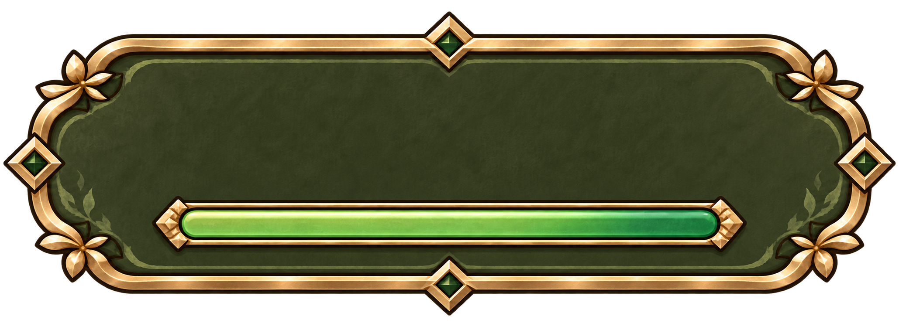
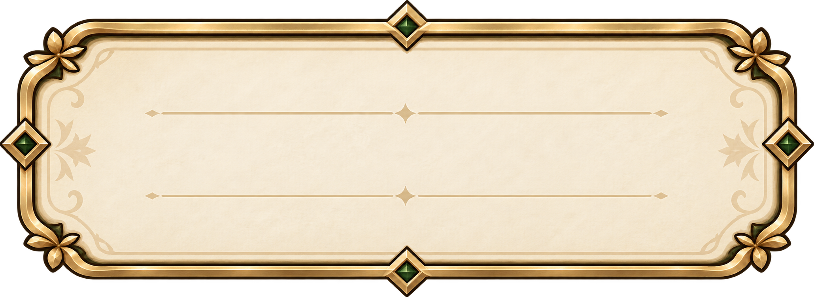

# 게임용 아이템

이 폴더는 **스토리에서 채택한 FOCUS 3장**, **채택 검수 전 프레임 카드 3장**, **일반 아이템 아트 25장**, **사용자 승인 UI 재료 5장**을 분리해 기록합니다. `ART-*`는 제작 문서의 그림 ID입니다. 이름이 비슷한 일반 아이템을 해당 장면에 자동으로 연결하지 않습니다.

명칭·용도는 자원 설명이며 획득 조건·수치·소모 효과를 확정하는 데이터가 아닙니다. 일반 25장은 [엔진의 아트 미리보기 목록](../../engine/src/core/bag-assets.mjs)에 파일명이 등록되어 있으나, 이 목록 자체에 소지품·해금 데이터가 아니라고 명시되어 있습니다. 현재 저장소에서 이 목록을 가져와 사용하는 화면 코드는 확인되지 않았습니다. 따라서 아래의 `배치 후보`는 **검색을 돕는 용도 분류**이고 실제 스토리 배정이나 게임 표시 완료를 뜻하지 않습니다.

기존 일반 아이템 PNG 25장과 프레임형 조사 이미지 3장, 스토리 FOCUS 3장, 마이룸·일지 UI 5장으로 **총 36장**입니다. 원본 26장과 이전 회복 식물 시안 1장은 로컬에 보관했습니다. 시든/회복 식물과 비활성/활성 이벤트 룬은 게임 상태가 달라 별도 이미지로 유지합니다. 회복 식물은 승인된 v2를 사용합니다.

## 마이룸·일지 UI 재료 · 사용자 승인 5장

요청에 따라 UI용 그림이지만 이 `asset/item/` 폴더에 저장했습니다. 소지품이나 스토리 FOCUS가 아닙니다. 프레임에는 텍스트가 없으므로 이름·연도·날짜는 게임에서 별도로 표시해야 합니다. 프로필·날짜 프레임의 캔버스는 **둘 다 2059×764px**로 가로 폭이 같습니다. 화살표와 X는 원본의 형태를 참고해 만든 투명 PNG 시안입니다. 아래 X는 사용자가 선택한 **첫 번째 생성본**입니다. 이미지 채택과 엔진 배치·클릭 동작 검수는 별개입니다.

| 파일 | 정확한 사용처 · 상태 | 크기 | 미리보기 |
|---|---|---:|:---:|
| [UI21_myroom_profile_frame_green.png](./UI21_myroom_profile_frame_green.png) | 마이룸 화면 왼쪽 위: 캐릭터 이름·상태 막대의 녹색 프레임. 텍스트 없음; 엔진 배치 미검수 | 2059×764 |  |
| [UI22_myroom_date_frame_ivory.png](./UI22_myroom_date_frame_ivory.png) | 마이룸 화면의 프로필 바로 아래: 연도·날짜·계절 표시용 아이보리 프레임. 텍스트 없음; 엔진 배치 미검수 | 2059×764 |  |
| [UI23_journal_arrow_right.png](./UI23_journal_arrow_right.png) | 일지 일정 화면: 월 제목 오른쪽의 오른쪽 방향 화살표. 클릭 동작 미연결 | 1280×1229 |  |
| [UI24_journal_arrow_down.png](./UI24_journal_arrow_down.png) | 일지 화면: 같은 화살표의 아래 방향 변형. 배치·클릭 동작 미정 | 1280×1229 |  |
| [UI25_journal_close_x.png](./UI25_journal_close_x.png) | 일지 일정 화면 오른쪽 위: 닫기 X. 첫 번째 생성 시안 채택; 클릭 동작 미연결 | 1254×1254 |  |

## 스토리 FOCUS 연결 상태

아래 그림은 보유 이미지입니다. `ART-*`는 최신 제작 문서의 **필요 그림 ID**이며, 이름이나 장소가 비슷하다는 이유로 자동 확정하지 않습니다. [전체 장면 연결표](../README.md)에서 배경·화자와 함께 확인하세요.

| 이야기·필요 그림 | 현재 보유 이미지 · 미리보기 | 판단 |
|---|---|---|
| `LOC_OBS_01–04` · `ART-L01` 펼친 관측 일기 | [먼지·거미줄이 쌓인 펼친 관측 일기](./ART-L01_observation_diary_open_dusty.png) 큰 미리보기는 아래 `ART-L01` 항목 참조 | **이미지 채택**: 네 회차가 이 한 장을 재사용. 엔진 표시 검수는 별도 |
| `LOC_GH_01-R1` · `ART-L02` 시든 허브 화분 | [시든 화분 카드](./plant1_wilted_frame_thin_3840x2161.png)  | **채택 후보**: 프레임을 포함한 3840×2161 카드. 온실 배경 위 FOCUS 표시 방식 검수 필요 |
| `LOC_GH_01-R2` · `ART-L03` 같은 화분의 회복 상태 | [회복 화분 카드](./plant2_restored_frame_thin_3840x2161.png)  | **채택 후보**: L02와 한 쌍. 상태 전환·규격 검수 필요 |
| `LOC_LIB_01-R1` · `ART-L04` 책장 위 평범한 책 | [장식 있는 고서 카드](./book1_ancient_frame_thin_3840x2161.png)  | **불일치 후보**: 보유 그림은 장식 있는 고서 카드. 평범한 책이 책장 위에 가로로 놓인 구도가 아님 |

`MS02`의 마법 덩굴은 `ART-M01/M02`로 별도 제작 지시가 있습니다. 여기의 일상 시든·회복 화분이나 `LOC_GH_01` 카드를 MS02에 자동 연결하지 않습니다. `ART-N01` 안내지와 `ART-N06` 루루 보물상자는 아래의 전용 FOCUS를 사용합니다. 그 밖의 `ART-N02–N05`, `ART-M01–M06`, `ART-E01`은 이름이 비슷한 일반 아이템을 대신 연결하지 않습니다.

## 채택한 스토리 FOCUS · 3장

다음 세 장은 사용자 승인에 따라 같은 밝은 아이보리 바탕·얇은 장식 프레임으로 교체했습니다. 미리보기는 좁은 표에서 줄어들지 않도록 각각 따로 배치하고 모두 폭 280px로 맞췄습니다. 프레임 밖은 투명합니다. 아래 규격은 파일의 실제 픽셀 수입니다. **이미지 경로 확정과 엔진 화면 연결 완료는 별개**이며, 게임 화면의 표시·크기 검수는 남아 있습니다.

### `ART-N01` · 바람에 흩어진 모임 안내지

- 파일: [ART-N01_meeting_notices_scattered.png](./ART-N01_meeting_notices_scattered.png) · 1672×941 투명 PNG
- 사용처: `NPC_GUIDE_01` 시계탑 광장에서 처음 표시. `NPC_GUIDE_02`, `NPC_GUIDE_04`에서 같은 그림 재사용. 읽히는 글자 대신 단순 문양 사용.

### `ART-N06` · 루루의 열린 보물상자

- 파일: [ART-N06_lulu_treasure_chest_open.png](./ART-N06_lulu_treasure_chest_open.png) · 1672×941 투명 PNG
- 사용처: `NPC_LULU_02` 온실 또는 약초원에서 처음 표시. `NPC_LULU_03–04`에서 같은 그림 재사용. 이후 새 발견물은 대사로 설명.

### `ART-L01` · 펼쳐진 관측 일기

- 파일: [ART-L01_observation_diary_open_dusty.png](./ART-L01_observation_diary_open_dusty.png) · 1672×941 투명 PNG
- 사용처: `LOC_OBS_01` 별빛 천문대에서 처음 표시. `LOC_OBS_02–04`에서 같은 그림 재사용. 회차별 기록 내용은 대화창 텍스트로 표시.

## 일반 아이템 아트 · 25장

같은 대상을 그린 일반 PNG와 프레임 카드는 화면 역할이 다릅니다. 일반 PNG는 소품·가구 이미지 후보이고, 프레임 카드는 대화 중 중앙에 띄울 FOCUS 후보입니다. 아래의 `마이룸`, `온실`, `공방` 등은 파일명·그림 내용에 따른 후보 장소입니다. 제작 문서가 장면 ID를 지정하기 전에는 엔진이 이 표만 보고 배치하지 않습니다.

| 파일 | 명칭·용도 | 배치 후보 · 연결 상태 | 규격 | 미리보기 |
|---|---|---|---:|:---:|
| [diary1_heart.png](./diary1_heart.png) | 마음 일기: 일반 기록 소품. 관측 일기 `ART-L01`과 별개 | 개인 기록·마이룸 소품 후보. `ART-L01` 관측 일기 아님; 화면 배치 미확인 | 1024×1024 |  |
| [lamp1_rune.png](./lamp1_rune.png) | 룬 램프: 조명 소품 | 마이룸 조명 소품 후보; 화면 배치 미확인 | 1024×1024 |  |
| [tea1_set.png](./tea1_set.png) | 차 세트: 생활 소품 | 마이룸 생활 소품 후보; 화면 배치 미확인 | 1024×1024 |  |
| [pot1_herb.png](./pot1_herb.png) | 약초 화분 | 마이룸·온실 화분 후보. `ART-L02/L03` 확정 그림 아님 | 1024×1024 |  |
| [rune1_fragment.png](./rune1_fragment.png) | 룬 조각 | 룬 수집·조사 소품 후보; 획득 조건·화면 배치 미확인 | 1024×1024 |  |
| [frame1_memory.png](./frame1_memory.png) | 추억 액자 | 마이룸 장식 후보; 화면 배치 미확인 | 1024×1024 |  |
| [desk1_myroom.png](./desk1_myroom.png) | 마이룸 책상 | 마이룸 가구 후보; 화면 배치 미확인 | 1024×1024 |  |
| [chair1_myroom.png](./chair1_myroom.png) | 마이룸 의자 | 마이룸 가구 후보; 화면 배치 미확인 | 1024×1024 |  |
| [bed1_myroom.png](./bed1_myroom.png) | 마이룸 침대 | 마이룸 가구 후보; 화면 배치 미확인 | 1024×1024 |  |
| [bookshelf1_myroom.png](./bookshelf1_myroom.png) | 마이룸 책장 | 마이룸 가구 후보; 화면 배치 미확인 | 1024×1024 |  |
| [rug1_myroom.png](./rug1_myroom.png) | 마이룸 러그 | 마이룸 가구 후보; 화면 배치 미확인 | 1024×1024 |  |
| [ornament1_rune.png](./ornament1_rune.png) | 룬 장식품 | 마이룸 룬 장식 후보; 화면 배치 미확인 | 1024×1024 |  |
| [book1_ancient.png](./book1_ancient.png) | 고서 | 대서고 소품 후보. `ART-L04`의 평범한 가로 책과 불일치 | 1024×1024 |  |
| [letter1_parchment.png](./letter1_parchment.png) | 양피지 편지 | 편지·문서 소품 후보. `MS01` 초대장이나 `END` 편지로 확정되지 않음 | 1024×1024 |  |
| [tools1_workshop.png](./tools1_workshop.png) | 공방 도구 | 마도 공방 소품 후보. `ART-N03/N04`로 확정되지 않음 | 1024×1024 |  |
| [sword1_wooden.png](./sword1_wooden.png) | 목검: 훈련 소품 | 훈련 소품 후보; 룬 수련장 배치 미확인 | 1024×1024 |  |
| [stone1_magic.png](./stone1_magic.png) | 마석 | 마법 재료 후보; 스토리 배정 미확인 | 1024×1024 |  |
| [rune2_heart.png](./rune2_heart.png) | 마음의 룬 | 룬 수집·조사 소품 후보; 스토리 배정 미확인 | 1024×1024 |  |
| [rune3_shadow.png](./rune3_shadow.png) | 그림자 룬 | 룬 수집·조사 소품 후보. `ART-M04/M05` 그림자 장면 아님 | 1024×1024 |  |
| [rune4_purified.png](./rune4_purified.png) | 정화된 룬 | 룬 수집·조사 소품 후보; 스토리 배정 미확인 | 1024×1024 |  |
| [plant1_wilted.png](./plant1_wilted.png) | 시든 식물: 회복 전 | 온실 상태 소품 후보. `ART-L02` 프레임 카드는 아래 별도 파일 | 512×512 |  |
| [plant2_restored.png](./plant2_restored.png) | 회복된 식물: 승인 v2 | 온실 상태 소품 후보. `ART-L03` 프레임 카드는 아래 별도 파일 | 512×512 |  |
| [herb1_moonlight.png](./herb1_moonlight.png) | 달빛 약초: 조사 소품 | 약초원 조사 소품 후보; 획득 조건·장면 배정 미확인 | 256×256 |  |
| [event_rune1_inactive.png](./event_rune1_inactive.png) | 이벤트 룬: 비활성 | 이벤트 룬 비활성 상태 후보; 장면 배정 미확인 | 512×512 |  |
| [event_rune2_active.png](./event_rune2_active.png) | 이벤트 룬: 활성 | 이벤트 룬 활성 상태 후보; 장면 배정 미확인 | 512×512 |  |

## 기존 프레임형 조사 이미지 · 3장

기존 아이템 디자인을 바탕으로 만든 밝은 아이보리 카드 시안입니다. 원본 아이템은 그대로 유지합니다. 얇은 모서리 장식 프레임 3장을 한 묶음으로 정리했습니다. 모두 3840×2161 PNG이며 생성 시안을 확대한 출력물입니다. 게임 화면 적용 검수는 별도입니다.

| 파일 | 명칭·용도 | 규격 | 미리보기 |
|---|---|---:|:---:|
| [plant1_wilted_frame_thin_3840x2161.png](./plant1_wilted_frame_thin_3840x2161.png) | 온실: 시든 식물, 얇은 아이보리 프레임 | 3840×2161 |  |
| [plant2_restored_frame_thin_3840x2161.png](./plant2_restored_frame_thin_3840x2161.png) | 온실: 되살아난 식물, 얇은 아이보리 프레임 | 3840×2161 |  |
| [book1_ancient_frame_thin_3840x2161.png](./book1_ancient_frame_thin_3840x2161.png) | 대서고: 고서, 얇은 아이보리 프레임 | 3840×2161 |  |

원본: `C:/Users/josep/Desktop/Final Project/asset/item/originals`. 이전 회복 식물: `asset/item/review`. 기존 소지품·가구 20장은 1254×1254 원본에서 1024×1024로 축소했습니다. 기존 조사 오브젝트는 픽셀 데이터를 유지했습니다. 기존 25장은 새 이미지 생성 없이 정리한 파일이고, 위 프레임형 3장은 새로 생성한 투명 배경 PNG 시안입니다. 실제 게임 적용 검수는 별도입니다.
