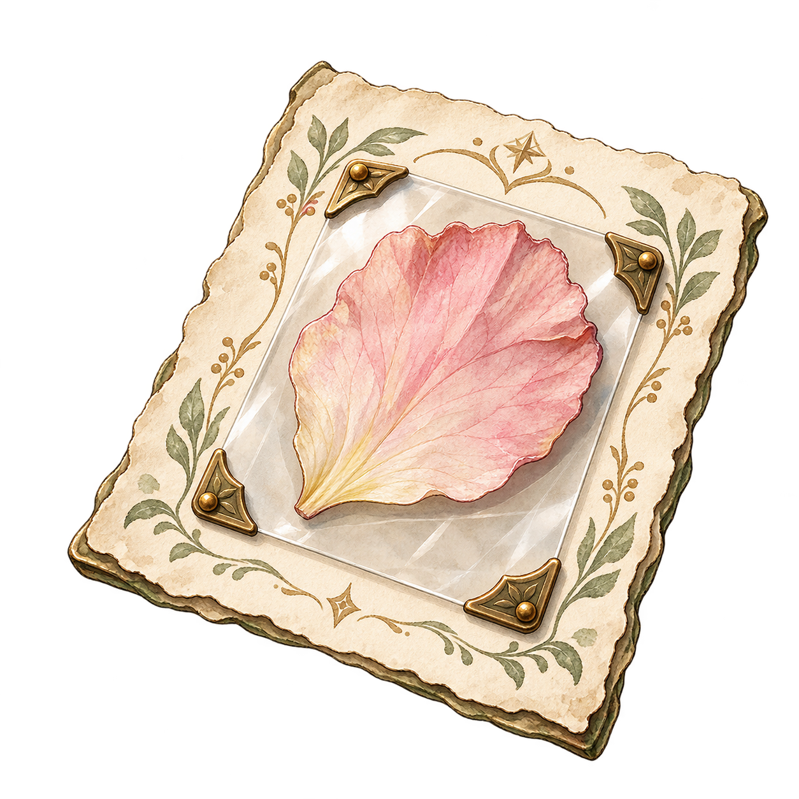
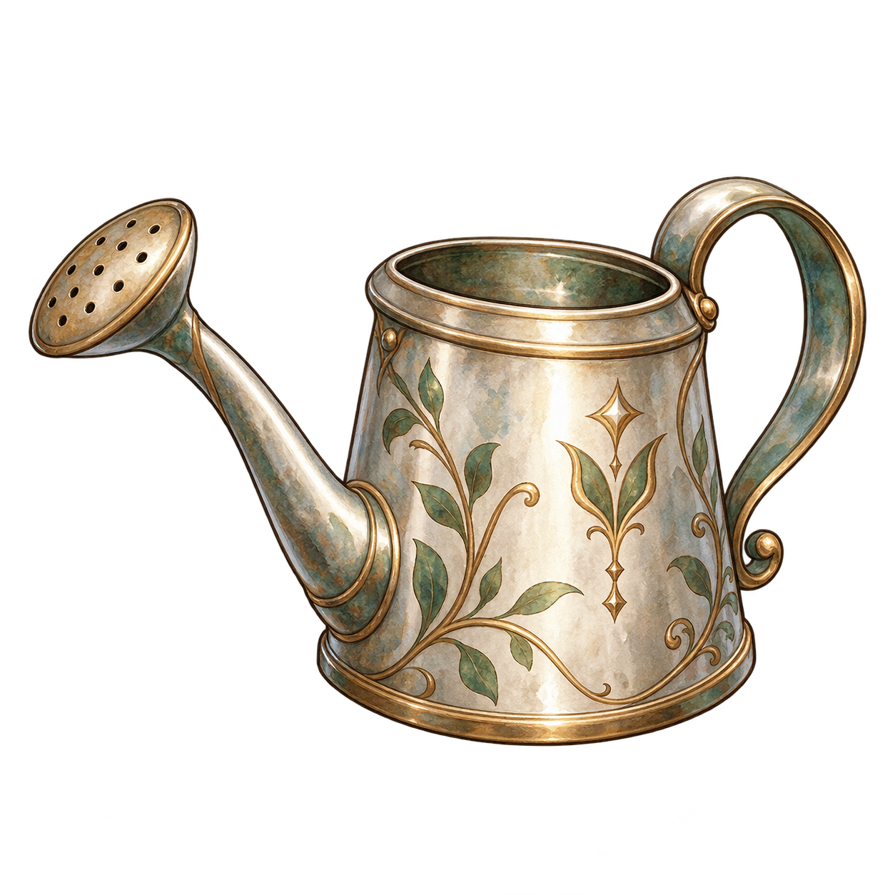
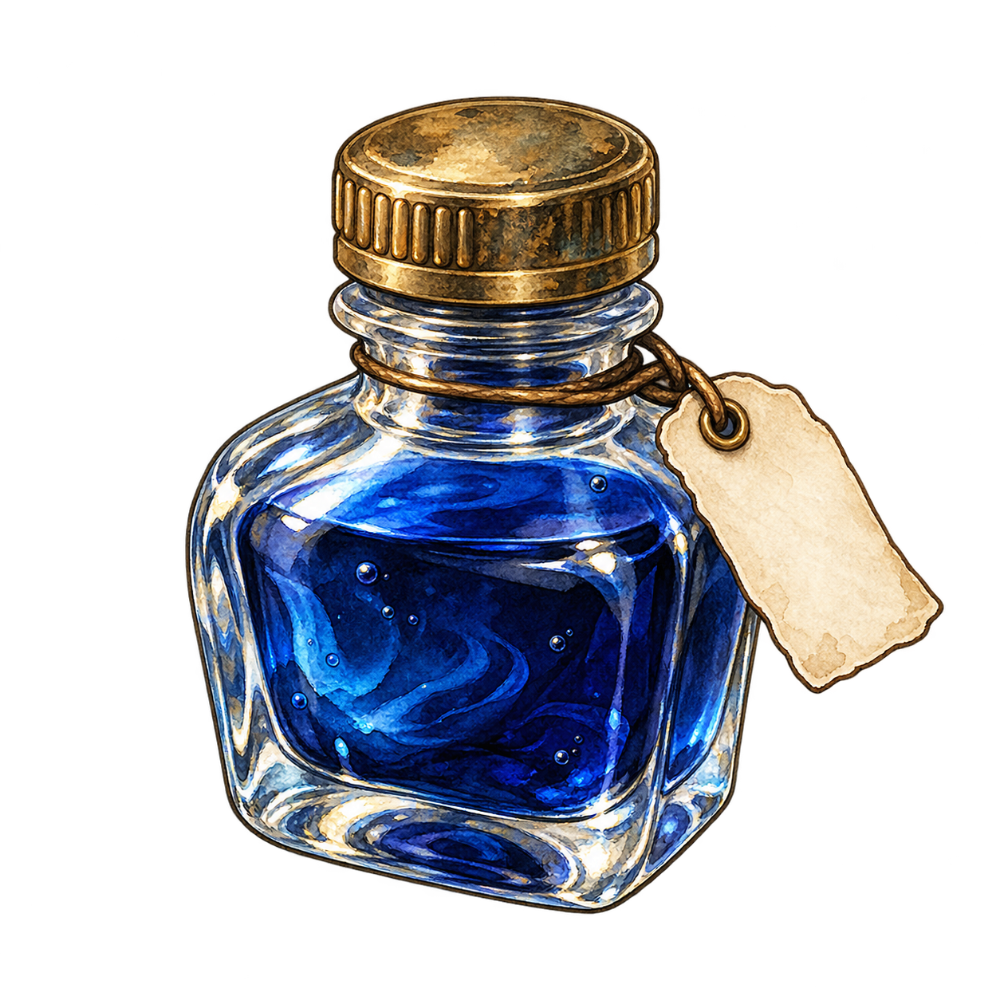
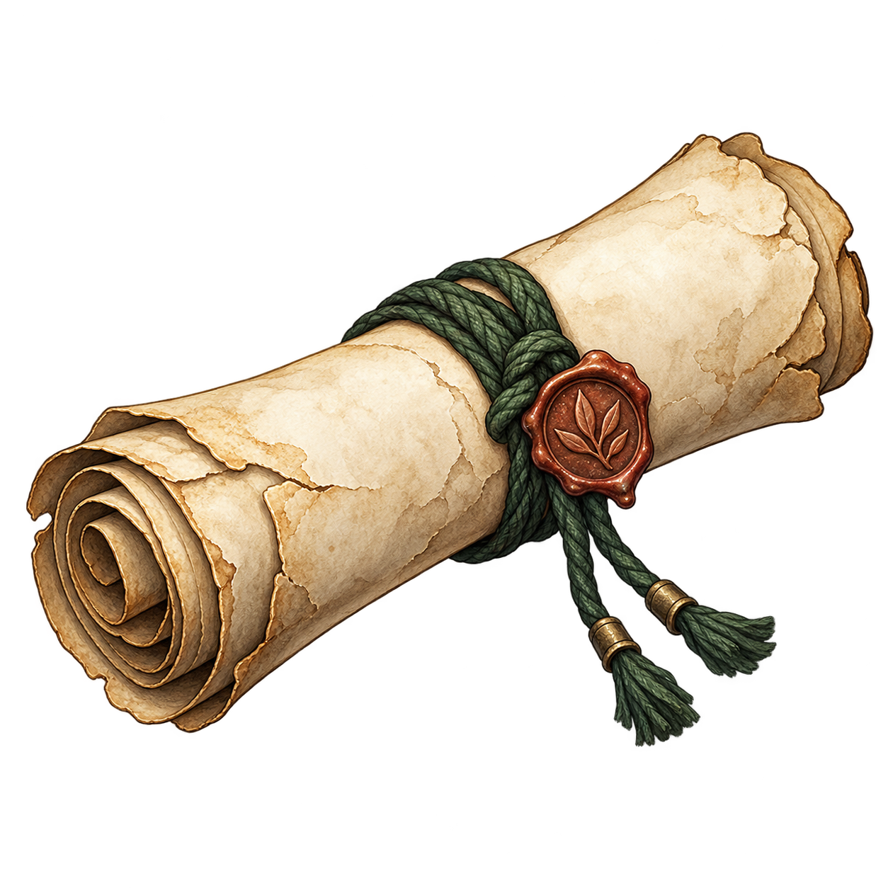
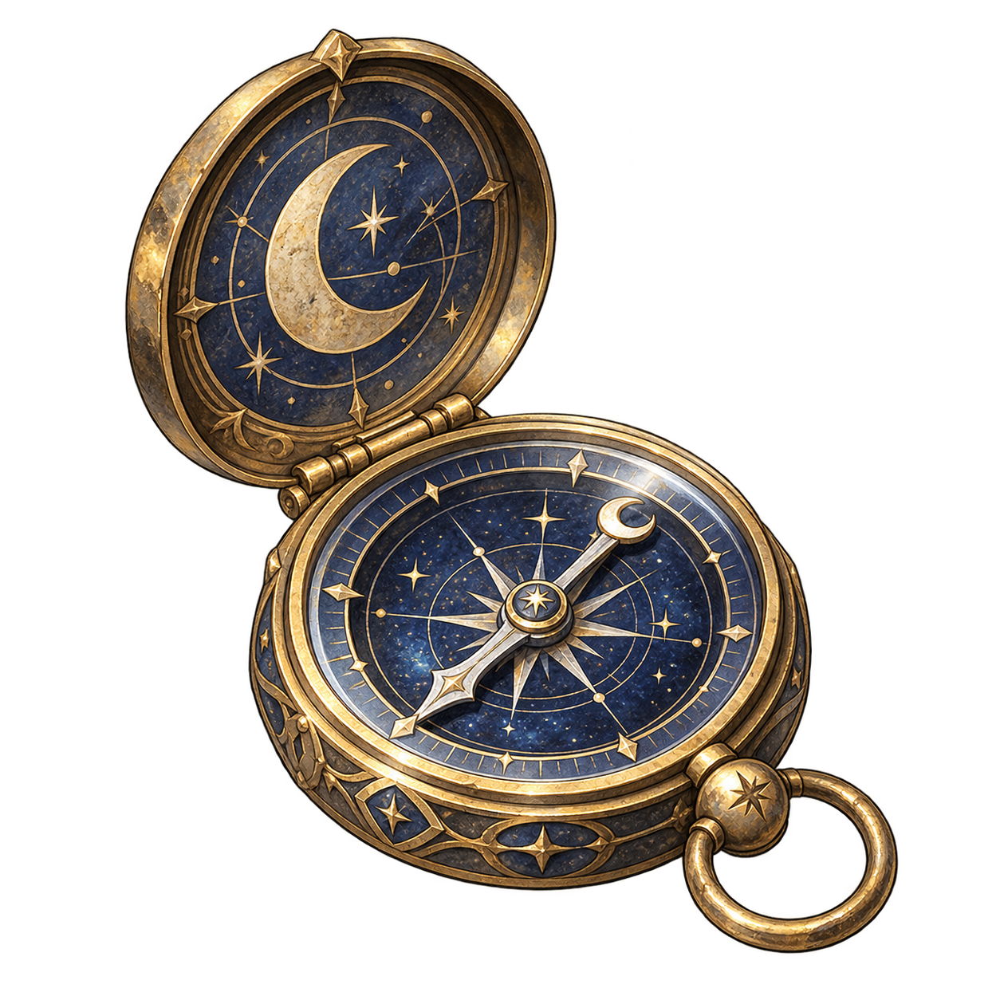
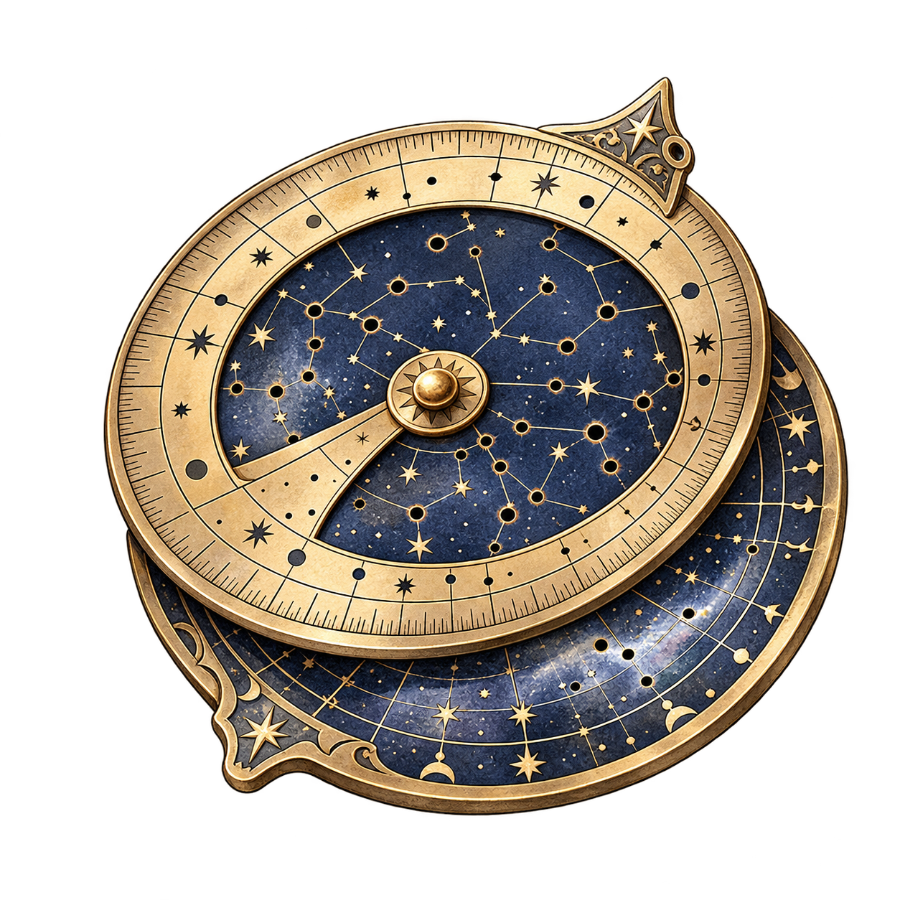
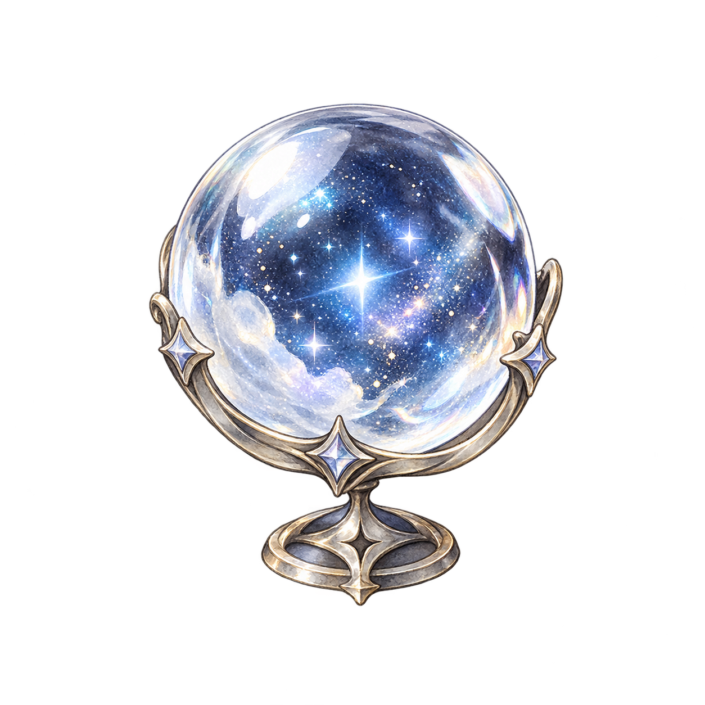

# 모험 목표 아이템 · 15장

[에셋 전체](../../README.md) → [아이템](../README.md) → 모험 목표

## 빠른 탐색

| 장소 | 아이템 ID | 목록 |
|---|---|---|
| 유리 온실·약초원 | `ADV_GH_01`–`ADV_GH_05` | [온실·약초원](#유리-온실약초원) |
| 대서고 | `ADV_LIB_01`–`ADV_LIB_05` | [대서고](#대서고) |
| 별빛 천문대 | `ADV_OBS_01`–`ADV_OBS_05` | [별빛 천문대](#별빛-천문대) |

## 사용처·상태

[공통 엔진 프레임 7.1](../../../document/content/10_COMMON_ENGINE_FRAME.md#71-장소별-목표-아이템-풀)과 [이미지 제작 목록](../../../document/content/14_ADVENTURE_ITEM_IMAGES.md)의 ID·이름·경로를 그대로 사용합니다. 이 15장은 **모험판 안에서만 쓰는 임시 목표 아이템**입니다. 해당 장소의 5종 중 선택된 목표를 단서 화면에서 이름 옆에 보여 주기 위한 이미지이며, 지도 위 숨은 위치 표지나 일반 가방 소지품·스토리 FOCUS를 뜻하지 않습니다.

사용자가 승인한 1254×1254 투명 PNG를 파일로 등록했습니다. **아트 선택·경로 등록은 완료**, 엔진의 단서 화면에서 실제 이미지 표시·크기 검수는 별도입니다. 새 이미지를 `IT_*` 일반 아이템이나 `ART-*` 스토리 FOCUS와 혼용하지 않습니다.

현재 실행형 엔진 서버의 /design-assets/item/ 경로는 하위 `adventure/` 폴더를 제공하지 않고, 단서 UI에도 이 15개 ID의 이미지 매핑이 없습니다. 게임 화면 연결 시 서버 경로와 단서 UI 매핑을 별도로 추가해야 합니다.

## 파일 목록·미리보기

### 유리 온실·약초원

| 아이템 ID · 파일 | 단서 화면 이름 | 사용처 | 미리보기 |
|---|---|---|:---:|
| `ADV_GH_01` · [ADV_GH_01.png](./ADV_GH_01.png) | 푸른 잎의 씨앗 | 유리 온실·약초원 모험 목표 · 단서 화면 |  |
| `ADV_GH_02` · [ADV_GH_02.png](./ADV_GH_02.png) | 작은 약초 주머니 | 유리 온실·약초원 모험 목표 · 단서 화면 |  |
| `ADV_GH_03` · [ADV_GH_03.png](./ADV_GH_03.png) | 햇살을 머금은 유리구슬 | 유리 온실·약초원 모험 목표 · 단서 화면 |  |
| `ADV_GH_04` · [ADV_GH_04.png](./ADV_GH_04.png) | 꽃잎 표본 카드 | 유리 온실·약초원 모험 목표 · 단서 화면 |  |
| `ADV_GH_05` · [ADV_GH_05.png](./ADV_GH_05.png) | 은빛 물뿌리개 | 유리 온실·약초원 모험 목표 · 단서 화면 |  |

### 대서고

| 아이템 ID · 파일 | 단서 화면 이름 | 사용처 | 미리보기 |
|---|---|---|:---:|
| `ADV_LIB_01` · [ADV_LIB_01.png](./ADV_LIB_01.png) | 책갈피 룬 조각 | 대서고 모험 목표 · 단서 화면 |  |
| `ADV_LIB_02` · [ADV_LIB_02.png](./ADV_LIB_02.png) | 빛바랜 서가 열쇠 | 대서고 모험 목표 · 단서 화면 |  |
| `ADV_LIB_03` · [ADV_LIB_03.png](./ADV_LIB_03.png) | 접힌 장서 목록 | 대서고 모험 목표 · 단서 화면 |  |
| `ADV_LIB_04` · [ADV_LIB_04.png](./ADV_LIB_04.png) | 푸른 잉크병 | 대서고 모험 목표 · 단서 화면 |  |
| `ADV_LIB_05` · [ADV_LIB_05.png](./ADV_LIB_05.png) | 봉인된 두루마리 | 대서고 모험 목표 · 단서 화면 |  |

### 별빛 천문대

| 아이템 ID · 파일 | 단서 화면 이름 | 사용처 | 미리보기 |
|---|---|---|:---:|
| `ADV_OBS_01` · [ADV_OBS_01.png](./ADV_OBS_01.png) | 별빛 렌즈 조각 | 별빛 천문대 모험 목표 · 단서 화면 |  |
| `ADV_OBS_02` · [ADV_OBS_02.png](./ADV_OBS_02.png) | 달무늬 나침반 | 별빛 천문대 모험 목표 · 단서 화면 |  |
| `ADV_OBS_03` · [ADV_OBS_03.png](./ADV_OBS_03.png) | 접힌 별자리 지도 | 별빛 천문대 모험 목표 · 단서 화면 |  |
| `ADV_OBS_04` · [ADV_OBS_04.png](./ADV_OBS_04.png) | 황동 성도판 | 별빛 천문대 모험 목표 · 단서 화면 |  |
| `ADV_OBS_05` · [ADV_OBS_05.png](./ADV_OBS_05.png) | 작은 수정구슬 | 별빛 천문대 모험 목표 · 단서 화면 |  |
