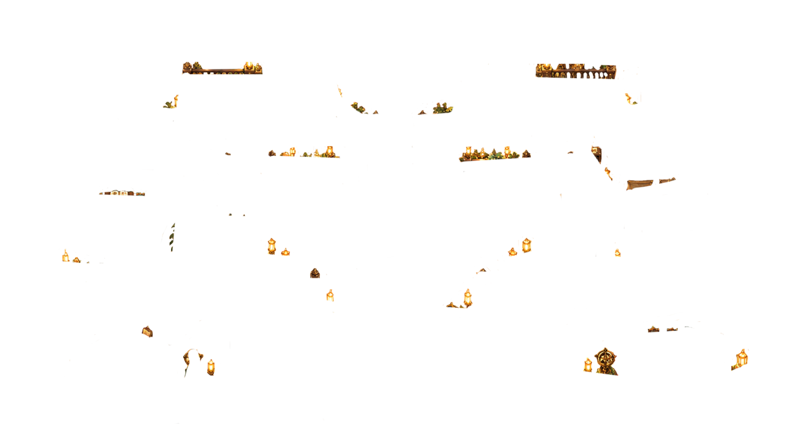
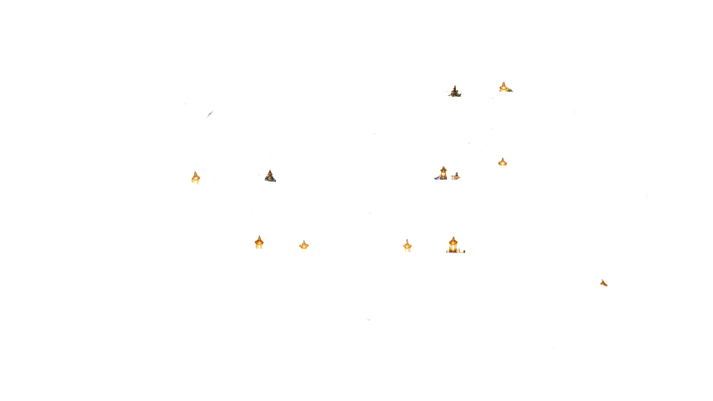
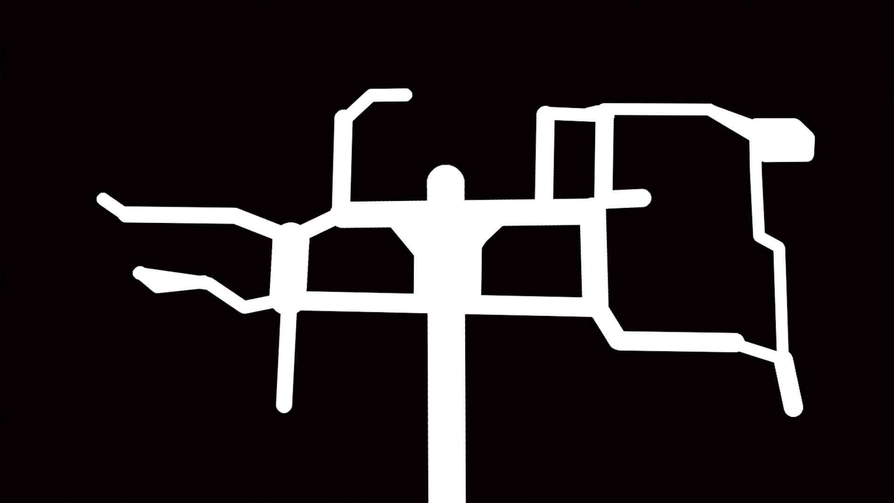

# 장소별 어드벤처 맵

현재 엔진 모험은 아래 온실 원본에서 내보낸 WebP와 충돌 마스크를 사용합니다. 대서고·천문대는 각각 전체맵·전경·충돌 마스크가 있지만 엔진 연결과 충돌·가림 검수는 별도입니다. 기존 직선맵은 참고 자원이며, 과거 곡선맵 파일은 현재 이 폴더에 없습니다.

추가 장소 자원의 이력은 [2026-10-16 추가 기록](./ADDITIONS_2026-10-16.md)을 확인합니다.

## 현재 엔진 연결 (2026-10-14)

| 파일 | 역할 | 규격 |
|---|---|---|
| `MP01_greenhouse_master_3840x2160.png` | 디자이너 배경 원본 · 보존 | 3840×2160 |
| `MP01_greenhouse_foreground_3840x2160.png` | 투명 전경 원본 · 보존 | 3840×2160 |
| `MP01_greenhouse_collision_mask_3840x2160.png` | 충돌 마스크 원본 · 보존 | 3840×2160 |
| `MP01_greenhouse_world_3840x2160.webp` | 런타임 배경 · quality 85 시안 | 3840×2160 |
| `MP01_greenhouse_world_1920x1080.webp` | 활동 카드 배경 썸네일 | 1920×1080 |
| `MP01_greenhouse_foreground_3840x2160.webp` | 런타임 투명 전경 · 무손실 | 3840×2160 |
| `MP01_greenhouse_collision_mask_1920x1080.png` | 런타임 흑백 충돌 · 흰색만 이동 가능 | 1920×1080 |

배경·전경은 동일한 world 좌표와 원점 (0,0)을 사용합니다. 충돌 마스크는 정규화 좌표로 대응합니다. 전경은 사용자 승인에 따라 임시로 항상 캐릭터 앞에 표시하며, 오브젝트별 기준선·영역 데이터는 미정입니다. 카메라 기본 확대율은 0.7이며 캐릭터를 추적합니다.

원본은 덮어쓰지 않습니다. 수정된 배경은 4K/축소 WebP, 수정된 전경은 4K 투명 WebP로 별도 내보냅니다. 미사용 1920×1080 전경 WebP는 삭제했습니다. `engine/assets/`는 사용하지 않으며 모든 맵 자원은 이 폴더에서 관리합니다.

| 파일 | 용도 | 규격 | 미리보기 |
|---|---|---|---|
| [map1_straight.png](./map1_straight.png) | 직선 전체맵 참고 시안 | 1920×1080 |  |
| [MP01_greenhouse_master_3840x2160.png](./MP01_greenhouse_master_3840x2160.png) | 온실 마스터 배경 | 3840×2160 |  |
| [MP01_greenhouse_foreground_3840x2160.png](./MP01_greenhouse_foreground_3840x2160.png) | 온실 투명 전경 원본 | 3840×2160 |  |
| [MP01_greenhouse_collision_mask_3840x2160.png](./MP01_greenhouse_collision_mask_3840x2160.png) | 온실 충돌 원본 | 3840×2160 |  |
| [MP01_greenhouse_world_3840x2160.webp](./MP01_greenhouse_world_3840x2160.webp) | 온실 런타임 배경 | 3840×2160 |  |
| [MP01_greenhouse_world_1920x1080.webp](./MP01_greenhouse_world_1920x1080.webp) | 온실 썸네일 | 1920×1080 |  |
| [MP01_greenhouse_foreground_3840x2160.webp](./MP01_greenhouse_foreground_3840x2160.webp) | 온실 런타임 전경 | 3840×2160 |  |
| [MP01_greenhouse_collision_mask_1920x1080.png](./MP01_greenhouse_collision_mask_1920x1080.png) | 온실 런타임 충돌 마스크 | 1920×1080 |  |
| [MP02_grand_library3840x2161.png](./MP02_grand_library3840x2161.png) | 대서고 전체맵 | 3840×2161 |  |
| [MP02_foreground_3840x2161.png](./MP02_foreground_3840x2161.png) | 대서고 투명 전경 | 3840×2161 |  |
| [MP02_collosion_mask_1920x1081.png](./MP02_collosion_mask_1920x1081.png) | 대서고 충돌 마스크 (`collosion`은 현재 실제 파일명) | 1920×1081 |  |
| [MP03_starlight_observatory_fullmap3840x2161.png](./MP03_starlight_observatory_fullmap3840x2161.png) | 천문대 전체맵 | 3840×2161 |  |
| [MP03_foreground_3840x2161.png](./MP03_foreground_3840x2161.png) | 천문대 투명 전경 | 3840×2161 |  |
| [MP03_collision_mask_1920x1081.png](./MP03_collision_mask_1920x1081.png) | 천문대 충돌 마스크 | 1920×1081 |  |

## 로컬 보관

`C:/Users/josep/Desktop/Final Project/asset/map`

- `originals`: 원본 2개와 밝은 색감 수정본의 생성 원본 2개.
- `previous_versions`: 기존 전체맵·플레이·백팩·직선맵 6개.
- `map_archive_000.md`: 기존 파일 복사 검증 기록.

2026-10-10: 초기 MAP01~MAP03 및 이전 맵 파일을 GitHub에서 제거하고 두 전체맵만 유지했습니다. 두 맵 모두 기존 구조를 유지하고 SD 캐릭터가 배경에 묻히지 않도록 식물 채도와 그림자 대비를 낮춰 색감을 수정했습니다. 입구 상부 아치 연결부를 제거하고 양쪽 기둥만 유지했습니다. SD 캐릭터·UI·경로 표시가 없는 전체맵입니다. 이 PNG는 합쳐진 전체맵 이미지로, 이동 충돌·앞뒤 가림용 레이어나 타일 데이터는 포함하지 않습니다.
