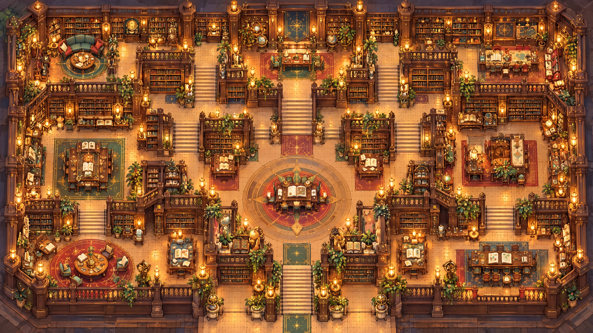

# 이동 맵 에셋

이 폴더는 모험 화면에서 SD 캐릭터가 이동하는 **전체맵·가림 전경·충돌 마스크**를 보관합니다. 대화 장면 배경은 [background/README.md](../background/README.md)를 보세요. 현재 브랜치의 추적 이미지 16개는 MP01 4개, MP02 4개, MP03 7개, 참고 맵 1개입니다. 아래 링크는 `asset/map/`의 실제 파일을 가리킵니다.

**런타임 연결:** MP01·MP02는 기존 WebP·1920×1080 마스크를 제거하고 새 3840×2160 PNG 세트로 교체했습니다. [엔진의 모험 맵 경로](../../engine/src/core/adventure-mission.mjs)의 전체맵·썸네일·전경·마스크도 새 파일을 가리킵니다. 썸네일은 별도 저해상도 파일 없이 같은 3840×2160 맵을 재사용합니다. 서버 파일 응답과 자동 테스트로 연결을 확인했으며, 실제 게임 화면의 충돌 경계·가림·확대 품질은 수동 플레이 검수가 남아 있습니다.

## 빠른 탐색

| 장소 | 새 전체맵(게임 좌표 기준) | 새 가림 전경 | 새 충돌 마스크 | 고해상도 원본 | 실행 상태 |
|---|---|---|---|---|---|
| MP01 유리 온실·약초원 | [3840×2160 맵](./MP01_greenhouse_master_3840x2160.png) | [`-1` 전경](./MP01_greenhouse_foreground_3840x2160-1.png) | [3840×2160 마스크](./MP01_greenhouse_collision_mask_3840x2160.png) | [5504×3072 원본](./MP01_greenhouse_master_5504x3072.png) | 엔진 PNG 경로 연결, 화면 수동 검수 대기 |
| MP02 대서고 | [3840×2160 맵](./MP02_grand_library_3840x2160.png) | [3840×2160 전경](./MP02_grand_library_foreground_3840x2160.png) | [3840×2160 마스크](./MP02_grand_library_collision_mask_3840x2160.png) | [5504×3072 원본](./MP02_grand_library_5504x3072.png) | 엔진 PNG 경로 연결, 화면 수동 검수 대기 |
| MP03 별빛 천문대 | [3840×2160 실행용 WebP](./MP03_starlight_observatory_world_3840x2160.webp) | [3840×2160 실행용 WebP](./MP03_starlight_observatory_foreground_3840x2160.webp) | [1920×1080 실행용 마스크](./MP03_starlight_observatory_collision_mask_1920x1080.png) | [3840×2162 검토용 마스터](./MP03_starlight_observatory_master_3840x2162.png) | 기존 실행 경로 유지 |

전경은 전체 오브젝트를 따로 그린 그림이 아니라 **캐릭터보다 앞에 표시할 가림 영역만 있는 투명 레이어**입니다. 충돌 마스크는 완전 불투명한 순백색(`#FFFFFF`)만 이동 가능하며 나머지는 이동 불가입니다. 전체맵·전경·마스크는 같은 맵의 동일한 좌표계로 함께 사용하세요. 5504×3072 원본과 3840×2160 게임 맵은 구도·픽셀이 완전히 같다고 가정하지 말고, 3840×2160 전경·마스크는 표에 적힌 3840×2160 맵과 대조하세요.

## MP01 · 유리 온실·약초원 (4개)

| 파일 | 역할 | 실제 크기 | 상태 |
|---|---|---:|---|
| [MP01_greenhouse_master_3840x2160.png](./MP01_greenhouse_master_3840x2160.png) | SD 이동 화면의 새 전체맵 | 3840×2160 | 엔진 PNG 경로 연결, 화면 수동 검수 대기 |
| [MP01_greenhouse_foreground_3840x2160-1.png](./MP01_greenhouse_foreground_3840x2160-1.png) | 새 전체맵 위에 겹칠 투명 가림 전경. `-1`은 사용자가 지정한 버전명 | 3840×2160 | 엔진 PNG 경로 연결, 화면 수동 검수 대기 |
| [MP01_greenhouse_collision_mask_3840x2160.png](./MP01_greenhouse_collision_mask_3840x2160.png) | 새 전체맵의 흰색 이동 가능/검정 충돌 마스크 | 3840×2160 | 엔진 PNG 경로 연결, 화면 수동 검수 대기 |
| [MP01_greenhouse_master_5504x3072.png](./MP01_greenhouse_master_5504x3072.png) | 고해상도 편집·보존 원본 | 5504×3072 | 게임의 3840 좌표 파일과 구분 |

## MP02 · 대서고 (4개)

| 파일 | 역할 | 실제 크기 | 상태 |
|---|---|---:|---|
| [MP02_grand_library_3840x2160.png](./MP02_grand_library_3840x2160.png) | SD 이동 화면의 새 전체맵 | 3840×2160 | 엔진 PNG 경로 연결, 화면 수동 검수 대기 |
| [MP02_grand_library_foreground_3840x2160.png](./MP02_grand_library_foreground_3840x2160.png) | 새 전체맵 위에 겹칠 투명 가림 전경 | 3840×2160 | 엔진 PNG 경로 연결, 화면 수동 검수 대기 |
| [MP02_grand_library_collision_mask_3840x2160.png](./MP02_grand_library_collision_mask_3840x2160.png) | 새 전체맵의 흰색 이동 가능/검정 충돌 마스크 | 3840×2160 | 엔진 PNG 경로 연결, 화면 수동 검수 대기 |
| [MP02_grand_library_5504x3072.png](./MP02_grand_library_5504x3072.png) | 고해상도 편집·보존 원본 | 5504×3072 | 게임의 3840 좌표 파일과 구분 |

## MP03 · 별빛 천문대 (7개, 이번 교체 대상 아님)

| 파일 | 역할 | 실제 크기 |
|---|---|---:|
| [MP03_starlight_observatory_world_3840x2160.webp](./MP03_starlight_observatory_world_3840x2160.webp) | 현재 게임용 전체맵 | 3840×2160 |
| [MP03_starlight_observatory_world_1920x1080.webp](./MP03_starlight_observatory_world_1920x1080.webp) | 현재 게임용 축소 미리보기 | 1920×1080 |
| [MP03_starlight_observatory_foreground_3840x2160.webp](./MP03_starlight_observatory_foreground_3840x2160.webp) | 현재 게임용 투명 전경 | 3840×2160 |
| [MP03_starlight_observatory_collision_mask_1920x1080.png](./MP03_starlight_observatory_collision_mask_1920x1080.png) | 현재 게임용 충돌 마스크 | 1920×1080 |
| [MP03_starlight_observatory_master_3840x2162.png](./MP03_starlight_observatory_master_3840x2162.png) | 다른 구도의 검토용 마스터, 런타임 미반영 | 3840×2162 |
| [MP03_starlight_observatory_foreground_3840x2161.png](./MP03_starlight_observatory_foreground_3840x2161.png) | 검토용 마스터와 함께 보관한 전경 | 3840×2161 |
| [MP03_starlight_observatory_collision_mask_1920x1081.png](./MP03_starlight_observatory_collision_mask_1920x1081.png) | 검토용 마스터와 함께 보관한 마스크 | 1920×1081 |

## 참고 파일 (1개)

| 파일 | 역할 | 크기 |
|---|---|---:|
| [map1_straight.png](./map1_straight.png) | 직선형 전체맵 시안, MP01~MP03 런타임 경로와 무관 | 1920×1080 |

## 엔진 연결과 검수

`engine/src/core/adventure-mission.mjs`의 MP01·MP02 `world`, `thumbnail`, `mask`, `foreground`는 위의 3840×2160 PNG를 사용합니다. `engine/server.mjs`는 `design-assets/map/` 요청을 이 폴더에 직접 매핑하므로 별도 복사·번들이 없습니다. 삭제된 1920×1080 썸네일 대신 전체맵 PNG를 재사용합니다. 자동 테스트는 파일 응답과 경로를 확인합니다. 실제 화면에서는 시작점·목표 배치·충돌 경계·가림과 확대 품질을 별도로 플레이 검수해야 합니다.

[ADDITIONS_2026-10-16.md](./ADDITIONS_2026-10-16.md)는 과거 MP02·MP03 추가 당시의 기록입니다. 그 문서에 나온 MP02 3840×2161 파일은 이번 교체로 제거됐으며, **현재 파일 목록은 이 README가 우선**입니다.
