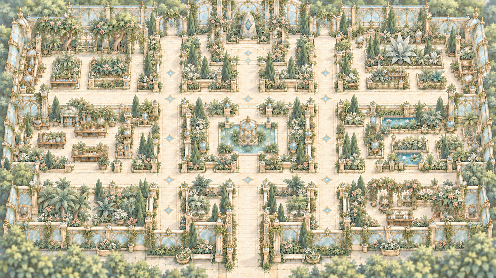
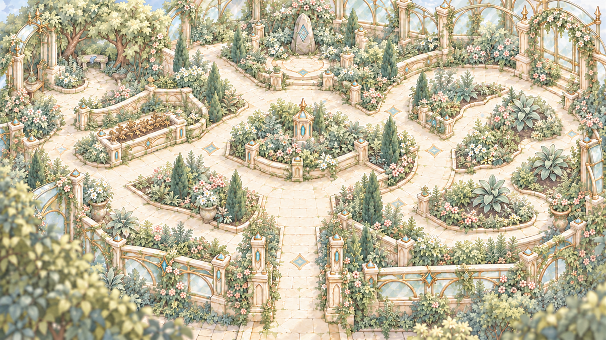
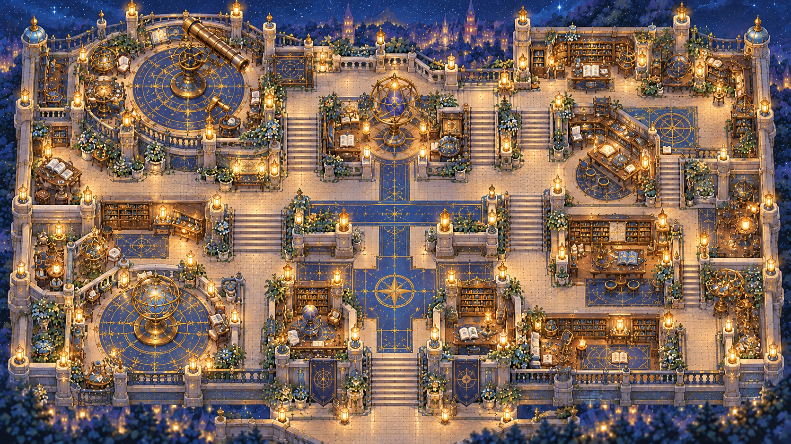
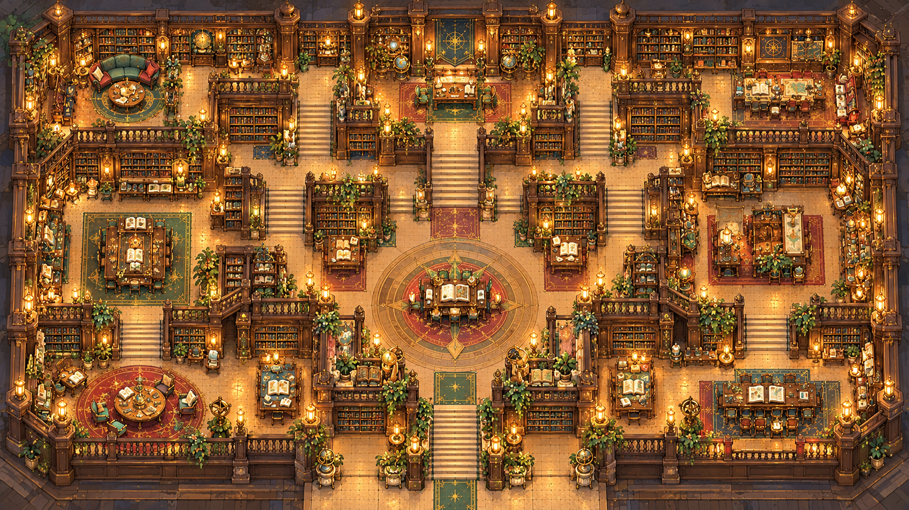

# 장소별 어드벤처 전체맵

기존 온실 직선·곡선 전체맵 2장과 신규 별빛 천문대·대서고 전체맵 원본 2장을 보관합니다. 기존 온실맵은 1920×1080 게임 규격이며, 신규 장소맵은 생성 원본 1672×941입니다.

| 파일 | 용도 | 규격 | 미리보기 |
|---|---|---|---|
| [map1_straight.png](./map1_straight.png) | 직선 전체맵 | 1920×1080 |  |
| [map2_curved.png](./map2_curved.png) | 곡선 온실 전체맵 | 1920×1080 |  |
| [starlight_observatory_fullmap.png](./starlight_observatory_fullmap.png) | 별빛 천문 관측 테라스 전체맵 원본 | 1672×941 |  |
| [grand_library_fullmap.png](./grand_library_fullmap.png) | 황금빛 대서고 전체맵 원본 | 1672×941 |  |

## 로컬 보관

`C:/Users/josep/Desktop/Final Project/asset/map`

- `originals`: 기존 온실맵 생성 원본과 이번에 추가한 별빛 천문대·대서고 전체맵 원본을 보관합니다.
- `previous_versions`: 기존 전체맵·플레이·백팩·직선맵 6개.
- `map_archive_000.md`: 기존 파일 복사 검증 기록.

2026-10-10: 초기 MAP01~MAP03 및 이전 맵 파일을 GitHub에서 제거하고 두 전체맵만 유지했습니다. 두 맵 모두 기존 구조를 유지하고 SD 캐릭터가 배경에 묻히지 않도록 식물 채도와 그림자 대비를 낮춰 색감을 수정했습니다. 입구 상부 아치 연결부를 제거하고 양쪽 기둥만 유지했습니다. SD 캐릭터·UI·경로 표시가 없는 전체맵입니다. 이 PNG는 합쳐진 전체맵 이미지로, 이동 충돌·앞뒤 가림용 레이어나 타일 데이터는 포함하지 않습니다.

2026-10-15: 로컬 `originals/`의 `별빛 천문 관측 테라스 지도.png`와 `황금빛 판타지 도서관 평면도.png`를 원본 바이트 그대로 각각 별빛 천문대·대서고 전체맵으로 추가했습니다. 기존 온실맵 2장은 변경하지 않았습니다. 새 맵의 게임 규격 변환, 이동 충돌·앞뒤 가림 데이터, 실제 화면 적용은 아직 검수되지 않았습니다.
