# 맵 에셋

이 폴더의 이미지 22개를 아래에 모두 표시합니다. 미리보기와 파일 링크는 같은 폴더의 실제 파일을 가리킵니다. 크기는 이미지 자체의 픽셀 기준입니다. `MP01`은 온실, `MP02`는 대서고, `MP03`은 별빛 천문대의 **이동용 전체맵·가림 전경·충돌 마스크**입니다. 스토리 대화의 화면 배경은 [background/README.md](../background/README.md)에서 찾습니다. 맵 파일 보유와 엔진 연결 완료는 구분합니다. MP02·MP03의 새 마스터 PNG는 이전보다 파일 용량이 크고 구도도 달라졌지만, 현재 엔진이 읽는 월드·썸네일 WebP는 기존 파일을 유지합니다.

## 빠른 탐색

| 사용처·장면 | 파일명 기준 | 현재 상태 | 파일 목록·미리보기 |
|---|---|---|---|
| 이동·충돌용 맵; 장소별 이동 지형; BACKGROUND와 구분 | `MP* 및 기존 참고 맵` | 이 폴더 이미지 22장. 개별 파일의 채택·후보·검수 상태는 아래 설명을 따름 | 아래 파일 표와 미리보기, [에셋 전체 장면표](../README.md) 참조 |

## MP01 · 온실

| 파일 | 용도 | 크기 | 미리보기 |
|---|---|---:|---|
| [MP01_greenhouse_master_3840x2160.png](./MP01_greenhouse_master_3840x2160.png) | 전체맵 원본 | 3840×2160 | 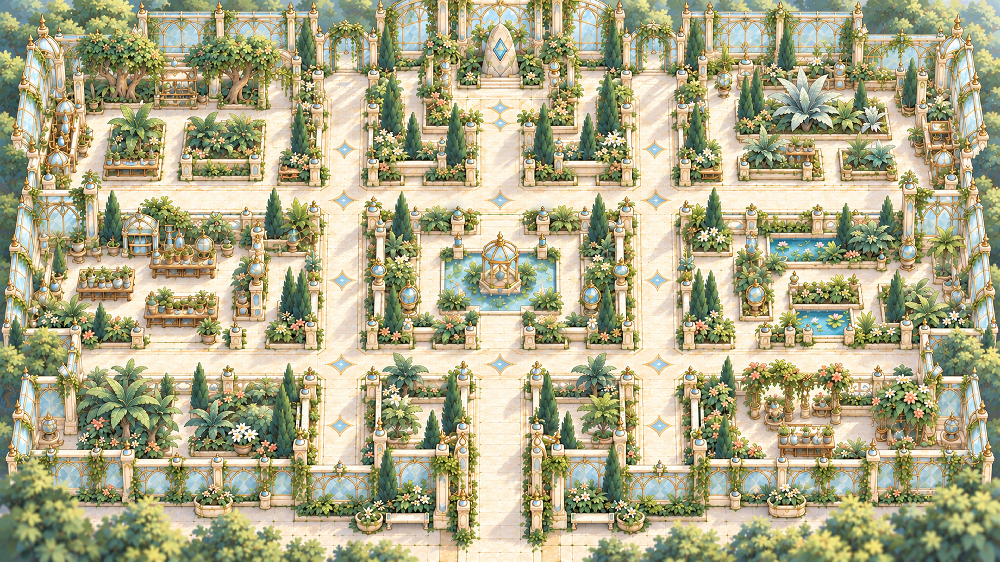 |
| [MP01_greenhouse_world_3840x2160.webp](./MP01_greenhouse_world_3840x2160.webp) | 전체맵 WebP | 3840×2160 | 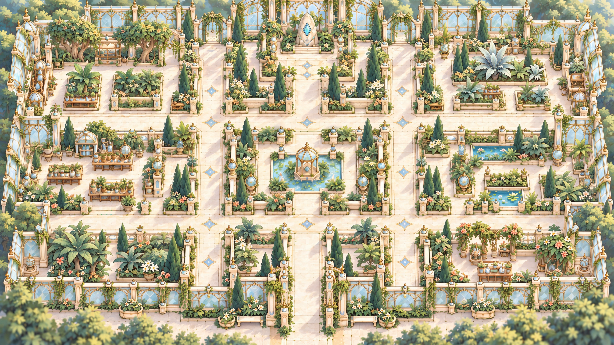 |
| [MP01_greenhouse_world_1920x1080.webp](./MP01_greenhouse_world_1920x1080.webp) | 축소 전체맵 WebP | 1920×1080 |  |
| [MP01_greenhouse_foreground_3840x2160.png](./MP01_greenhouse_foreground_3840x2160.png) | 투명 전경 PNG | 3840×2160 | 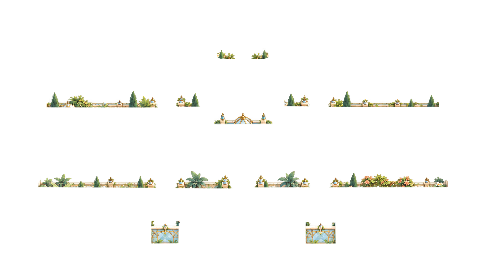 |
| [MP01_greenhouse_foreground_3840x2160.webp](./MP01_greenhouse_foreground_3840x2160.webp) | 투명 전경 WebP | 3840×2160 | 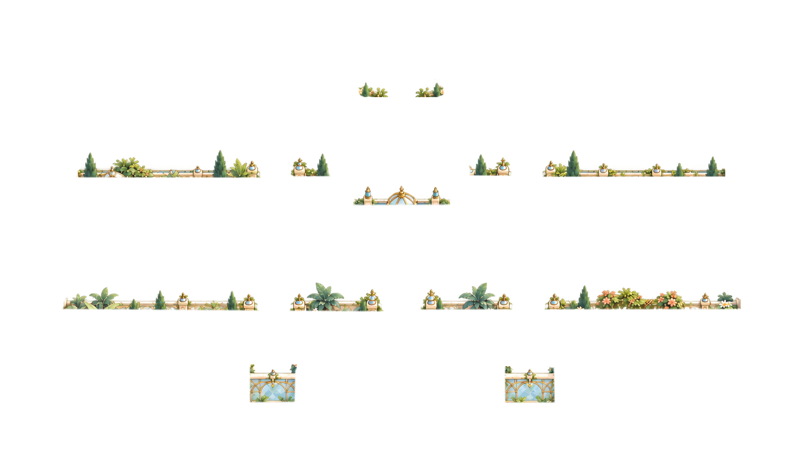 |
| [MP01_greenhouse_collision_mask_3840x2160.png](./MP01_greenhouse_collision_mask_3840x2160.png) | 충돌 마스크 원본 | 3840×2160 | 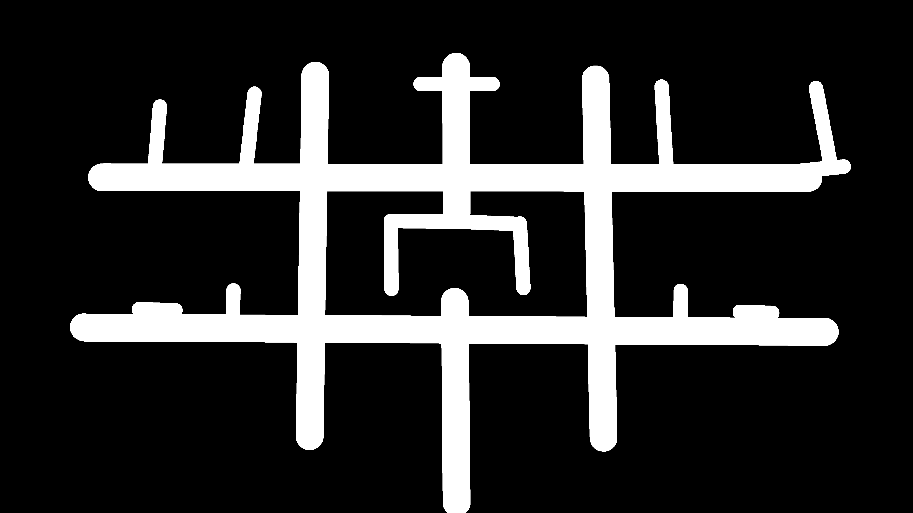 |
| [MP01_greenhouse_collision_mask_1920x1080.png](./MP01_greenhouse_collision_mask_1920x1080.png) | 축소 충돌 마스크 | 1920×1080 | 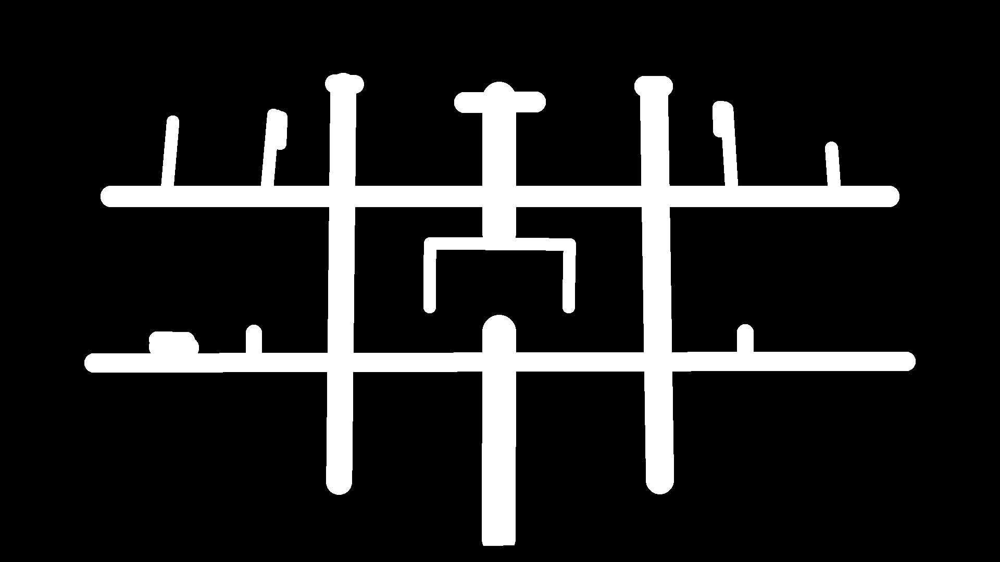 |

## MP02 · 대서고

| 파일 | 용도 | 크기 | 미리보기 |
|---|---|---:|---|
| [MP02_grand_library_master_3840x2161.png](./MP02_grand_library_master_3840x2161.png) | 갱신된 대서고 마스터 원본 · 런타임 미반영 | 3840×2161 |  |
| [MP02_grand_library_foreground_3840x2161.png](./MP02_grand_library_foreground_3840x2161.png) | 투명 전경 | 3840×2161 |  |
| [MP02_grand_library_collision_mask_1920x1081.png](./MP02_grand_library_collision_mask_1920x1081.png) | 충돌 마스크 | 1920×1081 |  |
| [MP02_grand_library_world_3840x2160.webp](./MP02_grand_library_world_3840x2160.webp) | 게임용 전체맵 WebP | 3840×2160 | 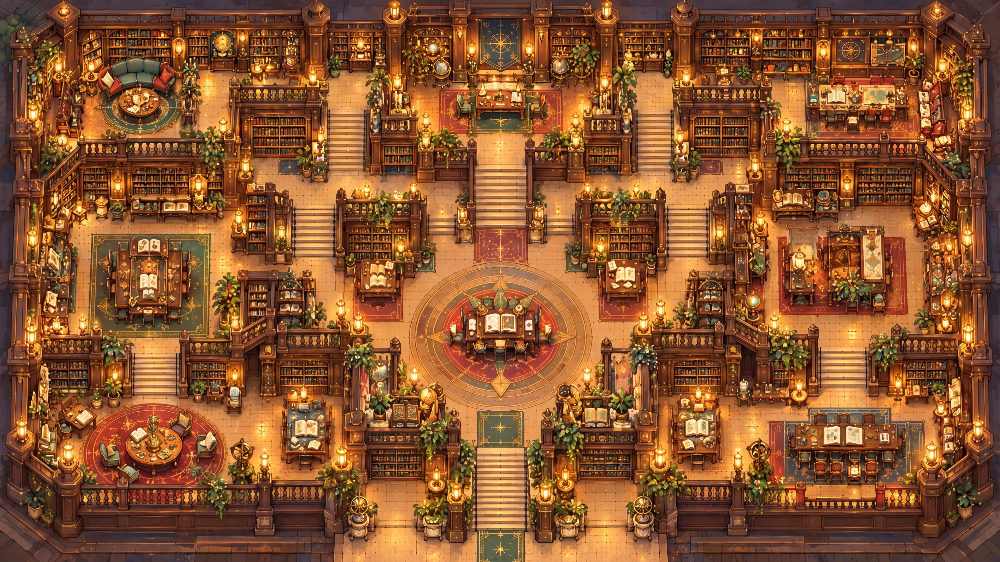 |
| [MP02_grand_library_world_1920x1080.webp](./MP02_grand_library_world_1920x1080.webp) | 축소 전체맵 WebP | 1920×1080 | 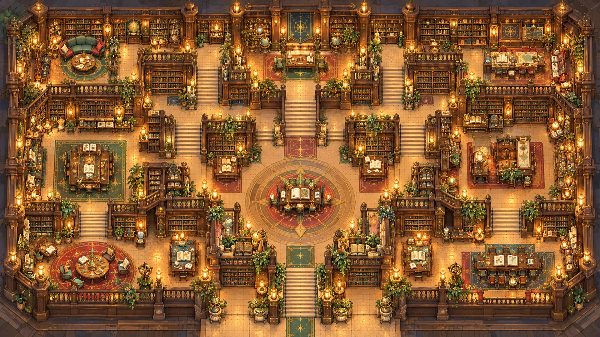 |
| [MP02_grand_library_foreground_3840x2160.webp](./MP02_grand_library_foreground_3840x2160.webp) | 게임용 투명 전경 | 3840×2160 | 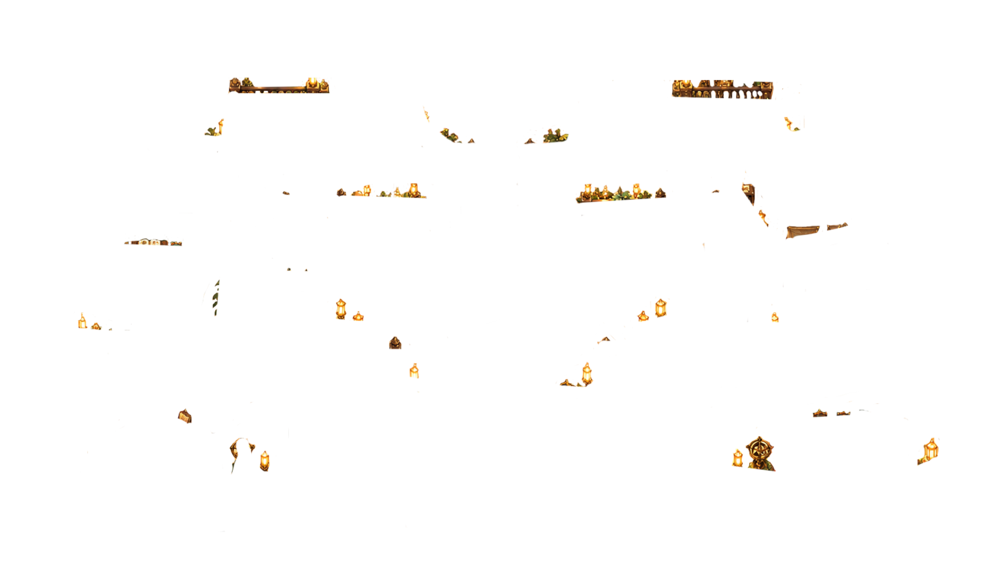 |
| [MP02_grand_library_collision_mask_1920x1080.png](./MP02_grand_library_collision_mask_1920x1080.png) | 게임용 충돌 마스크 | 1920×1080 | 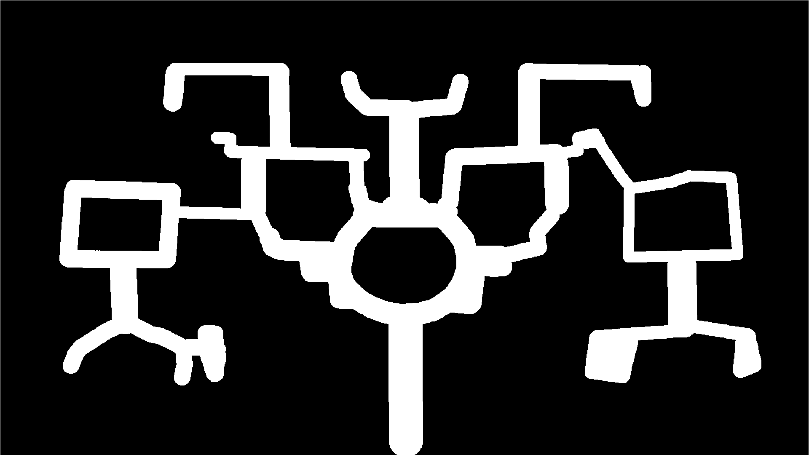 |

## MP03 · 별빛 천문대

| 파일 | 용도 | 크기 | 미리보기 |
|---|---|---:|---|
| [MP03_starlight_observatory_master_3840x2162.png](./MP03_starlight_observatory_master_3840x2162.png) | 갱신된 별빛 천문대 마스터 원본 · 런타임 미반영 | 3840×2162 |  |
| [MP03_starlight_observatory_foreground_3840x2161.png](./MP03_starlight_observatory_foreground_3840x2161.png) | 투명 전경 | 3840×2161 | 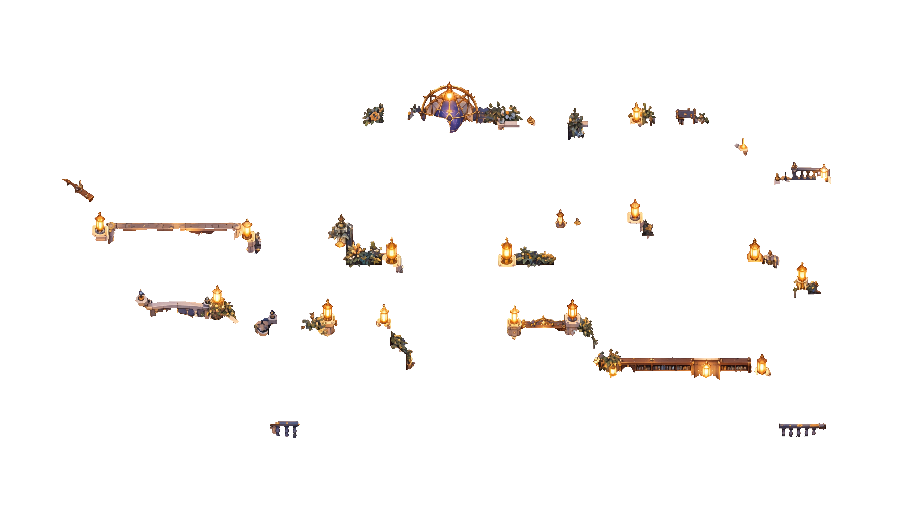 |
| [MP03_starlight_observatory_collision_mask_1920x1081.png](./MP03_starlight_observatory_collision_mask_1920x1081.png) | 충돌 마스크 | 1920×1081 |  |
| [MP03_starlight_observatory_world_3840x2160.webp](./MP03_starlight_observatory_world_3840x2160.webp) | 게임용 전체맵 WebP | 3840×2160 | 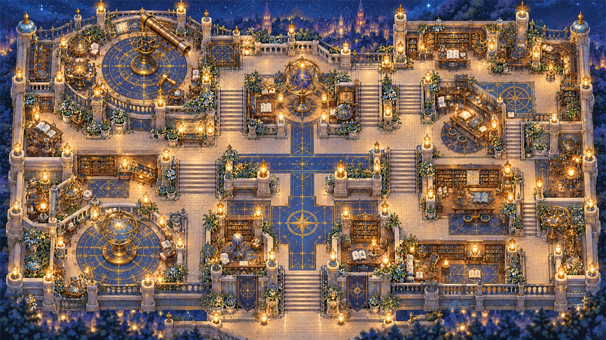 |
| [MP03_starlight_observatory_world_1920x1080.webp](./MP03_starlight_observatory_world_1920x1080.webp) | 축소 전체맵 WebP | 1920×1080 | 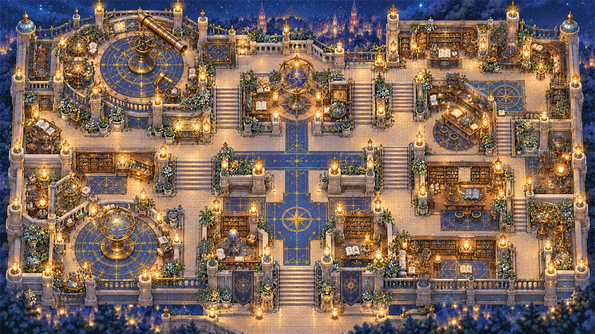 |
| [MP03_starlight_observatory_foreground_3840x2160.webp](./MP03_starlight_observatory_foreground_3840x2160.webp) | 게임용 투명 전경 | 3840×2160 |  |
| [MP03_starlight_observatory_collision_mask_1920x1080.png](./MP03_starlight_observatory_collision_mask_1920x1080.png) | 게임용 충돌 마스크 | 1920×1080 | 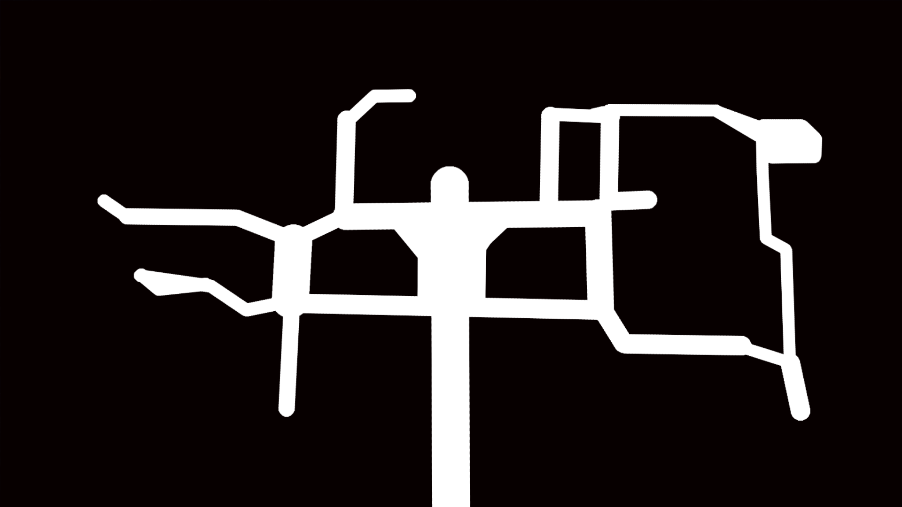 |

## 참고 맵

| 파일 | 용도 | 크기 | 미리보기 |
|---|---|---:|---|
| [map1_straight.png](./map1_straight.png) | 직선형 전체맵 시안 | 1920×1080 |  |

## MP02·MP03 마스터 갱신 기록

| 장소 | 이전 마스터(브랜치 이력) | 현재 마스터 | 적용 상태 |
|---|---:|---:|---|
| MP02 대서고 | 3840×2161 · 13,369,241바이트 | 3840×2161 · 14,149,644바이트 | 같은 픽셀 크기의 새 구도. 게임용 WebP는 기존판 유지 |
| MP03 별빛 천문대 | 3840×2161 · 13,932,037바이트 | 3840×2162 · 14,020,750바이트 | 세로 1px 증가한 새 구도. 게임용 WebP는 기존판 유지 |

새 마스터는 파일 용량이 커졌지만 픽셀 해상도는 MP02가 동일하고 MP03은 세로로 1px만 늘었습니다. 전경·충돌 마스크와 새 구도의 위치 정합을 확인하기 전에는 마스터를 기존 게임용 WebP 경로에 덮어쓰지 않습니다. 현재 엔진은 기존 3840×2160 월드 WebP·1920×1080 썸네일 WebP·전경·충돌 마스크를 사용합니다. 원본 PNG는 `MP번호_장소_역할_실제해상도` 규칙으로 표시합니다. 이 README의 파일 보유는 새 마스터의 엔진 적용 완료를 뜻하지 않습니다.
