# 펫 및 동물 NPC 이미지 (`asset/pet/`)

이 폴더의 `PT01–PT10`은 본편 펫 10종입니다. `NPC_LULU_01–03`은 별도의 동물 NPC 루루의 의상별 이미지로, 펫 번호나 해금 목록에 포함하지 않습니다. 루루의 NPC 역할과 이야기는 [NPC 문서](../../story/npc/feedback_npc.md)를 따릅니다.

## 루루 이야기에서 찾기

`NPC_LULU_01–04`는 네 번의 **대화 사건**이고, 파일명 `NPC_LULU_01–03`은 세 벌의 **의상**입니다. 같은 번호로 연결하지 않습니다. 대화 소품 `ART-N05` 손 위 단추와 `ART-N06` 열린 보물상자는 현재 확정 파일 경로가 없습니다. 루루의 의상·표정도 제작 문서에 회차별 지정이 없어 **미정**입니다.

| 이야기 | 필요한 FOCUS | 보유한 루루 의상 예시 · 작은 미리보기 |
|---|---|---|
| `NPC_LULU_01` | `ART-N05` 단추 | [초록 탐험복](./NPC_LULU_01_front.png)  |
| `NPC_LULU_02` | `ART-N06` 보물상자, N05 회상 가능 | [남색 학자복](./NPC_LULU_02_front.png) 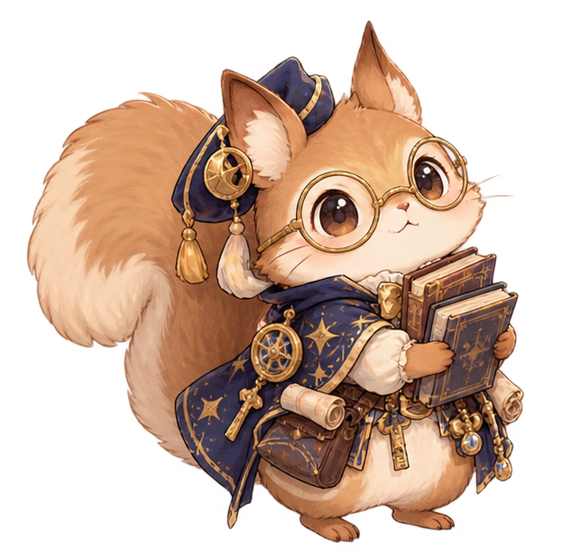 |
| `NPC_LULU_03–04` | `ART-N06` 재사용 | [분홍 꽃 의상](./NPC_LULU_03_front.png) 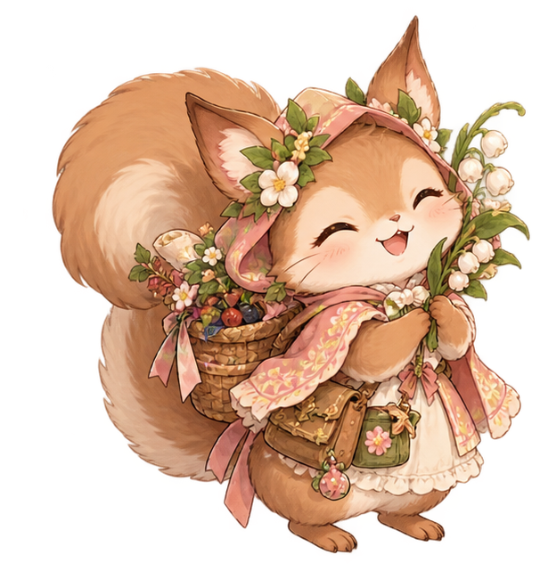 |

위 의상 그림은 **보유 예시**이며 해당 회차에 확정 배정된 이미지가 아닙니다. 배경은 실제 만남 장소에 따라 [유리 온실 또는 치유의 약초원](../background/README.md)을 사용합니다. [전체 장면 연결표](../README.md)와 [NPC 제작 문서](../../story/npc/NPC_STORY_PRODUCTION.md)를 함께 확인하세요.

## 본편 펫

기존 `PT01–PT10` 파일과 ID 매핑을 유지합니다.

| 펫 ID | 이름 | 동물 | 파일 | 미리보기 |
|---|---|---|---|---|
| `PT01` | 에든 | 부엉이 | [PT01_owl.png](./PT01_owl.png) |  |
| `PT02` | 루엔 | 여우 | [PT02_fox.png](./PT02_fox.png) |  |
| `PT03` | 포포 | 토끼 | [PT03_rabbit.png](./PT03_rabbit.png) |  |
| `PT04` | 마린 | 수달 | [PT04_otter.png](./PT04_otter.png) | 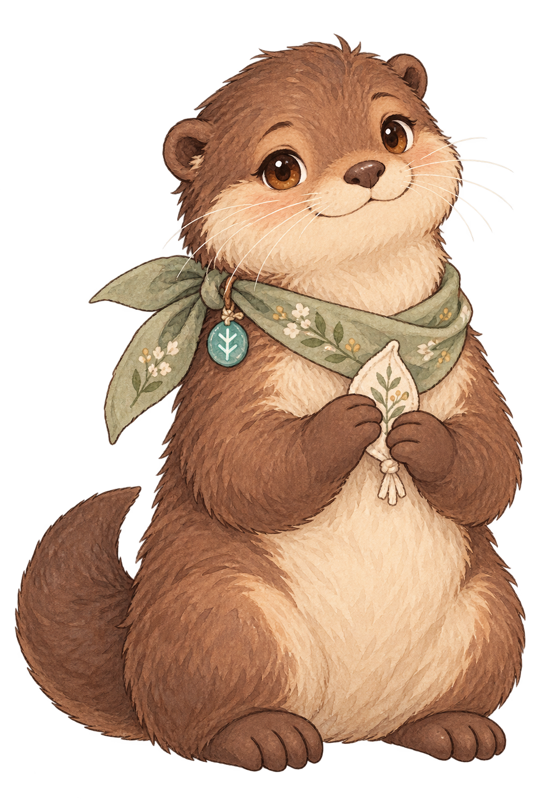 |
| `PT05` | 토비 | 강아지 | [PT05_puppy.png](./PT05_puppy.png) |  |
| `PT06` | 니브 | 고양이 | [PT06_cat.png](./PT06_cat.png) | 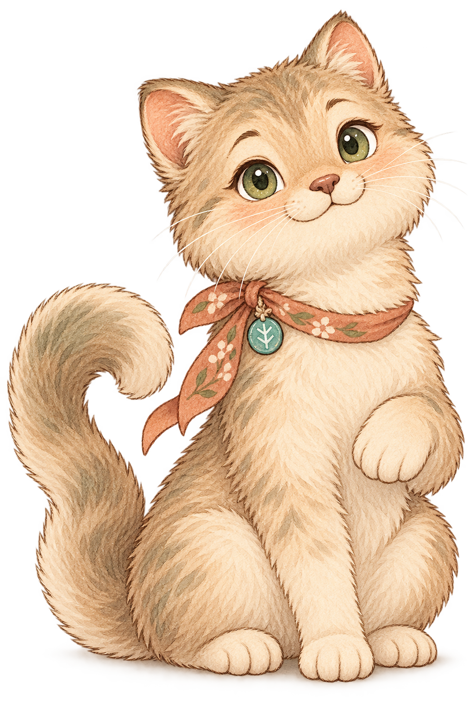 |
| `PT07` | 로코 | 레서판다 | [PT07_red_panda.png](./PT07_red_panda.png) |  |
| `PT08` | 피핀 | 다람쥐 | [PT08_squirrel.png](./PT08_squirrel.png) | 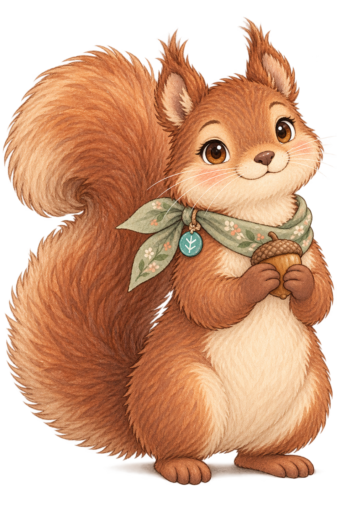 |
| `PT09` | 브램 | 고슴도치 | [PT09_hedgehog.png](./PT09_hedgehog.png) |  |
| `PT10` | 세렌 | 아기사슴 | [PT10_fawn.png](./PT10_fawn.png) |  |

## 동물 NPC 루루

사용자 승인 시트에서 의상 3종을 각각 앞모습·뒷모습·표정 4개로 분리한 투명 PNG 18장입니다. `01`은 초록 탐험복, `02`는 남색 학자복, `03`은 분홍 꽃 의상입니다. `01`과 `03`의 뒷모습에는 마지막 승인본을 사용했고 `02` 뒷모습은 원 시트 분리본입니다. 이미지별 원본 크기가 달라 게임 적용 시 표시 크기는 별도로 조정해야 합니다.

| 의상 | 구분 | 파일 | 미리보기 |
|---|---|---|---|
| 01 · 초록 탐험복 | 앞모습 | [NPC_LULU_01_front.png](./NPC_LULU_01_front.png) |  |
| 01 · 초록 탐험복 | 뒷모습 | [NPC_LULU_01_back.png](./NPC_LULU_01_back.png) | 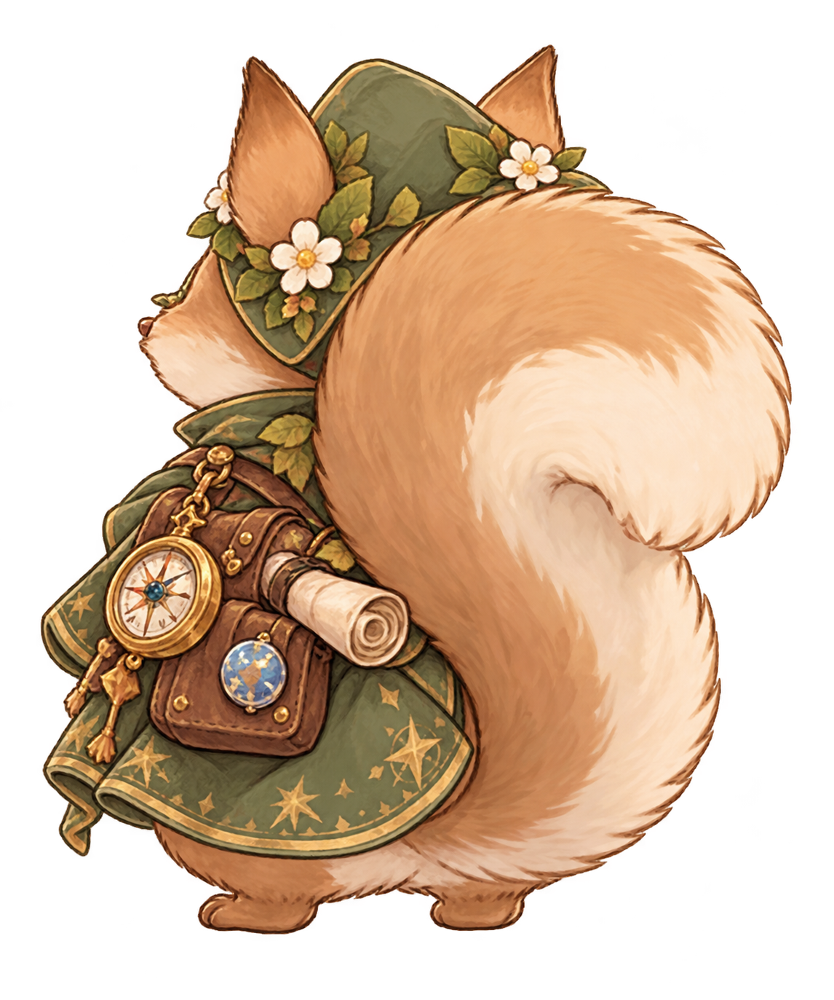 |
| 01 · 초록 탐험복 | 표정 1 | [NPC_LULU_01_expression_01.png](./NPC_LULU_01_expression_01.png) |  |
| 01 · 초록 탐험복 | 표정 2 | [NPC_LULU_01_expression_02.png](./NPC_LULU_01_expression_02.png) | 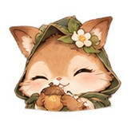 |
| 01 · 초록 탐험복 | 표정 3 | [NPC_LULU_01_expression_03.png](./NPC_LULU_01_expression_03.png) |  |
| 01 · 초록 탐험복 | 표정 4 | [NPC_LULU_01_expression_04.png](./NPC_LULU_01_expression_04.png) | 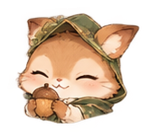 |
| 02 · 남색 학자복 | 앞모습 | [NPC_LULU_02_front.png](./NPC_LULU_02_front.png) |  |
| 02 · 남색 학자복 | 뒷모습 | [NPC_LULU_02_back.png](./NPC_LULU_02_back.png) | 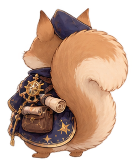 |
| 02 · 남색 학자복 | 표정 1 | [NPC_LULU_02_expression_01.png](./NPC_LULU_02_expression_01.png) | 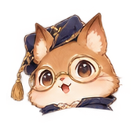 |
| 02 · 남색 학자복 | 표정 2 | [NPC_LULU_02_expression_02.png](./NPC_LULU_02_expression_02.png) | 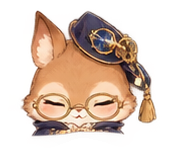 |
| 02 · 남색 학자복 | 표정 3 | [NPC_LULU_02_expression_03.png](./NPC_LULU_02_expression_03.png) |  |
| 02 · 남색 학자복 | 표정 4 | [NPC_LULU_02_expression_04.png](./NPC_LULU_02_expression_04.png) | 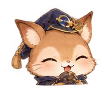 |
| 03 · 분홍 꽃 의상 | 앞모습 | [NPC_LULU_03_front.png](./NPC_LULU_03_front.png) |  |
| 03 · 분홍 꽃 의상 | 뒷모습 | [NPC_LULU_03_back.png](./NPC_LULU_03_back.png) | 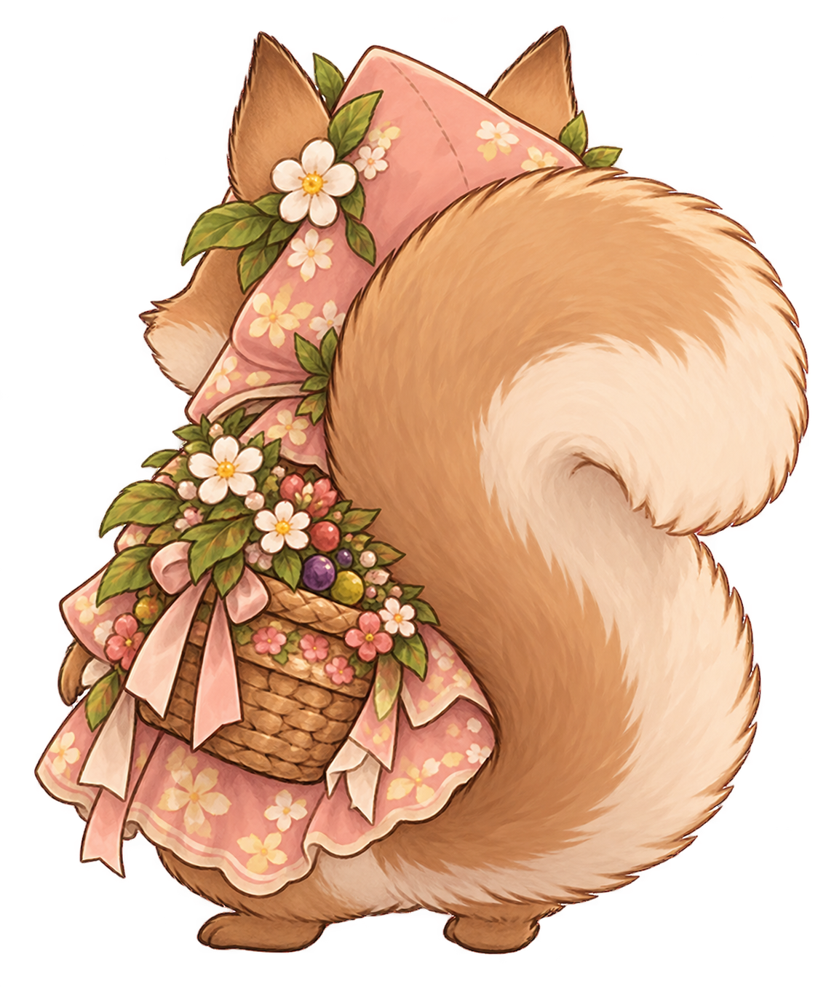 |
| 03 · 분홍 꽃 의상 | 표정 1 | [NPC_LULU_03_expression_01.png](./NPC_LULU_03_expression_01.png) | 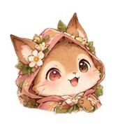 |
| 03 · 분홍 꽃 의상 | 표정 2 | [NPC_LULU_03_expression_02.png](./NPC_LULU_03_expression_02.png) | 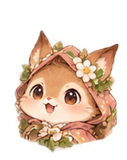 |
| 03 · 분홍 꽃 의상 | 표정 3 | [NPC_LULU_03_expression_03.png](./NPC_LULU_03_expression_03.png) | 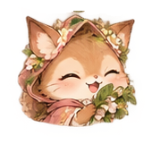 |
| 03 · 분홍 꽃 의상 | 표정 4 | [NPC_LULU_03_expression_04.png](./NPC_LULU_03_expression_04.png) | 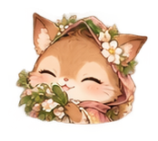 |

파일명 `NPC_LULU_<의상 번호>_<front|back|expression_01–04>.png`은 루루 NPC 이미지의 구분용입니다. `NPC_LULU_01–04` 스토리 사건 ID와 혼동하지 않습니다. 이미지 확정과 게임 화면 적용·크기 검수는 별개입니다.
