# 게임용 퍼즐 에셋

룬 회로 퍼즐용 256×256 에셋 9개와 마이룸 배경 퍼즐 조각 36개, 경계선이 표시된 방별 완성본 3개를 보관합니다. 룬 회로 타일 바탕은 투명 PNG이며 연결선·시작·목표는 확대 가능한 SVG입니다. 마이룸 조각은 우주방·공주방·식물방의 낮 원본을 각각 4열×3행으로 자른 PNG입니다. 원본 이미지의 색상과 픽셀은 변경하지 않았습니다.

| 파일 | 용도 | 규격 | 미리보기 |
|---|---|---|---|
| [tile0_base.png](./tile0_base.png) | 타일 바탕 | 256×256 | 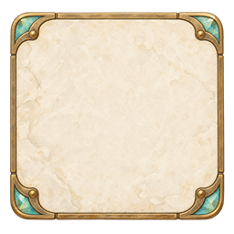 |
| [start1_inactive.svg](./start1_inactive.svg) | 시작 비활성 | 256×256 |  |
| [start2_active.svg](./start2_active.svg) | 시작 활성 | 256×256 |  |
| [goal1_inactive.svg](./goal1_inactive.svg) | 목표 비활성 | 256×256 | 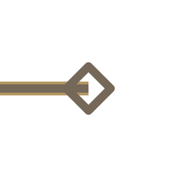 |
| [goal2_active.svg](./goal2_active.svg) | 목표 활성 | 256×256 |  |
| [straight1_inactive.svg](./straight1_inactive.svg) | 직선 비활성 | 256×256 | 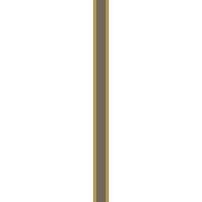 |
| [straight2_active.svg](./straight2_active.svg) | 직선 활성 | 256×256 |  |
| [corner1_inactive.svg](./corner1_inactive.svg) | 꺾임 비활성 | 256×256 |  |
| [corner2_active.svg](./corner2_active.svg) | 꺾임 활성 | 256×256 |  |

파일 번호: 바탕 0, 상태별 비활성 1 / 활성 2. 원본 1개(1254×1254)는 `C:/Users/josep/Desktop/Final Project/asset/puzzle/originals`에 보관하고 내용 일치를 확인했습니다. GitHub에는 원본·옛 파일명·중복 사본을 남기지 않았습니다. 실제 퍼즐 규칙 및 화면 적용 검수는 별도입니다.

## 마이룸 배경 퍼즐 · 낮 원본 3종 × 12조각

각 방의 낮 배경을 원본 해상도 1672×941에서 4열×3행으로 나눴습니다. 1행은 위쪽, 1열은 왼쪽입니다. 가로 경계는 0·418·836·1254·1672px, 세로 경계는 0·314·627·941px입니다. 조각은 원본의 직사각형 영역을 그대로 담으며 테두리나 배경을 추가하지 않았습니다. 획득한 위치를 드러내는 마이룸 배경 퍼즐용이며, 드래그형 맞추기 퍼즐은 아닙니다.

### 12조각을 합친 완성본 시안

파일명은 방별로 `PZ01_우주방`, `PZ02_공주방`, `PZ03_식물방`을 사용합니다. 번호 없는 PNG는 경계선이 있는 완성본이고, `_01`~`_12`는 왼쪽 위부터 행 우선 순서로 나열한 개별 조각입니다.

아래 3장은 각 방의 조각을 원본 위치에 다시 합치고 경계선만 덧그린 확인용 이미지입니다. 개별 조각 PNG에는 선이 들어 있지 않습니다.

| 우주방 | 공주방 | 식물방 |
|---|---|---|
| [완성본 PNG](./PZ01_우주방.png) 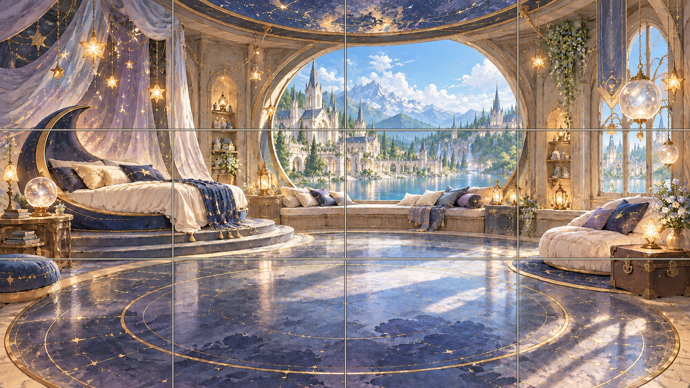 | [완성본 PNG](./PZ02_공주방.png) 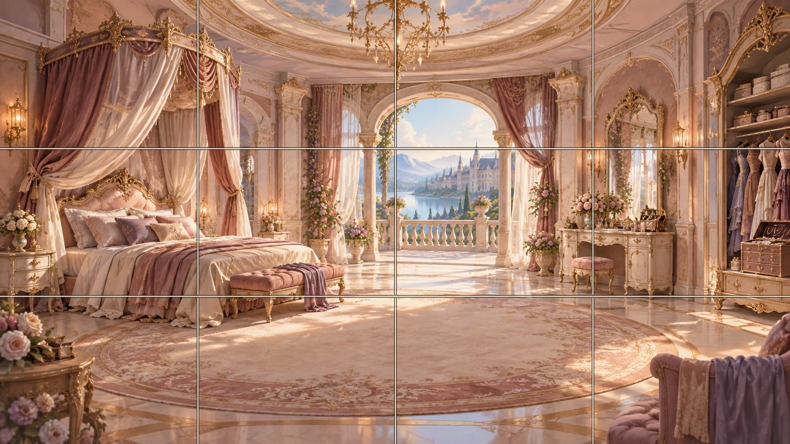 | [완성본 PNG](./PZ03_식물방.png) 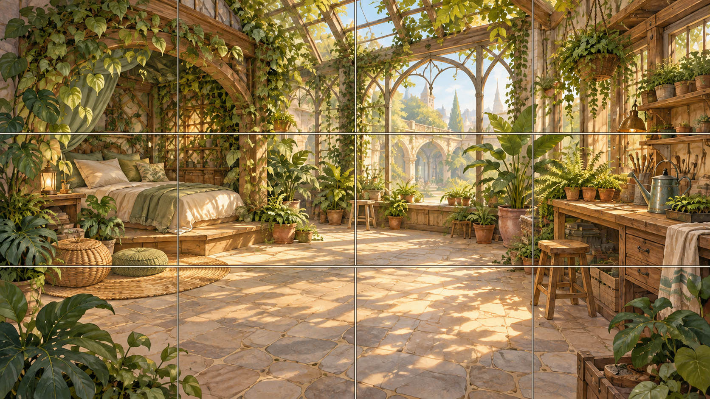 |

### 우주방 · 12조각

원본: [낮 배경](../background/BG11_myroom4_cosmos_day.png)

| 왼쪽 1열 | 2열 | 3열 | 오른쪽 4열 |
|---|---|---|---|
| [행 1·열 1](./PZ01_우주방_01.png)  | [행 1·열 2](./PZ01_우주방_02.png)  | [행 1·열 3](./PZ01_우주방_03.png)  | [행 1·열 4](./PZ01_우주방_04.png)  |
| [행 2·열 1](./PZ01_우주방_05.png)  | [행 2·열 2](./PZ01_우주방_06.png)  | [행 2·열 3](./PZ01_우주방_07.png)  | [행 2·열 4](./PZ01_우주방_08.png)  |
| [행 3·열 1](./PZ01_우주방_09.png) 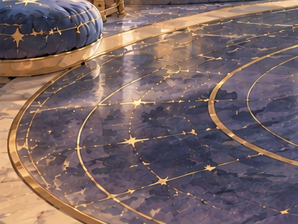 | [행 3·열 2](./PZ01_우주방_10.png) 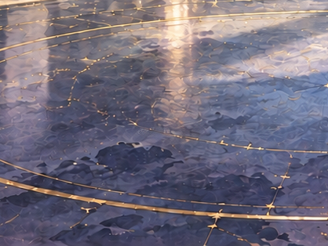 | [행 3·열 3](./PZ01_우주방_11.png) 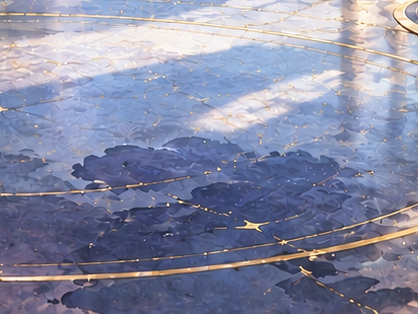 | [행 3·열 4](./PZ01_우주방_12.png)  |

### 공주방 · 12조각

원본: [낮 배경](../background/BG11_myroom5_princess_day.png)

| 왼쪽 1열 | 2열 | 3열 | 오른쪽 4열 |
|---|---|---|---|
| [행 1·열 1](./PZ02_공주방_01.png)  | [행 1·열 2](./PZ02_공주방_02.png)  | [행 1·열 3](./PZ02_공주방_03.png)  | [행 1·열 4](./PZ02_공주방_04.png)  |
| [행 2·열 1](./PZ02_공주방_05.png)  | [행 2·열 2](./PZ02_공주방_06.png)  | [행 2·열 3](./PZ02_공주방_07.png)  | [행 2·열 4](./PZ02_공주방_08.png) 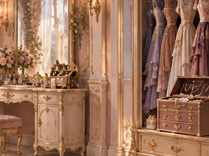 |
| [행 3·열 1](./PZ02_공주방_09.png) 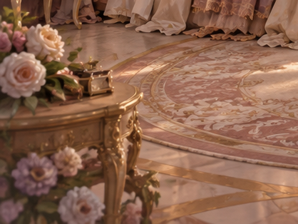 | [행 3·열 2](./PZ02_공주방_10.png) 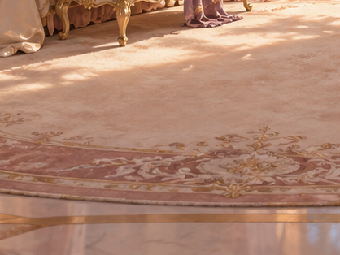 | [행 3·열 3](./PZ02_공주방_11.png) 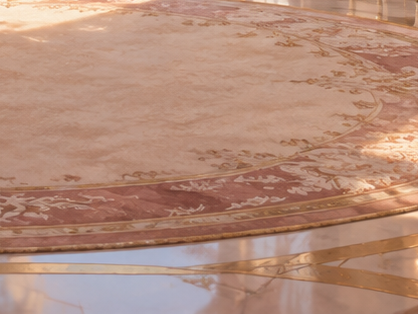 | [행 3·열 4](./PZ02_공주방_12.png)  |

### 식물방 · 12조각

원본: [낮 배경](../background/BG11_myroom6_botanical_day.png)

| 왼쪽 1열 | 2열 | 3열 | 오른쪽 4열 |
|---|---|---|---|
| [행 1·열 1](./PZ03_식물방_01.png) 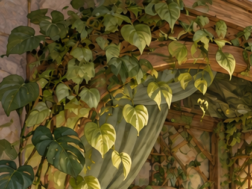 | [행 1·열 2](./PZ03_식물방_02.png)  | [행 1·열 3](./PZ03_식물방_03.png)  | [행 1·열 4](./PZ03_식물방_04.png)  |
| [행 2·열 1](./PZ03_식물방_05.png)  | [행 2·열 2](./PZ03_식물방_06.png)  | [행 2·열 3](./PZ03_식물방_07.png)  | [행 2·열 4](./PZ03_식물방_08.png)  |
| [행 3·열 1](./PZ03_식물방_09.png)  | [행 3·열 2](./PZ03_식물방_10.png) 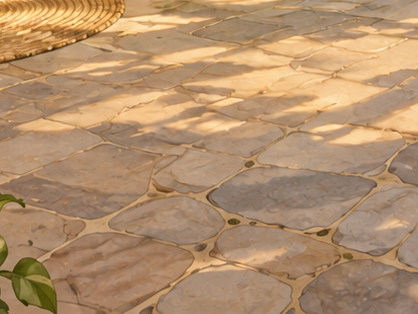 | [행 3·열 3](./PZ03_식물방_11.png) 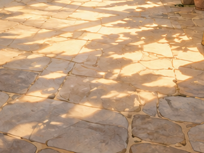 | [행 3·열 4](./PZ03_식물방_12.png)  |
