# 기본 오픈 캐릭터 SD 보행 세트

[캐릭터 기준](../../document/03_CHARACTERS.md)의 기본 오픈 6명입니다. 카엘 기존 8개 스트립을 내용 변경 없이 복사하고, 세라·아이리스·로빈·티아·니코 각 8개를 생성했습니다. 총 PNG 48개, 프레임 144개입니다.

## 빠른 탐색

| 사용처·장면 | 파일명 기준 | 현재 상태 | 파일 목록·미리보기 |
|---|---|---|---|
| SD 캐릭터; Adventure용 작은 캐릭터; 전신 대화 화자와 구분 | `기존 캐릭터별 SD 계열` | 이 폴더 이미지 48장. 개별 파일의 채택·후보·검수 상태는 아래 설명을 따름 | 아래 파일 표와 미리보기, [에셋 전체 장면표](../README.md) 참조 |

## 규격과 사용

- 스트립 768×256px, 가로 3프레임, 프레임 256×256px, 투명 RGBA PNG.
- 방향 순서: S → SW → W → NW → N → NE → E → SE. 좌우는 화면 기준입니다.
- 기존 카엘 설정: 발 기준 Y=218, 표시 폭 128, 7fps. 보행 재생은 프레임 인덱스 **0 → 1 → 2 → 1** 반복, 정지 프레임은 1입니다.
- 신규 이미지는 프레임별 종횡비를 유지하고 발 하단을 Y=218 경계에 정렬했습니다. 원본을 로컬에 보존합니다.
- 카엘 출처: `prototype/assets/SD03_{방향}_strip.png`. prototype 파일·코드와 캐릭터 전신 이미지는 수정하지 않았습니다.
- 파일명 끝 번호 000~047은 자원 식별 번호이며 게임 캐릭터 ID를 대체하지 않습니다.

## 검수 상태

**규격 확인 완료 / 최종 모션 검수 필요.** 48개 파일의 크기·알파·3프레임·비어 있지 않은 그림 영역과 미리보기 경로를 검사했습니다. 카엘 8개는 원본 해시 일치를 확인합니다. 신규 40개는 생성 후 방향·외형을 시각 대조했으며 세라 SW의 역방향 프레임과 티아 S의 지팡이 손을 수정했습니다.

일부 첫·세 번째 자세의 보폭 차이가 작고, 방향 전환 시 소품·실루엣의 연속성은 추가 다듬기 대상입니다. 따라서 최종 보행 애니메이션 승인·실제 게임 연결·모바일 화면 검수까지 완료한 세트로 간주하지 않습니다. 이 폴더 추가만으로 게임의 캐릭터 선택이나 이동 자원이 자동 교체되지 않습니다.

## 파일·캐릭터·규격·미리보기

| 파일 | 캐릭터·방향·용도 | 규격 | 미리보기 |
|---|---|---|---|
| [kael_s_strip_000.png](./kael_s_strip_000.png) | 카엘 · 남·정면 보행 · 기존본 | 768×256 · 3프레임 | 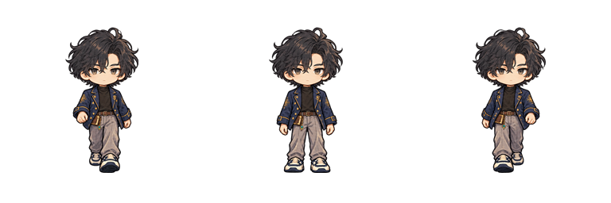 |
| [kael_sw_strip_001.png](./kael_sw_strip_001.png) | 카엘 · 남서 보행 · 기존본 | 768×256 · 3프레임 |  |
| [kael_w_strip_002.png](./kael_w_strip_002.png) | 카엘 · 서 보행 · 기존본 | 768×256 · 3프레임 | 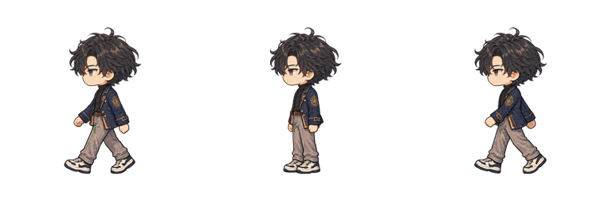 |
| [kael_nw_strip_003.png](./kael_nw_strip_003.png) | 카엘 · 북서 보행 · 기존본 | 768×256 · 3프레임 | 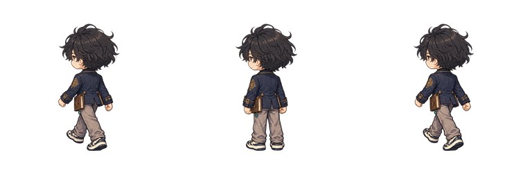 |
| [kael_n_strip_004.png](./kael_n_strip_004.png) | 카엘 · 북·후면 보행 · 기존본 | 768×256 · 3프레임 | 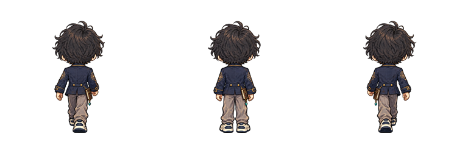 |
| [kael_ne_strip_005.png](./kael_ne_strip_005.png) | 카엘 · 북동 보행 · 기존본 | 768×256 · 3프레임 | 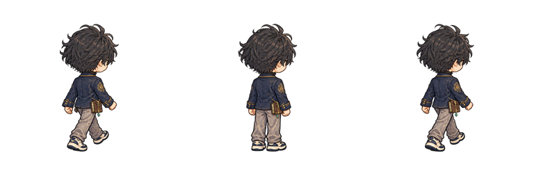 |
| [kael_e_strip_006.png](./kael_e_strip_006.png) | 카엘 · 동 보행 · 기존본 | 768×256 · 3프레임 | 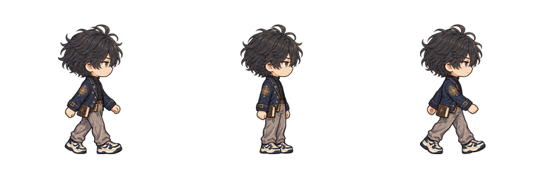 |
| [kael_se_strip_007.png](./kael_se_strip_007.png) | 카엘 · 남동 보행 · 기존본 | 768×256 · 3프레임 | 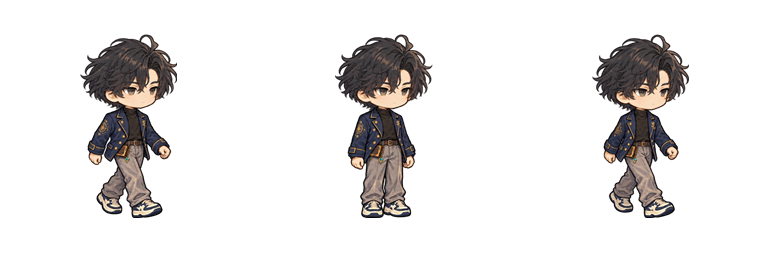 |
| [sera_s_strip_008.png](./sera_s_strip_008.png) | 세라 · 남·정면 보행 · 모션 검수 대기 | 768×256 · 3프레임 |  |
| [sera_sw_strip_009.png](./sera_sw_strip_009.png) | 세라 · 남서 보행 · 모션 검수 대기 | 768×256 · 3프레임 |  |
| [sera_w_strip_010.png](./sera_w_strip_010.png) | 세라 · 서 보행 · 모션 검수 대기 | 768×256 · 3프레임 | 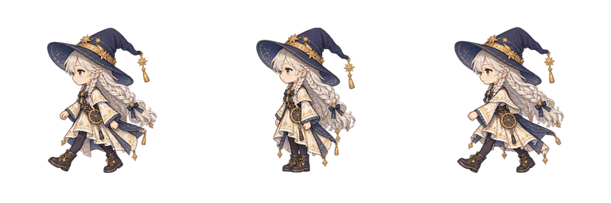 |
| [sera_nw_strip_011.png](./sera_nw_strip_011.png) | 세라 · 북서 보행 · 모션 검수 대기 | 768×256 · 3프레임 | 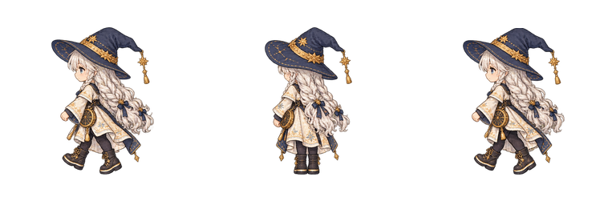 |
| [sera_n_strip_012.png](./sera_n_strip_012.png) | 세라 · 북·후면 보행 · 모션 검수 대기 | 768×256 · 3프레임 | 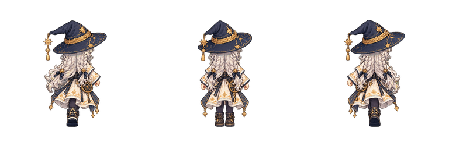 |
| [sera_ne_strip_013.png](./sera_ne_strip_013.png) | 세라 · 북동 보행 · 모션 검수 대기 | 768×256 · 3프레임 | 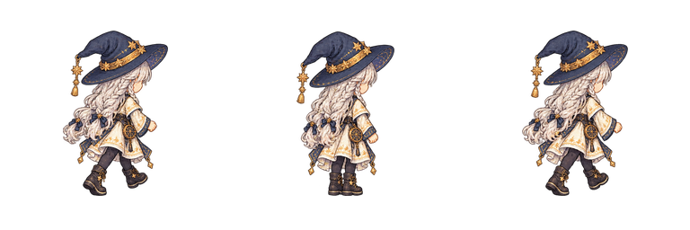 |
| [sera_e_strip_014.png](./sera_e_strip_014.png) | 세라 · 동 보행 · 모션 검수 대기 | 768×256 · 3프레임 | 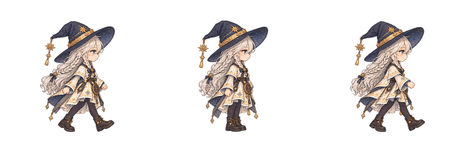 |
| [sera_se_strip_015.png](./sera_se_strip_015.png) | 세라 · 남동 보행 · 모션 검수 대기 | 768×256 · 3프레임 | 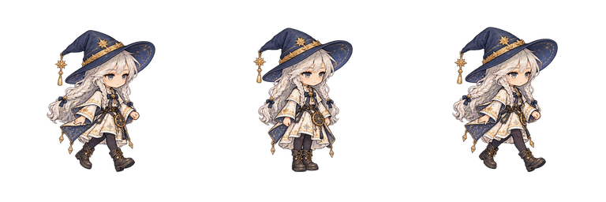 |
| [iris_s_strip_016.png](./iris_s_strip_016.png) | 아이리스 · 남·정면 보행 · 모션 검수 대기 | 768×256 · 3프레임 |  |
| [iris_sw_strip_017.png](./iris_sw_strip_017.png) | 아이리스 · 남서 보행 · 모션 검수 대기 | 768×256 · 3프레임 | 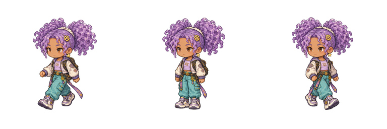 |
| [iris_w_strip_018.png](./iris_w_strip_018.png) | 아이리스 · 서 보행 · 모션 검수 대기 | 768×256 · 3프레임 | 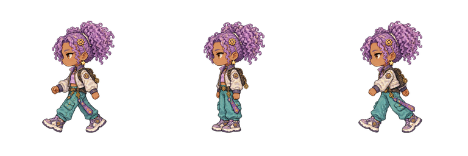 |
| [iris_nw_strip_019.png](./iris_nw_strip_019.png) | 아이리스 · 북서 보행 · 모션 검수 대기 | 768×256 · 3프레임 | 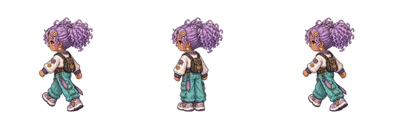 |
| [iris_n_strip_020.png](./iris_n_strip_020.png) | 아이리스 · 북·후면 보행 · 모션 검수 대기 | 768×256 · 3프레임 | 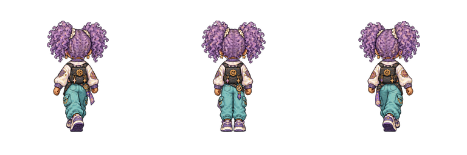 |
| [iris_ne_strip_021.png](./iris_ne_strip_021.png) | 아이리스 · 북동 보행 · 모션 검수 대기 | 768×256 · 3프레임 | 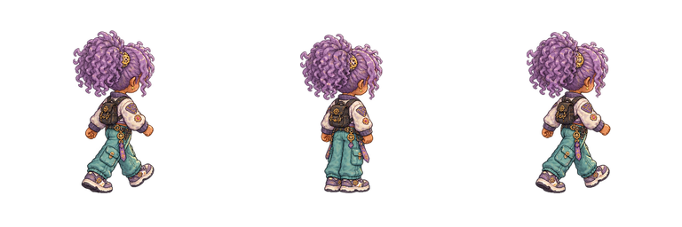 |
| [iris_e_strip_022.png](./iris_e_strip_022.png) | 아이리스 · 동 보행 · 모션 검수 대기 | 768×256 · 3프레임 | 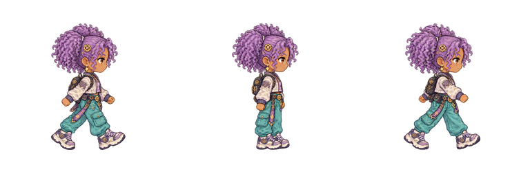 |
| [iris_se_strip_023.png](./iris_se_strip_023.png) | 아이리스 · 남동 보행 · 모션 검수 대기 | 768×256 · 3프레임 | 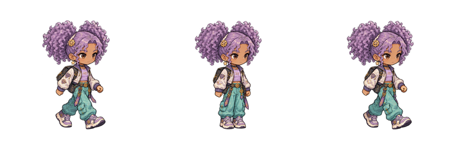 |
| [robin_s_strip_024.png](./robin_s_strip_024.png) | 로빈 · 남·정면 보행 · 모션 검수 대기 | 768×256 · 3프레임 |  |
| [robin_sw_strip_025.png](./robin_sw_strip_025.png) | 로빈 · 남서 보행 · 모션 검수 대기 | 768×256 · 3프레임 |  |
| [robin_w_strip_026.png](./robin_w_strip_026.png) | 로빈 · 서 보행 · 모션 검수 대기 | 768×256 · 3프레임 |  |
| [robin_nw_strip_027.png](./robin_nw_strip_027.png) | 로빈 · 북서 보행 · 모션 검수 대기 | 768×256 · 3프레임 | 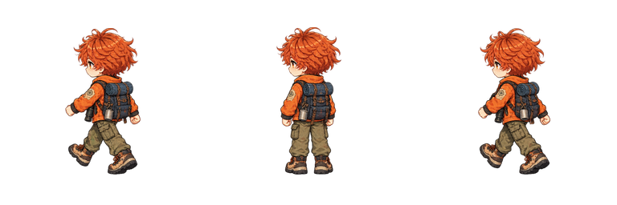 |
| [robin_n_strip_028.png](./robin_n_strip_028.png) | 로빈 · 북·후면 보행 · 모션 검수 대기 | 768×256 · 3프레임 | 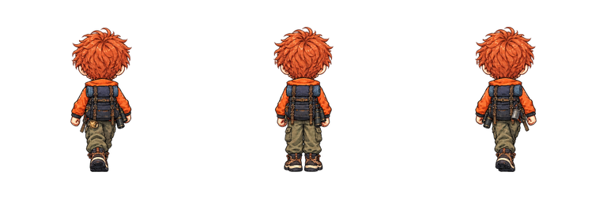 |
| [robin_ne_strip_029.png](./robin_ne_strip_029.png) | 로빈 · 북동 보행 · 모션 검수 대기 | 768×256 · 3프레임 | 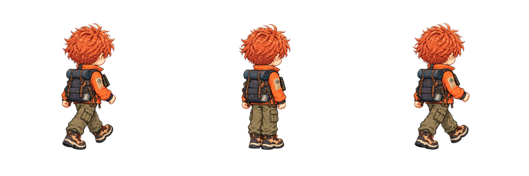 |
| [robin_e_strip_030.png](./robin_e_strip_030.png) | 로빈 · 동 보행 · 모션 검수 대기 | 768×256 · 3프레임 | 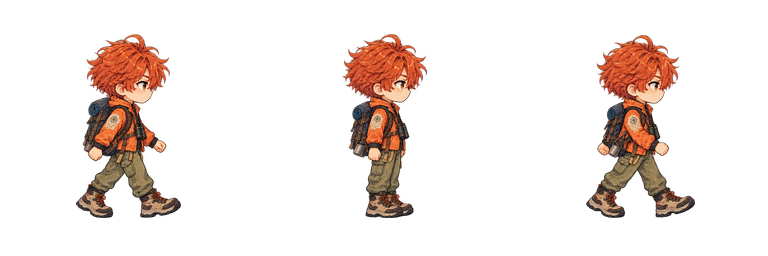 |
| [robin_se_strip_031.png](./robin_se_strip_031.png) | 로빈 · 남동 보행 · 모션 검수 대기 | 768×256 · 3프레임 |  |
| [tia_s_strip_032.png](./tia_s_strip_032.png) | 티아 · 남·정면 보행 · 모션 검수 대기 | 768×256 · 3프레임 |  |
| [tia_sw_strip_033.png](./tia_sw_strip_033.png) | 티아 · 남서 보행 · 모션 검수 대기 | 768×256 · 3프레임 |  |
| [tia_w_strip_034.png](./tia_w_strip_034.png) | 티아 · 서 보행 · 모션 검수 대기 | 768×256 · 3프레임 |  |
| [tia_nw_strip_035.png](./tia_nw_strip_035.png) | 티아 · 북서 보행 · 모션 검수 대기 | 768×256 · 3프레임 |  |
| [tia_n_strip_036.png](./tia_n_strip_036.png) | 티아 · 북·후면 보행 · 모션 검수 대기 | 768×256 · 3프레임 | 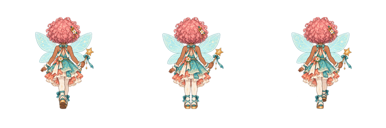 |
| [tia_ne_strip_037.png](./tia_ne_strip_037.png) | 티아 · 북동 보행 · 모션 검수 대기 | 768×256 · 3프레임 |  |
| [tia_e_strip_038.png](./tia_e_strip_038.png) | 티아 · 동 보행 · 모션 검수 대기 | 768×256 · 3프레임 |  |
| [tia_se_strip_039.png](./tia_se_strip_039.png) | 티아 · 남동 보행 · 모션 검수 대기 | 768×256 · 3프레임 |  |
| [nico_s_strip_040.png](./nico_s_strip_040.png) | 니코 · 남·정면 보행 · 모션 검수 대기 | 768×256 · 3프레임 |  |
| [nico_sw_strip_041.png](./nico_sw_strip_041.png) | 니코 · 남서 보행 · 모션 검수 대기 | 768×256 · 3프레임 |  |
| [nico_w_strip_042.png](./nico_w_strip_042.png) | 니코 · 서 보행 · 모션 검수 대기 | 768×256 · 3프레임 | 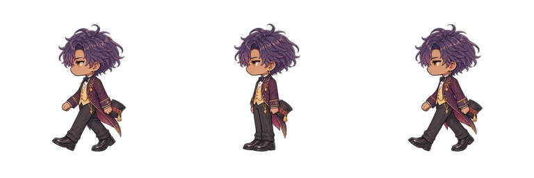 |
| [nico_nw_strip_043.png](./nico_nw_strip_043.png) | 니코 · 북서 보행 · 모션 검수 대기 | 768×256 · 3프레임 |  |
| [nico_n_strip_044.png](./nico_n_strip_044.png) | 니코 · 북·후면 보행 · 모션 검수 대기 | 768×256 · 3프레임 | 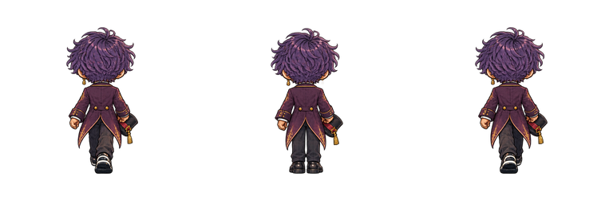 |
| [nico_ne_strip_045.png](./nico_ne_strip_045.png) | 니코 · 북동 보행 · 모션 검수 대기 | 768×256 · 3프레임 | 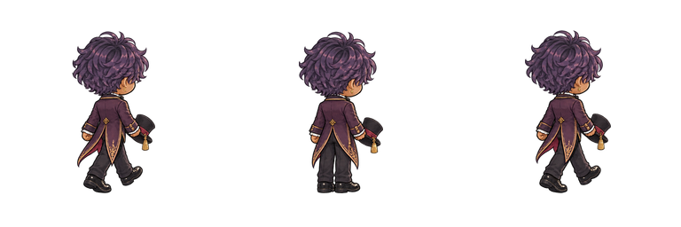 |
| [nico_e_strip_046.png](./nico_e_strip_046.png) | 니코 · 동 보행 · 모션 검수 대기 | 768×256 · 3프레임 |  |
| [nico_se_strip_047.png](./nico_se_strip_047.png) | 니코 · 남동 보행 · 모션 검수 대기 | 768×256 · 3프레임 |  |

## 로컬 원본

`C:/Users/josep/Desktop/Final Project/asset/sd_character/originals`에 신규 스트립 생성 원본 40개를 보관합니다. 상위 로컬 폴더에는 규격화 스크립트, 원본 대응표, 검수용 시트가 있습니다. 검수용 자료는 게임용 PNG 수량에 포함하지 않습니다.
