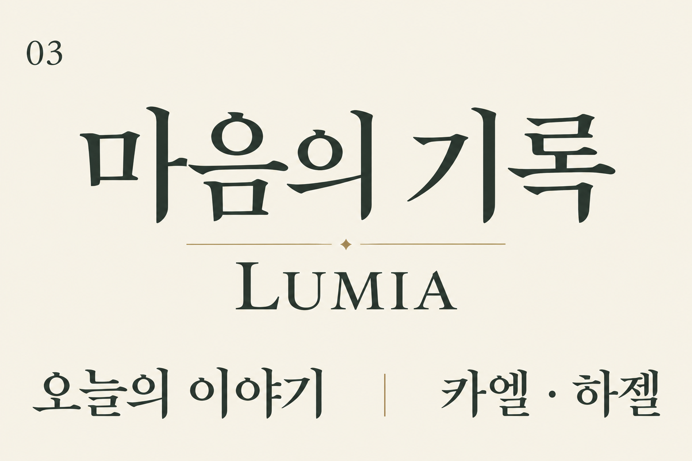
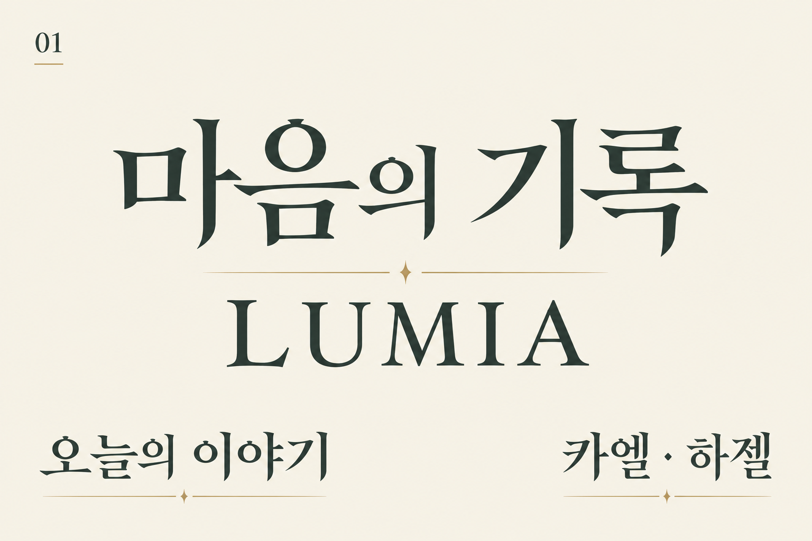

# 폰트 관련 타이포그래피 시안

이 PNG 5장은 [폰트 자원](../font_files/README.md)에 포함되는 서체 방향 참고 자료입니다. 기존 경로만 유지합니다. 설치 가능한 폰트가 아니며 웹폰트와의 일대일 대응이나 최종 채택을 확정하지 않습니다.

명칭은 파일 식별명을 풀어 쓴 안내입니다. 화면 적용과 가독성 검수는 별도입니다.

## 파일·명칭·미리보기

| 파일 | 명칭·용도 | 미리보기 |
|---|---|---|
| [mature_type_inscription_serif_000.png](./mature_type_inscription_serif_000.png) | 비문형 세리프: 각인·비문 계열 |  |
| [mature_type_literary_serif_001.png](./mature_type_literary_serif_001.png) | 문학형 세리프: 문학적 본문 계열 |  |
| [mature_type_manuscript_serif_002.png](./mature_type_manuscript_serif_002.png) | 필사본형 세리프: 필사본 계열 |  |
| [mature_type_moonlit_serif_003.png](./mature_type_moonlit_serif_003.png) | 달빛형 세리프: 달빛 테마 |  |
| [mature_type_scholarly_serif_004.png](./mature_type_scholarly_serif_004.png) | 학술형 세리프: 학술·서고 계열 |  |
