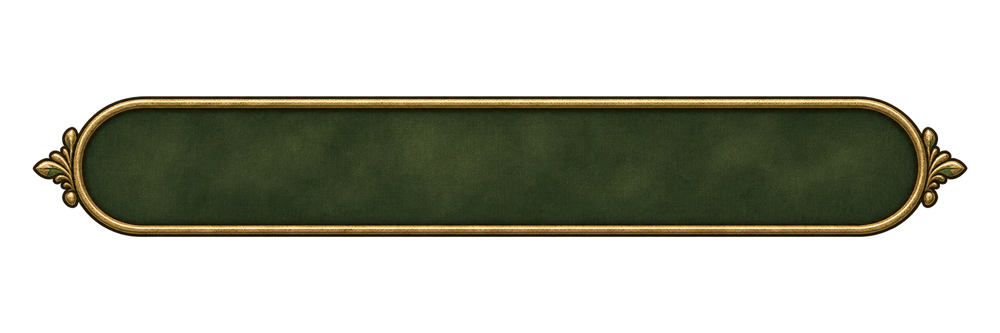
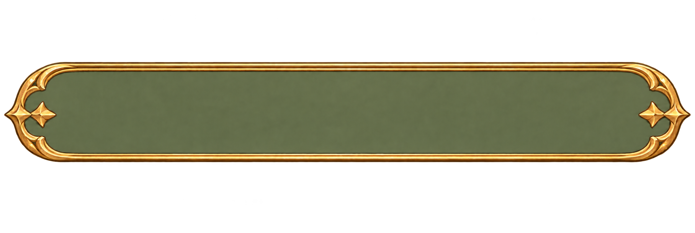
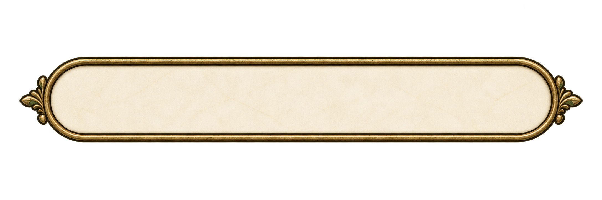
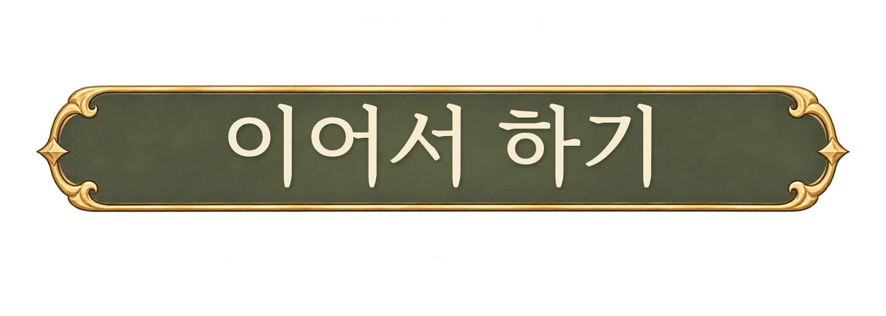
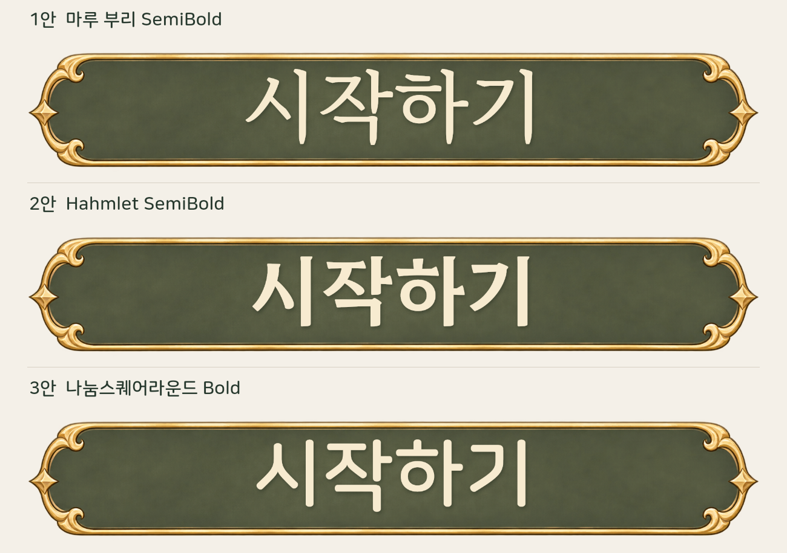

# UI 이미지 목록 (`asset/ui/`)

GitHub `dev-jw` 기준 이미지 **42개**(PNG 40개, JPG 2개)와 이 README를 정리했습니다. 모든 이미지 파일명은 용도에 따라 `BT`(버튼)·`UI`(화면 요소·검토 시안)·`LG`(로고)로 시작합니다. 각 미리보기는 같은 폴더의 이미지 파일을 직접 참조합니다.

파일이 존재한다는 사실만으로 게임 적용·최종 승인·동작 검수가 끝난 것은 아닙니다. 이름에 `final`이 있는 기존 파일의 상태도 별도 기획·검수 기준을 따릅니다.

## 버튼·글꼴

| 파일 | 설명 | 원본 크기 | 미리보기 |
|---|---|---:|---|
| [BT01_diary_green.png](./BT01_diary_green.png) | 다이어리 버튼 · 녹색 시안 | 1254×1254 |  |
| [BT01_diary_ivory.png](./BT01_diary_ivory.png) | 다이어리 버튼 · 아이보리 시안 | 1254×1254 |  |
| [BT02_backpack_green.png](./BT02_backpack_green.png) | 백팩 버튼 · 녹색 시안 | 1254×1254 |  |
| [BT02_backpack_ivory.png](./BT02_backpack_ivory.png) | 백팩 버튼 · 아이보리 시안 | 1254×1254 |  |
| [BT03_menu_green.png](./BT03_menu_green.png) | 메뉴 버튼 · 녹색 시안 | 1254×1254 |  |
| [BT03_menu_ivory.png](./BT03_menu_ivory.png) | 메뉴 버튼 · 아이보리 시안 | 1254×1254 |  |
| [BT04_blank_green.png](./BT04_blank_green.png) | 텍스트 없는 가로 버튼 · 녹색 시안 | 2171×724 |  |
| [BT04_blank_light_green.png](./BT04_blank_light_green.png) | 텍스트 없는 가로 버튼 · 라이트그린 시안 | 2162×727 |  |
| [BT04_blank_ivory.png](./BT04_blank_ivory.png) | 텍스트 없는 가로 버튼 · 아이보리 시안 | 2173×724 |  |
| [BT04_blank_pale_green.png](./BT04_blank_pale_green.png) | 텍스트 없는 가로 버튼 · 연그린 시안 | 2098×750 |  |
| [BT05_start_game.png](./BT05_start_game.png) | ‘시작하기’ 버튼 | 2098×750 |  |
| [BT06_new_game.png](./BT06_new_game.png) | ‘새로 시작하기’ 버튼 | 2098×750 |  |
| [BT07_continue_game.png](./BT07_continue_game.png) | ‘이어서 하기’ 버튼 | 2098×750 |  |
| [UI17_button_font_comparison.png](./UI17_button_font_comparison.png) | 버튼 글꼴 비교용 이미지 | 1300×915 |  |

## 기본 재료·프레임

| 파일 | 설명 | 원본 크기 | 미리보기 |
|---|---|---:|---|
| [UI01_parchment_tile_000.png](./UI01_parchment_tile_000.png) | 양피지 질감 타일 | 512×512 |  |
| [UI01_parchment_tile_source_008.png](./UI01_parchment_tile_source_008.png) | 양피지 질감 타일 생성 원본 | 1254×1254 |  |
| [UI02_frame_corner_001.png](./UI02_frame_corner_001.png) | UI 프레임 모서리 재료 | 192×192 |  |
| [UI02_frame_corner_source_009.png](./UI02_frame_corner_source_009.png) | 프레임 모서리 생성 원본 | 1254×1254 |  |
| [UI03_character_card_background_002.png](./UI03_character_card_background_002.png) | 캐릭터 카드 배경 | 480×640 |  |
| [UI03_character_card_background_source_010.png](./UI03_character_card_background_source_010.png) | 캐릭터 카드 배경 생성 원본 | 1086×1448 |  |
| [UI04_fullbody_preview_background_003.png](./UI04_fullbody_preview_background_003.png) | 전신 미리보기 배경 | 800×1200 |  |
| [UI04_fullbody_preview_background_source_011.png](./UI04_fullbody_preview_background_source_011.png) | 전신 미리보기 배경 생성 원본 | 1024×1536 |  |
| [UI07_admission_invitation_004.png](./UI07_admission_invitation_004.png) | 입학 초대장 이미지 재료 | 1200×800 |  |
| [UI07_admission_invitation_source_012.png](./UI07_admission_invitation_source_012.png) | 입학 초대장 생성 원본 | 1536×1024 |  |

## 로고

기존 게임 타이틀에서 사용한 확정 로고를 `LG01`로 이름 변경했습니다. `LG02`·`LG03`은 각각 신비 로고 1안·5안이며, 동일 이미지 중복 파일은 제거했습니다. 빛 효과는 별도 파일입니다.

| 파일 | 설명 | 원본 크기 | 미리보기 |
|---|---|---:|---|
| [LG01_lumia_logo_final.png](./LG01_lumia_logo_final.png) | 확정 LUMIA 로고; 빛 효과는 별도 파일 | 1774×887 |  |
| [LG02_lumia_logo_mystic_01.png](./LG02_lumia_logo_mystic_01.png) | LUMIA 신비 로고 시안 1 | 1600×800 |  |
| [LG03_lumia_logo_mystic_05.png](./LG03_lumia_logo_mystic_05.png) | LUMIA 신비 로고 시안 5 | 1600×800 |  |

## 화면 구성·다이어리 시안

| 파일 | 설명 | 원본 크기 | 미리보기 |
|---|---|---:|---|
| [UI08_diary_open_book.png](./UI08_diary_open_book.png) | 빈 다이어리 펼친 책 프레임 | 1672×941 |  |
| [UI09_diary_bookmark_fabric.png](./UI09_diary_bookmark_fabric.png) | 다이어리용 빈티지 천 책갈피 | 1028×432 |  |
| [UI10_dialogue_panel_plain.png](./UI10_dialogue_panel_plain.png) | 이름표 없는 대화 패널 | 1988×791 |  |
| [UI11_dialogue_panel_nameplate.png](./UI11_dialogue_panel_nameplate.png) | 이름표가 있는 대화 패널 | 1280×320 |  |
| [UI12_portrait_card_frame.png](./UI12_portrait_card_frame.png) | 세로형 카드 프레임 | 1086×1448 |  |
| [UI13_collection_screen_layout.png](./UI13_collection_screen_layout.png) | 컬렉션 화면 통합 시안 | 1672×941 |  |
| [UI14_date_frame_original.png](./UI14_date_frame_original.png) | 날짜 프레임 원래 색상 | 1902×827 |  |
| [UI14_date_frame_variant_01.png](./UI14_date_frame_variant_01.png) | 날짜 표시 시안 1 | 1860×846 |  |
| [UI15_diary_layout_01_book.png](./UI15_diary_layout_01_book.png) | 다이어리 · 펼친 책 구성 | 1672×941 |  |
| [UI15_diary_layout_02_chronology.png](./UI15_diary_layout_02_chronology.png) | 다이어리 · 시간순 기록 구성 | 1672×941 |  |
| [UI15_diary_layout_04_letters.png](./UI15_diary_layout_04_letters.png) | 다이어리 · 편지함 구성 | 1671×941 |  |
| [UI15_diary_layout_05_archive.png](./UI15_diary_layout_05_archive.png) | 다이어리 · 서고 기록함 구성 | 1671×941 |  |
| [UI16_weekly_planner_layout.png](./UI16_weekly_planner_layout.png) | 주간 일정 플래너 시안 | 1672×941 |  |

## 검토 캡처

| 파일 | 설명 | 원본 크기 | 미리보기 |
|---|---|---:|---|
| [UI18_myroom_time_review.jpg](./UI18_myroom_time_review.jpg) | 마이룸 시간대 검토 화면 캡처 | 1264×906 |  |
| [UI19_screen_gallery_review.jpg](./UI19_screen_gallery_review.jpg) | 전체 화면 갤러리 검토 캡처 | 558×849 |  |

## 정리 기록

- 첨부 화면에 지정된 가방·기록·힌트 SVG 3개와 기록 버튼 아이콘 SVG 5개는 제외했습니다.
- 기존 로고 3종과 내용이 같은 LG 중복 파일을 정리하고, 게임에서 사용하던 원본에 LG 이름을 적용했습니다.
- 검토용 실행 코드와 작업 문서는 이 GitHub 폴더에 포함하지 않았습니다.
