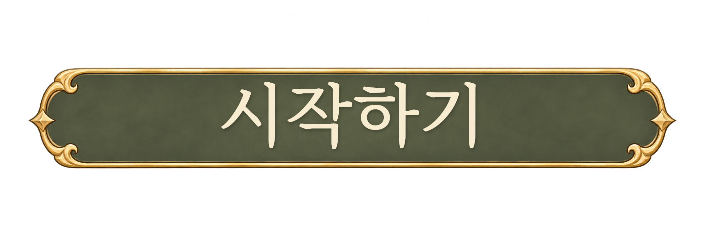
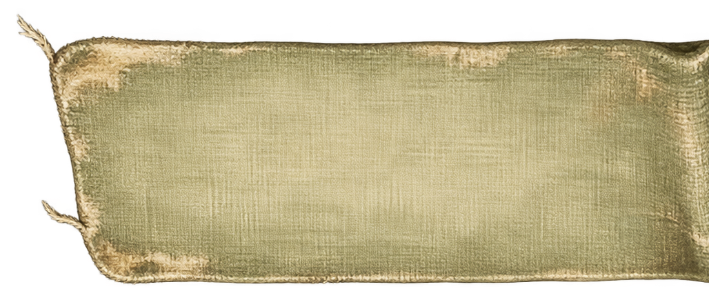
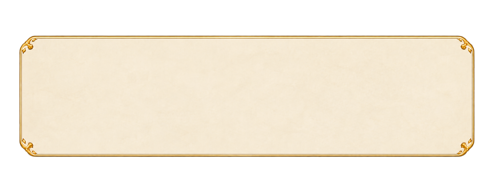
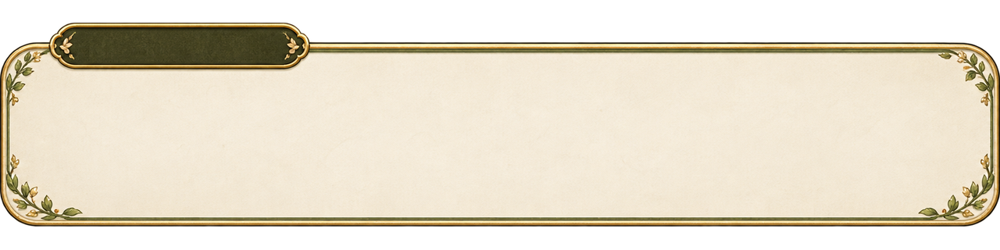
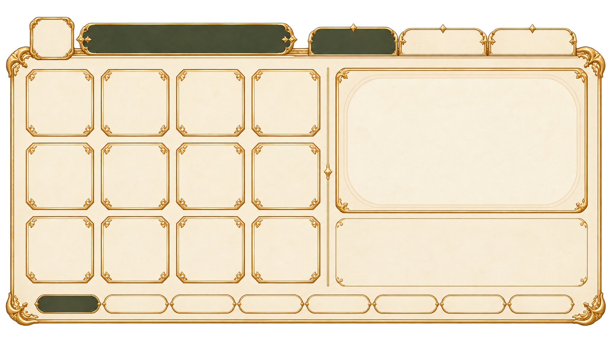
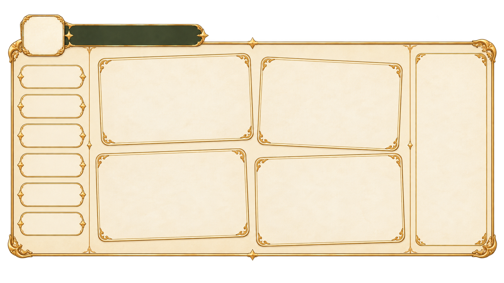
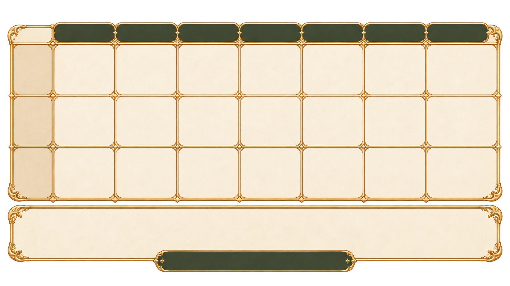
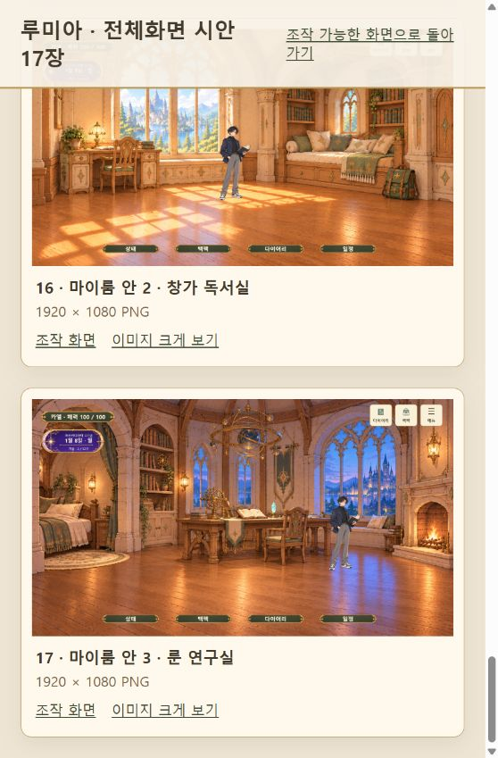

# UI 이미지 목록 (`asset/ui/`)

GitHub `dev-jw` 기준 이미지 **56개**(PNG 44개, SVG 10개, JPG 2개)와 이 README를 정리했습니다. 각 파일명은 원본에 연결되고, 미리보기는 같은 폴더의 이미지 파일을 직접 참조합니다.

파일이 존재한다는 사실만으로 게임 적용·최종 승인·동작 검수가 끝난 것은 아닙니다. 이름에 `final`이 있는 기존 파일의 상태도 별도 기획·검수 기준을 따릅니다.

## 버튼·글꼴

| 파일 | 설명 | 원본 크기 | 미리보기 |
|---|---|---:|---|
| [BT01_다이어리_그린.png](./BT01_%EB%8B%A4%EC%9D%B4%EC%96%B4%EB%A6%AC_%EA%B7%B8%EB%A6%B0.png) | 다이어리 버튼 · 녹색 시안 | 1254×1254 |  |
| [BT01_다이어리_아이보리.png](./BT01_%EB%8B%A4%EC%9D%B4%EC%96%B4%EB%A6%AC_%EC%95%84%EC%9D%B4%EB%B3%B4%EB%A6%AC.png) | 다이어리 버튼 · 아이보리 시안 | 1254×1254 |  |
| [BT02_백팩_그린.png](./BT02_%EB%B0%B1%ED%8C%A9_%EA%B7%B8%EB%A6%B0.png) | 백팩 버튼 · 녹색 시안 | 1254×1254 |  |
| [BT02_백팩_아이보리.png](./BT02_%EB%B0%B1%ED%8C%A9_%EC%95%84%EC%9D%B4%EB%B3%B4%EB%A6%AC.png) | 백팩 버튼 · 아이보리 시안 | 1254×1254 |  |
| [BT03_메뉴_그린.png](./BT03_%EB%A9%94%EB%89%B4_%EA%B7%B8%EB%A6%B0.png) | 메뉴 버튼 · 녹색 시안 | 1254×1254 |  |
| [BT03_메뉴_아이보리.png](./BT03_%EB%A9%94%EB%89%B4_%EC%95%84%EC%9D%B4%EB%B3%B4%EB%A6%AC.png) | 메뉴 버튼 · 아이보리 시안 | 1254×1254 |  |
| [BT04_버튼_그린.png](./BT04_%EB%B2%84%ED%8A%BC_%EA%B7%B8%EB%A6%B0.png) | 텍스트 없는 가로 버튼 · 녹색 시안 | 2171×724 |  |
| [BT04_버튼_라이트그린.png](./BT04_%EB%B2%84%ED%8A%BC_%EB%9D%BC%EC%9D%B4%ED%8A%B8%EA%B7%B8%EB%A6%B0.png) | 텍스트 없는 가로 버튼 · 라이트그린 시안 | 2162×727 |  |
| [BT04_버튼_아이보리.png](./BT04_%EB%B2%84%ED%8A%BC_%EC%95%84%EC%9D%B4%EB%B3%B4%EB%A6%AC.png) | 텍스트 없는 가로 버튼 · 아이보리 시안 | 2173×724 |  |
| [BT04_버튼_연그린.png](./BT04_%EB%B2%84%ED%8A%BC_%EC%97%B0%EA%B7%B8%EB%A6%B0.png) | 텍스트 없는 가로 버튼 · 연그린 시안 | 2098×750 |  |
| [BT05_start_1.png](./BT05_start_1.png) | 시작 버튼 시안 1 | 2098×750 |  |
| [BT05_start_2.png](./BT05_start_2.png) | 시작 버튼 시안 2 | 2098×750 |  |
| [BT05_start_3.png](./BT05_start_3.png) | 시작 버튼 시안 3 | 2098×750 |  |
| [font_button_comparison_final.png](./font_button_comparison_final.png) | 버튼 글꼴 비교용 이미지 | 1300×915 |  |

## 기본 재료·프레임

| 파일 | 설명 | 원본 크기 | 미리보기 |
|---|---|---:|---|
| [player_status_frame_015.png](./player_status_frame_015.png) | 플레이어 상태창 프레임 | 512×192 |  |
| [title_layout_dialogue_title_layout_024.svg](./title_layout_dialogue_title_layout_024.svg) | 대화 제목 배치 시안 D01 | 벡터 (0 0 1280 320) |  |
| [title_layout_dialogue_title_layout_025.svg](./title_layout_dialogue_title_layout_025.svg) | 대화 제목 배치 시안 D02 | 벡터 (0 0 1280 320) |  |
| [title_layout_dialogue_title_layout_026.svg](./title_layout_dialogue_title_layout_026.svg) | 대화 제목 배치 시안 D03 | 벡터 (0 0 1280 320) |  |
| [title_layout_dialogue_title_layout_027.svg](./title_layout_dialogue_title_layout_027.svg) | 대화 제목 배치 시안 D04 | 벡터 (0 0 1280 320) |  |
| [title_layout_dialogue_title_layout_028.svg](./title_layout_dialogue_title_layout_028.svg) | 대화 제목 배치 시안 D05 | 벡터 (0 0 1280 320) |  |
| [title_layout_reference_title_layout_029.svg](./title_layout_reference_title_layout_029.svg) | 참조 카드 제목 배치 시안 R01 | 벡터 (0 0 384 448) |  |
| [title_layout_reference_title_layout_030.svg](./title_layout_reference_title_layout_030.svg) | 참조 카드 제목 배치 시안 R02 | 벡터 (0 0 384 448) |  |
| [title_layout_reference_title_layout_031.svg](./title_layout_reference_title_layout_031.svg) | 참조 카드 제목 배치 시안 R03 | 벡터 (0 0 384 448) |  |
| [title_layout_reference_title_layout_032.svg](./title_layout_reference_title_layout_032.svg) | 참조 카드 제목 배치 시안 R04 | 벡터 (0 0 384 448) |  |
| [title_layout_reference_title_layout_033.svg](./title_layout_reference_title_layout_033.svg) | 참조 카드 제목 배치 시안 R05 | 벡터 (0 0 384 448) |  |
| [UI01_parchment_tile_000.png](./UI01_parchment_tile_000.png) | 양피지 질감 타일 | 512×512 |  |
| [UI01_parchment_tile_source_008.png](./UI01_parchment_tile_source_008.png) | 양피지 질감 타일 생성 원본 | 1254×1254 |  |
| [UI02_frame_corner_001.png](./UI02_frame_corner_001.png) | UI 프레임 모서리 재료 | 192×192 |  |
| [UI02_frame_corner_source_009.png](./UI02_frame_corner_source_009.png) | 프레임 모서리 생성 원본 | 1254×1254 |  |
| [UI03_character_card_background_002.png](./UI03_character_card_background_002.png) | 캐릭터 카드 배경 | 480×640 |  |
| [UI03_character_card_background_source_010.png](./UI03_character_card_background_source_010.png) | 캐릭터 카드 배경 생성 원본 | 1086×1448 |  |
| [UI04_fullbody_preview_background_003.png](./UI04_fullbody_preview_background_003.png) | 전신 미리보기 배경 | 800×1200 |  |
| [UI04_fullbody_preview_background_source_011.png](./UI04_fullbody_preview_background_source_011.png) | 전신 미리보기 배경 생성 원본 | 1024×1536 |  |
| [UI07_admission_invitation_004.png](./UI07_admission_invitation_004.png) | 입학 초대장 이미지 재료 | 1200×800 |  |
| [UI07_admission_invitation_source_012.png](./UI07_admission_invitation_source_012.png) | 입학 초대장 생성 원본 | 1536×1024 |  |

## 로고

새 이름의 로고와 기존 이름의 로고는 각 쌍이 동일한 이미지·해상도입니다. 게임 타이틀과 기존 문서가 이전 이름을 참조하므로 두 이름을 함께 유지합니다.

| 파일 | 설명 | 원본 크기 | 미리보기 |
|---|---|---:|---|
| [LG01_lumia_logo_final.png](./LG01_lumia_logo_final.png) | LUMIA 로고 파일 · 기존 확정 로고와 동일 이미지 | 1774×887 |  |
| [LG02_lumia_logo_mystic.png](./LG02_lumia_logo_mystic.png) | LUMIA 신비 로고 시안 1 · 기존 파일과 동일 이미지 | 1600×800 |  |
| [LG03_lumia_logo_mystic.png](./LG03_lumia_logo_mystic.png) | LUMIA 신비 로고 시안 5 · 기존 파일과 동일 이미지 | 1600×800 |  |
| [lumia_logo_final_034.png](./lumia_logo_final_034.png) | 확정 LUMIA 로고; 빛 효과는 별도 파일 | 1774×887 |  |
| [lumia_logo_mystic_01_017.png](./lumia_logo_mystic_01_017.png) | 이전 LUMIA 로고 시안 1 | 1600×800 |  |
| [lumia_logo_mystic_05_018.png](./lumia_logo_mystic_05_018.png) | 이전 LUMIA 로고 시안 5 | 1600×800 |  |

## 화면 구성·다이어리 시안

| 파일 | 설명 | 원본 크기 | 미리보기 |
|---|---|---:|---|
| [BT06_diary1.png](./BT06_diary1.png) | 다이어리 화면 요소 시안 1 | 1672×941 |  |
| [BT06_diary2.png](./BT06_diary2.png) | 다이어리 화면 요소 시안 2 | 1028×432 |  |
| [BT07_dialogue_chat.png](./BT07_dialogue_chat.png) | 대화창 요소 시안 | 1988×791 |  |
| [BT07_dialogue_frame.png](./BT07_dialogue_frame.png) | 대화 프레임 시안 | 1280×320 |  |
| [BT07_frame.png](./BT07_frame.png) | 프레임 시안 | 1086×1448 |  |
| [collection_01_integrated.png](./collection_01_integrated.png) | 컬렉션 화면 통합 시안 | 1672×941 |  |
| [date_01_original.png](./date_01_original.png) | 날짜 프레임 원래 색상 | 1902×827 |  |
| [date_01.png](./date_01.png) | 날짜 표시 시안 1 | 1860×846 |  |
| [diary_01_book.png](./diary_01_book.png) | 다이어리 · 펼친 책 구성 | 1672×941 |  |
| [diary_02_chronology.png](./diary_02_chronology.png) | 다이어리 · 시간순 기록 구성 | 1672×941 |  |
| [diary_04_letters.png](./diary_04_letters.png) | 다이어리 · 편지함 구성 | 1671×941 |  |
| [diary_05_archive.png](./diary_05_archive.png) | 다이어리 · 서고 기록함 구성 | 1671×941 |  |
| [weekly_01_planner.png](./weekly_01_planner.png) | 주간 일정 플래너 시안 | 1672×941 |  |

## 검토 캡처

| 파일 | 설명 | 원본 크기 | 미리보기 |
|---|---|---:|---|
| [myroom-times-proof.jpg](./myroom-times-proof.jpg) | 마이룸 시간대 검토 화면 캡처 | 1264×906 |  |
| [screens-gallery-proof.jpg](./screens-gallery-proof.jpg) | 전체 화면 갤러리 검토 캡처 | 558×849 |  |

## 정리 기록

- 첨부 화면에 지정된 가방·기록·힌트 SVG 3개와 기록 버튼 아이콘 SVG 5개는 제외했습니다.
- 같은 픽셀의 이미지가 다른 파일명으로 존재하는 경우에도 기존 파일명을 유지했습니다.
- 검토용 실행 코드와 작업 문서는 이 GitHub 폴더에 포함하지 않았습니다.
