# UI 이미지 목록 (`asset/ui/`)

이미지 **62개**(PNG 60개, JPG 2개)와 이 README를 정리했습니다. 신규 정리 이미지 파일명은 용도에 따라 `BT`(버튼)·`UI`(화면 요소·환경 재료·검토 시안)·`LG`(로고)로 시작합니다. `UI20_environment_`는 기존 `asset/environment/`의 게임 규격 이미지 15장을 내용 변경 없이 통합한 묶음입니다. 각 미리보기는 같은 폴더의 이미지 파일을 직접 참조합니다.

파일이 존재한다는 사실만으로 게임 적용·최종 승인·동작 검수가 끝난 것은 아닙니다. 이름에 `final`이 있는 기존 파일의 상태도 별도 기획·검수 기준을 따릅니다.

## 빠른 탐색

| 사용처·장면                                                               | 파일명 기준                      | 현재 상태                                                               | 파일 목록·미리보기                                             |
| ------------------------------------------------------------------------- | -------------------------------- | ----------------------------------------------------------------------- | -------------------------------------------------------------- |
| 버튼·프레임·로고·환경 UI; 마이룸 프로필·날짜, 일지 화살표·닫기, 대화·버튼 | `BT / UI / LG 및 실행 호환 이름` | 이 폴더 이미지 62장. 개별 파일의 채택·후보·검수 상태는 아래 설명을 따름 | 아래 파일 표와 미리보기, [에셋 전체 장면표](../README.md) 참조 |

## 이야기에서 사용하는 UI 재료

이야기 공통 UI와 현재 이미지 목록을 연결합니다. **재료 보유와 최종 화면 적용은 다릅니다.** `MS01-S1`의 초대장 파일 채택이나 대화창 변형 선택은 제작 문서에 정확한 파일명이 지정되지 않아 후보로 둡니다. [전체 장면 연결표](../README.md)를 참고하세요.

| 사용처                                                                        | 파일 · 작은 미리보기                                                                                                                                              | 판단                                                                                                                                                             |
| ----------------------------------------------------------------------------- | ----------------------------------------------------------------------------------------------------------------------------------------------------------------- | ---------------------------------------------------------------------------------------------------------------------------------------------------------------- |
| `MS01-S1` 입학 초대                                                           | [입학 초대장 재료](./UI07_admission_invitation_004.png)                      | **후보**: 초대장을 보여 주는 장면과 내용 일치, 채택·표시 방식 확인 필요                                                                                          |
| `MS01–MS06`, `LOC_*`, `NPC_*` 대화                                            | [이름표 없는 대화 패널](./UI10_dialogue_panel_plain.png)                    | 공통 대화 UI **재료**. 실제 사용 변형 확인 필요                                                                                                                  |
| 같은 대화 화면의 이름표 변형                                                  | [이름표 있는 대화 패널](./UI11_dialogue_panel_nameplate.png)            | UI10과 대안/구성 관계 확인 필요                                                                                                                                  |
| `MS01–MS06`, `LOC_*`, `NPC_*` 선택지 버튼; 폭 확인 기준 `MS05_S4_SHARE_ROLES` | [긴 선택지용 빈 프레임](./BT04_choice_blank_pale_green.png)  | **승인된 빈 프레임** 2400×311. 48자 선택지로 폭을 확인했습니다. 문구는 이미지에 포함하지 않고 게임에서 왼쪽 정렬로 표시합니다. 엔진 연결·표시 검수는 별도입니다. |

화면의 `BACKGROUND`·`FOCUS` 이미지는 이 대화 패널과 별개의 자원입니다. 버튼·로고·환경 재료를 해당 이야기의 FOCUS 그림으로 추정하지 않습니다.

## 마이룸·일지 프레임과 조작 아이콘

승인된 UI 재료 5장을 이 폴더에 보관합니다. `asset/item/`에서 이동했으며 복제본은 없습니다. 두 프레임은 글자 없는 마이룸 왼쪽 위 프로필·날짜 표시용이며, 화살표 두 방향과 첫 번째 X 시안은 일지 화면용입니다. 두 프레임의 실제 가로 폭은 모두 2058px이며, 세로 길이는 프로필 764px·날짜 854px입니다. 실제 화면 합성·클릭 연결은 별도 검수 대상입니다.

| 사용처              | 파일 · 미리보기                                                                                                                                         | 실제 크기 |
| ------------------- | ------------------------------------------------------------------------------------------------------------------------------------------------------- | --------: |
| 마이룸 프로필       | [녹색 프로필 프레임](./UI21_myroom_profile_frame_green.png) 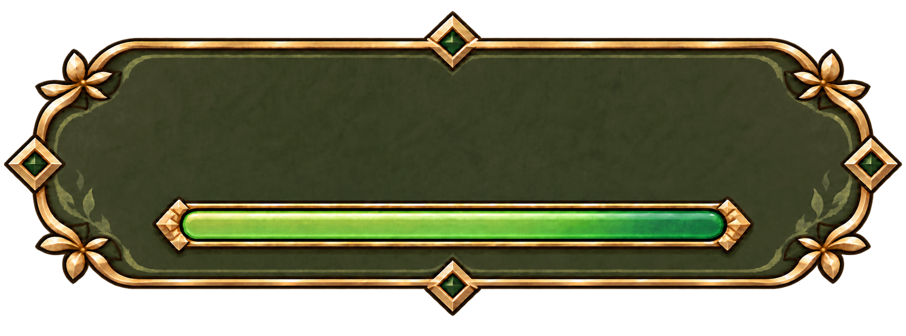 |  2058×764 |
| 마이룸 날짜         | [아이보리 날짜 프레임](./UI22_myroom_date_frame_ivory.png)        |  2058×854 |
| 일지 오른쪽 이동    | [오른쪽 화살표](./UI23_journal_arrow_right.png)                        | 1280×1229 |
| 일지 아래 방향 변형 | [아래 화살표](./UI24_journal_arrow_down.png)                              | 1280×1229 |
| 일지 닫기           | [첫 번째 X 시안](./UI25_journal_close_x.png)                                      | 1254×1254 |

## 버튼

두 아이보리판은 기존 녹색판의 폭·높이를 각각 유지한 바탕색 변형입니다. 텍스트는 포함하지 않습니다. 현재 엔진은 녹색판을 사용하므로 아이보리판을 화면에 적용하려면 해당 UI 경로를 명시적으로 선택해야 합니다.

| 파일                                                                   | 설명                                                                 | 원본 크기 | 미리보기                                                                                              |
| ---------------------------------------------------------------------- | -------------------------------------------------------------------- | --------: | ----------------------------------------------------------------------------------------------------- |
| [BT01_diary_green.png](./BT01_diary_green.png)                         | 다이어리 버튼 · 녹색 시안                                            | 1254×1254 |                         |
| [BT01_diary_ivory.png](./BT01_diary_ivory.png)                         | 다이어리 버튼 · 아이보리 시안                                        | 1254×1254 | 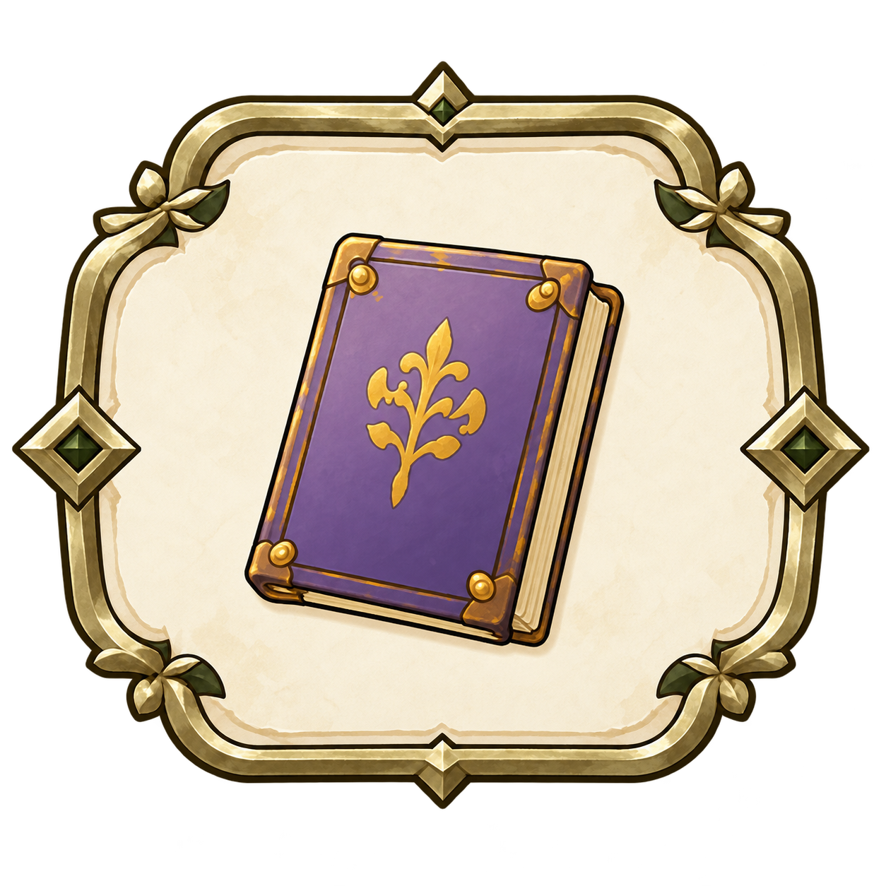                    |
| [BT02_backpack_green.png](./BT02_backpack_green.png)                   | 백팩 버튼 · 녹색 시안                                                | 1254×1254 | 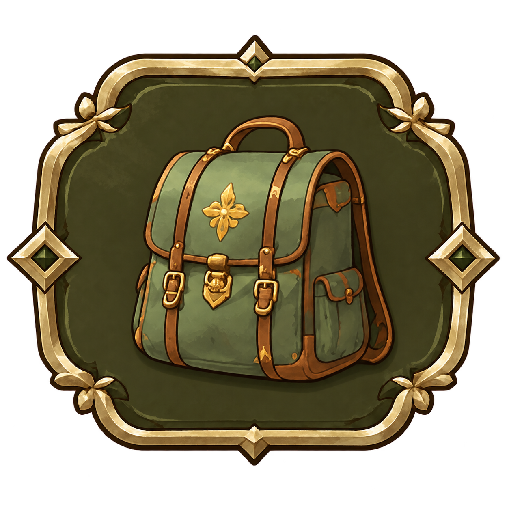                         |
| [BT02_backpack_ivory.png](./BT02_backpack_ivory.png)                   | 백팩 버튼 · 아이보리 시안                                            | 1254×1254 | 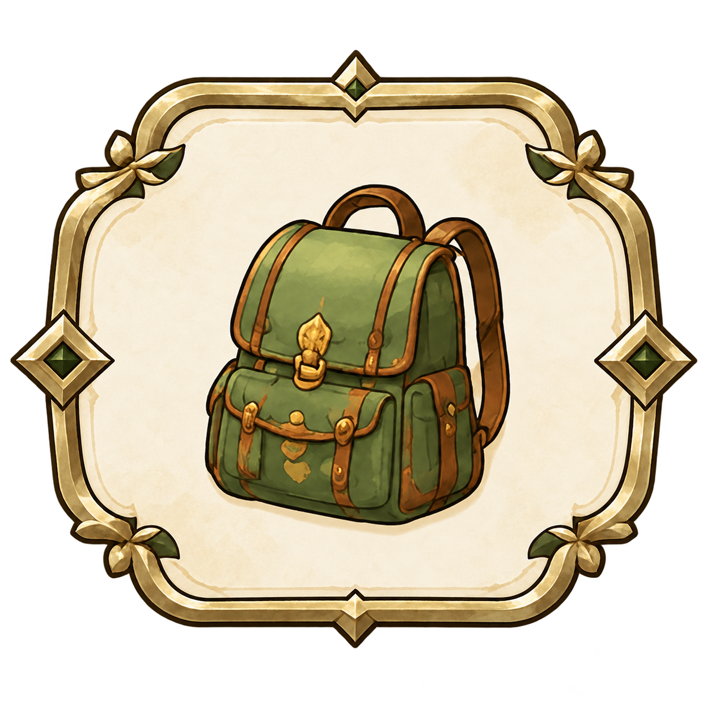                     |
| [BT03_menu_green.png](./BT03_menu_green.png)                           | 메뉴 버튼 · 녹색 시안                                                | 1254×1254 | 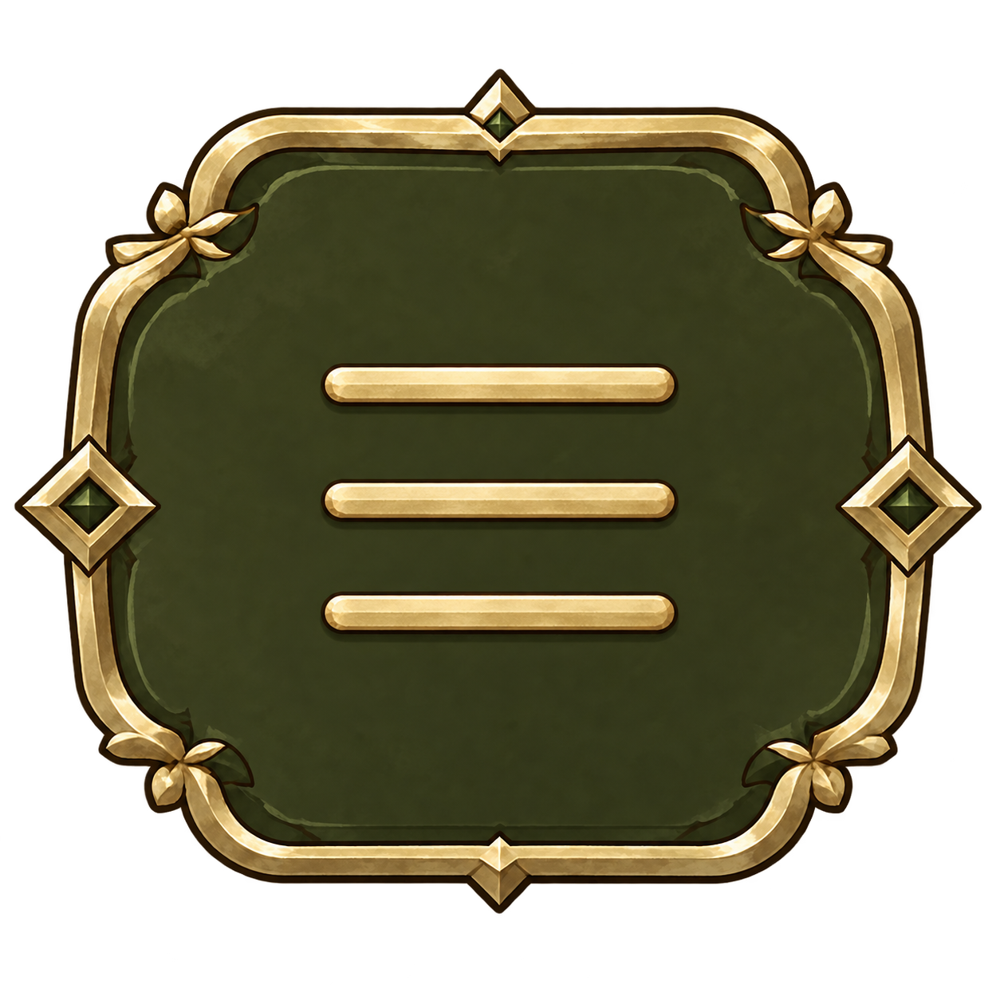                             |
| [BT03_menu_ivory.png](./BT03_menu_ivory.png)                           | 메뉴 버튼 · 아이보리 시안                                            | 1254×1254 | 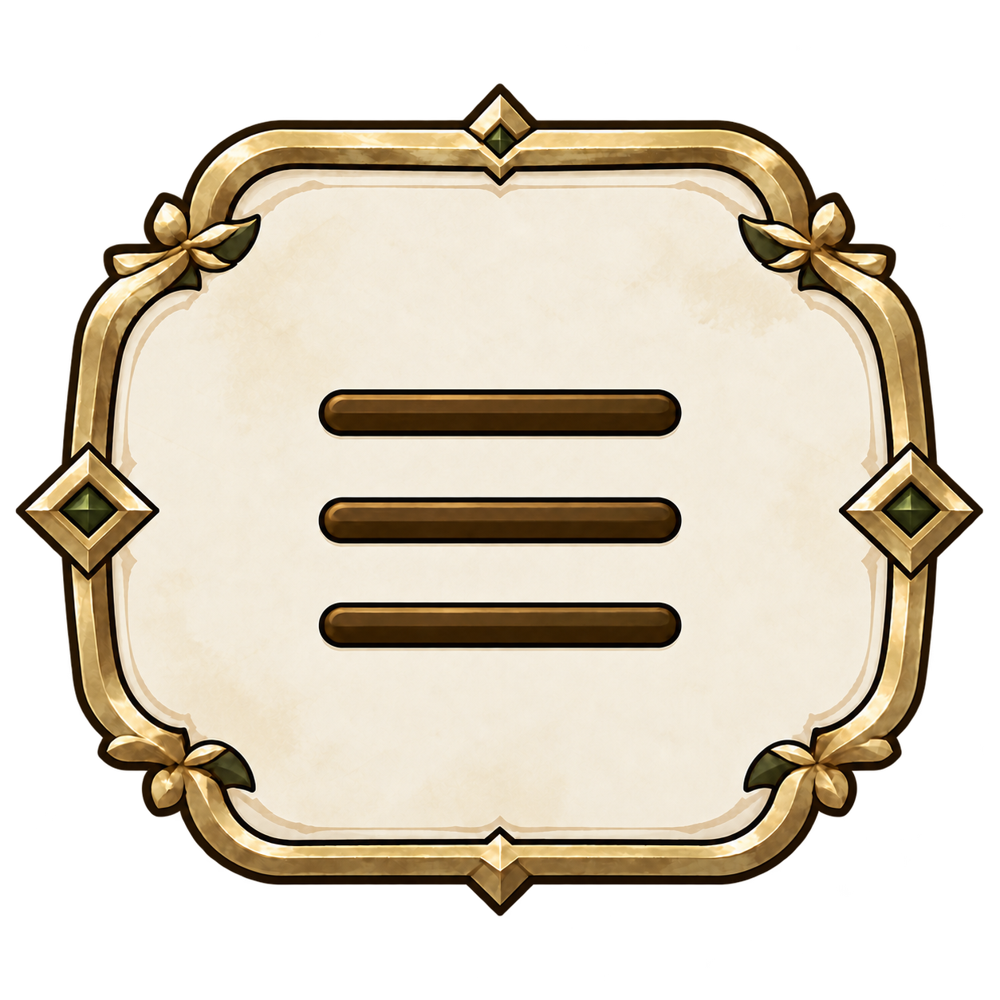                         |
| [BT04_blank_pale_green.png](./BT04_blank_pale_green.png)               | 텍스트 없는 가로 버튼 · 연그린 시안                                  |  1940×311 |          |
| [BT04_blank_pale_ivory.png](./BT04_blank_pale_ivory.png)               | 공통 대화/선택지용 아이보리 양피지 빈 프레임 · 기존 녹색판과 동일 폭 |  1940×311 | 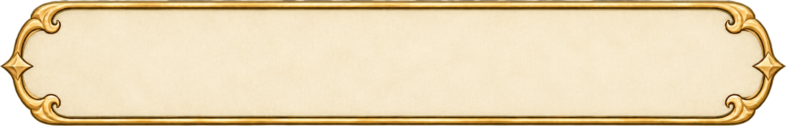          |
| [BT04_blank_pale_green_short.png](./BT04_blank_pale_green_short.png)   | 텍스트 없는 짧은 가로 버튼 · 연그린                                  |  1362×311 |    |
| [BT04_blank_pale_ivory_short.png](./BT04_blank_pale_ivory_short.png)   | 텍스트 없는 짧은 가로 버튼 · 아이보리                                |  1362×311 | 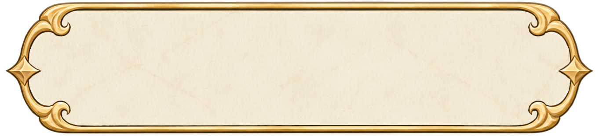 |
| [BT04_choice_blank_pale_ivory.png](./BT04_choice_blank_pale_ivory.png) | `MS05_S4_SHARE_ROLES` 등 긴 선택지용 아이보리 양피지 빈 프레임       |  2400×311 |      |
| [BT04_choice_blank_pale_green.png](./BT04_choice_blank_pale_green.png) | 공통 선택지용 긴 빈 버튼 프레임 · `MS05_S4_SHARE_ROLES` 폭 기준      |  2400×311 |       |

## 기본 재료·프레임

| 파일                                                                                                 | 설명                         | 원본 크기 | 미리보기                                                                                                     |
| ---------------------------------------------------------------------------------------------------- | ---------------------------- | --------: | ------------------------------------------------------------------------------------------------------------ |
| [UI01_parchment_tile_000.png](./UI01_parchment_tile_000.png)                                         | 양피지 질감 타일             |   512×512 |                                  |
| [UI01_parchment_tile_source_008.png](./UI01_parchment_tile_source_008.png)                           | 양피지 질감 타일 생성 원본   | 1254×1254 |                 |
| [UI02_frame_corner_001.png](./UI02_frame_corner_001.png)                                             | UI 프레임 모서리 재료        |   192×192 |                               |
| [UI02_frame_corner_source_009.png](./UI02_frame_corner_source_009.png)                               | 프레임 모서리 생성 원본      | 1254×1254 |                      |
| [UI03_character_card_background_002.png](./UI03_character_card_background_002.png)                   | 캐릭터 카드 배경             |   480×640 |                       |
| [UI03_character_card_background_source_010.png](./UI03_character_card_background_source_010.png)     | 캐릭터 카드 배경 생성 원본   | 1086×1448 |      |
| [UI04_fullbody_preview_background_003.png](./UI04_fullbody_preview_background_003.png)               | 전신 미리보기 배경           |  800×1200 |                   |
| [UI04_fullbody_preview_background_source_011.png](./UI04_fullbody_preview_background_source_011.png) | 전신 미리보기 배경 생성 원본 | 1024×1536 |  |
| [UI07_admission_invitation_004.png](./UI07_admission_invitation_004.png)                             | 입학 초대장 이미지 재료      |  1200×800 |                     |
| [UI07_admission_invitation_source_012.png](./UI07_admission_invitation_source_012.png)               | 입학 초대장 생성 원본        | 1536×1024 |                |

## 로고

기존 게임 타이틀에서 사용한 확정 로고를 `LG01`로 이름 변경했습니다. `LG02`·`LG03`은 각각 신비 로고 1안·5안이며, 동일 이미지 중복 파일은 제거했습니다. 빛 효과는 별도 파일입니다.

| 파일                                                             | 설명                                 | 원본 크기 | 미리보기                                                                                       |
| ---------------------------------------------------------------- | ------------------------------------ | --------: | ---------------------------------------------------------------------------------------------- |
| [LG01_lumia_logo_final.png](./LG01_lumia_logo_final.png)         | 확정 LUMIA 로고; 빛 효과는 별도 파일 |  1774×887 |  |
| [LG02_lumia_logo_mystic_01.png](./LG02_lumia_logo_mystic_01.png) | LUMIA 신비 로고 시안 1               |  1600×800 |            |
| [LG03_lumia_logo_mystic_05.png](./LG03_lumia_logo_mystic_05.png) | LUMIA 신비 로고 시안 5               |  1600×800 |            |

## 화면 구성·다이어리 시안

| 파일                                                                         | 설명                        | 원본 크기 | 미리보기                                                                                        |
| ---------------------------------------------------------------------------- | --------------------------- | --------: | ----------------------------------------------------------------------------------------------- |
| [UI08_diary_open_book.png](./UI08_diary_open_book.png)                       | 빈 다이어리 펼친 책 프레임  |  1286×850 | 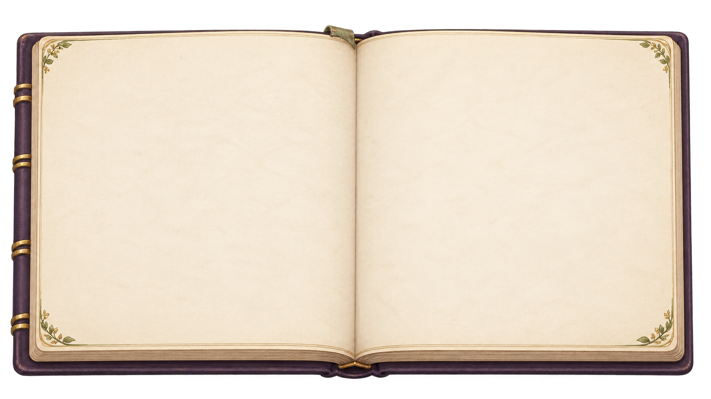             |
| [UI09_diary_bookmark_fabric.png](./UI09_diary_bookmark_fabric.png)           | 다이어리용 빈티지 천 책갈피 |  1028×432 |       |
| [UI10_dialogue_panel_plain.png](./UI10_dialogue_panel_plain.png)             | 이름표 없는 대화 패널       |  1988×791 |              |
| [UI11_dialogue_panel_nameplate.png](./UI11_dialogue_panel_nameplate.png)     | 이름표가 있는 대화 패널     |  1280×320 |        |
| [UI12_portrait_card_frame.png](./UI12_portrait_card_frame.png)               | 세로형 카드 프레임          | 1086×1448 | 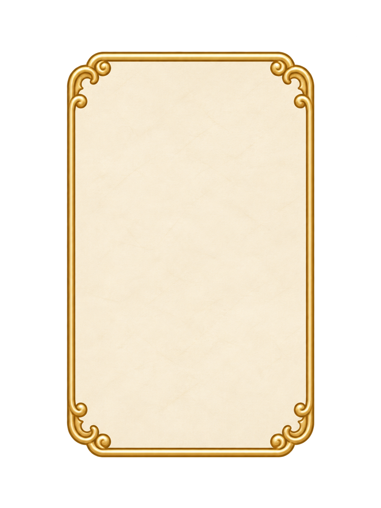                 |
| [UI13_collection_screen_layout.png](./UI13_collection_screen_layout.png)     | 컬렉션 화면 통합 시안       |  1672×941 |          |
| [UI14_date_frame_original.png](./UI14_date_frame_original.png)               | 날짜 프레임 원래 색상       |  1902×827 | 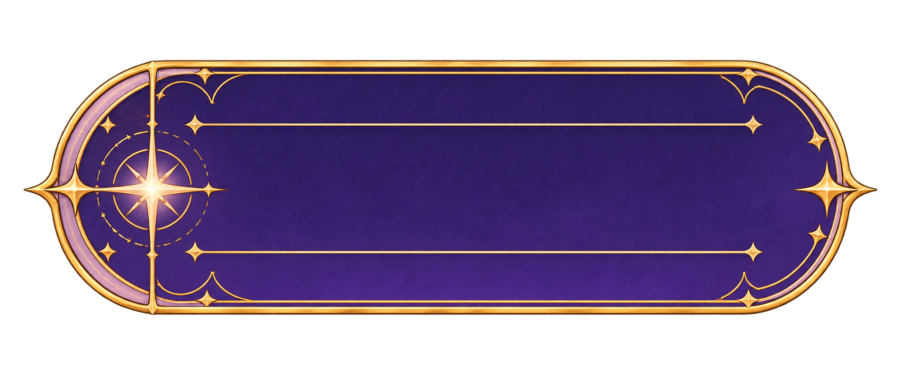              |
| [UI14_date_frame_variant_01.png](./UI14_date_frame_variant_01.png)           | 날짜 표시 시안 1            |  1860×846 | 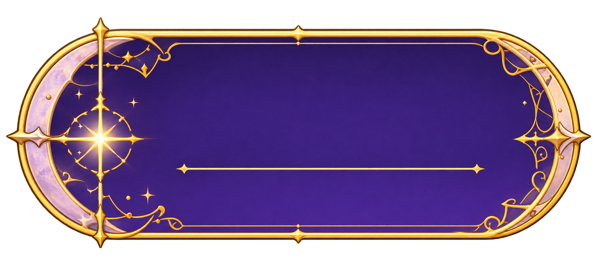                 |
| [UI15_diary_layout_01_book.png](./UI15_diary_layout_01_book.png)             | 다이어리 · 펼친 책 구성     |  1672×941 | 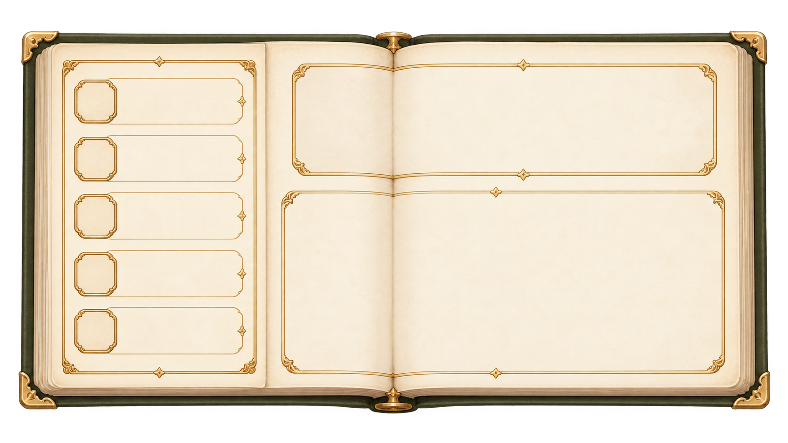           |
| [UI15_diary_layout_02_chronology.png](./UI15_diary_layout_02_chronology.png) | 다이어리 · 시간순 기록 구성 |  1672×941 |  |
| [UI15_diary_layout_04_letters.png](./UI15_diary_layout_04_letters.png)       | 다이어리 · 편지함 구성      |  1671×941 | 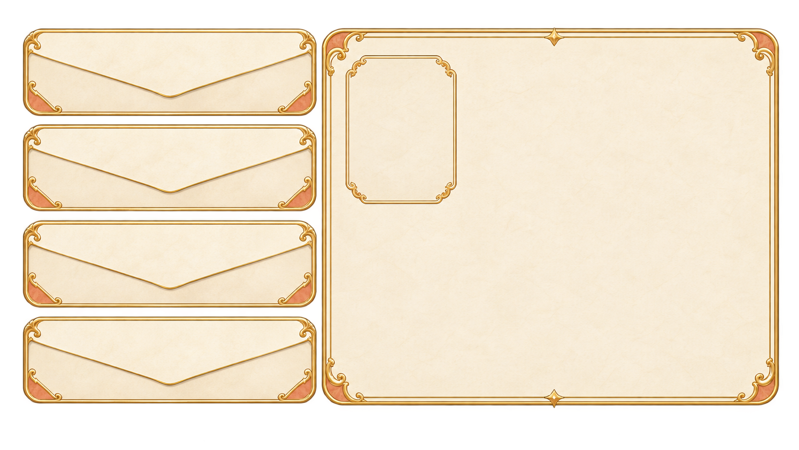         |
| [UI15_diary_layout_05_archive.png](./UI15_diary_layout_05_archive.png)       | 다이어리 · 서고 기록함 구성 |  1671×941 | 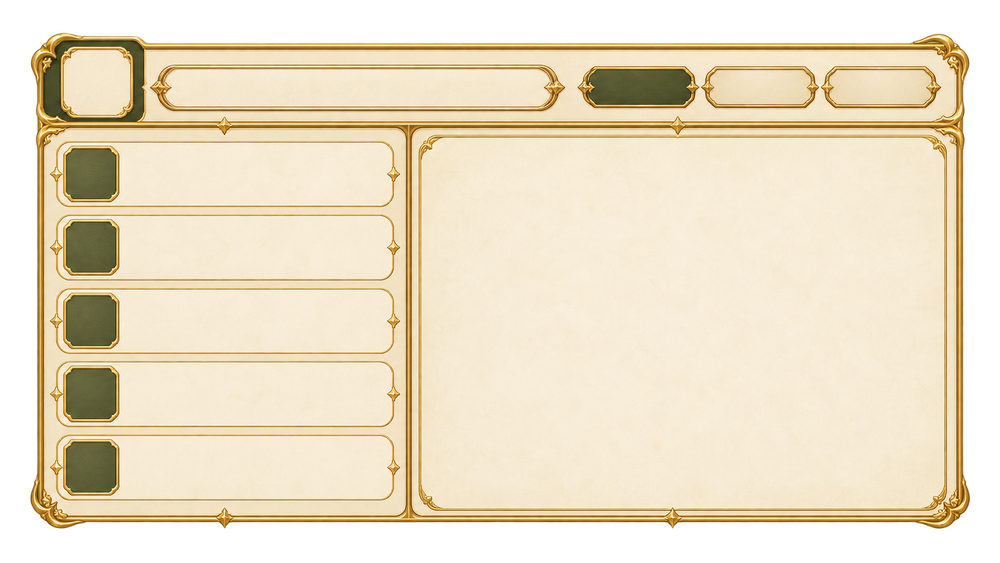    |
| [UI16_weekly_planner_layout.png](./UI16_weekly_planner_layout.png)           | 주간 일정 플래너 시안       |  1672×941 |             |

## 검토 캡처

| 파일                                                               | 설명                         | 원본 크기 | 미리보기                                                                                  |
| ------------------------------------------------------------------ | ---------------------------- | --------: | ----------------------------------------------------------------------------------------- |
| [UI18_myroom_time_review.jpg](./UI18_myroom_time_review.jpg)       | 마이룸 시간대 검토 화면 캡처 |  1264×906 | 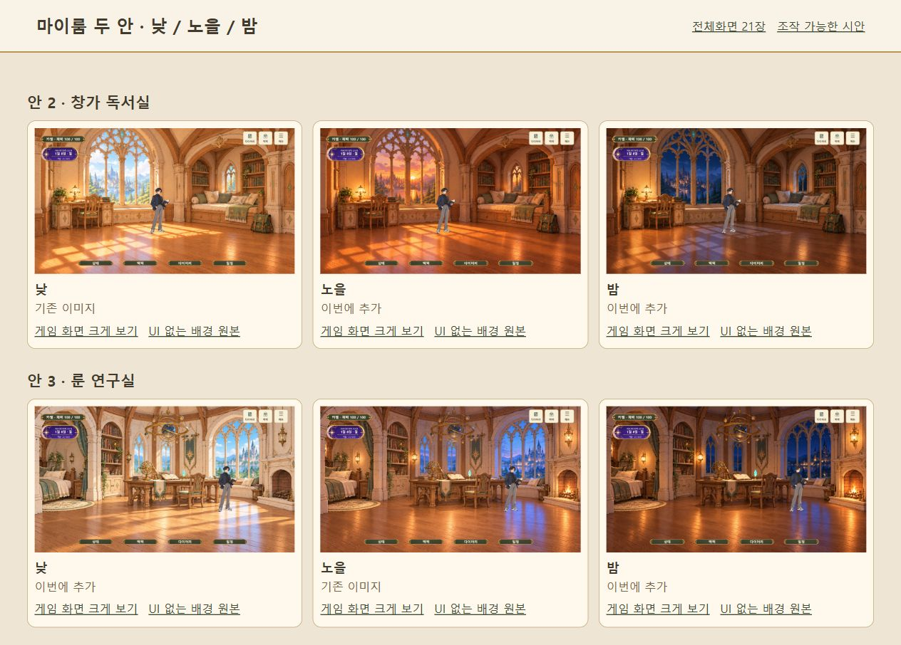  |
| [UI19_screen_gallery_review.jpg](./UI19_screen_gallery_review.jpg) | 전체 화면 갤러리 검토 캡처   |   558×849 |  |

## 게임용 환경 이미지

기존 `asset/environment/`에서 옮긴 바닥·식물·구조물·전경 15장입니다. 개별 파일의 크기와 픽셀 내용은 유지했습니다. 실제 배치·반복 경계·캐릭터 가림·접지 검수는 별도입니다.

| 파일                                                                                       | 설명                    | 원본 크기 | 미리보기                                                                                        |
| ------------------------------------------------------------------------------------------ | ----------------------- | --------: | ----------------------------------------------------------------------------------------------- |
| [UI20_environment_floor1_square.png](./UI20_environment_floor1_square.png)                 | 정사각 바닥 타일        |   128×128 | 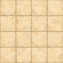             |
| [UI20_environment_floor2_small_square.png](./UI20_environment_floor2_small_square.png)     | 작은 정사각 바닥 타일   |   128×128 | 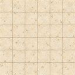  |
| [UI20_environment_floor3_wide_tile.png](./UI20_environment_floor3_wide_tile.png)           | 가로형 바닥 타일        |   128×128 | 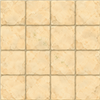          |
| [UI20_environment_floor4_brick.png](./UI20_environment_floor4_brick.png)                   | 벽돌 바닥 타일          |   128×128 | 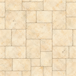                |
| [UI20_environment_floor5_warm_square.png](./UI20_environment_floor5_warm_square.png)       | 따뜻한 색감의 바닥 타일 |   128×128 | 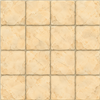 |
| [UI20_environment_border1_stone.png](./UI20_environment_border1_stone.png)                 | 돌 경계 타일            |   128×128 | 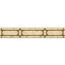                 |
| [UI20_environment_plant1_white_flower.png](./UI20_environment_plant1_white_flower.png)     | 흰꽃 식물               |   256×256 | 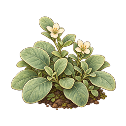              |
| [UI20_environment_plant2_lavender.png](./UI20_environment_plant2_lavender.png)             | 라벤더 식물             |   256×256 | 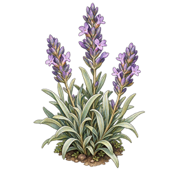                |
| [UI20_environment_plant3_broadleaf.png](./UI20_environment_plant3_broadleaf.png)           | 넓은잎 식물             |   512×512 | 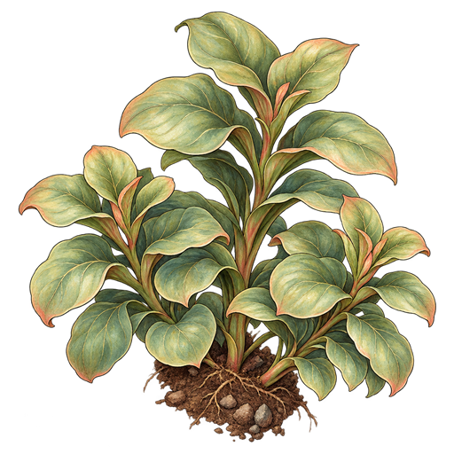               |
| [UI20_environment_plant4_fern.png](./UI20_environment_plant4_fern.png)                     | 고사리 식물             |   512×512 | 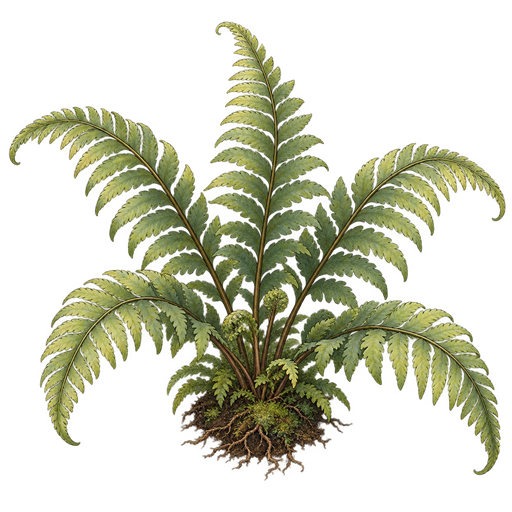                    |
| [UI20_environment_flowerbed1_stone.png](./UI20_environment_flowerbed1_stone.png)           | 돌 화단                 |  1024×512 | 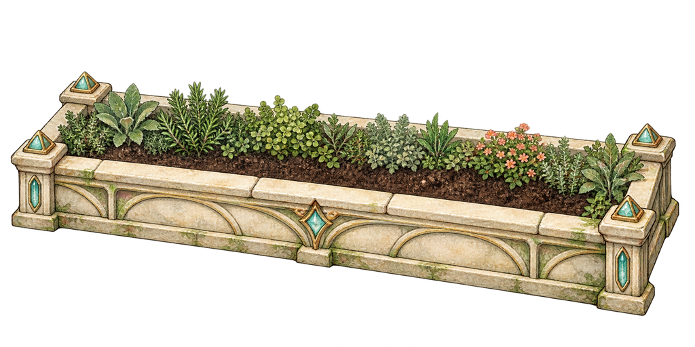                   |
| [UI20_environment_vine1_ivy.png](./UI20_environment_vine1_ivy.png)                         | 담쟁이 덩굴             |   512×512 | 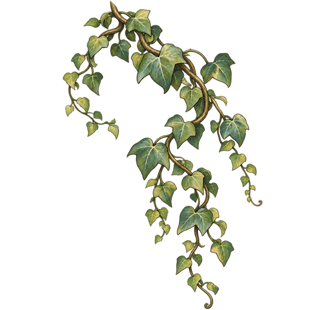                      |
| [UI20_environment_arch1_greenhouse.png](./UI20_environment_arch1_greenhouse.png)           | 온실 아치 구조물        | 1024×1024 | 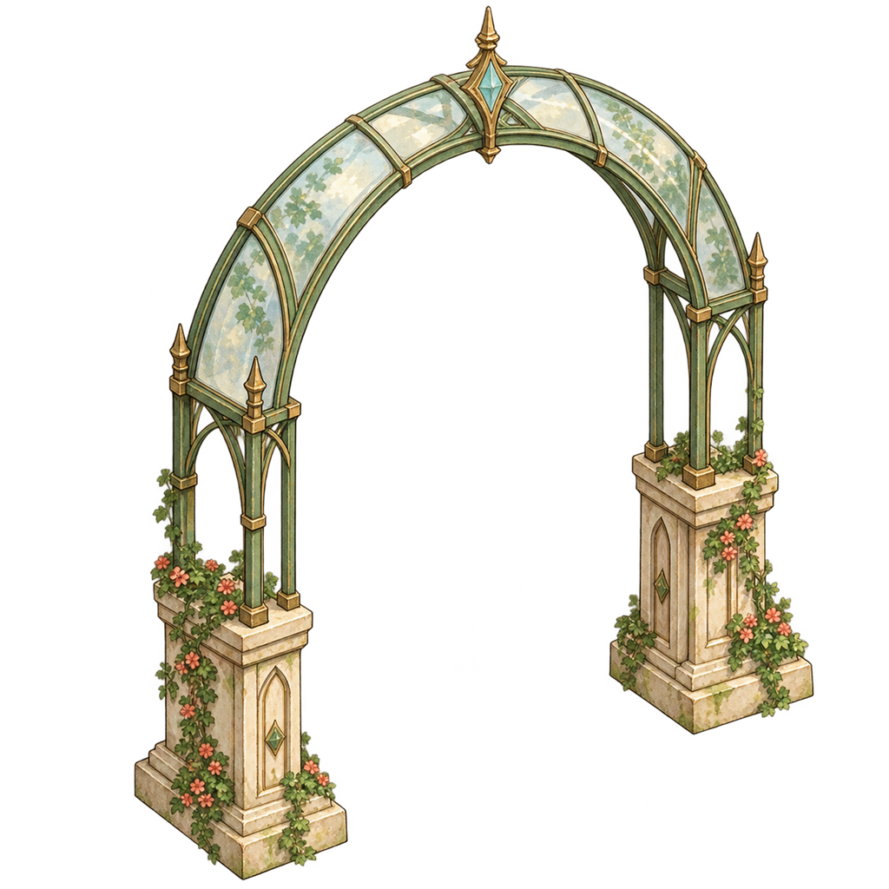          |
| [UI20_environment_foreground1_flowering.png](./UI20_environment_foreground1_flowering.png) | 꽃이 핀 전경            | 1024×1024 | 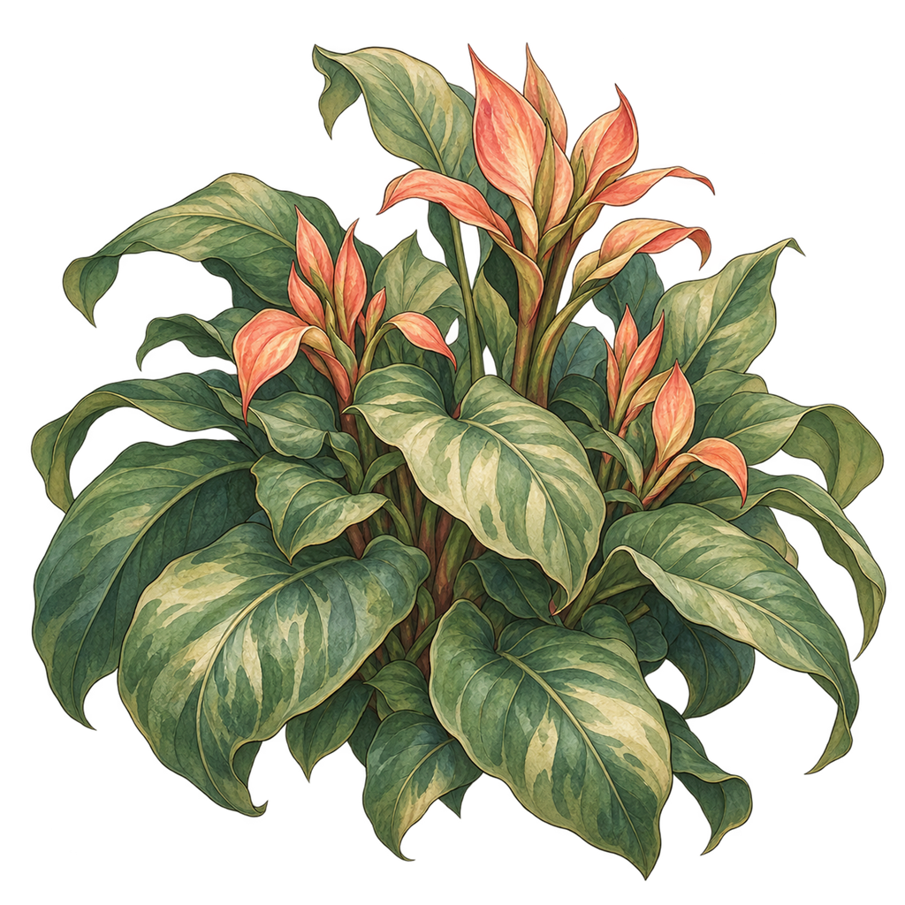         |
| [UI20_environment_foreground2_fern.png](./UI20_environment_foreground2_fern.png)           | 고사리 전경             | 1024×1024 | 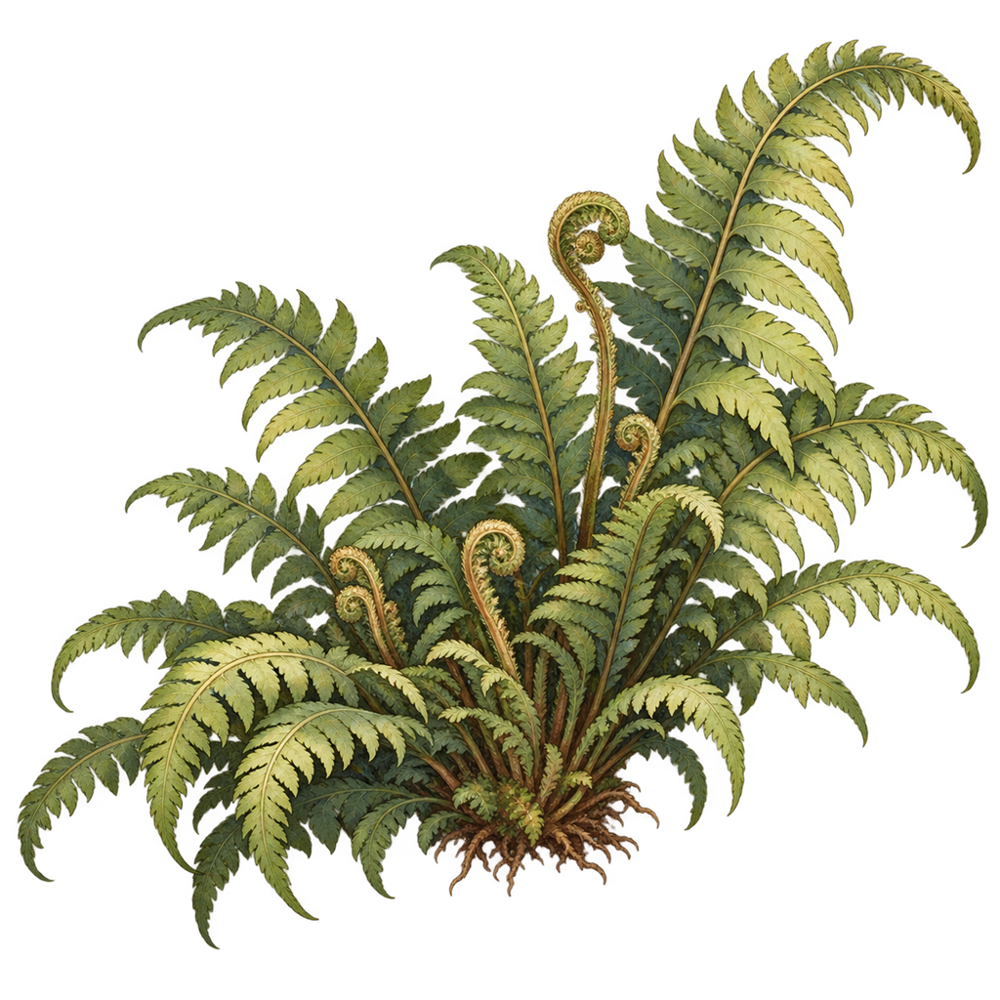               |

## 정리 기록

- 첨부 화면에 지정된 가방·기록·힌트 SVG 3개와 기록 버튼 아이콘 SVG 5개는 제외했습니다.
- 기존 로고 3종과 내용이 같은 LG 중복 파일을 정리하고, 게임에서 사용하던 원본에 LG 이름을 적용했습니다.
- 검토용 실행 코드와 작업 문서는 이 GitHub 폴더에 포함하지 않았습니다.

## 메인 게임 실행 호환 파일

현재 메인 게임 코드가 아래 원래 파일명을 직접 사용하므로 보존했습니다. `LG01_lumia_logo_final.png`과의 중복 여부와 무관하게 실행 경로를 유지합니다.

| 파일                                                         | 용도                                                                                     | 미리보기 |
| ------------------------------------------------------------ | ---------------------------------------------------------------------------------------- | -------- |
| [lumia_logo_final_034.png](./lumia_logo_final_034.png)       |        |
| [player_status_frame_015.png](./player_status_frame_015.png) |  |
