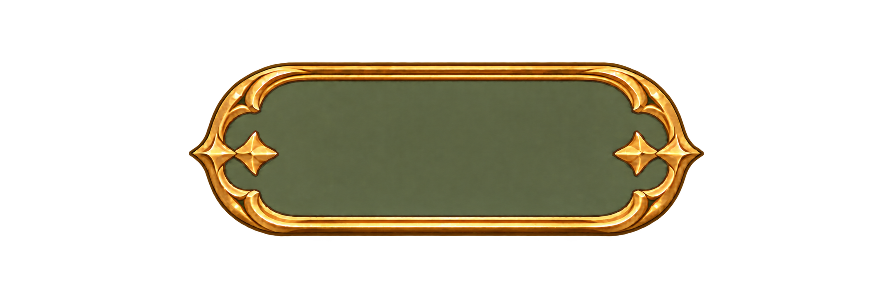
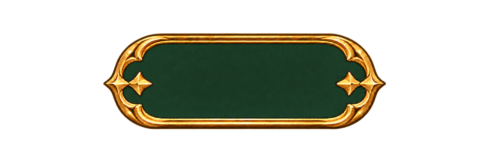

# 골드 버튼 비율·색상 시안 2종

사용자 첨부 [원본 버튼](button_source.png)의 빈티지 골드 이중 테두리와 양끝 별 장식을 유지하면서 버튼 가로폭을 줄이고 세로 높이를 늘린 투명 PNG 시안입니다. 원본의 보이는 버튼 영역은 약 2126×313px, 두 신규 안은 약 1240×420px입니다. 투명 캔버스는 2155×730px이며, 실제 게임 적용 시 글자는 별도 UI 텍스트로 올립니다.

| 시안 | 내부 색상 | 미리보기 |
|---|---|---|
| [현재 컬러 비율 변경](button_compact_olive.png) | 기존과 가까운 올리브 그린 |  |
| [진한 녹색 비율 변경](button_compact_forest.png) | 딥 포레스트 그린 |  |

내장 이미지 생성 도구의 편집 기능으로 올리브색 비율 변경본을 만든 후, 해당 결과를 기준으로 내부 색상만 진한 녹색으로 바꿨습니다. 두 결과는 글자 없이 투명 배경으로 저장한 비교 시안이며 최종 버튼 규격 확정은 아닙니다.
