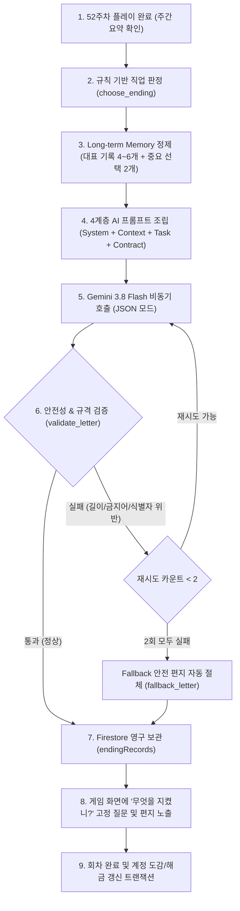
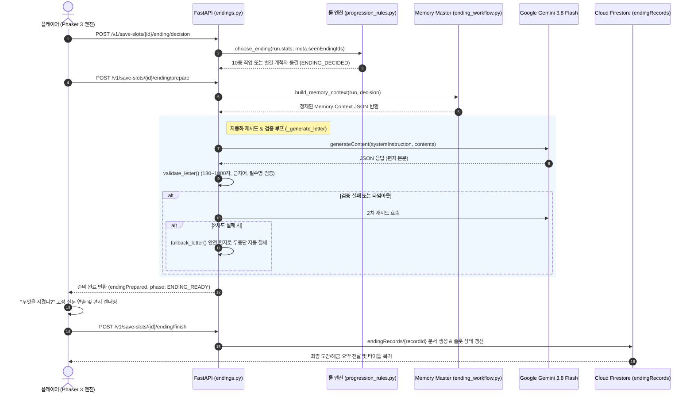

# LUMIA AI 기술 명세서 (AI Architecture & Tech Specification)

> **문서 상태:** Final Project 공식 기술 명세서 / 구현 및 실환경 검증 완료  
> **관련 기준 문서:** [`document/08_REQUEST.md`](08_REQUEST.md), [`document/09_AI_ENDING_LETTER.md`](09_AI_ENDING_LETTER.md), [`document/10_TECH_STACK.md`](10_TECH_STACK.md)  
> **기준 모델:** Google Gemini 3.8 Flash (`gemini-3.8-flash`) via Google GenAI API  

---

## 1. 개요 및 과제 요구사항 대조

LUMIA는 아동(9~11세) 대상의 힐링 육성 시뮬레이션 게임으로, 5개월간의 AI 네이티브 과정을 증명하는 최종 캡스톤 프로젝트입니다.  
본 프로젝트는 **생성형 AI를 서비스의 핵심 기능(Core Feature)으로 내재화**하고, Final Project 필수 기술 요구조건을 100% 충족하도록 설계·구현되었습니다.

### 1.1 Final Project AI 필수 요구조건 대조표

| 요구 조건 | 과제 규정 기준 | LUMIA 적용 및 충족 상태 | 충족 여부 |
|---|---|---|:---:|
| **핵심 기능성** | 단순 API 호출이 아닌 서비스의 핵심 가치 창출 | 52주 플레이 기록 기반 **「개인화 엔딩 편지」** 생성 | **충족** |
| **필수 기술 요소** | 5대 기술 요소 중 **최소 2개 이상** 필수 포함 | **자동화 워크플로우** + **Long-term Memory** (2종 채택) | **충족 (2/5)** |
| **외부 배포** | 외부 접근 가능한 실환경 배포 필수 | **Render (FastAPI 백엔드) + Vercel (웹 프론트엔드)** 배포 완료 | **충족** |
| **안전성·윤리** | AI 생성물 고지, 아동 대상 안전성 확보 | AI 생성 표시, 12대 금지어 필터링, Fail-Safe Fallback 보장 | **충족** |

---

## 2. 필수 기술 요소 5종 분석 및 선택 근거

과제 명세서에서 제시한 5대 기술 요소 중, 프로젝트의 장르와 대상 연령에 최적화된 **2가지 핵심 요소를 선별하여 고도화**했습니다.

```
[ 과제 제시 5대 기술 요소 ]
 ├─ 1. AI Agent ─────────────▶ [제외] 자율 도구 실행이 힐링 육성 장르에 불필요하며 환각 위험 증가
 ├─ 2. RAG (검색 증강 생성) ──▶ [제외] 세계관/직업 설정이 정규화 DB(SQLite)에 완전히 통제되어 비정형 검색 불필요
 ├─ 3. 멀티모달 AI ──────────▶ [제외] 시각/음향은 전문 아티스트 에셋을 직접 사용 (인위적 결합 배제)
 ├─ 4. 자동화 워크플로우 ─────▶ [채택] 직업 동결 ➔ 기억 선별 ➔ Gemini 호출 ➔ 안전 검증 ➔ Fallback ➔ 영구 저장 파이프라인
 └─ 5. Long-term Memory ──────▶ [채택] 52주간의 활동·성향·선택 이력을 누적하고 엔딩 맥락으로 주입
```

---

## 3. 핵심 기술 요소 1: 자동화 워크플로우 (Automated Workflow)

### 3.1 워크플로우 정의
엔딩 시점에 단 한 번의 클라이언트 요청으로 **규칙 기반 직업 판정, 장기 기억 추출, 프롬프트 조립, Gemini API 호출, 3단계 안전성 검증, Fail-Safe 폴백 전환, Firestore 영구 저장**까지 이어지는 7단계 엔드투엔드 파이프라인입니다.

### 3.2 워크플로우 전체 흐름도 (Flowchart)



### 3.3 시퀀스 다이어그램 (Sequence Diagram)



### 3.4 자동화 워크플로우의 핵심 엔지니어링 특징
1. **무중단 안전성 (Fail-Safe Fallback):**
   * LLM API의 일시적 장애(503, 타임아웃)나 유해 표현 생성으로 검증이 실패하더라도, 시스템이 사전 검수된 작가 원문 기반의 `fallback_letter`로 자동 절체되어 플레이어의 엔딩 진행이 끊기지 않습니다.
2. **멱등성(Idempotency) 및 비용 보호:**
   * 유저가 네트워크 불안정으로 새로고침을 하거나 재시도하더라도, 슬롯 내 `endingPrepared` 캐시를 확인하여 이미 생성된 편지가 있다면 Gemini를 중복 호출하지 않고 기존 편지를 즉시 반환합니다.
3. **결정론적 직업 동결:**
   * AI가 직업을 판정하거나 바꾸지 못하도록, 백엔드 룰 엔진이 먼저 직업을 확정한 뒤 해당 직업 정보를 고정 파라미터로 주입합니다.

---

## 4. 핵심 기술 요소 2: Long-term Memory (장기 플레이 기억)

### 4.1 하이브리드 장기 기억 아키텍처 (Hybrid Architecture)
LUMIA의 Long-term Memory는 **무분별한 LLM 자동 요약을 지양하고, "규칙 기반 정밀 선별 + AI 맥락 소비" 방식을 결합한 하이브리드 아키텍처**로 구현되었습니다.

```
[ 52주간 플레이 진행 ] ──▶ [ Firestore ActiveRun 영구 누적 ]
                              ├─ runStatistics (활동 카운터)
                              ├─ hiddenStats (8대 성향 누적치)
                              └─ representativeChoices (중요 분기 결정)
                                       │
                                       ▼ (엔딩 시점: Python 규칙 엔진)
[ 지능적 선별 및 압축 ] ──▶ 1. 직업별 우선 활동 4~6개 선별 (select_play_records)
                          2. SQLite 중요 선택지 사실 요약 매핑 (memory_content)
                          3. 상위 3대 성향 하이라이트 추출 (hidden_highlights)
                                       │
                                       ▼ (100% 팩트 데이터 완성)
[ AI Memory Context ]  ──▶ Gemini 3.8 Flash의 Task Context로 주입
                                       │
                                       ▼ (결과물 창작)
[ 개인화 엔딩 편지 ]   ──▶ "46번의 모험을 떠났던 카엘아, 49주차 축제에서 솔직함을 택했던 네 용기가..."
```

### 4.2 왜 AI 요약 대신 규칙 기반 선별을 택했는가? (설계 타당성)
1. **환각(Hallucination) 0% 달성:**
   * 52주의 방대한 로그를 LLM에게 요약시키면 플레이어가 하지도 않은 선택을 지어내는 거짓 기억(환각)이 발생합니다.
   * LUMIA는 백엔드가 실제로 일어난 팩트(Fact) 데이터만 추출해 건네므로, AI가 거짓말을 할 수 없는 안전한 환경을 보장합니다.
2. **비용 및 지연 시간 최적화:**
   * 매 주차마다 요약 프롬프트를 호출하거나 방대한 전체 세이브를 전송하는 대신, 엔딩 시점에 0.01초 만에 최적의 4~6개 기록으로 압축하여 토큰 비용과 대기 시간을 극소화했습니다.

### 4.3 장기 기억 데이터 주입 규격 (`AI Memory Context`)

실제 Gemini 호출 시 `Task Context`로 주입되는 표준 JSON 규격입니다:

```json
{
  "character": {
    "id": "CH01",
    "name": "카엘"
  },
  "ending": {
    "id": "ENDING_ARCADIA_EXPLORER",
    "name": "아르카디아 탐험가",
    "subtitle": "아직 가보지 않은 길",
    "type": "CAREER",
    "careerAnchor": "아르카디아의 장소와 사람들을 더 알아가는 탐험가의 길을 택한다...",
    "futureSceneGuide": "익숙한 장소의 지도를 펼쳐 다음 답사지를 표시하고 아직 가보지 않은 길로 출발한다."
  },
  "visibleStats": {
    "knowledge": 210, "expression": 170, "skill": 245, "exploration": 382, "magic": 160
  },
  "hiddenHighlights": [
    { "id": "independence", "value": 54 },
    { "id": "curiosity", "value": 48 }
  ],
  "playRecords": [
    { "type": "adventureCount", "label": "모험을 떠난 횟수", "count": 46 },
    { "type": "locationDiscoveryCount", "label": "새로운 장소를 발견한 횟수", "count": 13 }
  ],
  "representativeChoices": [
    {
      "eventId": "MS05",
      "choiceId": "SHARE_FACTS_FIRST",
      "week": 49,
      "summary": "별빛 축제의 문제에서 확인된 사실과 아직 모르는 점을 모두에게 먼저 알리기로 했다"
    }
  ],
  "generationRules": {
    "audience": "age_9_11",
    "locale": "ko-KR",
    "answerFixedQuestion": false
  }
}
```

### 4.4 회차 격리 및 영구 보존
* **회차 격리 (Run Isolation):** 1회차의 기억이 2회차에 오염되지 않도록 장기 기억은 각 회차(`runId`)에 엄격히 격리됩니다.
* **영구 보존:** 확정된 편지와 사용된 기억 스냅샷(`selectedPlayRecords`, `memoryContextHash`)은 `users/{uid}/endingRecords/{recordId}`에 보관되어, 재접속 시 AI 재호출 없이 영구 열람됩니다.

---

## 5. 소스 코드 구현 매핑 (Implementation Map)

| 기능 분류 | 주요 파일 경로 | 핵심 함수 및 역할 |
|---|---|---|
| **API 라우터** | [`backend/api/app/endings.py`](backend/api/app/endings.py) | `prepare_ending()`, `finish_ending()`, `_generate_letter()` |
| **워크플로우 & 메모리** | [`backend/api/app/ending_workflow.py`](backend/api/app/ending_workflow.py) | `build_memory_context()`, `select_play_records()`, `validate_letter()`, `fallback_letter()` |
| **Gemini 통신** | [`backend/api/app/gemini.py`](backend/api/app/gemini.py) | `GeminiEndingLetterGenerator.generate()` (Google GenAI API 통신) |
| **직업 룰 엔진** | [`backend/api/app/progression_rules.py`](backend/api/app/progression_rules.py) | `choose_ending()` (10종 직업 조건 판정) |
| **클라이언트 연동** | [`engine/src/core/server-ending.mjs`](engine/src/core/server-ending.mjs) | `createEndingFlowManager()` (엔딩 상태머신 제어) |
| **자동화 테스트** | [`backend/api/tests/test_phase9_endings.py`](backend/api/tests/test_phase9_endings.py) | Phase 9 단위/통합 테스트 (6개 케이스 100% 통과) |

---

## 6. 실환경 검증 결과 (Live Validation)

* **배포 인프라:** Render Web Service (`https://lumia-api-pcxd.onrender.com`)
* **검증 기록 문서:** [`backend/api/deploy/PHASE12_VALIDATION.md`](backend/api/deploy/PHASE12_VALIDATION.md)
* **검증 결과 요약:**
  * Render 환경변수(`GEMINI_API_KEY`) 주입 후 실환경 라이브 호출 검증 완료.
  * 실제 Gemini 생성 및 3단계 안전성 검증 통과 확인 (`provider=gemini`, `validated=true`, `attempts=1`).
  * Python 단위 테스트 153건 및 엔진 테스트 338건 전원 통과 상태 확인.

---

## 7. 발표 및 포트폴리오 디펜스 전략 (Key Takeaways)

> **심사위원 질문 예상:**  
> *"장기기억 요약에 왜 LLM을 쓰지 않고 규칙 엔진을 사용했나요?"*
> 
> **답변 전략 (엔지니어링 가치 강조):**  
> "저희는 화려하지만 불안정한 기술보다 **실제 서비스의 안정성과 데이터 무결성을 최우선**으로 고려했습니다. 52주의 방대한 기록을 LLM에게 요약시키면 플레이어가 하지도 않은 선택을 지어내는 **환각(Hallucination)**이 발생하여 어린이 사용자의 몰입감을 해칩니다.  
> 따라서 Firestore에 1년간의 플레이 이력을 영구 누적하고, 백엔드의 결정론적 규칙 엔진으로 **100% 검증된 팩트(Fact)만 정제하여 Gemini에 맥락으로 주입하는 '하이브리드 장기기억 아키텍처'**를 구축했습니다. 이를 통해 환각 0%를 달성하면서도 완벽하게 개인화된 감동적인 엔딩 편지를 생성할 수 있었습니다."
