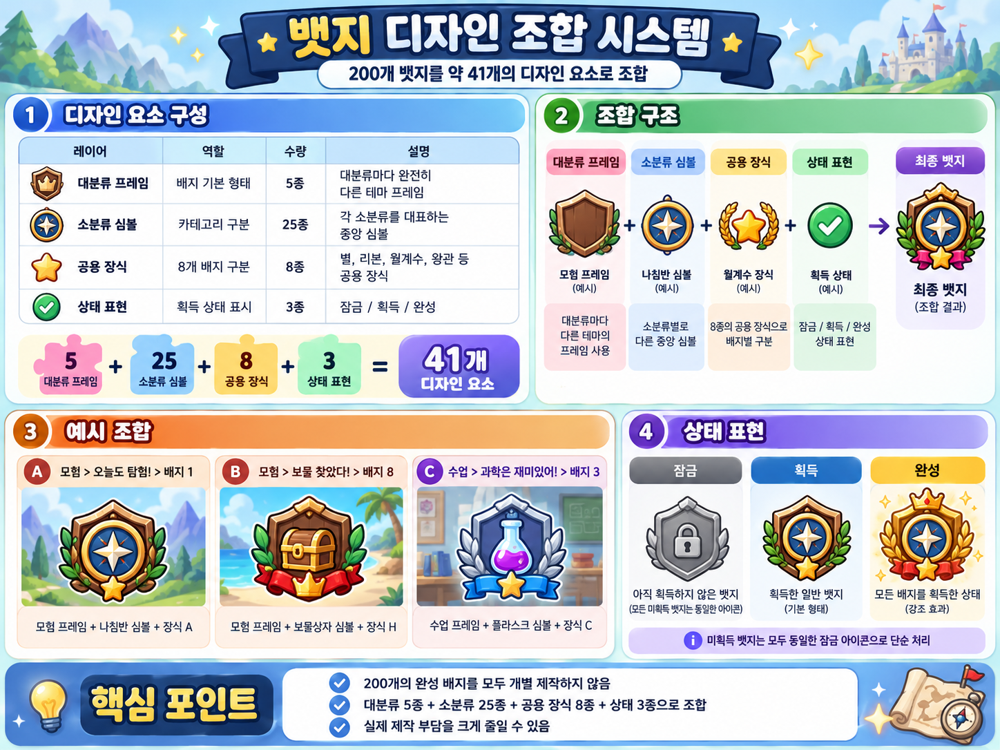

# 가방 수집 배지 분류·디자인 시스템

## 1. 기본 수량

가방의 수집 배지는 다음 구조를 기본안으로 사용합니다.

| 항목           |  수량 | 구성                     |
| -------------- | ----: | ------------------------ |
| 대분류         |   5개 | 서로 다른 큰 테마·프레임 |
| 소분류         |  25개 | 대분류당 5개             |
| 실제 배지      | 200개 | 소분류당 8개             |
| 단계 보상 지점 |  75개 | 소분류마다 3단계 보상    |

구조는 `5개 대분류 × 5개 소분류 × 8개 배지 = 총 200개 배지`입니다.

## 2. 디자인 제작 원칙

200개의 배지를 각각 완전히 별개의 일러스트로 만들지 않고, **공통 디자인 요소를 조합하는 방식**으로 제작 부담을 줄입니다.

| 디자인 레이어  | 수량 | 역할                           | 적용 방식                                                 |
| -------------- | ---: | ------------------------------ | --------------------------------------------------------- |
| 대분류 프레임  |  5종 | 배지의 큰 형태와 분위기        | 대분류마다 완전히 다른 프레임·테마 사용                   |
| 소분류 심볼    | 25종 | 어떤 소분류인지 구분           | 배지 중앙의 대표 심볼로 사용                              |
| 공용 배지 장식 |  8종 | 한 소분류 안의 8개 배지를 구분 | 별·리본·월계수·왕관 등 공용 장식을 모든 소분류에서 재사용 |
| 상태 표현      |  3종 | 잠금·획득·완성 상태 표현       | 모든 배지에 공통 적용                                     |

따라서 기본 디자인 요소는 `5 + 25 + 8 + 3 = 약 41종`으로 구성합니다.

완성 배지 하나는 다음 조합으로 만들어집니다.

`대분류 프레임 + 소분류 심볼 + 8종 중 하나의 공용 장식 + 상태 표현`

예시:

- `모험 프레임 + 나침반 심볼 + 장식 A`
- `모험 프레임 + 보물상자 심볼 + 장식 H`
- `수업 프레임 + 플라스크 심볼 + 장식 C`

## 3. 미획득 배지 표현

미획득 배지는 개별 배지 디자인을 미리 노출하지 않고 **하나의 통일된 잠금 아이콘**으로 단순하게 표시합니다.

- 기본안: 열쇠 또는 자물쇠 형태의 공통 아이콘 1종
- 대분류·소분류·배지별 미획득 실루엣은 별도로 제작하지 않음
- 획득하는 순간 실제 조합 배지 디자인을 공개

이를 통해 잠긴 배지 200개에 대한 별도 미획득 이미지를 만들 필요가 없습니다.

## 4. 배지 상태

| 상태   | 표시 방식                                                                        |
| ------ | -------------------------------------------------------------------------------- |
| 미획득 | 모든 배지에 동일한 열쇠/자물쇠 아이콘 사용                                       |
| 획득   | 대분류 프레임 + 소분류 심볼 + 공용 장식 조합을 정상 표시                         |
| 완성   | 소분류의 8개 배지를 모두 모았을 때 해당 카테고리 또는 배지 영역에 강조 효과 표시 |

완성 효과는 별도 고유 배지를 새로 그리는 방식보다 광택·별·리본·테두리 강조 등 공통 효과를 재사용하는 것을 기본으로 합니다.

## 5. 디자인 조합 이미지

아래 이미지는 200개 배지를 약 41개의 공통 디자인 요소로 조합하는 기준을 시각화한 기획 참고 이미지입니다.



## 6. 최종 대분류·소분류

`asset/badge/`에 이미 제작된 프레임 5종과 심볼 25종을 게임의 최종 분류로 사용합니다. 디자인 관리용 `forest / star / workshop / friendship / rune` ID는 유지하고 플레이어에게는 아래 한국어 대분류명을 표시합니다.

| 대분류 ID | 플레이어 표시명 | 영구 보너스 스탯 | 소분류 5개 |
|---|---|---|---|
| `forest` | **탐험과 발견** | 탐험 | 오늘도 탐험! / 보물 찾았다! / 여기 뭐가 있지? / 궁금한 건 못 참아 / 펫과 함께 |
| `star` | **배움과 성장** | 지식 | 과학은 재미있어! / 말이 술술 / 차근차근 생각해 / 혼자서도 척척 / 다시 도전! |
| `workshop` | **활동과 성취** | 솜씨 | 몸이 먼저! / 미니게임 챔피언 / 퍼즐 조각 착착 / 마이룸이 좋아 / 약속은 지켜야지 |
| `friendship` | **관계와 공감** | 표현력 | 친구가 생겼어 / 끝까지 들어볼게 / 마음을 알아줘 / 같이 하면 쉬워 / 솔직하게 말해봐 |
| `rune` | **각성과 선택** | 마법 | 룬이 반짝! / 선택의 순간 / 용기 한 스푼 / 새로운 얼굴! / 또 다른 미래 |

보이지 않는 스탯과 연결된 소분류도 내부 수치를 공개하지 않습니다. `호기심 30` 같은 숫자를 조건으로 보여 주는 대신 **호기심 태그가 붙은 행동·선택을 몇 번 경험했는지**를 계정 누적 카운터로 사용합니다.

## 7. 200개 배지 획득 조건

각 소분류의 8개 배지는 아래 기준값을 순서대로 달성할 때 하나씩 획득합니다. 표의 한 행이 실제 배지 8개이므로 `25행 × 8 = 200개` 조건입니다.

| 대분류 | 소분류 | 판정 데이터 | 배지 1~8 조건값 |
|---|---|---|---|
| 탐험과 발견 | 오늘도 탐험! | 모험 누적 횟수 | `1 / 5 / 10 / 20 / 40 / 70 / 120 / 200` |
| 탐험과 발견 | 보물 찾았다! | 특별 아이템·발견물 획득 누적 | `1 / 3 / 5 / 10 / 20 / 35 / 50 / 80` |
| 탐험과 발견 | 여기 뭐가 있지? | 장소·조사 포인트 발견 누적 | `1 / 3 / 5 / 10 / 20 / 30 / 50 / 80` |
| 탐험과 발견 | 궁금한 건 못 참아 | 호기심 태그 행동·선택 누적 | `1 / 3 / 5 / 10 / 20 / 35 / 50 / 80` |
| 탐험과 발견 | 펫과 함께 | 해금한 펫 수 | `2 / 3 / 4 / 5 / 6 / 7 / 8 / 10` |
| 배움과 성장 | 과학은 재미있어! | 지식 계열 수업 누적 | `1 / 5 / 10 / 20 / 40 / 70 / 120 / 200` |
| 배움과 성장 | 말이 술술 | 표현력 계열 수업 누적 | `1 / 5 / 10 / 20 / 40 / 70 / 120 / 200` |
| 배움과 성장 | 차근차근 생각해 | 신중함 태그 행동·선택 누적 | `1 / 3 / 5 / 10 / 20 / 35 / 50 / 80` |
| 배움과 성장 | 혼자서도 척척 | 독립성 태그 행동·선택 누적 | `1 / 3 / 5 / 10 / 20 / 35 / 50 / 80` |
| 배움과 성장 | 다시 도전! | 미니게임 실패 후 같은 게임 재도전 누적 | `1 / 2 / 3 / 5 / 8 / 12 / 20 / 30` |
| 활동과 성취 | 몸이 먼저! | 솜씨 계열 수업 누적 | `1 / 5 / 10 / 20 / 40 / 70 / 120 / 200` |
| 활동과 성취 | 미니게임 챔피언 | 미니게임 클리어 누적 | `1 / 5 / 10 / 20 / 40 / 70 / 120 / 200` |
| 활동과 성취 | 퍼즐 조각 착착 | 획득한 마이룸 퍼즐 조각 수 | `1 / 3 / 5 / 10 / 15 / 20 / 28 / 36` |
| 활동과 성취 | 마이룸이 좋아 | 마이룸을 1회 이상 연 주의 누적 수 | `1 / 5 / 10 / 20 / 40 / 70 / 120 / 200` |
| 활동과 성취 | 약속은 지켜야지 | 책임 태그 행동·선택 누적 | `1 / 3 / 5 / 10 / 20 / 35 / 50 / 80` |
| 관계와 공감 | 친구가 생겼어 | NPC 누적 만남 | `1 / 5 / 10 / 20 / 40 / 70 / 120 / 200` |
| 관계와 공감 | 끝까지 들어볼게 | 완료한 NPC 개별 스토리 수 | `1 / 2 / 3 / 5 / 8 / 12 / 16 / 20` |
| 관계와 공감 | 마음을 알아줘 | 공감 태그 행동·선택 누적 | `1 / 3 / 5 / 10 / 20 / 35 / 50 / 80` |
| 관계와 공감 | 같이 하면 쉬워 | 협력 태그 행동·선택 누적 | `1 / 3 / 5 / 10 / 20 / 35 / 50 / 80` |
| 관계와 공감 | 솔직하게 말해봐 | 솔직함 태그 행동·선택 누적 | `1 / 3 / 5 / 10 / 20 / 35 / 50 / 80` |
| 각성과 선택 | 룬이 반짝! | 마법 계열 수업 누적 | `1 / 5 / 10 / 20 / 40 / 70 / 120 / 200` |
| 각성과 선택 | 선택의 순간 | 중요 선택 누적 | `1 / 3 / 5 / 10 / 20 / 35 / 50 / 80` |
| 각성과 선택 | 용기 한 스푼 | 용기 태그 행동·선택 누적 | `1 / 3 / 5 / 10 / 20 / 35 / 50 / 80` |
| 각성과 선택 | 새로운 얼굴! | 해금한 플레이 가능 캐릭터 수 | `7 / 8 / 10 / 12 / 16 / 20 / 25 / 32` |
| 각성과 선택 | 또 다른 미래 | 서로 다른 직업 엔딩 확인 수 | `1 / 2 / 3 / 4 / 5 / 6 / 8 / 10` |

### 카운터 처리 규칙

- 모든 조건은 **계정 전역 누적값**을 기준으로 판단합니다.
- 한 번 획득한 배지는 다시 지급하지 않습니다.
- 보이지 않는 스탯 관련 배지는 `hiddenStats`의 숫자를 읽지 않고 콘텐츠에 이미 붙는 `공감/책임/호기심/용기/협력/독립성/신중함/솔직함` 태그의 **발생 횟수**를 별도 누적합니다.
- `중요 선택`은 콘텐츠 마스터에서 `importantChoice = true`로 지정한 선택만 카운트합니다.
- `다시 도전!`은 미니게임 실패 직후 같은 미니게임을 다시 시작한 경우 한 번 증가합니다. 실패한 적이 있다는 이유만으로 이후 모든 플레이를 재도전으로 세지 않습니다.
- `마이룸이 좋아`는 같은 주에 마이룸을 여러 번 열어도 최대 1회만 증가합니다.
- 배지 조건의 수치는 구현·플레이테스트에서 체감 속도를 확인한 뒤 조정할 수 있지만, 25×8 구조와 조건 종류는 유지합니다.

## 8. 3단계 보상과 영구 보너스 상한

각 소분류는 `2 / 5 / 8`개 배지를 모았을 때 3단계 보상을 자동 지급합니다.

| 단계 | 조건 | 보상 |
|---|---|---|
| 1단계 | `2 / 8` | 해당 대분류 성장 스탯 영구 `+1` |
| 2단계 | `5 / 8` | 해당 대분류 성장 스탯 영구 `+1` |
| 3단계 | `8 / 8` | 해당 대분류 성장 스탯 영구 `+1` + 소분류 골드 완성 표시 |

따라서 한 소분류의 최대 영구 보너스는 `+3`, 한 대분류는 `5개 소분류 × +3 = +15`입니다.

```text
탐험과 발견 → 탐험 최대 +15
배움과 성장 → 지식 최대 +15
활동과 성취 → 솜씨 최대 +15
관계와 공감 → 표현력 최대 +15
각성과 선택 → 마법 최대 +15
```

- 계정 전체에서 얻을 수 있는 배지 영구 성장 보너스의 총합은 최대 `+75`이지만, **각 성장 스탯별 상한은 +15**입니다.
- 최대 체력 영구 보너스는 사용하지 않습니다. 체력은 기존 `0~100` 규칙을 유지합니다.
- 단계 보너스는 조건 달성 즉시 계정 메타에 기록하지만 **현재 진행 중인 회차의 `run.stats`를 소급 변경하지 않습니다. 다음 회차 생성 시 시작값에 반영합니다.**
- 같은 단계 보상은 `completedConditionIds` 등 지급 완료 ID를 이용해 한 번만 적용합니다.

### 대분류 40/40 완성 보상

한 대분류의 40개 배지를 모두 모으면 추가 스탯을 더 주지 않고 **해당 대분류 프레임의 골드 완성 강조 + 완료 알림**을 제공합니다. 이미 스탯별 `+15`를 모두 받은 상태이므로 별도 수치 보상을 추가하지 않아 밸런스와 구현을 단순하게 유지합니다.

## 9. 저장·ID 기준

- 실제 배지 ID는 `BADGE_{대분류}_{소분류}_{01~08}` 형태의 안정적인 마스터 ID를 사용합니다.
- 사용자 저장에는 획득한 `badgeId`만 저장하고 배지 이름·조건·이미지 경로는 마스터 데이터에서 조회합니다.
- 3단계 보상 지급 여부는 `completedConditionIds`에 별도 보상 조건 ID를 남깁니다.
- 대분류/소분류의 표시명과 디자인을 수정하더라도 기존 세이브 호환을 위해 ID는 변경하지 않습니다.
